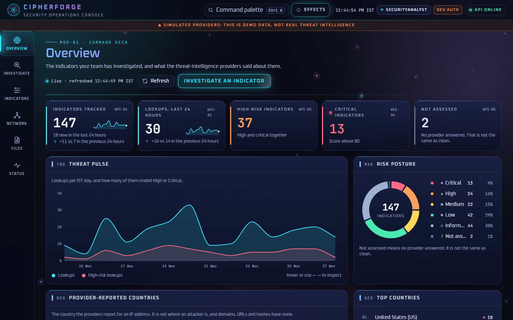

# CipherForge - Ai Enabled Advanced SOC Enigma

**Intelligence. Detection. Encryption.**

CipherForge is a small **security operations centre (SOC)** that runs on your own computer. Today it
does one job: you give it something suspicious (an IP address, a website name, a web link or a file
fingerprint) and it tells you **how risky that thing looks, and why**.

It asks two well-known security services what they know, shows their answers side by side, turns them
into **one risk score from 0 to 100** with the working shown, and keeps a permanent record of every
check. You use it in your web browser.



*The Overview screen in demo mode, so the numbers are invented. The background moves; this is one frame.*

> **Use it responsibly.** What exists today only sends the text you type to two outside services. The
> project also plans network tools such as packet capture and honeypots. When those are built, run
> them only on systems and networks you own or are explicitly allowed to test.

**New here?** Read these four parts in order: [What is CipherForge?](#what-is-cipherforge),
[How it works](#how-it-works), [Get it running](#get-it-running) and
[Using the dashboard](#using-the-dashboard). In a hurry?
[Try it without API keys](#try-it-without-api-keys) takes about 10 minutes and needs no accounts.

## Contents

1. [What is CipherForge?](#what-is-cipherforge)
2. [Words you will see](#words-you-will-see)
3. [How it works](#how-it-works): [the big picture](#the-big-picture),
   [one investigation, step by step](#what-happens-when-you-investigate-something),
   [how the score is made](#how-the-score-is-made),
   [what happens when you delete an indicator](#what-happens-when-you-delete-an-indicator),
   [what is built and what is planned](#what-is-built-and-what-is-planned)
4. [What you need before you start](#what-you-need-before-you-start)
5. [Get it running](#get-it-running): [try it without API keys](#try-it-without-api-keys),
   [run the real application](#run-the-real-application),
   [run everything in Docker](#run-everything-in-docker)
6. [Using the dashboard](#using-the-dashboard)
7. [Using the API directly](#using-the-api-directly)
8. [Settings](#settings)
9. [Tests and quality checks](#tests-and-quality-checks)
10. [Project layout](#project-layout)
11. [Security in plain words](#security-in-plain-words)
12. [Limitations](#limitations)
13. [More documentation](#more-documentation)
14. [Map data](#map-data), [Credits](#credits) and [Licence](#licence)

Full setup instructions, environment variables and troubleshooting live in
**[docs/setup.md](docs/setup.md)**; the full dashboard walkthrough lives in
**[docs/user-guide.md](docs/user-guide.md)**.

## What is CipherForge?

### The problem

Security teams ask "is this bad?" all day long. It might be an address in a log file, a link in an
email or a file someone downloaded. Checking each one by hand on several websites is slow, and the
websites do not always agree.

### What CipherForge does about it

1. You enter one **indicator**: an IP address, a domain name, a web link or a file hash.
2. CipherForge asks up to two outside **providers**, AbuseIPDB and AlienVault OTX, what they know.
3. It shows **each provider's answer on its own card**. If the providers disagree, you see that.
4. It combines the answers into **one score from 0 to 100** and shows the working, line by line.
5. It lists **what is not known** and suggests **next steps**.
6. It **saves** the result so you can search it later, and writes a permanent entry in an
   **audit log**.
7. When you no longer want an indicator, you can **delete** it, one at a time or a whole range at
   once. The audit log keeps a note that you did.

### The four screens

| Screen | What it is for |
| --- | --- |
| **Overview** | The home screen. Live figures: how many indicators you have checked, how many look risky, a world map, trends and the latest lookups. |
| **Investigate** | Where you type in an indicator and read the result. |
| **Indicators** | A searchable list of everything you have checked, with a page for each one. This is also where you delete indicators you no longer want. |
| **System status** | Shows whether the API is running and can reach its database. |

### What it is not

- **It is not antivirus.** It never looks at your files or scans your computer. A file hash is just a
  fingerprint that you type in.
- **It never acts on its own.** It does not block, isolate or change anything. It only advises.
- **It does not give verdicts.** A score is advice based on two sources. You decide what to do.
- **It is not finished.** The network sensor, detection rules, alerts, cases and encrypted file
  sharing are planned but not built. See
  [What is built and what is planned](#what-is-built-and-what-is-planned).

### One promise: "Not assessed" never means "safe"

If neither provider can answer (for example because no API key is set), CipherForge shows
**Not assessed**. It never shows "0, all clear". Nothing was checked, so nothing can be said. You
will see this wording all over the dashboard.

## Words you will see

| Word | What it means |
| --- | --- |
| **Indicator** (also **IOC**, "indicator of compromise") | One thing you want to check: an IP address, a domain, a URL or a file hash. |
| **IP address** | A number that identifies a computer on a network. **IPv4** looks like `8.8.8.8`. **IPv6** is the newer, longer kind and contains colons. |
| **Domain** | A website name such as `example.com`. |
| **URL** | A full web address such as `https://example.com/path`. |
| **SHA-256 hash** | A 64-character fingerprint of a file. The same file always gives the same fingerprint, so you can ask about a file without sending the file. |
| **Defanged** | Written in a deliberately broken way, such as `hxxp://example[.]com`, so that nobody clicks it by accident. CipherForge accepts these and fixes them. |
| **Threat intelligence** | Information that other people have collected about known bad addresses, websites, files and attackers. |
| **Provider** | An outside service that CipherForge asks. There are two today: AbuseIPDB and AlienVault OTX. |
| **API key** | A password-like code that a provider gives you (free) so it knows who is asking. CipherForge keeps it on the server and never shows it on screen. |
| **Risk score** | CipherForge's number from 0 to 100. Higher means more evidence of danger. |
| **Classification** | The score put into a named band: Informational, Low, Medium, High or Critical. |
| **Confidence** | How much fresh evidence stands behind the score. It is **not** the chance that the indicator is bad. |
| **Not assessed** | No provider answered, so nothing can be said. It is not the same as safe. |
| **Cache** | Saved answers that CipherForge reuses for a few hours, so it does not ask the providers again and again and use up your daily allowance. |
| **Audit log** | A permanent diary of every check and every deletion: what, when and by whom. Entries cannot be edited or deleted. |
| **Demo mode** | A special way to start CipherForge with made-up data and pretend ("simulated") providers, so you can explore without any keys. |
| **API** | The part of CipherForge that does the work. The dashboard and other programs talk to it. |
| **Dashboard** | The web pages you see in your browser. They show what the API sends them. |
| **Database** | Where CipherForge saves everything. **PostgreSQL** is for serious use. **SQLite** keeps everything in one file and is handy for quick tries. |
| **Terminal** | A window where you type commands. On Windows this guide uses PowerShell. |
| **SOC** | Security operations centre: a team that watches for attacks and responds to them. CipherForge is a small, learning-sized version of the tools such teams use. |
| **MITRE ATT&CK** | A public catalogue of attacker techniques, each with a code such as `T1059`. The Overview lists the techniques that providers mention. |

## How it works

### The big picture


**How to read the picture.** Cyan boxes are CipherForge's own parts. The green box is the database.
Orange boxes are outside services that you do not control (the dashed one is used only when real
Microsoft sign-in is switched on). The amber line at the bottom lists what is not built yet. Each
arrow is a question or an answer. The API is the only part that talks to outside services.

**The parts, in plain words**

| Part | What it does | Where it lives in the code |
| --- | --- | --- |
| **1. Your browser** | Shows the dashboard. It is just a web page, so a browser is all you need to use CipherForge. | none |
| **2. The web server** | Serves the dashboard pages and passes requests for data on to the API. While you are trying things it is **Vite** (port 5173). In Docker it is **nginx** (port 3000). | `frontend/` (`vite.config.ts`, `nginx.conf`) |
| **3a. Gatekeeper** | Checks who you are (a sign-in token and a role) and how many lookups you have made this minute (at most 30). | `backend/app/security/` |
| **3b. Input checks** | Cleans up what you typed, works out what kind of indicator it is, and refuses private or internal addresses before anything leaves your computer. | `backend/app/services/normalization.py` |
| **3c. Intel engine** | Reuses saved answers that are still fresh, asks the providers for the rest, and scores the evidence. It also removes the indicators you choose to delete. | `backend/app/services/intel_service.py`, `backend/app/collectors/`, `backend/app/correlation/scoring.py` |
| **3d. Audit trail** | Writes down every lookup and every deletion. The database refuses to change or delete these rows. | `backend/app/services/audit.py` |
| **4. The database** | Saves indicators, each provider's answers and the audit log. | `backend/app/models/`, `backend/alembic/` |
| **5. The providers** | **AbuseIPDB** (IP addresses only) and **AlienVault OTX** (IP addresses, domains, URLs and SHA-256 hashes). | `backend/app/collectors/abuseipdb.py`, `otx.py` |
| **6. Microsoft Entra ID** (optional) | Microsoft's sign-in service. Only when `AUTH_MODE=entra`, the API downloads Microsoft's public keys to check sign-in tokens. In the default local mode (`AUTH_MODE=dev`) there is no sign-in and you are a local developer. | `backend/app/security/auth.py` |

### What happens when you investigate something


1. **You press Investigate.** The browser sends the indicator to the API
   (`POST /api/v1/intel/investigate`).
2. **The gatekeeper checks you.** Are you signed in? Is your role allowed (`SecurityAnalyst` or
   `Admin`)? Have you used up your 30 lookups this minute?
3. **The input is cleaned up and checked.** Spaces are trimmed, defanged forms are repaired and the
   kind of indicator is worked out. Private and internal addresses, such as `192.168.1.10`, are
   refused here, before anything is sent anywhere.
4. **The API asks the database:** do we already have a fresh saved answer?
5. **The database replies** with any answers that are still fresh. Fresh means less than 6 hours old
   for AbuseIPDB and less than 12 hours old for OTX (you can change both).
6. **The API asks the providers for what is missing,** both at the same time, waiting at most 10
   seconds for each. A provider with no key is skipped (it shows as *Not configured*). A provider
   that cannot handle this kind of indicator is skipped too (*Not supported*).
7. **The providers answer, or fail.** One provider failing never stops the other.
8. **The API saves the new answers.** Failures are not saved.
9. **It scores the evidence** into a number from 0 to 100 (see the next section).
10. **It saves the score and writes the audit record,** the permanent diary entry.
11. **The result goes back to your browser,** and you see it.

If no provider answers, the result says **Not assessed**, never "clean".

### How the score is made

The score is plain arithmetic. No AI model is involved and nothing is hidden: every point can be
traced to a line in the **How the score was built** panel (the method is called `intel-risk-v1`).

```text
  For each provider that answered:
        points = 45 x evidence strength x recency weight
                          |
                          v
  + 8 points when two providers independently back each other up
  + 5 points for each malware family they name (at most 10)
                          |
                          v
  If fewer than two providers back it up, the score never goes above 60
  The score never goes above 100
                          |
                          v
  Score 0 to 100  ->  a named band (see the table below)
```

- **Evidence strength** (0 to 1) says how strong a provider's own evidence is. For AbuseIPDB it is
  its "abuse confidence" divided by 100, lowered when there are very few reports. For OTX it grows
  with the number of community reports ("pulses") that mention the indicator.
- **Recency weight** makes newer evidence count more. Activity in the last 7 days counts fully (1.0),
  the last 30 days 0.9, 90 days 0.7, 180 days 0.5, anything older 0.3, and evidence with no date 0.6.
- A provider **backs it up** when its evidence strength times its recency weight is at least 0.4.
- **One source alone can never push the score above 60.** A single source can be wrong; two that
  agree are much stronger evidence.

| Score | Band | What CipherForge suggests |
| --- | --- | --- |
| 0 to 20 | **Informational** | No action needed from this evidence alone. If the indicator came from an alert, check your own logs before closing it. |
| 21 to 40 | **Low** | Treat it as context, not a finding. Check your own logs. |
| 41 to 60 | **Medium** | Investigate: search your own logs and alerts for it. |
| 61 to 80 | **High** | Prioritise the investigation. |
| 81 to 100 | **Critical** | Escalate for immediate review by an analyst. |

**Confidence** is separate from the score. Each provider that answered recently adds 35 points (an
older answer adds 15), two providers that back each other up add 20 more, and the most it can reach
is 90. CipherForge is never 100% sure.

The method, with worked examples for every band, is written out in full in
[docs/threat-intelligence.md](docs/threat-intelligence.md#scoring-intel-risk-v1).

### What happens when you delete an indicator

Deleting is permanent, so it has a few safeguards. The step-by-step instructions are in
[Deleting indicators](docs/user-guide.md#deleting-indicators). Behind the scenes:

1. **You choose** one indicator or several, and press a delete button.
2. **A box asks you to confirm.** It names what is about to go, and **Cancel** is already selected,
   so pressing Enter by accident does nothing.
3. **The gatekeeper checks you,** just as for a lookup: you must be a `SecurityAnalyst` or `Admin`.
4. **The database removes everything in one go:** each chosen indicator and every provider answer
   that was saved for it. Either all of it goes or none of it does.
5. **The audit trail gets a note** for each deleted indicator: who deleted it, when, and from which
   address. Nothing already in the audit log is changed or removed.
6. **Every screen forgets the indicator:** the Indicators list, the Overview's lists and counts of
   indicators, and the indicator's own page, which now says it cannot be found.

Two things to know. **There is no undo,** because nothing is kept aside; only a database backup can
bring an indicator back. And **the audit log is not touched,** so it still holds the text of the
indicator, such as `8.8.8.8`, in its old entries. That is its job: it is the permanent record of what
was looked up and deleted. CipherForge has no feature for deleting audit entries.

### What is built and what is planned

| Area | Status |
| --- | --- |
| Threat intelligence: AbuseIPDB and OTX lookups, the cache, the score and the audit log | **Built and tested** |
| Deleting indicators: one at a time, a ticked range or a whole page, with a confirmation and an audit record | **Built and tested** |
| The dashboard: Overview, Investigate, Indicators, System status, command palette and the animated "Aurora Forge" look | **Built** |
| Demo mode with simulated providers (for development and learning) | **Built** |
| Microsoft Entra ID sign-in checks in the API | **Built on the API side.** The dashboard cannot sign in yet, so it works with `AUTH_MODE=dev` only |
| Docker Compose stack and the automated build pipeline | **Built and checked by GitHub's automatic checks**, but never run on the author's own computer (see [Limitations](#limitations)) |
| Network sensor (packet capture), detection rules, correlation, alerts, cases, encrypted file sharing, background workers, Azure deployment | **Planned, not started** |

The history of the project, phase by phase, is in [docs/project-status.md](docs/project-status.md).
How the planned modules would plug in is in [docs/architecture.md](docs/architecture.md).

## What you need before you start

| You need | What for | Where to get it |
| --- | --- | --- |
| **Python 3.12 or newer** | Runs the API | <https://www.python.org/downloads/>. On Windows, tick **Add python.exe to PATH** in the installer. |
| **Node.js 22.22 or newer** (24 is recommended) | Builds and serves the dashboard. It includes `npm`. | <https://nodejs.org/en/download> |
| **A web browser** | You use CipherForge in it | Any modern browser. The automated tests use Microsoft Edge. |
| **About 400 MB of free disk space** | The Python and Node packages | |

Optional:

- **Docker Desktop**, only for [Path C](#run-everything-in-docker):
  <https://www.docker.com/products/docker-desktop/>
- **Two free API keys** (AbuseIPDB and AlienVault OTX), only if you want real answers. See
  [Add your API keys](docs/setup.md#add-your-api-keys-optional).
- **Git**, only if you get the project through a Git repository.

You also need **the project folder**: the folder that contains `backend`, `frontend` and `docs`. Put
it somewhere you can find it, for example `C:\Users\you\cipherforge`. Every command in this guide
starts from that folder.

Full prerequisites, including how to check your installed versions, are in
[docs/setup.md](docs/setup.md#prerequisites).

## Get it running

There are three ways to run CipherForge. **Start with Path A.** Full step-by-step instructions for
all three paths are in [docs/setup.md](docs/setup.md); this section gives the two-minute version of
each.

| | **Path A:** [try it without API keys](#try-it-without-api-keys) | **Path B:** [run the real application](#run-the-real-application) | **Path C:** [run everything in Docker](#run-everything-in-docker) |
| --- | --- | --- | --- |
| Best for | Learning every screen, with data already in it | Real lookups of your own indicators | People who already use Docker |
| What you see | Invented data and pretend providers, clearly labelled | Your own lookups. Real providers if you add keys. | The same as B, with the PostgreSQL database |
| Accounts and keys | None | Optional and free | Optional and free |
| You need | Python and Node | Python and Node | Docker |
| Time | About 10 minutes | About 15 minutes | About 10 minutes, plus the first build |
| Run by the author | Yes | Yes | **No.** Docker was not available when the project was written. |

Paths A and B both use port 8000 for the API, so run only one of them at a time. The demo shows a
banner at the top of every screen ("Simulated providers: this is demo data, not real threat
intelligence"); the real application does not. That is how you can tell which one you are looking at.

### Try it without API keys

**Path A** runs the real application in **demo mode**: the two providers are **simulated** (nothing
is sent to AbuseIPDB or OTX) and the database starts pre-filled with about two weeks of invented
lookups, so every screen has something to show. No `.env` file and no keys needed.

Terminal 1:

```powershell
cd backend
python -m venv .venv
.\.venv\Scripts\python.exe -m pip install -r requirements-dev.txt
.\.venv\Scripts\python.exe -m uvicorn devtools.demo_server:create_demo_app --factory
```

Terminal 2:

```powershell
cd frontend
npm.cmd ci
npm.cmd run dev
```

(macOS or Linux: `python3`/`.venv/bin/python` and `npm` instead of `npm.cmd`.) Open
<http://127.0.0.1:5173>. You should see the Overview with a "simulated providers" banner, numbers on
the tiles, and **API ONLINE** in the top bar — a labelled picture of this screen is in
[docs/user-guide.md](docs/user-guide.md).

Everything in the demo is invented, including answers for anything you type yourself, so never use it
to judge a real indicator. The full explanation, exact terminal setup for both operating systems, what
the startup log should look like, and what each demo setting does are in
[docs/setup.md](docs/setup.md#path-a-try-it-without-api-keys).

### Run the real application

**Path B** is CipherForge without the pretend parts: it starts empty and every lookup is real. It
works with no API keys at all (every result then says **Not assessed**).

```powershell
Copy-Item .env.example .env
```

Open `.env`, set `DATABASE_URL=sqlite+pysqlite:///./cipherforge.db`, then in `backend`:

```powershell
python -m venv .venv
.\.venv\Scripts\python.exe -m pip install -r requirements-dev.txt
.\.venv\Scripts\python.exe -m alembic upgrade head
.\.venv\Scripts\python.exe -m uvicorn app.main:create_app --factory
```

Start the dashboard the same way as Path A, in `frontend`. Open <http://127.0.0.1:5173>: this is a
brand-new installation, so the Overview is empty and every investigation says **Not assessed** until
you add a provider key.

To get real answers, create a free [AbuseIPDB](https://www.abuseipdb.com/register) and/or
[AlienVault OTX](https://otx.alienvault.com) account, put the key(s) in `.env`
(`ABUSEIPDB_API_KEY`/`OTX_API_KEY`) and restart the API. Keep keys private: never paste them into a
chat, screenshot or commit; CipherForge keeps them server-side only and never sends them to the
browser.

Full steps (the database migration, what a brand-new installation looks like, and getting each
provider key) are in [docs/setup.md](docs/setup.md#path-b-run-the-real-application).

### Run everything in Docker

**Path C** runs the database (PostgreSQL), the API and the dashboard in containers, so you need only
Docker Desktop installed.

> **Checked by the automatic tests, not by hand.** Docker was not available where this project was
> written, so these steps have never been followed on a personal computer. GitHub's automatic checks
> do build both images and start the whole stack on Linux, and confirm the page and API answer. If
> Path C fails for you, use Path A or B and please report it. See
> [Limitations](#limitations).

```bash
docker compose up --build
```

(After copying `.env.example` to `.env` and setting a letters-and-digits-only `POSTGRES_PASSWORD`
first — PostgreSQL stores it on first start.) Open <http://localhost:3000>. Everything binds to
`127.0.0.1` only. The full steps, the port table and adding API keys are in
[docs/setup.md](docs/setup.md#path-c-run-everything-in-docker); the full service breakdown, backups
and production hardening are in [docs/deployment.md](docs/deployment.md).

**Stopping and restarting.** Press `Ctrl+C` in each terminal (or run `docker compose down`). To start
again later you only need the start commands above, not the install steps. Full detail, including how
to reset the demo or start from an empty database, is in
[docs/setup.md](docs/setup.md#stop-it-and-start-it-again).

## Using the dashboard

Open <http://127.0.0.1:5173> for Paths A and B, or <http://localhost:3000> for Path C. The complete
screen-by-screen walkthrough, with a labelled picture for every screen and result type, is in
**[docs/user-guide.md](docs/user-guide.md)**.

| Screen | What it is for |
| --- | --- |
| **Overview** (`/`) | Figures, charts and a map for everything you have checked. |
| **Investigate** (`/investigate`) | Type in an indicator and read the result: a score, a risk band, and each provider's answer. |
| **Indicators** (`/indicators`) | A searchable list of everything you have checked. Delete one, a ticked range, or a whole page. |
| *(click any indicator)* | The saved record of one indicator. Re-check it or delete it there. |
| **System status** (`/status`) | Is the API running, and can it reach its database? |

Use the menu on the left to move around (it becomes a bar along the bottom on a phone), or press
`Ctrl K` (`Cmd K` on a Mac) to open a command palette from any screen. Every screen has its own
address, so you can bookmark it.


### Deleting indicators

Delete one indicator at a time (the bin button on its row, or **Delete indicator** on its saved
record), a ticked range (hold `Shift` to select several rows), or every row on the page at once.
Deleting is permanent: a confirmation box names what will go before anything is removed, and the
audit log keeps a record of the deletion rather than losing it — CipherForge has no feature for
deleting audit entries. The full walkthrough, with every screen pictured, is in
[docs/user-guide.md](docs/user-guide.md#deleting-indicators).

Everything else — reading a result and its score breakdown, what the provider labels mean,
shortcuts, the demo's sample values, and the visual effects — is covered screen by screen in
**[docs/user-guide.md](docs/user-guide.md)**.

## Using the API directly

The dashboard is only one way in. Everything it shows comes from the **API**, and you can call it
yourself from PowerShell, `curl` or your own scripts — handy for automation, and for seeing exactly
what the dashboard sees. (In demo mode the answers are invented, as everywhere else.)

The API has ten endpoints today, covering health and readiness, who you are, and investigating,
searching, reading, deleting and summarising indicators. `GET /api/v1/me` and everything under
`/api/v1/intel` need the `SecurityAnalyst` or `Admin` role; with the default `AUTH_MODE=dev` you
already have it and send no token.

```powershell
Invoke-RestMethod http://127.0.0.1:8000/health
Invoke-RestMethod -Method Post -Uri http://127.0.0.1:8000/api/v1/intel/investigate -ContentType 'application/json' -Body '{"indicator": "8.8.8.8"}' | ConvertTo-Json -Depth 8
```

> **Always read `score.answered_sources`.** With no provider keys, the API answers `risk_score: 0`
> and `classification: "informational"` because it has no evidence at all — that is **not** "clean".
> `answered_sources: 0` means no provider answered. The dashboard makes this check for you and shows
> **Not assessed**; a script of your own must do the same.

The full endpoint list, every field, error codes, and terminal examples for deleting indicators
through the API are in **[docs/api.md](docs/api.md)**. With the API running, you can also browse it
interactively at <http://127.0.0.1:8000/docs> (disabled when `ENVIRONMENT=production`).

## Settings

CipherForge reads its settings from the `.env` file in the project folder, the one you made by copying
`.env.example`. **After you change a setting, stop the API (`Ctrl+C`) and start it again.** The
defaults lean towards safety: leaving out `ENVIRONMENT` and `AUTH_MODE` gets you `production` and
`entra`, so `.env.example` sets the relaxed values needed for local use. A wrong value stops the API
from starting, and the error names the setting but never its value.

The full reference for every setting — authentication, the database, provider API keys and rate
limits, Docker-only settings, and demo/development-only settings — is in
**[docs/setup.md](docs/setup.md#environment-variables)**; the reasoning behind each rule is in
[docs/deployment.md](docs/deployment.md). If something does not start or behave as expected, the
symptom-by-symptom table in
[docs/setup.md, Common setup problems](docs/setup.md#common-setup-problems) covers installation,
startup and dashboard issues, including freeing or changing a port.

## Tests and quality checks

You do not need any of this to *use* CipherForge. It is for people who change the code, and for anyone
who wants to know how far the results can be trusted.

The project has three layers of automated tests (counts are for version 0.5.0):

| Layer | Tests | Tool | What it checks |
| --- | --- | --- | --- |
| Backend | 958 | pytest | The API, the input checks, the provider code (run against recorded answers, never the live services), the score, the database, deleting indicators and the audit log |
| Frontend units | 477 | Vitest | Screens, components, helpers and the motion layer |
| End to end | 686 | Playwright | The finished dashboard, in a real browser, talking to the real API |

To run the first two, from the project folder.

Windows (PowerShell):

```powershell
cd backend
.\.venv\Scripts\python.exe -m pytest      # ends with: 717 passed, 241 skipped

cd ..\frontend
npm.cmd run typecheck
npm.cmd run lint
npm.cmd test                              # ends with: Tests  477 passed (477)
```

macOS or Linux:

```bash
cd backend && .venv/bin/python -m pytest      # ends with: 717 passed, 241 skipped
cd ../frontend && npm run typecheck && npm run lint && npm test
```

**"241 skipped" is normal.** 240 of them are the PostgreSQL copies of the database tests. They are
skipped unless you point `TEST_DATABASE_URL` at a throwaway PostgreSQL database (see
[docs/testing.md](docs/testing.md#quality-checks)). The last one is skipped on purpose, because SQLite
has no `TRUNCATE` statement. With a PostgreSQL database supplied, 957 tests pass and 1 is skipped.
The backend run takes about a minute and a half, and the frontend run about a minute.

The end-to-end tests are started with `npm.cmd run test:e2e` (from `frontend`). They take 20 to 40
minutes, depending on the computer. Before the first run, read
[docs/testing.md](docs/testing.md#testing-the-dashboard): it lists what to install and what each group
of tests proves. The same page lists the security scanners and the other
[quality checks](docs/testing.md#quality-checks).

**What a green result shows.** At the time of writing, every backend test passes (on SQLite, and on a
real PostgreSQL 16.2 when one is supplied), and so do all 477 frontend tests and all 686 end-to-end
tests. That shows the code does what the tests expect. It does **not** show that the live providers
work (the tests use recorded and simulated answers), that Docker Desktop works on your computer (the
containers have only been started by the automatic checks on GitHub) or that the design looks good to
a person. [What a green run does not show](docs/testing.md#what-a-green-run-does-not-show)
lists the gaps.

The checks also run automatically on GitHub, in `.github/workflows/ci.yml` (four jobs: backend,
frontend, dashboard end-to-end in Chromium on Linux, and a Docker build with a smoke test). Its first
run failed two of the four jobs. [What the first run on GitHub found](docs/testing.md#what-the-first-run-on-github-found)
explains the three causes, all of which are fixed.

## Project layout

You do not need to read any code to use CipherForge. This map is for when you are curious or want to
change something. A folder marked **Planned** holds only a short note, because that part is not built.

```text
cipherforge/
|-- README.md                 This guide
|-- LICENSE                   The MIT licence
|-- .env.example              A template for your settings (copy it to .env)
|-- docker-compose.yml        Starts everything in Docker (run by the automatic checks only)
|-- .github/                  The automatic checks (ci.yml) and dependency updates
|
|-- backend/                  THE API: the part that does the work (Python, FastAPI)
|   |-- app/
|   |   |-- main.py           Where the API starts
|   |   |-- api/              The web addresses: /health, /ready and /api/v1/...
|   |   |-- collectors/       One file per provider: abuseipdb.py and otx.py
|   |   |-- correlation/      scoring.py: how the 0 to 100 score is worked out
|   |   |-- services/         The investigation steps, deleting indicators, Overview figures, audit log
|   |   |-- security/         Sign-in checks, roles and the rate limiter
|   |   |-- models/           The database tables
|   |   |-- schemas/          The exact shape of every request and reply
|   |   |-- database/         The connection to the database
|   |   |-- core/             Settings, logging, error format, request helpers
|   |   |-- detection/        Planned: nothing in it yet
|   |   `-- workers/          Planned: nothing in it yet
|   |-- alembic/              Database set-up scripts, called "migrations"
|   |-- devtools/             Demo mode: demo server, made-up data, pretend providers
|   |-- tests/                The backend tests (pytest)
|   `-- Dockerfile, requirements.txt, pyproject.toml, ...
|
|-- frontend/                 THE DASHBOARD (React, TypeScript, Vite, Tailwind)
|   |-- src/
|   |   |-- pages/            The screens: Overview, Investigate, Indicators, ...
|   |   |-- components/       Building blocks: cards, charts, the side rail, ...
|   |   |-- features/         Helper logic behind the screens' figures
|   |   |-- services/         The code that talks to the API and checks replies
|   |   |-- hooks/            Small helpers that load data and keep track of ticked rows
|   |   |-- motion/           The animations (anime.js)
|   |   |-- effects/          The "Visual effects" on/off switch
|   |   |-- test/, types/     Test helpers and shared type definitions
|   |   `-- App.tsx, main.tsx, index.css
|   |-- e2e/                  The browser tests (Playwright)
|   |-- public/               The icon shown on the browser tab
|   |-- scripts/              build-world-data.mjs, which makes the map data
|   |-- nginx.conf            Web server settings used by the Docker image
|   `-- Dockerfile, package.json, vite.config.ts, ...
|
|-- docs/                     The detailed documents (see "More documentation")
|   |-- images/               The two diagrams in this guide
|   `-- screenshots/          The pictures in this guide
|
|-- infra/                    Planned: Azure set-up (a note only)
`-- sensor/                   Planned: the network sensor (a note only)
```

Some more folders appear after you run things. They are not part of the project, Git ignores them, and
you can leave them alone: `backend/.venv` (the Python packages), `frontend/node_modules` (the
JavaScript packages), `frontend/dist` (the built dashboard), `backend/.demo` (the demo database) and
`backend/cipherforge.db` (the database from [Path B](#run-the-real-application)).

**Where to look when you want to change something:**

| I want to... | Look here |
| --- | --- |
| Change how the score is worked out | `backend/app/correlation/scoring.py`. The dashboard's "How the score was built" panel keeps its own copy of the rules in `frontend/src/components/intel/ScorePanel.tsx`, so change that too, and the write-up in [docs/threat-intelligence.md](docs/threat-intelligence.md#scoring-intel-risk-v1). |
| Add a third provider | `backend/app/collectors/`. The steps are in [Adding a provider](docs/threat-intelligence.md#adding-a-provider). |
| Add or change a setting | `backend/app/core/config.py` and `.env.example`. |
| Add a database table | `backend/app/models/`, plus a new script in `backend/alembic/versions/`. |
| Change how deleting works | The rules and the database work are in `delete_indicators` in `backend/app/services/intel_service.py`, and the two routes are in `backend/app/api/v1/intel.py`. The confirmation box is `frontend/src/components/intel/DeleteIndicatorsDialog.tsx`, and the tick boxes are `frontend/src/hooks/useRowSelection.ts`. |
| Change what a screen looks like | `frontend/src/pages/` (the screens) and `frontend/src/components/` (the pieces). |
| Change the colours | The `@theme` block near the top of `frontend/src/index.css`. |
| Change the animations | `frontend/src/motion/`. |
| Change the demo's invented data | `backend/devtools/demo_data.py`. The pretend provider answers are in `simulated_providers.py` next to it. |

## Security in plain words

CipherForge is a security tool, so it tries to be careful with what it handles. This is what it does,
in everyday words. The technical list is in [docs/security.md](docs/security.md), and the thinking
behind it is in [docs/threat-model.md](docs/threat-model.md).

> **This is not a security audit.** CipherForge is a learning and portfolio project. Its protections
> are checked by automated tests and scanners. No independent security review or penetration test
> has been done, and the project does not claim to be ready for production use.

| Worry | What CipherForge does about it |
| --- | --- |
| **Will my API keys leak?** | The keys stay on the server, in the `.env` file (which Git ignores) or in environment variables. The dashboard never receives them. The API never sends them back; it only says whether a key is set. The logs hide them. |
| **What if I type something harmful?** | Every indicator is checked before it is used: a length limit, no hidden or invisible characters, only SHA-256 hashes, and only `http` and `https` links with no password inside. Error messages never repeat what you typed. |
| **Could CipherForge be tricked into probing my own network?** | No. Private and internal addresses (such as `192.168.1.10`) and made-up endings (such as `.local`) are refused before any request is made. The server contacts only two fixed provider websites and does not follow redirects. Security people call the trick this stops "server-side request forgery". |
| **Could a provider's answer attack me?** | Answers are treated as untrusted. Only known fields are kept, sizes are capped and control characters are removed. The dashboard shows every provider word as plain text, never as page code. The only links to other websites go to OTX and MITRE ATT&CK pages, built from strict patterns, so a provider cannot send you somewhere else. The project's code checks, and in the Docker image a strict browser security policy (CSP), add two more layers. |
| **What if a provider is slow or sends too much?** | Each call has a time limit (10 seconds by default) and a size limit (2 MiB). If one provider fails, the other one's answer still appears and the failure is labelled. |
| **Who can see what I look up?** | The providers: the indicator you investigate is sent to them, outside your organisation, so do not type anything you are not allowed to share. The Investigate screen says this next to the button. CipherForge also writes each lookup, with who asked and when, to the audit log in your own database. Your browser talks only to CipherForge's own web server. No fonts, maps or analytics come from other sites, and there are no cookies. The one thing the dashboard remembers is your visual-effects switch. One thing to know: the search text on the Indicators screen is part of the web address, so it can appear in your browser history. |
| **Who is allowed to use it?** | The API has three roles: `Admin`, `SecurityAnalyst` and `User`. The investigation and indicator routes need `SecurityAnalyst` or `Admin`, and unknown roles are ignored. In Microsoft Entra ID mode the API checks sign-in tokens and rejects forged or unsigned ones. In `dev` mode (used in this guide) there is no sign-in, so use it only on your own computer. |
| **What if someone floods it with requests?** | Each user may start 30 investigations a minute (you can change this). That also protects your providers' free allowances. |
| **Can the history be altered?** | Every check, and every deletion of an indicator, is written to the audit log, even refused checks (without the text that was refused). The database refuses to change or delete these rows, and CipherForge has no feature that does. A database administrator could still remove that protection, so for serious use copy the log somewhere the application cannot write. |
| **Could something be deleted by accident, or by someone who should not?** | Deleting always shows a box that names what will go, with **Cancel** already selected, so pressing Enter does nothing. No address or link can delete anything: only pressing the red button does. The API accepts a deletion only from a `SecurityAnalyst` or an `Admin`, only for the ids it names (there is no "delete everything that matches"), and for at most 100 at a time. Each deletion is recorded in the audit log with who did it. Any analyst may delete any indicator, and there is no undo. |
| **What if the settings are unsafe?** | In `production` mode the API refuses to start with dev sign-in, SQLite, the example password `CHANGE_ME` or `*` for CORS (the setting that decides which websites may call the API). The message names the setting and never its value. The `/docs` page is switched off too. |
| **Could CipherForge break something on its own?** | No. It reads from two providers and advises. It never blocks, isolates or changes anything on your network or computers. The only thing it removes is what you tell it to delete from its own database. |
| **Could the demo touch real data?** | No. Demo mode uses its own database file inside `backend/.demo/` (it refuses any other place), its providers are pretend and make no outside requests, and a banner on every screen says so. |
| **Will the screen mislead me?** | It is designed not to. "Not assessed" never looks like "safe". Each provider is shown separately. A country on the map is labelled "Provider-reported country", never as where the attacker is. Every chart has its exact numbers as text. |
| **Is the Docker set-up locked down?** | It is written to be: the containers run without administrator rights, drop extra Linux powers and publish ports only on `127.0.0.1`. The automatic checks on GitHub start it and confirm that it answers, but they do not test each of these protections, and it has not been run on a personal computer (see [Limitations](#limitations)). |

**Use it responsibly.** A score describes an *address*, not a *person*. Never treat it as proof of who
did something or where they are. When the planned network tools arrive (packet capture, honeypots),
use them only on systems and networks you own or have clear permission to test. See
[Responsible use](docs/security.md#responsible-use).

**Before you put CipherForge anywhere other people can reach**, read
[Before exposing it beyond your machine](docs/deployment.md#before-exposing-it-beyond-your-machine) and
the [Entra ID setup](docs/deployment.md#entra-id-setup-for-auth_modeentra). In short: put HTTPS (TLS)
in front of it, use `production` with Entra ID sign-in, set a strong database password, keep the API
keys in a secret store and add rate limiting at the proxy. Remember that the dashboard cannot sign in
yet, so it cannot be used against such an API.

## Limitations

CipherForge is open about what it cannot do. Please read this list before you rely on it for anything
that matters. More detail is in [docs/threat-intelligence.md](docs/threat-intelligence.md#limitations),
[docs/security.md](docs/security.md) and [docs/deployment.md](docs/deployment.md#verification-status).

### Not built yet

| Missing piece | What it would do |
| --- | --- |
| **Network sensor** | A defensive program that would watch the *numbers* of network traffic (how many packets and connections, not what is inside them) on a network you own, and report them. Only a note exists, in `sensor/`. |
| **Detection rules and correlation** | Spot attacks in that traffic and link them to what the providers know. Today only the scoring of looked-up indicators exists. |
| **Alerts and cases** | Raise an alert and follow an incident from start to finish. |
| **Encrypted file sharing ("Vault")** | Share files safely. **No encryption code exists**, and CipherForge does not claim to encrypt anything. [docs/encryption-design.md](docs/encryption-design.md) lists what must be decided first. |
| **Background workers** | Refresh old answers and tidy old data by themselves. A shared store such as Redis would join here. |
| **Azure deployment** | Run CipherForge in the cloud, described as code in `infra/`. |
| **Sign-in in the dashboard** | The dashboard cannot sign in to Microsoft Entra ID. It works only with `AUTH_MODE=dev`, which the API refuses in production. Against an API that needs Entra ID sign-in, every screen says "Not signed in". |

### Never tried for real

- **The two providers have never been called for real.** The tests use recorded and invented answers,
  because no keys were available when the code was written. The requests were checked against the
  services' public documentation and AlienVault's own code library, but a few OTX details (the pulse
  counts and dates, malware families and MITRE codes) come from sample answers and are **not
  confirmed**. If one is missing or renamed, CipherForge treats it as unknown and gives a weaker
  result instead of failing. **Do one real lookup with your own keys before you rely on the output.**
  Details: [Verification status](docs/threat-intelligence.md#verification-status).
- **Docker has not been run by a person.** The computer used to write the project had no Docker. The
  automatic checks on GitHub do build both images and start `docker-compose.yml` on a Linux machine,
  then check that the page and the API answer, but nobody has run `docker compose up` on a personal
  computer, and Docker Desktop on Windows or macOS was not tried. The nginx settings were also tested
  with a real nginx program outside Docker. If Path C fails, use Path A or B, and please report it.
  Details: [Verification status](docs/deployment.md#verification-status).
- **The automatic checks are new.** They ran for the first time only after the project was put
  online, and that first run failed two of its four jobs for three reasons, all since fixed (see
  [What the first run on GitHub found](docs/testing.md#what-the-first-run-on-github-found)).
- **Microsoft sign-in has never been tried with a real organisation.** The token checks are tested
  with generated keys only.
- **The browser tests ran in Chromium-based browsers only:** Microsoft Edge on Windows, and Chromium
  on Linux in the automatic checks. Firefox and Safari were not tested.
- **Only the Windows commands were run.** The macOS and Linux versions in this guide follow the same
  steps, but nobody has run them.

### What a score can and cannot tell you

- **A score is advice from two sources.** CipherForge has no data of your own to compare with, and
  every result says so. See [How the score is made](#how-the-score-is-made).
- **A score does not age by itself.** It is worked out again only when you investigate the indicator
  again. There are no background refreshes.
- **Provider text is written by other people.** Some of it (OTX pulse names and tags, for example) is
  written by volunteers, and it can be wrong or out of date.
- **A country is what the provider says,** and it says little about who is behind an address.
- **Demo mode invents its answers**, even for things you type yourself. Never treat a demo result as
  real threat intelligence.

### Limits of the dashboard

- **The Overview is worked out again on every request.** It reads only the 2,000 newest provider
  answers and the last 14 days (up to 20,000 lookups and 20,000 new indicators). The page says when it
  had to stop early. That is fine for a personal database. A busy installation would need caching.
- **The look was checked by measurement.** Automatic checks measured the layout at many window sizes,
  the text contrast and that each effect really runs. No formal design review has been done.
- **The effects were not tuned for slow computers.** If the dashboard feels heavy, switch the effects
  off (see [Visual effects and small screens](docs/user-guide.md#visual-effects-and-small-screens)).
- **No screen reader has been used.** The accessibility checks are automatic ones: contrast, layout
  and keyboard use.
- **The screenshots in this guide show demo data,** so their numbers are invented.

### Smaller limits

- **There is no HTTPS built in.** CipherForge speaks plain HTTP on your own computer (`127.0.0.1`).
  Anything other people can reach needs a proxy with HTTPS in front of it.
- **The rate limit lives in memory.** It is per process, it resets when the API restarts, and several
  copies of the API would not share it.
- **Only investigations and deletions are audited.** Opening a stored record is not.
- **The audit log is protected from the application, not from a database administrator.**
- **Old data is kept until you delete it.** You can delete indicators by hand. Nothing is deleted or
  tidied away by itself, and the audit log cannot be deleted from at all.
- **A deleted indicator is still named in the audit log.** The audit entries keep the text of what was
  looked up and deleted, such as `8.8.8.8`, on purpose. Deleting also does not wipe copies that live
  outside the application, such as database backups.
- **Any analyst can delete any indicator.** There is no owner for an indicator, and there is no
  undo.
- **Two lookups of the same new indicator at the same moment** may both ask the providers and keep two
  answers.
- **One advisory about a build tool is open, and nothing can fix it yet.** The automatic checks scan
  the packages that end up in the dashboard (nothing found) and, separately, the tools that build and
  test it. That second scan reports an advisory in `picomatch` (GHSA-fc5q-39xc-vjpf) that no released
  version fixes, so for now it only reports and does not fail the build. See
  [Dependency management](docs/security.md#dependency-management).
- **A plain `pytest` run covers SQLite only,** so it reports 241 skipped tests. See
  [Tests and quality checks](#tests-and-quality-checks).

## More documentation

This guide is the starting point. Each document below goes deeper on one subject.

| Document | What is in it |
| --- | --- |
| [docs/setup.md](docs/setup.md) | The full step-by-step install for all three paths, every environment variable, and troubleshooting. |
| [docs/user-guide.md](docs/user-guide.md) | The screen-by-screen dashboard walkthrough, with a labelled picture for every screen and result type. |
| [docs/project-status.md](docs/project-status.md) | The history of the project, phase by phase: what each phase added and what is still missing. |
| [docs/architecture.md](docs/architecture.md) | How the pieces are built and how the planned ones would plug in, including the [threat-intelligence flow](docs/architecture.md#threat-intelligence-flow-phase-2) and the [motion layer](docs/architecture.md#aurora-forge-and-the-motion-layer). |
| [docs/api.md](docs/api.md) | Every API endpoint, with the fields it accepts and returns. |
| [docs/threat-intelligence.md](docs/threat-intelligence.md) | The two providers, caching, the [scoring rules in full](docs/threat-intelligence.md#scoring-intel-risk-v1), the [limits](docs/threat-intelligence.md#limitations) and how to add a provider. |
| [docs/security.md](docs/security.md) | Every security control, in technical detail. |
| [docs/threat-model.md](docs/threat-model.md) | A STRIDE analysis: what could go wrong and what stops it. |
| [docs/deployment.md](docs/deployment.md) | Docker Compose, what to do before exposing CipherForge to a network, Entra ID setup and what has been verified. |
| [docs/testing.md](docs/testing.md) | Every automated check and how to run it. |
| [docs/detection-engine.md](docs/detection-engine.md) | The **planned** design for detection rules. Nothing is built. |
| [docs/encryption-design.md](docs/encryption-design.md) | The **planned** design for encrypted file sharing. No encryption code exists. |
| [sensor/README.md](sensor/README.md) and [infra/README.md](infra/README.md) | Notes on the planned network sensor and Azure set-up. |

## Map data

The world map on the Overview screen is drawn from [Natural Earth](https://www.naturalearthdata.com/)
data (public domain, release v5.1.2): a grid of 2-degree squares marked land or sea, made from the
1:110m land outline, and one label point per country from the 1:50m country data. The two generated
files are saved in the project (`frontend/src/features/overview/worldMask.ts` and
`countryCentroids.ts`), so building the app and loading the page never need the internet. To make them
again, run `node scripts/build-world-data.mjs` from the `frontend` folder.

## Credits

- **[AbuseIPDB](https://www.abuseipdb.com) and [AlienVault OTX](https://otx.alienvault.com)** supply the
  threat information CipherForge shows, under their own terms of use.
- **[anime.js](https://animejs.com)** by Julian Garnier (MIT) animates the interface (version 4.5.0,
  pinned; only the parts the app uses end up in the build).
- **[21st.dev](https://21st.dev) and [GetLayers](https://getlayers.ai)** were design references for the
  "Aurora Forge" look: a spotlight card, a "tubelight" navigation bar and layered, pointer-reactive
  backgrounds are general ideas both show. No component, prompt or source from either is in this
  repository. Everything was rebuilt from scratch.
- **Fonts** (Oxanium and JetBrains Mono, SIL Open Font License) come from the `@fontsource` packages
  and are bundled, never fetched from a font host.
- **Map data:** [Natural Earth](https://www.naturalearthdata.com/). See [Map data](#map-data).

## Licence

MIT. See [LICENSE](LICENSE).
