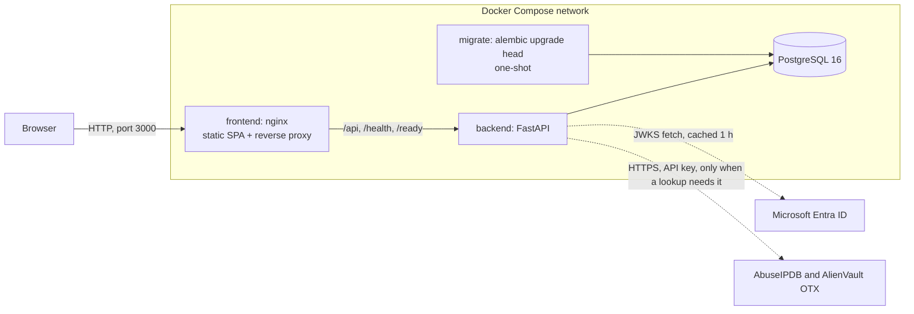
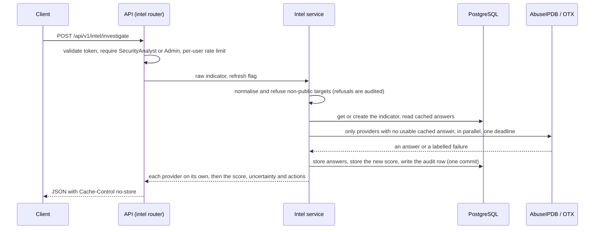
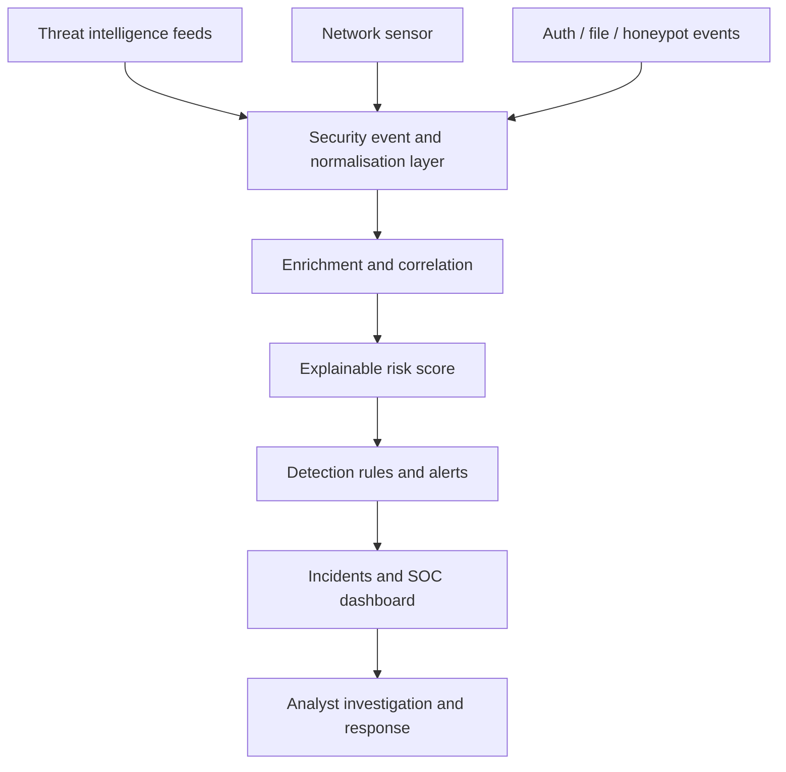

# Architecture

This document describes what is built (Phases 1 to 3b) and how the remaining modules are intended to
plug in. Anything not built is labelled **planned**. The intended end state follows the project
specification; nothing planned here should be read as implemented.

## System context



- The browser only talks to nginx. The SPA calls the API with relative URLs, so there is no CORS in
  the default deployment.
- nginx sets the security headers and the Content Security Policy for the static files and strips
  the duplicates the API adds, so each header appears once.
- The API reaches Entra ID only to download signing keys. Tokens are validated locally.
- The API reaches the two threat-intelligence providers only through their collectors, at fixed
  hosts, and only when an investigation needs a fresh answer. The browser never contacts them and
  never sees their keys.
- Migrations are a separate one-shot step, not something the API does at startup.

## Threat-intelligence flow (Phase 2)



The collectors, the scoring function and the service are separate so each can be tested without the
others: the scorer is a pure function, the collectors run against a stub transport, and the service
runs against SQLite and PostgreSQL. [threat-intelligence.md](threat-intelligence.md) has the details
(normalisation, caching, the `intel-risk-v1` method, stored data and the limits).

## Target architecture (planned)



Only the threat-intelligence feed path (indicator in, enrichment, explainable score out) is built.
It scores one indicator on demand; there is no event stream, correlation across events, detection
rules or incident handling yet.

## Module map

| Module | Purpose | Status | Where it lives or will live |
| --- | --- | --- | --- |
| Core platform | Config, logging, auth, errors, health | **Phase 1 done** | `backend/app/core`, `security`, `api`, `database` |
| Intel | Threat-intelligence ingestion, IOC investigation, caching | **Phase 2 done** (API) and **Phases 3 and 3b done** (analyst screens) | `collectors/`, `services/`, `correlation/scoring.py`, `api/v1/intel.py`; UI in `frontend/src` |
| SOC | Command-centre UI, triage, analytics | **Phases 3 and 3b done** for threat intelligence: the overview command deck, investigate, indicator list and detail, status. Alerts, incidents and live telemetry are not built | `frontend/src` |
| Sentinel | Defensive network monitoring and anomaly detection | Not started | `sensor/`, `detection/` |
| Core (correlation) | Event normalisation, correlation, scoring, rules | Indicator scoring only; event correlation and rules not started | `correlation/`, `detection/` |
| Case | Incidents, notes, timelines | Not started | `services/`, `models/` |
| Vault | Client-side encrypted file sharing | Not started; needs a threat model first | `docs/encryption-design.md` |

## Backend

`backend/app` is organised by responsibility, with one-way dependencies: `api` calls `services`,
which use `models`, `collectors` and `correlation`; `core` and `security` are shared by everything.

| Package | Responsibility |
| --- | --- |
| `api/` | HTTP routes and request dependencies. No business logic. Versioned under `/api/v1`. |
| `core/` | Settings, structured logging and redaction, correlation ID context, error envelope, middleware. |
| `security/` | Entra ID token validation, role-based access control and the in-memory rate limiter. |
| `database/` | Engine and session factory, the readiness probe. |
| `models/`, `schemas/` | SQLAlchemy tables and Pydantic request/response models. |
| `services/` | Indicator normalisation, the investigation workflow (caching, scoring, storage), the overview aggregation (`overview.py`) and the audit writer. |
| `collectors/` | One adapter per provider (AbuseIPDB, OTX) behind a common interface, plus response sanitising helpers. |
| `correlation/` | The pure, explainable scoring function (`intel-risk-v1`). |
| `detection/`, `workers/` | Placeholders for later phases. |

`backend/devtools/` sits beside `app/`, not inside it: the demo server, its simulated providers and
its synthetic data (see [Try it without API keys](../README.md#try-it-without-api-keys)). `app/`
never imports it, the Docker build context leaves it out, and its database is confined to
`backend/.demo/`. It exists so the dashboard can be seen and tested with a populated database
without provider keys; the only trace of it in `app/` is the `simulated` flag that its adapters set
and the dashboard turns into a banner.

### Request lifecycle

`create_app` stacks the middleware so a request passes through, outermost first:

```text
CorrelationId -> SecurityHeaders -> RequestLogging -> CORS (only if configured)
              -> UnhandledException -> router -> endpoint
```

- **CorrelationId** accepts an incoming `X-Correlation-ID` only if it matches `[A-Za-z0-9._-]{8,64}`
  (otherwise it generates one), so a client cannot inject log lines.
- **SecurityHeaders** adds `nosniff`, `X-Frame-Options: DENY`, `Referrer-Policy: no-referrer` and
  `Cache-Control: no-store`.
- **RequestLogging** writes one structured line per request (method, path, status, duration). It
  never logs query strings or bodies.
- **UnhandledException** turns any unexpected error into a generic 500, so the outer layers can
  still add headers and logging.

The middleware are plain ASGI rather than `BaseHTTPMiddleware`, so the correlation ID context
variable also reaches synchronous endpoints running in the thread pool.

### Errors

Every error uses one envelope: `{"error": {"code", "message", "correlation_id", "details?"}}`.
Validation errors (422) return only the location, message and type of each problem, never the
submitted value. A 500 never exposes internals.

### Authentication and authorisation

`AUTH_MODE=entra` validates Microsoft Entra ID access tokens: RS256 only, signature checked against
the tenant's cached JWKS, and `exp`, `iss`, `aud`, `sub` and `tid` required and verified.
`require_roles(...)` guards endpoints by role (`Admin`, `SecurityAnalyst`, `User`). `AUTH_MODE=dev`
returns a fixed local principal and is refused when `ENVIRONMENT=production`. The validator can be
injected into `create_app`, which is how the tests use generated keys instead of a real tenant.

Resource-level authorisation (for example per-file access in Vault) is not implemented and must be
designed with the feature that needs it.

### Data layer

SQLAlchemy 2 with Alembic. Constraint names follow a naming convention so migrations stay
deterministic. Two migrations exist: `0001` (the baseline) and `0002_threat_intel`, which adds
`threat_sources`, `threat_indicators`, `threat_observations` and `audit_logs`. The audit table is
append-only: triggers on SQLite and PostgreSQL reject `UPDATE` and `DELETE`. Unit tests run on
SQLite and, when `TEST_DATABASE_URL` is set, again on PostgreSQL (the same tests, parametrised),
including upgrade, downgrade and upgrade again on the real engine. Production requires PostgreSQL.

## Frontend

React 19 and TypeScript, built with Vite and styled with Tailwind CSS 4 (dark theme only). Routing is
`react-router`. There is no state-management, data-fetching or charting library: the only runtime
dependencies are React, React Router and two self-hosted font packages (Oxanium and JetBrains
Mono), so the page never asks a third party for anything. The production build is one JavaScript
chunk of about 390 KiB (minified, before compression) and about 67 KiB of CSS.

Phase 3 built the screens. Phase 3b redesigned them as a dense "command deck" and added the one
aggregate endpoint the overview draws from. The screens contain no scoring logic of their own: they
show what the API returns and, where it is silent, say so.

| Route | Screen | Data |
| --- | --- | --- |
| `/` | Overview (the command deck) | `GET /intel/overview`, asked again every minute while the tab is visible |
| `/investigate` | Investigate an indicator | `POST /intel/investigate` |
| `/indicators` | Search, filter and page the stored indicators. The filters live in the query string. | `GET /intel/indicators` |
| `/indicators/:indicatorId` | The stored record, with a re-check button | `GET /intel/indicators/{id}`, `POST /intel/investigate` |
| `/status` | API and database health | `GET /health`, `GET /ready` |
| `*` | Page not found | none |

Around every route sits the shell (`components/Layout.tsx`): a skip link, the top bar (UTC clock,
an API beacon, the identity and roles the API reports from `GET /api/v1/me`, the effects switch and
the palette button), the navigation rail (a bottom tab bar on phones), the content area and the
command palette.
The shell shares one `/health` and `/ready` check (on load, on demand and every 30 seconds) between
the beacon and the status page, and reads `GET /intel/stats` once for a single purpose: if any
provider reports `simulated`, a banner says the data is demo data. It stays silent if that request
fails, because the pages report their own errors.

```text
pages/               route-level screens
components/          shared presentational pieces (Card, Pagination, ErrorNotice, ...) and Layout
components/shell/    top bar, navigation rail, command palette, shortcuts, API beacon, backdrop, banner
components/hud/      the visual language: Panel, PageHeader, StatusLed, AnimatedNumber, DecodeText, CipherWheel, Overlay
components/charts/   hand-built SVG charts (area, ring, radar, dot map, heat grids, ranked bars, sparkline, gauge)
components/overview/ the overview's tiles, drawer, lists and panels
components/intel/    the investigation view: verdict, one card per provider, score, internal evidence
components/status/   the shared service check and the status page's "reactor" graphic
effects/             the visual-effects switch (EffectsProvider, useEffects)
features/            domain logic with no React (labels, formatting, filters, links, summaries, map data)
hooks/               stateful logic (useApiResource, useLiveResource, useInvestigate, useServiceStatus, ...)
services/            the API client, per-resource services and the runtime response checks
types/               API types mirroring the backend schemas
e2e/                 the Playwright browser tests (not part of the built app)
```

All network access goes through `services/apiClient.ts`: relative URLs, a timeout, no caching,
runtime shape checks on responses, and errors that surface only the server's sanitised message and
correlation ID. A token provider can be registered (for the future MSAL wrapper); the token is
requested per call and never stored. The app sets no cookies and uses neither `sessionStorage` nor
IndexedDB. The one thing it keeps in the browser is the visual-effects choice, under the
`localStorage` key `cipherforge.effects`; a browser test fails if anything else appears.

`useLiveResource` serves the overview: it asks again on a timer and when the tab becomes visible
again, and while it does it keeps showing the last good answer. A failed refresh turns the "Live"
label into "Stale" instead of blanking the screen, and a late answer from a superseded request is
discarded.

How the screens keep the evidence honest:

- **Each provider is a card of its own**, with its status, freshness and evidence, before the
  CipherForge assessment that combines them. A provider that was not configured, not queried or
  failed is shown as exactly that, never as a clean answer.
- **"Not assessed"** is shown whenever no provider answered (confidence 0). The classification
  badge is replaced, so a score of 0 is not read as "low risk".
- **Internal evidence** has its own card. While nothing feeds it, it says no internal telemetry is
  connected rather than disappearing.
- **Classification is never carried by colour alone**: each band has a symbol and a word, and the
  charts print their values.
- **Provider text is rendered as plain text.** React escapes it, nothing uses `innerHTML`, and
  links to outside sites (OTX pulses, MITRE ATT&CK techniques) are built from a fixed base and an
  identifier that matches a strict pattern, so provider data never chooses where a link goes.
- **A stale answer cannot leak between indicators.** The detail page is keyed by indicator ID, and
  a re-check result is held by the component for that ID, so moving to another indicator discards it.
  A test pins this.
- **Failures are explained, not swallowed.** `ErrorNotice` maps timeouts, network failures,
  unreadable responses (a console and API that disagree on version), 401, 403, 404, 422, 429 (with
  the `Retry-After` wait) and 5xx to plain-language titles, shows the server's own sanitised
  message and the correlation ID for support, and offers "Try again" on the screens that load data.
- **Accessibility basics**: a skip link, one `h1` per screen, a landmark `main` that receives focus
  after each navigation, `aria-current` on the active navigation link, labelled controls, a polite
  live region for progress and results, and a per-screen document title.
- **Every chart has a text equivalent.** The drawing is hidden from assistive technology and a
  visually hidden table (or list) carries the exact numbers, so nothing is learnt only by looking.
  Types, risk bands and statuses are always a word and a shape as well as a colour.
- **Numbers are never cut off.** Counts from one million up are shortened in tiles (ten thousand up
  inside radar labels, axes and tooltips), with the exact value in the tooltip and in the text
  equivalent. A long value wraps or scrolls in its box; it does not overflow the page.
- **Geography is labelled for what it is.** The map and the country list say "provider-reported
  country": it is what a provider says about an indicator, not where an attacker is. The map's
  markers are placed on country label points, not on cities.
- **Demo data cannot pass for real data.** Whenever any provider is simulated, a banner across the
  top says so on every screen.
- **Times are UTC**, written as such, so a screenshot or a shared link means the same thing to
  everyone.

### The command deck

The look is a set of Tailwind design tokens in `src/index.css` (ink surfaces, cipher cyan, severity
colours, two self-hosted fonts) and a small kit in `components/hud/`: a `Panel` with corner brackets
and a short module code, status LEDs, numbers that count up, a cipher-wheel motif and an overlay for
the palette and drawers. Colour is never the only carrier of meaning, and text is never dimmer than
`ink-300` because anything dimmer fails WCAG AA contrast on a panel.

Effects are the animated backdrop (glow, grid, scanlines, a slow beam), counting numbers, charts that
draw themselves, decoded text and the spinning wheel. One switch (`effects/EffectsProvider`) turns
them all off: it writes `data-effects="on|off"` on `<html>` and the stylesheet stills every animation
from that one place. The operating system's reduced-motion setting always wins: the switch is then
disabled, with a tooltip that says why. Nothing depends on an effect, and the tests run both ways.

The charts are small SVG components with no chart library behind them. `geometry.ts` holds the
shared maths (axes, smooth curves, polar ticks, ring slices, heat levels and the map projection),
`useChartWidth` measures the box a chart is given so it is drawn in real pixels instead of
stretched, and each chart is built from the same numbers as its text equivalent. The map is a dot
grid of land and sea with one label point per country. Both are generated from Natural Earth (public
domain, pinned to release v5.1.2) by `scripts/build-world-data.mjs` and committed, so building the
app and loading the page need no network.

Navigation is keyboard first: `/` or `Ctrl K` opens the command palette (pages, "Investigate", "Search
indicators", the effects switch), and `G` then `O`, `I`, `L` or `S` goes to a page. "Investigate" hands
the typed value to its page in the router's history state, not in the address, so a lookup never
puts the indicator in a URL. (The list's search does keep its query in the address, on purpose, so
that a filtered view can be bookmarked.)

### Layout rules

The layout answers to the width of the content area, not to the window: the navigation rail, the page
padding and the user's text size all change how much room a panel really has. The `<main>` element
and the top bar are CSS containers (`@container`), and the thresholds are in `rem`
(`--container-split: 52rem`, `--container-deck: 68rem`), so enlarged text reflows instead of
overflowing. Browser tests check 320 to 1440 px, 200% zoom and 200% text. Rules that were learnt from
real failures in those tests:

- A grid that only declares a column count at a breakpoint still has one implicit track. Declare
  `grid-cols-1` as well, and give grid and flex children `min-w-0`.
- A `truncate`d (non-wrapping) line does not let its block ancestors shrink. Text that should wrap
  needs `overflow-wrap`. `break-word`, which the stylesheet sets on `body`, lets text break but does
  not lower a box's minimum width, so a long value in a grid or flex child or a table cell also gets
  `wrap-anywhere`.
- Visually hidden (`sr-only`) boxes are absolutely positioned, so an `overflow: hidden` ancestor does
  not clip them. A visually hidden table ignores width and overflow, so wrap it in a hidden `div`.
- A scrollable region needs a keyboard-reachable way to scroll, or must not scroll at all (axe rule
  `scrollable-region-focusable`).

The phone navigation shows "Status" where the desktop rail says "System status" (the accessible name
stays "System status"); the identity chips are hidden when the top bar is narrower than 75rem.

### Tests

Vitest and Testing Library cover components, hooks and helpers. The Playwright suite in `e2e/`
drives a real browser through the production build, served with the headers from `nginx.conf`,
against the real API running with simulated providers on a seeded throwaway database. It checks
figures against the API's own answers, runs every screen through axe-core, enlarges the text and
shrinks the window, feeds the page hostile and extreme data, and verifies in the browser itself that
the Content Security Policy blocks injected content and that nothing leaves the origin. See
[Testing the dashboard](../README.md#testing-the-dashboard) to run it and for what a green run does
not prove.

### Sign-in and routing

There is no browser sign-in (MSAL) yet, so the screens work against `AUTH_MODE=dev` only. nginx
serves `index.html` for unknown paths so that client routes survive a reload, and it proxies only
`/api/`, `/health` and `/ready`, so a client route must never start with one of those.

## Design decisions

| Decision | Reason |
| --- | --- |
| App factory, no module-level `app` | Importing the module has no side effects; tests build apps with explicit settings. |
| Fail-closed settings | A missing or unsafe setting stops the API rather than weakening security silently. |
| Migrations as a separate step | No race between replicas, and the API process never changes the schema. |
| PostgreSQL as the cache for provider results | The specification says not to add a queue or cache service just to make the MVP look complex. Answers are stored as observations; the cache is a freshness check against them, so a restart loses nothing. |
| Scoring is a pure function of the stored answers | The same evidence always gives the same score, every point is a listed factor, and the method (`intel-risk-v1`) is tested with worked examples instead of being trusted. |
| One provider failing never fails the investigation | Each provider ends in a labelled status (for example `ok`, `no_data`, `not_configured`, `rate_limited` or `error`). Failures are shown, counted as uncertainty and never stored as answers. |
| Audit row written in the same transaction as the result | A stored score always has its audit row, and refused input is audited too. Reads are not audited (see [security.md](security.md)). |
| `httpx2` instead of `httpx` | The maintained continuation of HTTPX; Starlette's test client prefers it. The provider adapters use it, and its request logging is silenced because it records full request URLs, which contain the indicators being investigated. |
| TypeScript pinned to 6.0.3 | The latest stable `typescript-eslint` does not yet support TypeScript 7. |
| React Router and no other runtime library for the UI | The screens need client-side routes and nothing else. Loading and error state is two small hooks (`useApiResource`, and `useLiveResource` for the self-refreshing overview) that cancel the request in flight when the screen goes away or the query changes, so a late answer is never shown. A state-management or data-fetching library would add dependencies without removing code. The fonts are the only other runtime packages, self-hosted so the Content Security Policy can keep `font-src 'self'`. |
| Hand-built SVG charts instead of a charting library | The overview needs a few chart types (area, ring, radar, heat grids, a dot map, ranked bars). Each is a small component that is drawn from the same numbers as its hidden text equivalent, so it is accessible by construction, takes its colours from the design tokens and adds no dependency or third-party request. A library would add far more code than these components and would still need the text equivalents written. Revisit it if later telemetry needs zooming or brushing over long time series. |
| The overview is aggregated on the server, on every request | One `GET /intel/overview` gives the dashboard every figure from a single consistent snapshot, with bounded scans (the 2,000 most recent provider answers and 20,000 audit rows of the 14-day window) and flags when a bound cut it short. The browser never adds numbers up, so it cannot disagree with the API. The cost is a query per refresh; a busier installation would pre-aggregate or cache it. |
| Layout follows the container, in `rem` | The rail, the padding and the user's text size change a panel's real width, so breakpoints on the window gave overlapping or clipped content. Container queries (`@split`, `@deck`) in `rem` reflow with the text size. |
| Demo mode is dev-only code beside the app, not in it | The dashboard needs populated data to be seen and tested, and no provider keys exist. `backend/devtools` provides simulated providers and a seeded database that can only live in `backend/.demo/`; `app/` never imports it, and the Docker image excludes it. |
| End-to-end tests run the production build against the real API | The unit tests cannot see layout, the Content Security Policy or cross-screen behaviour. The suite serves `dist/` behind nginx's own header values and talks to the real API, so a green run says something about what ships. Its limits are listed in the README. |
| "Not assessed" is its own state in the UI | The API reports a score of 0 with confidence 0 when no provider answered. Showing that as "low" or "informational" would read as "checked and clean", so the UI shows a distinct badge, counts it as its own group on the overview, and says that no provider answered. |
| Exact version pins | Reproducible builds; Dependabot proposes updates and CI vets them. |

## How later phases plug in

1. **Collectors** (`collectors/`) wrap one provider each behind a common interface and return a
   normalised observation. They are tested against recorded responses, never live APIs. A new
   provider is one collector class, its settings and one registry entry (see
   [threat-intelligence.md](threat-intelligence.md#adding-a-provider)).
2. **Services** (`services/`) orchestrate collectors, persistence, caching and scoring. Phase 2
   built this for indicators; internal telemetry and incidents will add their own services.
3. **Detection rules** (`detection/`) live in one place, not in controllers or UI code. Not built.
4. **Workers** (`workers/`) appear only when scheduled refresh or correlation needs them. Not built;
   scores are recomputed only when an indicator is investigated.
5. Detection and response stay separate: the platform recommends actions and does not block
   anything automatically.
6. **Screens** (`frontend/src/pages`) call one service file per API area (`services/`), keep domain
   logic in `features/` and shared pieces in `components/`. A new module adds its route in
   `App.tsx`, its link to `NAV_ITEMS` in `components/shell/NavRail.tsx`, its `G`-key shortcut in
   `components/shell/useShortcuts.ts` and its entry in `PAGES` in
   `components/shell/paletteItems.ts`. Its unbuilt state stays visible in the overview's modules
   panel (`components/overview/ModulesPanel.tsx`) until the module exists, and a new screen gets a
   scene in `e2e/a11y.spec.ts` and checks in the responsive and untrusted-data specs.
