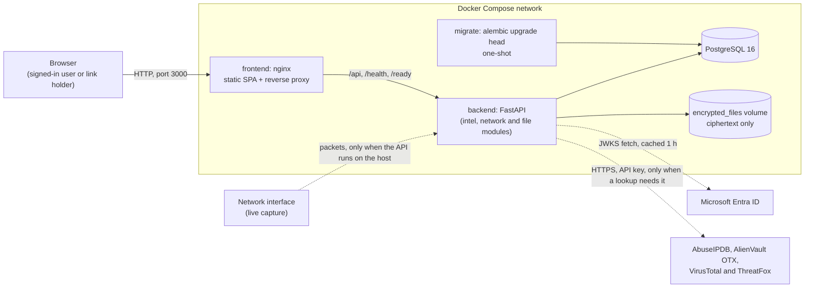
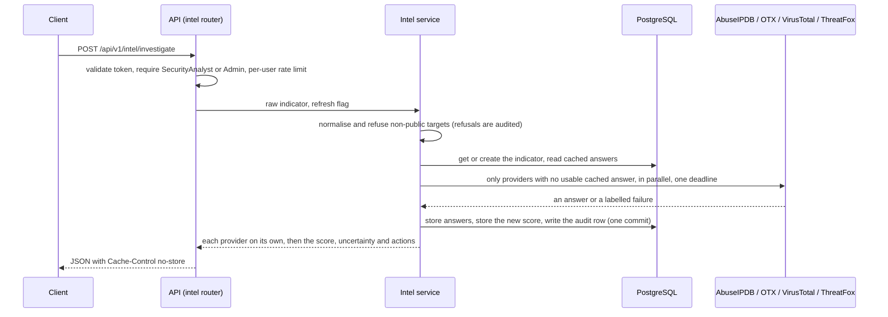
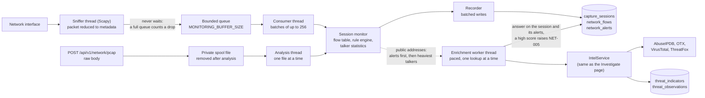
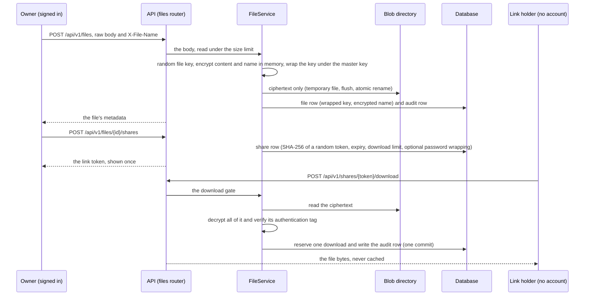
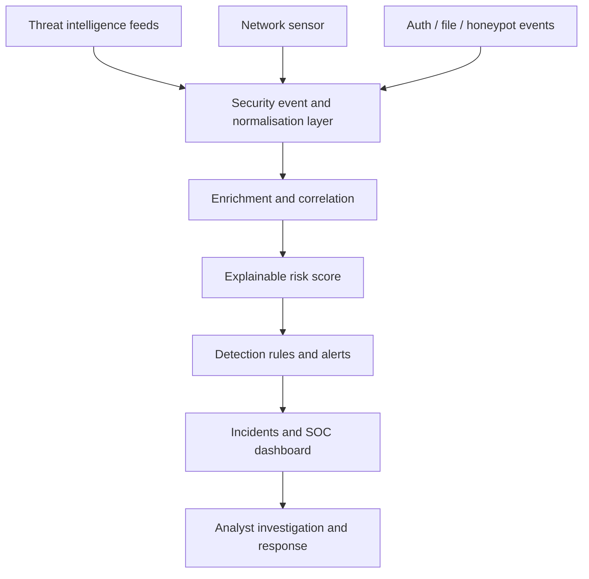

# Architecture

This document describes what is built and how the remaining modules are intended to plug in. Built
today (Phases 1 to 4, see [project-status.md](project-status.md)): the platform (configuration,
logging, authentication, errors, health), threat-intelligence investigation with four providers
(VirusTotal and ThreatFox joined AbuseIPDB and AlienVault OTX in Phase 4), the analyst dashboard
(Phases 3 to 3c, extended in Phase 4), **network monitoring** (live capture, PCAP analysis and
detection rules) and **encrypted file sharing**. Anything not built is labelled **planned**: browser
sign-in, a separate network sensor, correlation across events and sources, cases and the Azure
deployment. The intended end state follows the project specification; nothing planned here should be
read as implemented.

This file is the authority on how the pieces fit together, the data flows, the trust boundaries and
the [time-handling rule](#time-handling-utc-storage-ist-display). The feature pages go deeper:
[threat-intelligence.md](threat-intelligence.md), [network-monitoring.md](network-monitoring.md) and
[file-sharing.md](file-sharing.md).

## System context



- The browser only talks to nginx. The SPA calls the API with relative URLs, so there is no CORS in
  the default deployment. A person who opens a share link does the same: the page at
  `/share/<token>` is part of the SPA and calls the public share endpoints without credentials.
- nginx sets the security headers and the Content Security Policy for the static files and strips
  the duplicates the API adds, so each header appears once. It also sets the request-body limits
  (small by default, large only for the two upload endpoints) and keeps share tokens out of its
  access log; [deployment.md](deployment.md) has the configuration.
- The API reaches Entra ID only to download signing keys. Tokens are validated locally.
- The API reaches the four threat-intelligence providers (AbuseIPDB, AlienVault OTX, VirusTotal and
  ThreatFox) only through their collectors, at fixed hosts, and only when a lookup needs a fresh
  answer. The browser never contacts them and never sees their keys. A lookup is started either by
  an analyst on the Investigate page or by the network module's enrichment worker, which calls the
  same intelligence service.
- Encrypted file sharing keeps ciphertext in a directory the API process writes to (the
  `encrypted_files` volume in Compose). The database holds only metadata, wrapped keys and hashes.
- Network monitoring has two inputs. An uploaded capture file arrives like any other request and is
  analysed inside the API process, in the container too. A live capture reads packets from a network
  interface of the machine the API runs on, which needs a capture driver and sometimes elevated
  privileges. The Compose backend container drops all capabilities and has a read-only root
  filesystem, so live capture is not available there; run the API on the host for it (see
  [network-monitoring.md](network-monitoring.md)).
- Migrations are a separate one-shot step, not something the API does at startup.

## Threat-intelligence flow (Phase 2)



The collectors, the scoring function and the service are separate so each can be tested without the
others: the scorer is a pure function, the collectors run against a stub transport, and the service
runs against SQLite and PostgreSQL. [threat-intelligence.md](threat-intelligence.md) has the details
(normalisation, caching, the `intel-risk-v1` method, stored data and the limits).

The four collectors (`collectors/abuseipdb.py`, `otx.py`, `virustotal.py`, `threatfox.py`) share one
interface and one HTTP client, and each declares the indicator types it covers: IP addresses,
domains, URLs and the hash types MD5, SHA-1 and SHA-256 (migration `0003_hash_indicators` added the
hash types to the indicator table). A provider that does not cover the type, or has no key, makes no
call and is reported as `unsupported` or `not_configured`, never as a clean answer. VirusTotal and
ThreatFox are read-only lookups: nothing is uploaded or submitted to them, and "no detections" or "no
result" is never turned into "safe". `intel-risk-v1` is unchanged: the new providers add evidence to
it; there is no second score.

## Network-monitoring flow

Network monitoring has two ways in and one pipeline. A live capture and an uploaded capture file
differ only until their packets reach the session monitor; everything after that is shared.
[network-monitoring.md](network-monitoring.md) describes the behaviour, limits and privacy of the
module; this section is its shape.



1. **Reduce.** Each packet becomes a small metadata record (time, addresses, ports, protocol,
   length, TCP flags) in `network/packets.py`. The payload is never read, stored or logged. Non-IP
   and malformed packets are only counted.
2. **Hand over.** A live capture runs a Scapy sniffer thread whose callback only reduces the packet
   and puts it on a bounded queue. If the queue is full the packet is counted as dropped, because
   waiting would stall the capture; the session shows the number. A consumer thread takes batches
   from the queue and feeds the monitor. An uploaded file is streamed to a private spool file
   (random name, owner-only), checked for a valid PCAP or PCAPNG structure and then read by the
   analysis thread, which feeds the same monitor directly. The spool file is removed in every case.
3. **Judge.** The monitor drives a pure analyzer: the flow table (`flows.py`), bounded
   sliding-window counters (`windows.py`) and the rule engine (`detection/network_rules.py`, rules NET-001 to
   NET-007; thresholds and severities are in [detection-engine.md](detection-engine.md)). A flag on
   the monitor picks the clock that retires idle flows: the packets' own timestamps for a capture
   file (it may be years old), the wall clock for a live capture.
4. **Record.** A recorder writes flows, alerts and running totals to the database in batches, about
   every two seconds, so a slow database cannot stall the capture. A failed batch is kept and
   retried with the next one within fixed bounds; beyond them the oldest pending rows are dropped.
   Flows past `NETWORK_MAX_STORED_FLOWS` are counted but not stored. Both cases, and every failed
   write, are counted in the session's statistics, never lost silently.
5. **Enrich.** The monitor hands the public addresses of alerts, then of the heaviest talkers, to
   the enrichment worker. The worker calls `IntelService.investigate` (the Investigate page's code
   path, with the audit actor `system:network-monitor`), so each answer is an ordinary indicator
   that also appears on the Indicators page. It writes a compact answer onto the session and onto
   the alerts that name the address, and raises NET-005 when an assessed score reaches
   `KNOWN_MALICIOUS_MIN_SCORE`. Only public addresses are ever sent to a provider. Lookups that reach
   a provider are spaced out (`NETWORK_ENRICHMENT_MAX_PER_MINUTE`; answers already in the
   intelligence cache are not delayed), the number of addresses per session is capped
   (`NETWORK_ENRICHMENT_MAX_IPS`) and the whole step can be switched off
   (`EXTERNAL_ENRICHMENT_ENABLED`).

Sessions, flows and alerts belong to the user who started the capture or uploaded the file, and the
network endpoints need the SecurityAnalyst or Admin role. Finished sessions are deleted after
`NETWORK_RETENTION_HOURS`, together with their flows and alerts. There is no timer: the purge runs
when the API starts and when a session list is loaded, at most once every ten minutes. Indicators
that enrichment created are not deleted with the session: they belong to the Indicators page.

## Encrypted-file flow

Encrypted file sharing is server-side encryption: the API receives the file in plaintext over the
connection, encrypts it in memory and stores only ciphertext. It is not end-to-end encryption, and the
server can decrypt every file it holds. The algorithms and key handling are in
[encryption-design.md](encryption-design.md); the behaviour, limits and audit events are in
[file-sharing.md](file-sharing.md).



- **Upload.** The request is the raw file body with `Content-Type: application/octet-stream` and the
  original name, percent-encoded, in `X-File-Name`. Multipart is refused (415) because its parser
  can spool a large part to a temporary file, which would put plaintext on disk. The master key is
  checked before the body is read, the size limit is applied to the declared length and again to
  the stream, and the blob is written before its database row (it is removed again if the row cannot
  be written). Plaintext never touches the disk.
- **Share.** A link has a random 256-bit token that is returned once; only its SHA-256 is stored. It
  has an expiry, a download limit and optionally a password. A password never becomes a stored
  hash: it is run through Argon2id and HKDF with the master key, and the result wraps the file key,
  so a wrong password simply fails to unwrap it.
- **Download gate.** The public endpoints need no session, so the order of the checks is the
  design. Checks that need no secret come first (the per-client rate limit, the token's shape, the
  share's state: revoked, expired, used up). The key checks follow, then the password: its attempt
  budget is reserved before the expensive derivation, and at most two derivations run at once in
  the process. The whole file is then decrypted and verified before any download is counted; a
  failed check quarantines the file and consumes nothing. One conditional update reserves the
  download, which keeps `max_downloads` exact when requests overlap. The reservation and its audit
  row are committed before the first byte is sent. A rejection of a share that exists is audited; a
  token that matches nothing is not. The exact order, status codes and error codes are in
  [file-sharing.md](file-sharing.md).
- **Ownership.** Every management query is scoped to the owner, and another owner's file looks like
  a missing one. Any signed-in role may use the module.
- **Switch.** With no `CIPHERFORGE_MASTER_KEY` the module reports itself as not configured and
  refuses uploads, shares and downloads, while the rest of the application works.

## Trust boundaries and data stores

What crosses each boundary, and what protects it. This is a map, not a catalogue of controls:
[security.md](security.md) lists the controls, [threat-model.md](threat-model.md) the threats and the
residual risks, and [encryption-design.md](encryption-design.md) the cryptography and key handling.

| Boundary | What crosses it | Main protection |
| --- | --- | --- |
| Browser to nginx | The static app, JSON requests, raw file bodies (file and PCAP uploads), the bearer token of a signed-in user, and for a link holder the share token in the address and an optional password in a POST body. | TLS, which you add in front of nginx (the Compose stack serves plain HTTP on loopback). Security headers and the Content Security Policy are set once, by nginx. Request-body limits per location. Share tokens are masked in nginx's access log. Everything from the browser is treated as untrusted input. |
| nginx to API | The same requests, plus `X-Forwarded-For` with the client address. | The backend trusts that header only from `FORWARDED_ALLOW_IPS`, and its port is published on loopback only. |
| Public share endpoints | A token (and a password for a protected link) in, file bytes or a fixed error code out. There is no session: this is the one place an anonymous caller reaches stored data. | A 256-bit random token of which only the hash is stored, per-client rate limits, a wrong-password budget per share and per client network, checks that fail closed, fixed response headers (`no-store`, `nosniff`, a sandboxing CSP, no referrer), and masking of tokens in the API's own logs. |
| API to database | SQL over a pooled connection. | Credentials from the environment, parameterised queries, append-only audit table, owner-scoped queries. Production requires PostgreSQL. |
| API to the encrypted-blob directory | Ciphertext only. | An owner-only directory, random validated file names, atomic writes, reads that refuse symbolic links. The key that opens the ciphertext is not on that disk: it comes from the environment and wraps every per-file key. |
| Capture interface to API | Raw packets. This is the privileged boundary: it needs a capture driver and sometimes elevated rights. | Each packet is reduced to metadata in the capture callback and the payload is dropped, never queued, stored or logged. Promiscuous mode is never enabled. The Compose container has none of the privileges, so live capture is available only when the API runs on the host. |
| API to providers | Outbound HTTPS only, to fixed hosts, carrying the indicator (an analyst's value, or a public address from the network module) and the provider's key. | Redirects off, TLS verification on, private and reserved addresses never sent. The keys stay in the backend: the browser never sees them, the API never returns them and the log filter masks their exact values. |
| API to Entra ID | Download of the tenant's signing keys. | Tokens are validated locally, with RS256 only and every required claim checked. |

| Data store | Holds | Never holds |
| --- | --- | --- |
| Database (the `postgres_data` volume in Compose) | Indicators, provider observations, the audit trail, capture sessions, flows and alerts, file metadata with wrapped keys, share rules with token hashes. | File contents, plaintext file names, share tokens, share passwords or hashes of them, the master key, provider keys, packet payloads. |
| Encrypted-blob directory (the `encrypted_files` volume) | One ciphertext file per uploaded file. | Plaintext, file names. |
| Master key (`CIPHERFORGE_MASTER_KEY`) | A secret in the environment of the API process. One key does every job and it is not split into separate keys: it wraps each file's key, is part of the key of each password-protected link, and the fingerprint stored with each file is computed with it (see [encryption-design.md](encryption-design.md#the-master-key)). | It is not in the database or in the blob directory, so a backup of those two alone cannot be decrypted. |
| Upload spool | An uploaded capture file while it is analysed. | Anything after the analysis: it is removed in every case. |
| Process memory | Rate-limiter and wrong-password counters, the single live-capture slot and its queue, the flow table, the enrichment queue, and a file's plaintext while it is being encrypted or decrypted. | Nothing that outlives the process. A restart resets the counters and ends a running capture. |

## Time handling: UTC storage, IST display

One rule, applied everywhere: **a time is stored and sent as UTC, and shown to a person as Indian
Standard Time (IST).** Nothing in between converts it, so a stored value always means the same
instant.

| Where | Zone | How |
| --- | --- | --- |
| Database columns and the audit trail | UTC | `UTCDateTime` (`models/types.py`) refuses a naive datetime and always returns an aware UTC one, on SQLite and PostgreSQL alike. |
| API responses | UTC | ISO 8601 with an explicit zone. The API does not convert them. A value with no zone is read as UTC, on the backend and in the browser alike. |
| Text the backend writes for people | IST | Alert explanations (`detection/network_rules.py`) and the score explanation (`correlation/scoring.py`) go through `format_ist`. |
| Per-day figures | IST calendar day | The overview's buckets, described below. |
| The dashboard | IST | The browser converts each API timestamp when it draws it. |

- **One module on the backend.** `core/timeutil.py` is the only module that knows the display zone
  and the display format. It parses what comes in (`parse_timestamp`: datetimes, ISO strings with
  `Z`, an offset or a trailing ` UTC`, and epoch seconds; values before 1970 or from the year 2200
  on are refused) and provides `to_ist`, `format_ist`, `ist_date`, `ist_hour`, `today_ist` and the
  day-boundary helpers (`ist_day_start`, `ist_day_bounds`, `ist_range_bounds`, `parse_ist_date`).
  The conversion uses the IANA zone `Asia/Kolkata`; no code adds an offset by hand. Other modules
  call these helpers instead of converting a time themselves: the explanation texts use
  `format_ist`, and `services/overview.py` imports the module's `IST` zone object only to choose a
  bucket. The other conversions in the backend go to UTC, never to IST: the column type in
  `models/types.py` and the provider timestamp reader in `collectors/sanitize.py`.
- **Display format.** `DD-MM-YYYY hh:mm:ss A IST` on a 12-hour clock, for example
  `25-11-2026 09:49:00 AM IST` for `2026-11-25T04:19:00Z`. Both sides build it from date parts rather
  than from a locale-dependent format, so the process locale or the browser language cannot change it.
- **Per-day buckets.** The overview groups by IST calendar day and hour, so a day starts at 00:00 IST
  (18:30 UTC on the day before). `services/overview.py` builds a 14-day series and a 7-day by 24-hour
  activity grid this way: it starts the query at the UTC instant where the first IST day begins
  (`ist_day_start`), keeps every stored timestamp in UTC and converts a value only to choose its
  bucket. The "last 24 hours" and "previous 24 hours" figures are rolling windows of instants and do
  not depend on the zone. The bucket days travel to the browser as plain `YYYY-MM-DD` dates, which
  the browser shows as they are: they are calendar days, not instants, so nothing converts them again.
- **In the browser.** `frontend/src/features/time/ist.ts` reads an ISO 8601 timestamp the way the
  backend does (no zone means UTC, within a matching year range) and formats it with an
  `Intl.DateTimeFormat` for `Asia/Kolkata` and a fixed locale, then builds the 12-hour clock itself.
  `components/DateTime.tsx` shows the IST time with a relative time beside it, and the top bar shows
  an IST clock when it is wide enough (`components/shell/IstClock.tsx`). A value that cannot be read
  gets a placeholder ("Unknown" by default), never a guess.
- **Configuration.** `APP_TIMEZONE` states the display zone and accepts only `Asia/Kolkata`; any
  other value fails the settings check at start-up. It does not select the zone: the conversion code
  uses the fixed `Asia/Kolkata` constant.
- **The `tzdata` package.** The zone comes from the IANA database. Windows has none of its own, so
  `tzdata` is pinned in `backend/requirements.txt`, and the API refuses to start, with a message that
  names the package, if the zone cannot be loaded.
- **Logs are for operators.** JSON log lines carry a UTC timestamp. The console format used in
  development shows the host's local time of day.

## Target architecture (planned)



This diagram is the intended end state, not the current system. Two parts of it exist, and neither
passes through the normalisation layer shown here:

- **Threat-intelligence feeds.** An indicator goes in, the providers enrich it and an explainable
  score comes out, on demand (see [Threat-intelligence flow](#threat-intelligence-flow-phase-2)).
- **Network monitoring.** An in-process module analyses a live capture or an uploaded capture file
  against detection rules NET-001 to NET-007 and stores flows and alerts (see
  [Network-monitoring flow](#network-monitoring-flow)). It covers the sensor, the rules and the
  alerts of the diagram for one host at a time.

Not built: the **remote sensor** (`sensor/` is a placeholder; how it would report to the backend is
undecided, and the decision will be recorded in this file before it is built), a common event stream
and normalisation layer, correlation across events and sources, honeypot and authentication events,
and incidents or cases. File activity is recorded in the audit trail only.

## Module map

| Module | Purpose | Status | Where it lives or will live |
| --- | --- | --- | --- |
| Core platform | Config, logging, auth, errors, health, time handling | **Phase 1 done** | `backend/app/core`, `security`, `api`, `database` |
| Intel | Threat-intelligence ingestion (AbuseIPDB, OTX, VirusTotal, ThreatFox), IOC investigation, caching | **Phase 2 done** (API) and **Phases 3 to 3c done** (analyst screens) | `collectors/`, `services/`, `correlation/scoring.py`, `api/v1/intel.py`; UI in `frontend/src` |
| SOC | Command-centre UI, triage, analytics | **Phases 3 to 3c done** for threat intelligence: the overview command deck, investigate, indicator list and detail, status. The Network and Files screens are built too. A cross-source alert queue and incident handling are not built | `frontend/src` |
| Sentinel | Defensive network monitoring and anomaly detection | **Built** in the API process: live capture on the host, capture-file analysis, flow tracking, rules NET-001 to NET-007, enrichment of public addresses. The remote sensor is planned | `network/`, `detection/network_rules.py`, `api/v1/network.py`; `sensor/` is a placeholder |
| Core (correlation) | Event normalisation, correlation, scoring, rules | Indicator scoring and the network rules are built. Event normalisation and correlation across events are not started | `correlation/`, `detection/` |
| Case | Incidents, notes, timelines | Not started | `services/`, `models/` |
| Vault | Encrypted file sharing: server-side encryption at rest, expiring and revocable links, optional passwords, audit | **Built.** Not end-to-end: the server can decrypt every file it holds | `files/`, `api/v1/files.py`; design in [encryption-design.md](encryption-design.md) |
| Administration | Users, roles and audit review | Not started | - |

## Backend

`backend/app` is organised by responsibility, with one-way dependencies: `api` calls `services`,
which use `models`, `collectors` and `correlation`; `core` and `security` are shared by everything.

| Package | Responsibility |
| --- | --- |
| `api/` | HTTP routes and request dependencies. No business logic. The health probes, and the versioned routes under `/api/v1`: `intel.py`, `network.py`, `files.py` (the owner's endpoints and the public share endpoints) and `me.py`. |
| `core/` | Settings, structured logging and redaction, correlation ID context, error envelope, middleware, and the one time-handling module (`timeutil.py`). |
| `security/` | Entra ID token validation (`auth.py`), roles (`roles.py`) and the in-memory sliding-window rate limiter (`rate_limit.py`). |
| `database/` | Engine and session factory, the readiness probe. |
| `models/`, `schemas/` | SQLAlchemy tables and Pydantic request/response models for threat intelligence, the audit trail, network monitoring and files. Column types are in `models/types.py`. |
| `services/` | Indicator normalisation, the investigation workflow (caching, scoring, storage), the overview aggregation (`overview.py`) and the audit writer. |
| `collectors/` | One adapter per provider (AbuseIPDB, OTX, VirusTotal, ThreatFox) behind a common interface, plus response sanitising helpers. |
| `correlation/` | The pure, explainable scoring function (`intel-risk-v1`). |
| `detection/` | The network detection rules, NET-001 to NET-007 (`network_rules.py`). |
| `network/` | The network-monitoring module: the service that owns the capture, the analysis and the worker (`service.py`), the capture source and queue (`capture.py`), loading Scapy with only the protocol layers the monitor reads (`scapy_support.py`), reduction of packets to metadata (`packets.py`), the analyzer with its flow table and windows (`analyzer.py`, `flows.py`, `windows.py`), the session monitor, recorder and enrichment worker (`monitor.py`, `recorder.py`, `enrichment.py`), capture-file analysis (`pcap.py`), the module's error codes and the wording that is safe to show for them (`errors.py`), the conversion of stored rows into API response models (`views.py`) and the owner-scoped, retention and recovery queries (`repository.py`). The recorder and the enrichment worker open their own short database sessions for the rows they write. |
| `files/` | The encrypted-file module: the service and the share gate (`service.py`), cryptography (`crypto.py`), the blob directory (`storage.py`), file-name cleaning (`names.py`), the wrong-password counters (`attempts.py`) and the log filter that masks share tokens (`logsafe.py`). |
| `workers/` | Reserved for application-wide background workers. None exist yet: the network module owns its own threads. |

`backend/devtools/` sits beside `app/`, not inside it: the demo server, its simulated providers and
its synthetic data, including a simulated network interface and a sample capture file (see
[Try it without API keys](../README.md#try-it-without-api-keys)). `app/`
never imports it, the Docker build context leaves it out, and its database is confined to
`backend/.demo/`. It exists so the dashboard can be seen and tested with a populated database
without provider keys; the only traces of it in `app/` are the `simulated` flag that its adapters
set and the dashboard turns into a banner, and the `network_service_factory` argument of
`create_app`, which only the demo server and the tests pass.

### Start-up, wiring and shutdown

`create_app` builds every long-lived component once and keeps it on `app.state`; endpoints reach
them through the dependencies in `api/deps.py`. Nothing is a module-level global, so a test builds
its own wiring (`create_app` accepts settings, a token validator, an intel service and a
network-service factory).

At start-up, in this order:

1. The settings are loaded and validated. An unsafe or malformed value, including a malformed master
   key, stops the API here. Logging is then configured and the secret values are registered for
   redaction.
2. The database engine is built. It connects lazily.
3. With `AUTH_MODE=entra`, the Entra token validator is built.
4. The `IntelService` is built: one shared HTTP client (redirects off, TLS verification on) and one
   adapter per provider, in the order AbuseIPDB, OTX, VirusTotal, ThreatFox. A provider without a
   key still gets an adapter, which reports `not_configured` instead of calling out.
5. The session factory is built from the engine.
6. The `NetworkService` is built from the settings, the session factory and the `IntelService`. It
   touches neither the database nor the capture library until it is used.
7. The application and its state are created: `settings`, `engine`, `session_factory`,
   `token_validator`, `intel_service`, `rate_limiter` (the in-memory limiter behind the
   investigation endpoint, `INVESTIGATE_RATE_LIMIT_PER_MINUTE`), `file_service` and
   `network_service`. The `FileService` is built from the settings alone, without touching the disk
   or the database. A blank master key does not stop the API: the file module reports itself as not
   configured.
8. The lifespan hook calls `network_service.startup()`. Sessions that a previous run left
   `starting`, `running` or `stopping` are marked `failed` with the code `interrupted`, alert
   look-ups that were still pending are marked unavailable, finished sessions older than the
   retention period are deleted and upload folders more than a day old are removed. A database that
   is not migrated yet is tolerated: the step logs `network_startup_skipped` and the API still
   starts.

At shutdown the hook runs `network_service.shutdown()`, then `intel_service.close()`, then
`engine.dispose()`. The network module goes first because a capture that is still running makes its
last look-ups on the providers. Its shutdown stops a running live capture (with a bounded wait), the
capture-file analysis and the enrichment worker, marks look-ups that are still pending as
interrupted and removes the upload folder.

**Threads.** Request handlers run on the server's event loop and its worker-thread pool. The network
module adds threads of its own, each started on demand and stopped by its `shutdown()`:

| Thread | Exists while | Does |
| --- | --- | --- |
| Scapy `AsyncSniffer` | a live capture runs | Reduces each packet to metadata and puts it on the queue without waiting. |
| `cipherforge-capture-consumer` | a live capture runs | Takes batches off the queue and gives them to the session monitor. |
| `cipherforge-pcap-analysis` | a capture file is being analysed (one at a time) | Reads the spooled file into the session monitor. |
| `cipherforge-network-enrichment` | from the first look-up request until shutdown | One worker for every session: takes queued public addresses one at a time, alert addresses first. |

The file module starts no thread: its work runs in the request handlers, with the encryption and
the password key derivation on the worker-thread pool.

**Database sessions.** A request handler gets one session from `get_db` and it is closed when the
request ends. A thread that serves no request cannot use that, so the network module hands the
session factory to its recorder, its PCAP thread and its enrichment worker, and each opens a short
session around one write or look-up. A session is never shared between threads. A lock shared by the
recorders and the worker serialises their updates of a capture session's `stats` column, and
`alerts_total` is increased in the database (`alerts_total = alerts_total + n`), so the two writers
cannot overwrite each other.

**The existing intelligence service.** The enrichment worker calls the same
`IntelService.investigate` as the Investigate endpoint, with the audit actor
`system:network-monitor` (or, for a manual look-up, the person who asked). The cache, the scoring,
the storage of indicators and observations, and the audit row are therefore one code path, and the
providers' quotas are shared with analysts' own investigations.

### Request lifecycle

`create_app` stacks the middleware so a request passes through, outermost first:

```text
CorrelationId -> SecurityHeaders -> RequestLogging -> CORS (only if configured)
              -> UnhandledException -> router -> endpoint
```

- **CorrelationId** accepts an incoming `X-Correlation-ID` only if it matches `[A-Za-z0-9._-]{8,64}`
  (otherwise it generates one), so a client cannot inject log lines.
- **SecurityHeaders** adds `nosniff`, `X-Frame-Options: DENY`, `Referrer-Policy: no-referrer` and
  `Cache-Control: no-store`.
- **RequestLogging** writes one structured line per request (method, path, status, duration). It
  never logs query strings or bodies. A share token in the path is masked by the filter in
  `files/logsafe.py` (see [Logging and redaction](#logging-and-redaction)).
- **CORS** is added only when `CORS_ORIGINS` is set. The Compose stack is same-origin (nginx serves
  the dashboard and proxies `/api/`), so it needs none. When it is on, the allowed methods are
  `GET`, `POST` and `DELETE`, the allowed request headers are `Authorization`, `Content-Type`,
  `X-Correlation-ID` and `X-File-Name`, `X-Correlation-ID` is exposed to the page, and credentials
  (cookies) are not allowed.
- **UnhandledException** turns any unexpected error into a generic 500, so the outer layers can
  still add headers and logging.

The middleware are plain ASGI rather than `BaseHTTPMiddleware`, so the correlation ID context
variable also reaches synchronous endpoints running in the thread pool.

The interactive API documentation (`/docs` and `/openapi.json`) is served only when
`ENVIRONMENT` is not `production`; ReDoc is off. The routers are the unauthenticated health router
(`/health`, `/ready`) and the versioned router under `/api/v1`: `me`, `intel`, `network` and `files`,
plus the public share endpoints under `/api/v1/shares`.

### Errors

Every error uses one envelope, built in `core/errors.py`:
`{"error": {"code", "message", "correlation_id", "details?"}}`. The `code` is a stable,
machine-readable string for clients to branch on; the `message` is for people and is deliberately
generic (no stack trace, SQL, file path, connection detail or echoed input).

- **Specific codes.** `ApiError(status, code, message, headers)` carries its own code where the
  status alone is ambiguous: `file_too_large` (413), `share_expired` (410), `capture_already_running`
  and `analysis_already_running` (409), `service_busy` (503). Each module documents its own codes:
  [`network-monitoring.md`](network-monitoring.md) for network monitoring and
  [`file-sharing.md`](file-sharing.md) for files and shares.
- **Status-derived codes.** Anything raised as a plain HTTP error gets a code from its status:
  `bad_request` (400), `unauthorized` (401), `forbidden` (403), `not_found` (404),
  `method_not_allowed` (405), `conflict` (409), `gone` (410), `payload_too_large` (413),
  `unsupported_media_type` (415), `validation_error` (422), `rate_limited` (429), `internal_error`
  (500) and `service_unavailable` (503). The threat-intelligence endpoints still raise plain HTTP
  errors, so they use these codes; a 429 from them includes a `Retry-After` header.
- **Validation errors (422)** return only the location, message and type of each problem, never the
  submitted value.
- **A 500 never exposes internals.** The caller gets a generic message and the correlation ID; the
  detail is in the log under that ID. Database errors inside the file module become the same
  generic 500, and only the exception type is logged.

### Authentication and authorisation

`AUTH_MODE=entra` validates Microsoft Entra ID access tokens: RS256 only, signature checked against
the tenant's cached JWKS, and `exp`, `iss`, `aud`, `sub` and `tid` required and verified.
`require_roles(...)` guards endpoints by role (`Admin`, `SecurityAnalyst`, `User`). `AUTH_MODE=dev`
returns a fixed local principal and is refused when `ENVIRONMENT=production`. The validator can be
injected into `create_app`, which is how the tests use generated keys instead of a real tenant.

Authorisation has two layers:

- **Roles, per router.** The threat-intelligence and network-monitoring routers require
  `SecurityAnalyst` or `Admin`. The file-management endpoints accept any signed-in role (`User`,
  `SecurityAnalyst` or `Admin`). `/api/v1/me` needs any valid token. `/health`, `/ready` and the
  public share endpoints (`/api/v1/shares/...`) need none; a share is protected by its link and,
  optionally, a password instead (see [`file-sharing.md`](file-sharing.md)).
- **Ownership, per resource.** A capture session (with its flows and alerts) belongs to the person
  who started the capture or uploaded the file, and an encrypted file (with its shares) belongs to
  the person who uploaded it. The owner is the token's `oid` claim, or `sub` when there is no `oid`
  (`Principal.subject`). Every query that serves the API filters by that owner, so another person's
  resource looks exactly like one that does not exist (a 404-style answer), and that includes
  administrators: `Admin` does not widen what a person can see here. Only the network module's
  maintenance code (retention and crash recovery) and the public share lookup (by the hash of the
  link's token) work across owners. Indicators and observations are shared evidence, not per-owner
  data. With `AUTH_MODE=dev` every request is the same `dev-user`.

### Data layer

SQLAlchemy 2 with Alembic. Constraint names follow a naming convention so migrations stay
deterministic. The engine checks a connection before using it (`pool_pre_ping`); on PostgreSQL it
also sets a short connect timeout, so `/ready` answers quickly when the database is unreachable,
and recycles connections. Two column types in `models/types.py` keep the backends alike:
`UTCDateTime` refuses naive datetimes and always returns timezone-aware UTC values, and `JSONType`
is JSONB on PostgreSQL and plain JSON elsewhere.

| Table | What it holds |
| --- | --- |
| `threat_sources` | One row per provider: a unique name and a display name. |
| `threat_indicators` | One row per indicator, unique on type and value. The type is `ipv4`, `ipv6`, `domain`, `url`, `md5`, `sha1` or `sha256`. Holds the score, confidence, the providers' first and last evidence times, the source count, tags and the stored score breakdown. |
| `threat_observations` | What one provider said about one indicator: status, a signal from 0 to 1, when it was fetched and when the evidence dates from, and a short whitelisted summary, never the raw response. Only `ok` and `no_data` answers are stored. Deleted with its indicator. |
| `audit_logs` | The append-only audit trail: UTC timestamp, actor, action, target, result, source IP, correlation ID and JSON details. |
| `capture_sessions` | One live capture or PCAP analysis: owner, `source_kind` (`live` or `pcap`), status, interface or a sanitised file label, start and end, packet, byte, flow, alert and dropped-packet counters, a short machine-readable `error_code` and a JSON `stats` document. |
| `network_flows` | One conversation: protocol, addresses and ports, first and last seen, packet and byte counts in each direction, TCP flags and close reason. Deleted with its session. |
| `network_alerts` | One rule hit: rule ID and name, severity, explanation, observed value against threshold, window, addresses, protocol, and first and last observed. Deleted with its session. |
| `encrypted_files` | One stored file: owner, status (`active` or `corrupt`), the random name of the blob on disk, plaintext size, algorithm, nonce, the per-file key wrapped by the master key, a non-secret fingerprint of that master key (`key_id`) and the encrypted original filename. No plaintext content or name. |
| `file_shares` | One link: the SHA-256 hash of its token (never the token), expiry, `max_downloads`, `download_count`, last download, revocation time and, for password links, the Argon2id salt and parameters and the password-wrapped key (all set or all null). Deleted with its file. |

Alembic's own `alembic_version` table records the revision. The migrations, in order:

| Revision | What it does |
| --- | --- |
| `0001_baseline` | Creates no tables; it establishes Alembic version tracking. |
| `0002_threat_intel` | Adds `threat_sources`, `threat_indicators`, `threat_observations` and `audit_logs`, with the triggers that make the audit table append-only. |
| `0003_hash_indicators` | Widens the indicator-type check so `md5` and `sha1` are allowed. SQLite has to rebuild the table, so the migration refuses to run on a connection that enforces foreign keys (the Alembic command line does not). The downgrade is refused while MD5 or SHA-1 indicators are stored. |
| `0004_network_monitoring` | Adds `capture_sessions`, `network_flows` and `network_alerts` and touches nothing that exists. Downgrading drops the monitoring data. |
| `0005_encrypted_files` (head) | Adds `encrypted_files` and `file_shares` and touches nothing that exists. The ciphertext lives outside the database, so a downgrade drops the metadata and leaves blobs that can no longer be opened. |

The audit table is append-only: triggers reject `UPDATE` and `DELETE` on SQLite and PostgreSQL, and
`TRUNCATE` on PostgreSQL. They stop an application bug or injected SQL from rewriting history; a
database superuser can still drop them. Deleting an indicator (`services/intel_service.py`) removes
its observations and the indicator in one transaction that also adds an `IOC_DELETE` audit row for
each one, so the audit rows stay and are never touched. On SQLite every connection turns on
`foreign_keys` and `secure_delete` (`database/session.py`). Unit tests run on SQLite and, when
`TEST_DATABASE_URL` is set, again on PostgreSQL (the same tests, parametrised), including upgrade,
downgrade and upgrade again on the real engine. Production requires PostgreSQL.

**Ownership scoping.** `capture_sessions.owner` and `encrypted_files.owner` hold the principal's
subject (the `oid` claim, else `sub`), each with an index on owner and time. Flows and alerts belong
to a person through their session, and shares through their file, so deleting the parent removes
them (`ON DELETE CASCADE`). The repository and service functions behind the API take the owner as an
argument and put it in the `WHERE` clause. The functions that do not are the network maintenance
ones (the retention purge, and marking sessions and look-ups that were still running at start-up as
interrupted), the recorder and the enrichment worker (they write to a session by its ID, which the
service hands them for a session the person owns) and the public share lookup, which finds a link
by the hash of its token. Indicators, observations and audit rows are not per-owner.

### Logging and redaction

`core/logging_config.py` installs one handler on the root logger: structured JSON by default
(`LOG_FORMAT=json`, with UTC timestamps) or a readable console format for development. Every
message, structured field and exception text passes through redaction before it is written:

- the exact values of the configured secrets (registered at start-up from `Settings.secret_values()`;
  very short values are ignored), wherever they appear;
- JSON Web Tokens, `Bearer` and `Basic` credentials and `scheme://user:password@` URLs;
- the value of any `name=value`, `name: value` or `"name": "value"` pair, and any structured field,
  whose name looks sensitive (`api_key`, `token`, `secret`, `password`, `authorization`, `cookie`,
  `credential` and similar).

The logging is also arranged so that sensitive data is not produced in the first place:

- Request logging records the method, path, status and duration. It does not record query strings
  or bodies.
- uvicorn's own access log is turned off, because the request logger replaces it, and the HTTP
  client libraries (`httpx`, `httpcore`) are held at `WARNING`: at `INFO` they would copy
  analyst-submitted indicators, and any token inside a URL indicator, into the general log. The
  audit trail is the record of look-ups.
- A share token is a bearer secret and travels in the URL path, so `files/logsafe.py` masks the
  segment after `/shares/` or `/share/` on the request loggers. This covers the application's own
  log only. The bundled nginx redacts tokens in its access log but not in its error log, and a
  proxy or TLS terminator in front of it may log the URL (see [`deployment.md`](deployment.md)).
- A database error inside the file module is logged as its exception type only, because the text
  of a database error can contain key material.

### Concurrency and limits

These limits live inside the API process; none needs an extra service.

| Limit | Scope and behaviour |
| --- | --- |
| One live capture | The whole application. A second start answers 409 `capture_already_running`. The slot is guarded by a lock in `network/service.py`. |
| One PCAP analysis | The whole application. A second upload answers 409 `analysis_already_running`. An analysis that runs past its time limit is stopped and recorded as failed. |
| Investigation rate | Per signed-in person (`INVESTIGATE_RATE_LIMIT_PER_MINUTE`). One limiter guards `POST /intel/investigate`, the PCAP upload, a manual alert enrichment and a refresh of the interface list. |
| File upload and share creation | Per signed-in person (`FILE_UPLOAD_RATE_LIMIT_PER_MINUTE`, `SHARE_CREATE_RATE_LIMIT_PER_MINUTE`). |
| Public link requests | Per client network (`SHARE_DOWNLOAD_RATE_LIMIT_PER_MINUTE`). An IPv6 client counts as its /64 and an IPv4-mapped address as the IPv4 address. |
| Wrong share passwords | Counted per share and per client network (`SHARE_PASSWORD_ATTEMPT_LIMIT` in a 15-minute window). An attempt is reserved before the expensive key derivation starts, so parallel guesses cannot exceed the budget, and a correct password does not clear earlier failures. |
| Argon2id derivations | At most two at once. A further request waits briefly and then gets 503 `service_busy`. |

Uploads are bounded by `MAX_ENCRYPTED_FILE_SIZE_MB` (a file is encrypted in memory) and
`NETWORK_MAX_PCAP_SIZE_MB`. The proxy in front must allow at least the larger of the two; the
bundled nginx does (see [`deployment.md`](deployment.md)).

All of this state is in process memory, so the API runs as a **single worker**: the `Dockerfile`
starts one uvicorn process, and running more than one is not supported. With several processes the
rate limits would multiply by the number of processes and reset on restart, and a request to stop a
capture could reach a process that does not hold it. The client address comes from the connection;
behind a proxy it is the `X-Forwarded-For` value only when the proxy's address is in
`FORWARDED_ALLOW_IPS`, and without that the per-network limits and the audit `source_ip` would see
the proxy instead of the user.

## Frontend

React 19 and TypeScript, built with Vite and styled with Tailwind CSS 4 (dark theme only). Routing is
`react-router`. There is no state-management, data-fetching or charting library: the only runtime
dependencies are React, React Router, anime.js (the animation library: MIT, with no dependencies of
its own) and two self-hosted font packages (Oxanium and JetBrains Mono), so the page never asks a
third party for anything. No route is lazy-loaded or code-split, so the production build is still one
JavaScript chunk; its size is in the build output, which this document does not track.

Phase 3 built the screens. Phase 3b redesigned them as a dense "command deck" and added the one
aggregate endpoint the overview draws from. Phase 3c restyled them as "Aurora Forge" and added the
motion layer (see [below](#aurora-forge-and-the-motion-layer)); it changed no route, request or
wording. Phase 4 (network monitoring and encrypted file sharing) added the `/network`, `/files` and
`/share/:token` screens in the same style. The screens contain no scoring logic of their own: they
show what the API returns and, where it is silent, say so.

| Route | Screen | Data |
| --- | --- | --- |
| `/` | Overview (the command deck) | `GET /intel/overview`, asked again every minute while the tab is visible |
| `/investigate` | Investigate an indicator | `POST /intel/investigate` |
| `/indicators` | Search, filter and page the stored indicators, and delete them: tick rows (Shift-click ticks a range) or use a row's bin button, then confirm. The filters live in the query string. | `GET /intel/indicators`, `DELETE /intel/indicators/{id}`, `POST /intel/indicators/bulk-delete` |
| `/indicators/:indicatorId` | The stored record, with a re-check button and a delete button | `GET /intel/indicators/{id}`, `POST /intel/investigate`, `DELETE /intel/indicators/{id}` |
| `/network` | Network monitoring: start and stop a live capture, upload a PCAP file, and browse sessions, flows, alerts, the detection rules and the enrichment of each external address | `GET /network/status` (asked again every few seconds while a capture, an analysis or an enrichment is active, and less often otherwise), `GET /network/interfaces`, `GET /network/rules`, `POST /network/capture/start` and `/stop`, `POST /network/pcap`, `GET /network/sessions` (and `/{id}`, `/{id}/flows`, `/{id}/alerts`), `DELETE /network/sessions/{id}`, `POST /network/alerts/{id}/enrich` |
| `/files` | Encrypted files: upload, list, create and revoke share links, read a file's activity, delete | `GET /files/status`, `POST /files`, `GET /files`, `GET` and `DELETE /files/{id}`, `POST /files/{id}/shares`, `POST /files/{id}/shares/{shareId}/revoke`, `GET /files/{id}/activity` |
| `/share/:token` | The public page a share link opens. It sits outside the console shell and needs no sign-in. | `GET /shares/{token}`, `POST /shares/{token}/download` |
| `/status` | API and database health | `GET /health`, `GET /ready` |
| `*` | Page not found | none |

Around every console route sits the shell (`components/Layout.tsx`): a skip link, the top bar (an
Indian Standard Time clock, an API beacon, the identity and roles the API reports from
`GET /api/v1/me`, the effects switch and the palette button), the navigation rail (a bottom tab bar
on phones), the content area and the command palette. The public `/share/:token` page is the one
route outside it: its visitors are not signed in, so it has none of this, and no request it makes
carries a bearer token.
The shell shares one `/health` and `/ready` check (on load, on demand and every 30 seconds) between
the beacon and the status page, and reads `GET /intel/stats` once for a single purpose: if any
provider reports `simulated`, a banner says the data is demo data. It stays silent if that request
fails, because the pages report their own errors.

The layout of `frontend/src/`:

```text
pages/               route-level screens (Overview, Investigate, Indicators, IndicatorDetail, Network, Files, Share, Status, NotFound)
components/          shared presentational pieces (Card, Pagination, ErrorNotice, DateTime, ...) and Layout
components/shell/    top bar (with the IST clock), navigation rail (with the lamp), command palette, shortcuts, API beacon, atmosphere, motion director, banner
components/hud/      the visual language: Panel, PageHeader, StatusLed, AnimatedNumber, DecodeText, CipherWheel, Overlay
components/charts/   hand-built SVG charts (area, ring, radar, dot map, heat grids, ranked bars, sparkline, gauge)
components/overview/ the overview's tiles, drawer, lists and panels
components/intel/    the investigation view: verdict, one card per provider, score, internal evidence; the indicator table and the delete dialog
components/network/  the network console: capture control, PCAP upload, session history and workspace, flows, alerts, rules, top talkers, enrichment detail
components/files/    the file console (upload, list, detail, share creation and revocation, activity) and the public share page's pieces
components/status/   the shared service check and the status page's "reactor" graphic
effects/             the visual-effects switch (EffectsProvider, useEffects)
motion/              the anime.js motion layer: atmosphere, particle field, pointer light, entrances, navigation lamp
features/            domain logic with no React (labels, formatting, filters, links, summaries, map data; network/ and files/ for the two modules; time/ist.ts for IST parsing and formatting)
hooks/               stateful logic (useApiResource, useLiveResource, useInvestigate, useRowSelection, useDeleteIndicators, useServiceStatus, the network and file hooks, ...)
services/            the API client, per-resource services (intel, network, files, share) and the runtime response checks
types/               API types mirroring the backend schemas
test/                helpers and fixtures for the unit and component tests
```

Beside `src/`, in `frontend/`: `e2e/` holds the Playwright browser tests (not part of the built app),
and `scripts/` holds `build-world-data.mjs`, which generates the map data.

All network access goes through `services/apiClient.ts`: relative URLs, a timeout, no caching,
runtime shape checks on responses, and errors that surface only the server's sanitised message and
correlation ID. Besides JSON requests it can send a file as a raw body (`uploadFile`:
`application/octet-stream`, with the name percent-encoded in `X-File-Name`; the API does not accept
multipart forms, because they would put the plaintext in a temporary file on the server), fetch a
binary answer
(`downloadFile`, which returns a `Blob` and the `Content-Disposition` value) and handle a 204 reply
(`requestNoContent`). Uploads and downloads get a longer timeout than other requests. A request
marked `authenticated: false`, which is what the public share page sends, never carries the bearer
token. A token provider can be registered (for the future MSAL wrapper); the token is requested per
call and never stored. The app sets no cookies and uses neither `sessionStorage` nor IndexedDB. The
one thing it keeps in the browser is the visual-effects choice, under the `localStorage` key
`cipherforge.effects`; a browser test fails if anything else appears.

`useLiveResource` serves the overview: it asks again on a timer and when the tab becomes visible
again, and while it does it keeps showing the last good answer. A failed refresh turns the "Live"
label into "Stale" instead of blanking the screen, and a late answer from a superseded request is
discarded.

How the screens keep the evidence honest:

- **Each provider is a card of its own**, with its status, freshness and evidence, before the
  CipherForge assessment that combines them. A provider that was not configured, not queried or
  failed is shown as exactly that, never as a clean answer.
- **"Not assessed"** is shown whenever no provider answered (confidence 0). The classification
  badge is replaced, so a score of 0 is not read as "low risk".
- **Internal evidence** has its own card. While nothing feeds it, it says no internal telemetry is
  connected rather than disappearing.
- **Classification is never carried by colour alone**: each band has a symbol and a word, and the
  charts print their values.
- **Provider text is rendered as plain text.** React escapes it, nothing uses `innerHTML`, and
  links to outside sites (OTX pulses, MITRE ATT&CK techniques) are built from a fixed base and an
  identifier that matches a strict pattern, so provider data never chooses where a link goes.
- **A stale answer cannot leak between indicators.** The detail page is keyed by indicator ID, and
  a re-check result is held by the component for that ID, so moving to another indicator discards it.
  A test pins this.
- **Failures are explained, not swallowed.** `ErrorNotice` maps timeouts, network failures,
  unreadable responses (a console and API that disagree on version), 401, 403, 404, 422, 429 (with
  the `Retry-After` wait) and 5xx to plain-language titles, shows the server's own sanitised
  message and the correlation ID for support, and offers "Try again" on the screens that load data.
  The network and file screens word the failures of their own modules from the stable error code
  (`NetworkErrorNotice`, `FileErrorNotice`: rename the file, pick a smaller one, wait a while) and
  fall back to this notice for anything they have no words for.
- **Accessibility basics**: a skip link, one `h1` per screen, a landmark `main` that receives focus
  after each navigation, `aria-current` on the active navigation link, labelled controls, a polite
  live region for progress and results, and a per-screen document title.
- **Every chart has a text equivalent.** The drawing is hidden from assistive technology and a
  visually hidden table (or list) carries the exact numbers, so nothing is learnt only by looking.
  Types, risk bands and statuses are always a word and a shape as well as a colour.
- **Numbers are never cut off.** Counts from one million up are shortened in tiles (ten thousand up
  inside radar labels, axes and tooltips), with the exact value in the tooltip and in the text
  equivalent. A long value wraps or scrolls in its box; it does not overflow the page.
- **Geography is labelled for what it is.** The map and the country list say "provider-reported
  country": it is what a provider says about an indicator, not where an attacker is. The map's
  markers are placed on country label points, not on cities.
- **Demo data cannot pass for real data.** Whenever any provider is simulated, a banner across the
  top says so on every screen.
- **Times are shown in Indian Standard Time, and say so.** The API sends UTC; the browser converts it
  in one module and prints `DD-MM-YYYY hh:mm:ss A IST`, so a screenshot or a shared link means the
  same thing to everyone. A value that cannot be read is shown as a placeholder, never as a wrong
  time. See [Time handling](#time-handling-utc-storage-ist-display).

### The command deck

The look is a set of Tailwind design tokens in `src/index.css` (ink surfaces, cipher cyan, severity
colours, two self-hosted fonts) and a small kit in `components/hud/`: a `Panel` with corner brackets
and a short module code, status LEDs, numbers that count up, a cipher-wheel motif and an overlay for
the palette and drawers. Colour is never the only carrier of meaning, and text is never dimmer than
`ink-300` because anything dimmer fails WCAG AA contrast on a panel.

Effects are the animated background (aurora orbs, a grid floor, drifting particles, a light that
follows the pointer), the glass that catches that light, the navigation lamp, staggered entrances,
counting numbers, charts that draw themselves, decoded headings and the spinning wheel. One switch
(`effects/EffectsProvider`) turns them all off: it writes `data-effects="on|off"` on `<html>`, the
stylesheet stills every CSS animation from that one place, and `motion/useMotion` stops the code
that animates. The operating system's reduced-motion setting always wins: the switch is then
disabled, with a tooltip that says why. Nothing depends on an effect, and the tests run both ways.

The charts are small SVG components with no chart library behind them. `geometry.ts` holds the
shared maths (axes, smooth curves, polar ticks, ring slices, heat levels and the map projection),
`useChartWidth` measures the box a chart is given so it is drawn in real pixels instead of
stretched, and each chart is built from the same numbers as its text equivalent. The map is a dot
grid of land and sea with one label point per country. Both are generated from Natural Earth (public
domain, pinned to release v5.1.2) by `scripts/build-world-data.mjs` and committed, so building the
app and loading the page need no network.

Navigation is keyboard first: `/` or `Ctrl K` opens the command palette (pages, "Investigate", "Search
indicators", the effects switch), and `G` then `O` (Overview), `I` (Investigate), `L` (Indicators),
`N` (Network), `F` (Files) or `S` (System status) goes to a page. "Investigate" hands
the typed value to its page in the router's history state, not in the address, so a lookup never
puts the indicator in a URL. (The list's search does keep its query in the address, on purpose, so
that a filtered view can be bookmarked.)

### Aurora Forge and the motion layer

Phase 3c changed how the console looks and moves, and nothing else. No route, request, heading,
label, accessible name or test id changed, so the existing browser tests are the proof that the
behaviour did not. The one existing spec that was edited is the contrast audit, because the glass is
a new set of surfaces for it to flatten (see [Contrast](#contrast)).

**The look.** Glass over a living background. The ground is deep indigo (`ink-950`); panels are
translucent with a hairline border and a soft highlight; three spectral accents (cyan `cipher`,
violet `arc`, magenta `pulse`) carry the identity, with `ember` for warnings and a pink-red for
critical. The charts, badges and gradient headings use the same tokens. Everything that is a fixed
look lives in CSS (`src/index.css`).

**What moves, and what moves it.** Anything that must follow the pointer, the route, a number or
the clock is in `src/motion/` and uses [anime.js](https://animejs.com) 4.5.0 (MIT, no dependencies
of its own). `motion/anime.ts` is the only file that imports it, so the rest of the code depends on
a small surface.

| Module | What it does |
| --- | --- |
| `useMotion` | The one question every effect asks: is the effects switch on, and can this browser run Web Animations and registered custom properties (`canAnimate`)? |
| `pointer` | One shared pointer tracker. It only follows a fine, hovering pointer (never touch) and treats a window blur as "left the page". |
| `atmosphere`, `field` | The background: the orbs drift and breathe (23, 29 and 34 s trips, on the compositor), lean a little away from the pointer, the grid floor slides one 64 px cell every 3.6 s, a soft light follows the pointer, and a canvas of drifting dots is drawn from an anime.js timer at 30 frames a second (18 to 72 dots, depending on the window's area). |
| `panelGlow` | Sets `--mx`, `--my` and `data-lit` on `.hud-panel` and `.cf-glow` elements within 140 px of the pointer; the stylesheet draws the spotlight and the glowing edge from those. All rectangles are read before any style is written. |
| `reveal` | A `MutationObserver` gives every `[data-reveal]` panel, tile and page header a staggered entrance (640 ms, last one starts within 520 ms). When it ends, the inline styles it left are removed, so the element is exactly the one that was never animated. |
| `lamp` | The navigation's "tubelight": an anime.js animatable glides a lit pill onto the link of the open page. It measures to the sub-pixel (four tabs share 390 px on a phone), measures again on any resize of the track or a link, and goes dark on a page that has no link. |

Two components in `components/hud/` use the same switch. `AnimatedNumber` counts up from the figure
on screen, writing into one text node so React does not re-render sixty times a second;
`DecodeText` resolves headings of up to 160 characters out of scrambled characters with anime.js's
`scrambleText`. Both show the real value to assistive technology at once and hide the animation
from it, and what is left when they settle is the plain text, as it renders with effects off.

**Rules the layer keeps**

- **Off means off.** With the switch off, with reduced motion, or in a browser without the engine
  (the unit-test DOM is one), nothing starts: no canvas, no cursor light, no lamp, no running
  animation. The page is the same page, standing still.
- **Everything that starts can stop.** Each starter returns a function that cancels its animations
  and puts every inline style back. Switching effects off and on again does not replay the page:
  an element that finished its entrance never gets another. One that was cut short does, because
  React's StrictMode runs effects twice in development and the entrance still has to play.
- **Decoration is inert.** The background is `aria-hidden`, `pointer-events: none` and outside the
  tab order; the lamp is `aria-hidden`; nothing is announced while it animates.
- **Quiet.** The motion code never writes to the console (anime.js warns about an empty target
  list, so one is never passed), because the browser tests treat any console message as a failure.
- **Allowed by the Content Security Policy.** anime.js is used through Web Animations, writes to
  elements' styles through the CSS object model (which `style-src 'self'` permits) and draws on a 2D
  canvas. There is no `eval`, no `new Function`, no WebGL, no inline `<style>` and no host beyond
  the page's own origin. The production build was scanned for these, and the browser tests fail on
  any violation.
- **Cheap where it matters.** Backdrop blur, the costliest thing to paint, is applied only while
  effects are on; the dots are capped and drawn at 30 frames a second; the orbs and the grid run
  on the compositor.

#### Contrast

Light that moves behind text could make its contrast unpredictable, so text that sits on tinted
surfaces (badges, notices, chips) is put on a `.cf-plate`: a solid dark plate, mixed from the ink
colour and the label's own colour, so its contrast never depends on the spotlight, a hovered row or
an orb drifting underneath. Panels themselves stay the dark glass the `ink-300` rule already
covers.

The accessibility audit measures this on the real pages. It hides the moving layers, paints every
panel one flat colour that is lighter than the glass ever gets (`#1a2244`, so light text that clears
4.5:1 on it clears it on the real panels) and has axe measure every text run, short ones included.
The ordinary axe scan of the same screens also runs with the effects on, with motion reduced and on
a phone. A one-off probe of the live page, in a real browser with the effects running, found no
text run below 4.5:1; that probe is not part of the repository, so the audit above is what keeps
it true.

#### Where the ideas came from

The design is original code. [21st.dev](https://21st.dev) (a community registry of React
components) and [GetLayers](https://getlayers.ai) (generated layered backgrounds) were the
references for the style: glass that catches the light, a gliding navigation lamp, a layered
atmosphere. Neither could be used directly: 21st.dev's installer needs a login and its terms
require attribution for copied components, and GetLayers' terms forbid copying its prompts. So
nothing was copied from either; the patterns were rebuilt from scratch on anime.js and CSS. They are
credited under [Credits](../README.md#credits).

### Layout rules

The layout answers to the width of the content area, not to the window: the navigation rail, the page
padding and the user's text size all change how much room a panel really has. The `<main>` element
and the top bar are CSS containers (`@container`), and the thresholds are in `rem`
(`--container-split: 52rem`, `--container-deck: 68rem`), so enlarged text reflows instead of
overflowing. Browser tests check 320 to 1440 px, 200% zoom and 200% text. Rules that were learnt from
real failures in those tests:

- A grid that only declares a column count at a breakpoint still has one implicit track. Declare
  `grid-cols-1` as well, and give grid and flex children `min-w-0`.
- A `truncate`d (non-wrapping) line does not let its block ancestors shrink. Text that should wrap
  needs `overflow-wrap`. `break-word`, which the stylesheet sets on `body`, lets text break but does
  not lower a box's minimum width, so a long value in a grid or flex child or a table cell also gets
  `wrap-anywhere`.
- Visually hidden (`sr-only`) boxes are absolutely positioned, so an `overflow: hidden` ancestor does
  not clip them. A visually hidden table ignores width and overflow, so wrap it in a hidden `div`.
- A scrollable region needs a keyboard-reachable way to scroll, or must not scroll at all (axe rule
  `scrollable-region-focusable`).

The phone's tab bar has room for five links: Overview, Investigate, Indicators, Network and Files.
System status is left to the rail; on a phone it is one tap away through the API indicator in the
top bar and in the command palette. The rail draws "Status" for it, and its accessible name stays
"System status". The identity chips are hidden when the top bar is narrower than 75rem.

### Tests

Vitest and Testing Library cover components, hooks and helpers. The Playwright suite in `e2e/`
drives a real browser through the production build, served with the headers from `nginx.conf`,
against the real API running with simulated providers on a seeded throwaway database. It checks
figures against the API's own answers, runs every screen through axe-core, enlarges the text and
shrinks the window, feeds the page hostile and extreme data, and verifies in the browser itself that
the Content Security Policy blocks injected content and that nothing leaves the origin. The motion
layer has unit tests of its own (`src/motion/*.test.ts`) and a browser spec, `e2e/motion.spec.ts`,
that checks the effects really run (the canvas is painted and changing, the orbs are animating, the
lamp sits on the open page's link and glides to the next, a heading decodes while its accessible
name never changes), that the switch and reduced motion remove them without replaying the page, and
that every screen still fits the window with them on, at desktop and phone width. See
[Testing the dashboard](testing.md#testing-the-dashboard) to run it and for what a green run does
not prove.

### Sign-in and routing

There is no browser sign-in (MSAL) yet, so the console screens work against `AUTH_MODE=dev` only. The
public `/share/:token` page does not need one: it calls the public share endpoints, which take no
bearer token. nginx serves `index.html` for unknown paths so that client routes survive a reload, and
it proxies only `/api/`, `/health` and `/ready`, so a client route must never start with one of
those.

## Design decisions

| Decision | Reason |
| --- | --- |
| App factory, no module-level `app` | Importing the module has no side effects; tests build apps with explicit settings. |
| Fail-closed settings | A missing or unsafe setting stops the API rather than weakening security silently. |
| Migrations as a separate step | No race between replicas, and the API process never changes the schema. |
| PostgreSQL as the cache for provider results | The specification says not to add a queue or cache service just to make the MVP look complex. Answers are stored as observations; the cache is a freshness check against them, so a restart loses nothing. |
| Scoring is a pure function of the stored answers | The same evidence always gives the same score, every point is a listed factor, and the method (`intel-risk-v1`) is tested with worked examples instead of being trusted. |
| One provider failing never fails the investigation | Each provider ends in a labelled status (for example `ok`, `no_data`, `not_configured`, `rate_limited` or `error`). Failures are shown, counted as uncertainty and never stored as answers. |
| Audit row written in the same transaction as the result | A stored score always has its audit row, and refused input is audited too. Reads are not audited (see [security.md](security.md)). A share download follows the same rule: the reservation of the download and its audit row are committed together, and bytes are returned only after that (see [file-sharing.md](file-sharing.md)). |
| `httpx2` instead of `httpx` | The maintained continuation of HTTPX; Starlette's test client prefers it. The provider adapters use it, and its request logging is silenced because it records full request URLs, which contain the indicators being investigated. |
| TypeScript pinned to 6.0.3 | The latest stable `typescript-eslint` does not yet support TypeScript 7. |
| React Router and no other runtime library for the UI | The screens need client-side routes and nothing else. Loading and error state is two small hooks (`useApiResource`, and `useLiveResource` for the self-refreshing overview) that cancel the request in flight when the screen goes away or the query changes, so a late answer is never shown. A state-management or data-fetching library would add dependencies without removing code. The fonts are the only other runtime packages, self-hosted so the Content Security Policy can keep `font-src 'self'`. |
| Hand-built SVG charts instead of a charting library | The overview needs a few chart types (area, ring, radar, heat grids, a dot map, ranked bars). Each is a small component that is drawn from the same numbers as its hidden text equivalent, so it is accessible by construction, takes its colours from the design tokens and adds no dependency or third-party request. A library would add far more code than these components and would still need the text equivalents written. Revisit it if later telemetry needs zooming or brushing over long time series. |
| The overview is aggregated on the server, on every request | One `GET /intel/overview` gives the dashboard every figure from a single consistent snapshot, with bounded scans (the 2,000 most recent provider answers and 20,000 audit rows of the 14-day window) and flags when a bound cut it short. The browser never adds numbers up, so it cannot disagree with the API. The cost is a query per refresh; a busier installation would pre-aggregate or cache it. |
| Layout follows the container, in `rem` | The rail, the padding and the user's text size change a panel's real width, so breakpoints on the window gave overlapping or clipped content. Container queries (`@split`, `@deck`) in `rem` reflow with the text size. |
| Demo mode is dev-only code beside the app, not in it | The dashboard needs populated data to be seen and tested, and no provider keys exist. `backend/devtools` provides simulated providers and a seeded database that can only live in `backend/.demo/`; `app/` never imports it, and the Docker image excludes it. |
| End-to-end tests run the production build against the real API | The unit tests cannot see layout, the Content Security Policy or cross-screen behaviour. The suite serves `dist/` behind nginx's own header values and talks to the real API, so a green run says something about what ships. Its limits are listed in [Testing](testing.md#what-a-green-run-does-not-show). |
| "Not assessed" is its own state in the UI | The API reports a score of 0 with confidence 0 when no provider answered. Showing that as "low" or "informational" would read as "checked and clean", so the UI shows a distinct badge, counts it as its own group on the overview, and says that no provider answered. |
| Exact version pins | Reproducible builds; Dependabot proposes updates and CI vets them. |
| Packets are reduced to metadata where they are captured | The capture callback keeps the addresses, ports, protocol, length, timestamp and TCP flags and drops the packet (`network/packets.py`). Payloads are never copied, stored or logged, so nothing later in the pipeline (queue, flow table, database, alerts, logs) can leak them. |
| The enrichment worker is separate from the packet path, and paced | One thread takes addresses from a priority queue and asks the providers through the same `IntelService` as the Investigate page. It spaces out the lookups that actually reach a provider (`NETWORK_ENRICHMENT_MAX_PER_MINUTE`) because the free provider tiers are small; answers from the intelligence cache are not delayed. Nothing on the packet path waits for it. |
| Uploads are raw bytes, not multipart forms | A multipart parser would put the plaintext of an upload in a temporary file on the server. The browser sends `application/octet-stream` with the name in `X-File-Name`; a file to be shared is encrypted in memory, and a capture file is kept in a private spool folder only while it is analysed. |
| Time is stored as UTC and converted for people in one module | UTC is unambiguous and machine friendly. Text written for a person and the per-day buckets use IST through `core/timeutil.py` only, and the browser formats through `features/time/ist.ts`. The rule and its details are in [Time handling](#time-handling-utc-storage-ist-display). |
| Server-side file encryption | A link holder has no account and holds no key, so the server decrypts on download. The cost is that the server, and anyone who holds the master key, can read every stored file; the design does not claim end-to-end secrecy. See [file-sharing.md](file-sharing.md) and [encryption-design.md](encryption-design.md). |
| A download is decrypted and verified before it is counted | The whole file and its name are checked first, then one conditional database update reserves the download. A failed integrity check or a wrong password never uses a download, and two requests for the last one cannot both succeed. |
| Another owner's resource answers as if it did not exist | A capture session, file or share that belongs to someone else gets the same answer as one that is not there, for an Admin too, so the answer does not reveal which identifiers exist. Only the network maintenance code and the public share lookup by token hash work across owners. |
| One API worker, with in-memory limiters and capture state | The rate limiters, the wrong-password budget, the one live capture and the one PCAP analysis live in process memory. With several workers or replicas each would keep its own counters (the effective limit is multiplied) and could run its own capture, and counters reset on restart. A shared limiter in front of the API is the route to a hard global limit. See [Concurrency and limits](#concurrency-and-limits). |

## How later phases plug in

1. **Collectors** (`collectors/`) wrap one provider each behind a common interface and return a
   normalised observation. The automated tests run them through a stub HTTP transport against
   sample answers, so a normal test run never calls a provider; opt-in live tests exist for the
   real services (what has been run live is in
   [Verification status](deployment.md#verification-status)). A new
   provider is one collector class, its settings and one registry entry (see
   [threat-intelligence.md](threat-intelligence.md#adding-a-provider)).
2. **Services** (`services/`) orchestrate collectors, persistence, caching and scoring. Phase 2
   built this for indicators. The network and file modules keep their own service beside their
   repository or storage code, in `network/` and `files/`, because they own threads or key material
   (see [Start-up, wiring and shutdown](#start-up-wiring-and-shutdown)). Incident management will
   add its own service.
3. **Detection rules** (`detection/`) live in one place, not in controllers or UI code. They are
   built for network traffic: `detection/network_rules.py` holds NET-001 to NET-007 (see
   [detection-engine.md](detection-engine.md)). Rules over other sources, and correlation across
   events, are not built.
4. **Workers** (`workers/`) appear only when scheduled refresh or correlation needs them. The
   package is still an empty placeholder: the network module owns the threads it needs (listed under
   [Start-up, wiring and shutdown](#start-up-wiring-and-shutdown)). There is no scheduled refresh, so
   scores are recomputed only when an indicator is investigated, whether an analyst asks or the
   enrichment worker looks up an address from a capture.
5. Detection and response stay separate: the platform recommends actions and does not block
   anything automatically.
6. **Screens** (`frontend/src/pages`) call one service file per API area (`services/`), keep domain
   logic in `features/` and shared pieces in `components/`. A new module adds its route in
   `App.tsx`, its link to `NAV_ITEMS` in `components/shell/NavRail.tsx`, its `G`-key shortcut in
   `components/shell/useShortcuts.ts` and its entry in `PAGES` in
   `components/shell/paletteItems.ts`. Its unbuilt state stays visible in the overview's modules
   panel (`components/overview/ModulesPanel.tsx`) until the module exists, and a new screen gets a
   scene in `e2e/a11y.spec.ts` and checks in the responsive and untrusted-data specs.
