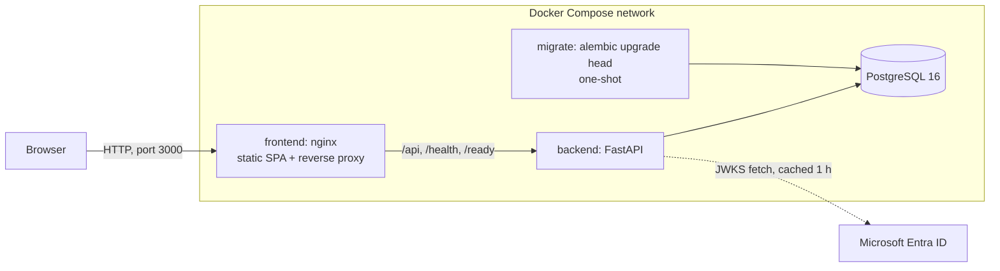
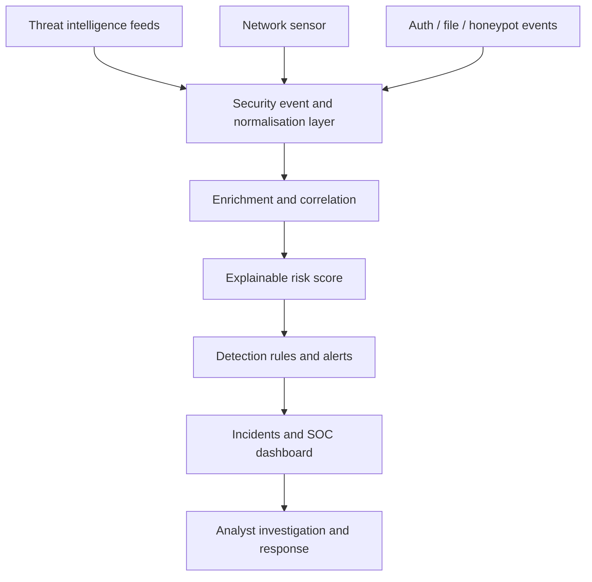

# Architecture

This document describes what is built (Phase 1) and how the remaining modules are intended to
plug in. Anything not built is labelled **planned**. The intended end state follows the project
specification; nothing planned here should be read as implemented.

## System context (Phase 1)



- The browser only talks to nginx. The SPA calls the API with relative URLs, so there is no CORS in
  the default deployment.
- nginx sets the security headers and the Content Security Policy for the static files and strips
  the duplicates the API adds, so each header appears once.
- The API reaches Entra ID only to download signing keys. Tokens are validated locally.
- Migrations are a separate one-shot step, not something the API does at startup.

## Target architecture (planned)



Only the first step for threat-intelligence feeds is the subject of Phase 2. The rest is not built.

## Module map

| Module | Purpose | Status | Where it will live |
| --- | --- | --- | --- |
| Core platform | Config, logging, auth, errors, health | **Phase 1 done** | `backend/app/core`, `security`, `api`, `database` |
| Intel | Threat-intelligence ingestion, IOC investigation, caching | Planned (Phase 2) | `collectors/`, `services/`, `api/v1/` |
| SOC | Command-centre UI, triage, analytics | Status page only; investigation UI planned (Phase 3) | `frontend/src` |
| Sentinel | Defensive network monitoring and anomaly detection | Not started | `sensor/`, `detection/` |
| Core (correlation) | Event normalisation, correlation, scoring, rules | Not started | `correlation/`, `detection/` |
| Case | Incidents, notes, timelines | Not started | `services/`, `models/` |
| Vault | Client-side encrypted file sharing | Not started; needs a threat model first | `docs/encryption-design.md` |

## Backend

`backend/app` is organised by responsibility, with one-way dependencies: `api` calls `services`,
which use `models`, `collectors` and `detection`; `core` and `security` are shared by everything.

| Package | Responsibility |
| --- | --- |
| `api/` | HTTP routes and request dependencies. No business logic. Versioned under `/api/v1`. |
| `core/` | Settings, structured logging and redaction, correlation ID context, error envelope, middleware. |
| `security/` | Entra ID token validation and role-based access control. |
| `database/` | Engine and session factory, the readiness probe. |
| `models/`, `schemas/` | SQLAlchemy tables and Pydantic request/response models. |
| `services/`, `collectors/`, `detection/`, `correlation/`, `workers/` | Placeholders for later phases. |

### Request lifecycle

`create_app` stacks the middleware so a request passes through, outermost first:

```text
CorrelationId -> SecurityHeaders -> RequestLogging -> CORS (only if configured)
              -> UnhandledException -> router -> endpoint
```

- **CorrelationId** accepts an incoming `X-Correlation-ID` only if it matches `[A-Za-z0-9._-]{8,64}`
  (otherwise it generates one), so a client cannot inject log lines.
- **SecurityHeaders** adds `nosniff`, `X-Frame-Options: DENY`, `Referrer-Policy: no-referrer` and
  `Cache-Control: no-store`.
- **RequestLogging** writes one structured line per request (method, path, status, duration). It
  never logs query strings or bodies.
- **UnhandledException** turns any unexpected error into a generic 500, so the outer layers can
  still add headers and logging.

The middleware are plain ASGI rather than `BaseHTTPMiddleware`, so the correlation ID context
variable also reaches synchronous endpoints running in the thread pool.

### Errors

Every error uses one envelope: `{"error": {"code", "message", "correlation_id", "details?"}}`.
Validation errors (422) return only the location, message and type of each problem, never the
submitted value. A 500 never exposes internals.

### Authentication and authorisation

`AUTH_MODE=entra` validates Microsoft Entra ID access tokens: RS256 only, signature checked against
the tenant's cached JWKS, and `exp`, `iss`, `aud`, `sub` and `tid` required and verified.
`require_roles(...)` guards endpoints by role (`Admin`, `SecurityAnalyst`, `User`). `AUTH_MODE=dev`
returns a fixed local principal and is refused when `ENVIRONMENT=production`. The validator can be
injected into `create_app`, which is how the tests use generated keys instead of a real tenant.

Resource-level authorisation (for example per-file access in Vault) is not implemented and must be
designed with the feature that needs it.

### Data layer

SQLAlchemy 2 with Alembic. Constraint names follow a naming convention so migrations stay
deterministic. Unit tests run on SQLite; a PostgreSQL test (enabled with `TEST_DATABASE_URL`)
exercises upgrade and downgrade on the real engine. Production requires PostgreSQL.

## Frontend

React 19 and TypeScript, built with Vite and styled with Tailwind CSS.

```text
pages/        route-level screens (StatusPage)
features/     domain logic with no React (overallStatus)
hooks/        stateful logic (useServiceStatus polls every 30 s)
services/     the API client and per-resource services
components/   shared presentational components
types/        API types mirroring the backend schemas
```

All network access goes through `services/apiClient.ts`: relative URLs, a timeout, no caching,
runtime shape checks on responses, and errors that surface only the server's sanitised message and
correlation ID. A bearer token can be supplied from memory; tokens are never persisted.

## Design decisions

| Decision | Reason |
| --- | --- |
| App factory, no module-level `app` | Importing the module has no side effects; tests build apps with explicit settings. |
| Fail-closed settings | A missing or unsafe setting stops the API rather than weakening security silently. |
| Migrations as a separate step | No race between replicas, and the API process never changes the schema. |
| PostgreSQL as the cache for provider results (Phase 2) | The specification says not to add a queue or cache service just to make the MVP look complex. |
| `httpx2` instead of `httpx` | The maintained continuation of HTTPX; Starlette's test client prefers it. Provider adapters will use it. |
| TypeScript pinned to 6.0.3 | The latest stable `typescript-eslint` does not yet support TypeScript 7. |
| Exact version pins | Reproducible builds; Dependabot proposes updates and CI vets them. |

## How later phases plug in

1. **Collectors** (`collectors/`) wrap one provider each behind a common interface and return a
   normalised observation. They are tested against recorded responses, never live APIs.
2. **Services** (`services/`) orchestrate collectors, persistence, caching and scoring.
3. **Detection rules** (`detection/`) live in one place, not in controllers or UI code.
4. **Workers** (`workers/`) appear only when scheduled refresh or correlation needs them.
5. Detection and response stay separate: the platform recommends actions and does not block
   anything automatically.
