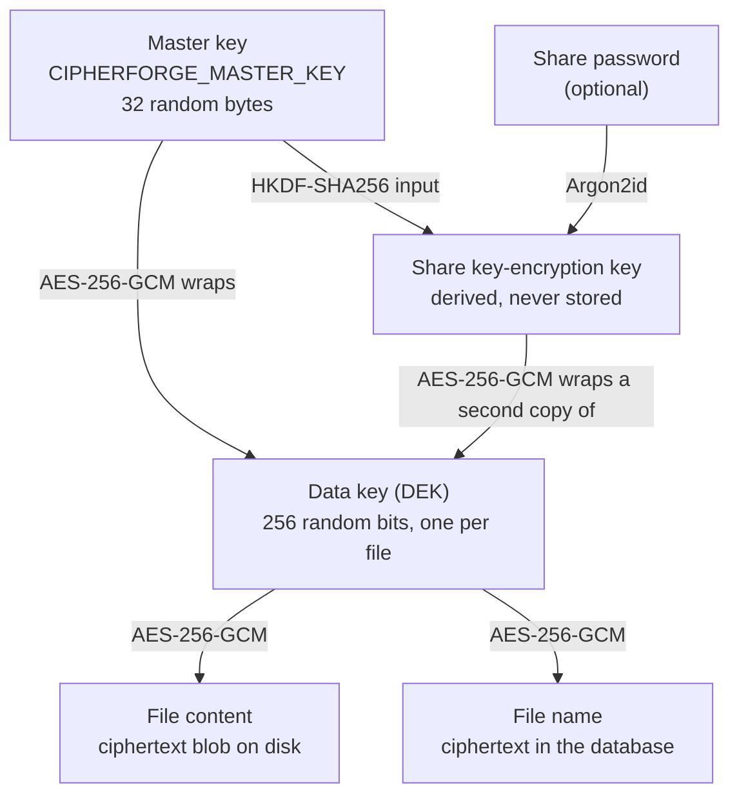

# Encryption design

Part of [CipherForge](../README.md). This page is the authoritative description of how
[encrypted file sharing](file-sharing.md) uses cryptography. How the feature behaves (links, limits,
audit events) is in [file-sharing.md](file-sharing.md); the threats it was designed against are in
[threat-model.md](threat-model.md); the full list of security controls and limitations is in
[security.md](security.md).

**Status.** Implemented: server-side envelope encryption with AES-256-GCM, a per-file key, a master
key held outside the database, and optional Argon2id-protected share passwords. Not built: end-to-end
(client-side) encryption, master-key rotation or recovery, a hardware security module or
key-management service (the key comes from the environment until the Azure phase adds a secret store),
and secure wiping of deleted blobs. No independent cryptographic review has been done. The overall
plan is in [project-status.md](project-status.md#not-implemented-yet).

## Summary

- Every file gets its own random 256-bit **data key**. The data key encrypts the file content and the
  file name with AES-256-GCM.
- The data key is itself encrypted ("wrapped") with a **master key** that the API reads from the
  `CIPHERFORGE_MASTER_KEY` setting. The application never writes the master key to the database or to
  a file, and it never appears in a response or log.
- A share link may have a password. The password does not replace the master key: the key that opens a
  password link is derived from **both** the password (through Argon2id) and the master key.
- Every ciphertext is bound by its associated data to the row it belongs to, so stored values cannot
  be swapped between files, links or purposes without detection.
- The encryption is **server-side**. The API sees plaintext while it encrypts and decrypts. This
  protects stored data (a copied database, a copied blob directory, a tampered file), not data in use.

## Key hierarchy



| Key or secret | Size and source | Where it lives | What it protects |
| --- | --- | --- | --- |
| Master key | 32 random bytes, base64url in the environment | The API process environment, or the secret store that fills it. Never in the database, never in a blob. | Wraps every data key. Is part of every password share's key-encryption key. Its fingerprint (`key_id`) is stored with each file. |
| Data key (DEK) | 256 random bits per file (`secrets.token_bytes`) | In the database, only in wrapped form (`encrypted_files.wrapped_dek`). In memory while a request runs. | The content and the name of one file. |
| Share key-encryption key | 256 bits, derived per password share | Never stored. Derived on demand. | A second wrapped copy of the file's data key (`file_shares.password_wrapped_dek`). |
| Share token | 256 random bits (`secrets.token_urlsafe(32)`, 43 characters) | With the link holder. The database keeps only its SHA-256 hash. | Authorises requests to the public endpoints. It is a bearer secret, not an encryption key. |

## Algorithms and parameters

| Purpose | Algorithm | Parameters |
| --- | --- | --- |
| Content, name and key wrapping | AES-256-GCM (`cryptography`, `AESGCM`) | 256-bit key, 96-bit random nonce, 128-bit tag |
| Password stretching | Argon2id (`cryptography`, `Argon2id`) | time cost 3, memory 64 MiB (65 536 KiB), 1 lane, 16-byte random salt, 32-byte output |
| Key-encryption key | HKDF-SHA256 | input = Argon2id output followed by the master key, no salt, `info` = `cipherforge-share-kek-v1\|` followed by the share id |
| Master-key fingerprint | HMAC-SHA256 | key = master key, message = `cipherforge-key-id-v1`, first 16 hex characters kept |
| Token storage | SHA-256 | of the 43-character token; the token has 256 bits of entropy, so no salt or slow hash is needed |
| Password normalisation | Unicode NFKC, then UTF-8 | so visually identical passwords give the same key |

The Argon2id cost follows the memory-constrained option in RFC 9106 (three passes over 64 MiB), but
with one lane where the RFC's option uses four, so a single derivation runs on one thread. The
parameters are stored with every password share, so the defaults can change later without
breaking existing links. When they are read back from the database they are checked against hard
limits (time cost at most 10, memory at most 256 MiB, at most 8 lanes, salt of 8 to 64 bytes), so a
tampered row cannot make the server allocate gigabytes or spin for minutes.

The ciphers and key-derivation functions come from the `cryptography` package. The HMAC and the
SHA-256 hash come from Python's standard library (`hmac`, `hashlib`), and random values from
`os.urandom` and `secrets`. The project does not implement any cipher, mode or key-derivation
function itself.

## How a file is encrypted

1. The service creates the file's id (a UUID) **before** encrypting, because the id is bound into every
   ciphertext.
2. It draws a fresh 256-bit data key and a random 96-bit nonce, and encrypts the content with
   AES-256-GCM. The result is the ciphertext followed by its 16-byte tag; that is exactly what is
   written to the blob.
3. It encrypts the file name with the same data key and a separate nonce. If the two nonces were ever
   equal the second is drawn again, so a (key, nonce) pair is never used twice.
4. It wraps the data key with the master key. The stored value is the nonce (12 bytes), the encrypted
   key (32 bytes) and the tag (16 bytes): 60 bytes.
5. It stores the blob, then the row: owner, plaintext size, the content nonce, the wrapped key, the
   master-key fingerprint, the name nonce and the encrypted name.

Decryption reads the whole blob, decrypts it in one operation and verifies the tag before any plaintext
is used. Nothing is sent to the client before verification has succeeded.

### Binding ciphertexts to their rows

Each AES-GCM operation authenticates "associated data" in addition to the message. The associated data
is a fixed label followed by the raw 16 bytes of the relevant UUIDs:

| Ciphertext | Associated data |
| --- | --- |
| File content | `cipherforge/file/v1\|` + file id |
| File name | `cipherforge/name/v1\|` + file id |
| Data key wrapped by the master key | `cipherforge/dek/v1\|` + file id |
| Data key wrapped by a share key | `cipherforge/share-dek/v1\|` + share id + file id |

Because of this, a blob copied to another file's row, a wrapped key moved to another file, and a
content ciphertext presented as a name all fail authentication even though the key is right. The labels
carry a version (`v1`) so a later format can be told apart.

### Nonces

Nonces are 96-bit random values from `os.urandom`. Each data key is used for exactly two messages
(content and name) and is never reused across files. The master key wraps one data key per file with a
fresh random nonce; NIST SP 800-38D allows up to 2^32 random-nonce invocations under one key, which is
far beyond the number of files this application is meant to hold. A password share's key-encryption key
is unique to that share (random salt, share id in the derivation) and encrypts a single message.

## Password-protected shares

A link without a password is opened by the server alone: the server unwraps the data key with the master
key when a valid token arrives. A password link adds a second requirement.

```text
stretched = Argon2id(NFKC(password), salt, time 3, memory 64 MiB, lanes 1)
kek       = HKDF-SHA256(ikm = stretched || master key, info = "cipherforge-share-kek-v1|" || share id)
wrapped   = AES-256-GCM(kek, data key, aad = "cipherforge/share-dek/v1|" || share id || file id)
```

- **The master key is part of the key-encryption key on purpose.** Someone who copies only the database
  has the salts and wrapped keys but cannot test password guesses, because they lack the master key.
  A password link is therefore never weaker than the file's at-rest protection.
- **No password and no password hash is stored.** A wrong password gives a different key, the AES-GCM
  tag does not verify, and the request is refused. The tag check says nothing about *which* input was
  wrong.
- **The same data key is wrapped twice**, once under the master key (so the owner and passwordless
  links can open it) and once per password link under that link's key.
- **Cost control.** At most two Argon2id derivations run at the same time in the process. Further
  requests wait up to ten seconds and then answer `503 service_busy`. Wrong guesses are rationed by a
  budget that is spent **before** the derivation runs; see
  [file-sharing.md](file-sharing.md#passwords).
- **Password rules.** 8 to 128 characters. Text that cannot be encoded as UTF-8 (lone surrogates) can
  never have been set as a password and is simply treated as wrong.

## Share tokens

A token is 32 random bytes encoded as 43 URL-safe characters. It is shown to the owner once, when the
link is created. The database stores only its SHA-256 hash, so a database dump cannot be used to
download a file. Because the token has 256 bits of entropy, a fast hash is sufficient; a slow hash
would only add cost to every request. A token is checked for shape (43 characters of `A-Za-z0-9_-`)
before the database is touched. The link is then found by looking up the hash of the presented token
(`token_hash` is unique): the code has no hand-written comparison of token values. The only
constant-time comparison in the module is the one of the key fingerprint below.

Tokens appear in URL paths. The API masks the path segment after `/shares/` and `/share/` in its own
request and access logs (`backend/app/files/logsafe.py`). Reverse proxies need their own redaction; see
[deployment.md](deployment.md).

## The master key

The master key is used directly for three things: it is the AES-256-GCM key that wraps every data key,
the HMAC key of the fingerprint described below, and half of the HKDF input of every password link. It
is not split into one derived key per purpose. The three uses are kept apart by their own labels (the
associated data, the fingerprint label and the HKDF `info`), and the fingerprint is one-way and
truncated. No independent review has looked at this choice.

### Generating and storing it

```powershell
python -c "import base64,secrets; print(base64.urlsafe_b64encode(secrets.token_bytes(32)).decode())"
```

The setting must decode to exactly 32 bytes and must contain at least eight different byte values (a
crude guard against placeholders such as all zeros). A blank value leaves the feature off. A malformed
value stops the API from starting, and the error names the setting but never prints the value. The key
is held in a `SecretStr`, so it is excluded from settings output and is part of the exact-value
redaction the logging layer applies to every configured secret.

For local use the key goes in the git-ignored `.env`. For production use a managed secret store and
inject the value as an environment variable. Do not put it in an image, a compose file or the
repository. There is no integration with a hardware security module or a key-management service: the
API reads the key from its environment when it starts. A secret store (Azure Key Vault) is part of the
planned Azure phase.

### Fingerprint and mismatch detection

Each file stores `key_id`, the first 16 hex characters of an HMAC of a fixed label under the master key.
It reveals nothing useful about the key (it is a one-way function of it) and lets the server tell two
situations apart:

- the stored `key_id` differs from the configured key's: the **wrong key** is configured. The answer is
  `503 encryption_key_mismatch`, the file is **not** quarantined, and restoring the right key fixes it;
- `key_id` matches but the wrapped key or the ciphertext does not verify: the **data is damaged**. The
  file is quarantined (see [file-sharing.md](file-sharing.md#integrity-failures)).

The comparison uses `hmac.compare_digest`.

### Loss, backup and rotation

- **Loss.** If the master key is lost, every file is permanently unreadable. There is no recovery path
  and no escrow. Back it up separately from the database and the blob directory.
- **Backup consistency.** A restore needs the database, the blob directory and the key from the same
  point in time.
- **Rotation is not implemented.** There is no command that re-wraps data keys under a new master key.
  `key_id` records which key wrapped each file, which a future tool could use to find the files that
  still use an old key. Because the master key is also part of every password link's key-encryption
  key, a rotation could re-wrap the data keys but could **not** re-wrap password links, since the
  server never holds the passwords. Those links would have to be created again.
- **Compromise.** Someone who obtains the master key together with the database and the blob directory
  can read every file. Someone who obtains the master key and the database can additionally try
  passwords against password links offline, at the Argon2id cost per guess.

## Integrity and failure behaviour

| Event | What the server does |
| --- | --- |
| A tag fails to verify (content, name or wrapped key) | The file is quarantined (`status = corrupt`), `FILE_INTEGRITY_FAILED` is written to the audit trail, the request answers `409 file_unavailable`, and no download is consumed. |
| The blob is missing, is a link or another non-regular file, or has a different size than recorded | The same as above. The size is checked before decryption. |
| The blob exists but cannot be read (permissions, disk error) | `503 storage_unavailable`. This is not evidence of tampering, so there is no quarantine, no audit row and no download is consumed. |
| The configured key is not the one that encrypted the file | `503 encryption_key_mismatch`, no quarantine. |
| A password is wrong | `403 invalid_password`, one attempt spent from the budget, no quarantine. |
| Stored Argon2id parameters or salt are out of bounds | The link is refused as `file_unavailable` and the attempt is handed back. |

## Secrets in logs, errors and memory

- Exceptions raised by the crypto layer carry fixed messages. None includes an input, a key, a
  password or plaintext.
- The file service logs identifiers (file id, share id) and exception **class names**. Database errors
  are turned into a generic `500 internal_error` and only the class name is logged, because SQLAlchemy
  error text embeds bound parameters such as wrapped keys and token hashes.
- Passwords are `SecretStr` in the request models. Validation errors for a download body report the
  location and the type of the problem, never the submitted value.
- Download responses carry `Cache-Control: no-store`.
- Python cannot reliably erase secrets from memory, and the operating system may write memory to a swap
  file. Key material and plaintext live in memory for the duration of a request.

## What this does not protect against

- **The server itself.** It holds the master key and sees plaintext when a file is uploaded and when it
  is downloaded. An attacker who controls the running API process, or who can read its environment, can
  read every file.
- **A compromised host or operator.** The same applies to a person with access to the host, the process
  memory, the environment or the secret store.
- **Loss of the key.** See above; there is no escrow.
- **Metadata.** File size, owner, creation time, link settings and audit rows are stored in plaintext.
  Only the content and the original file name are encrypted.
- **Transport.** TLS is what protects a file between the browser and the API. The API does not
  terminate TLS itself; see [deployment.md](deployment.md).
- **Secure deletion.** Deleting a file removes the blob and the row (including the wrapped key). It does
  not overwrite disk blocks, and copies in backups, snapshots or on solid-state storage may remain.
  Without the master key those copies are ciphertext.
- **Link sharing mistakes.** Anyone who has a link and its password (if any) can download within the
  link's limits. The link is a bearer secret.
- **Malicious content.** Files are opaque bytes. They are not scanned.

## Planned: end-to-end encryption

This section keeps the original design intent for the feature. **None of it is implemented.**

The original proposal was that the application server should never receive plaintext: the client
generates a random key per file, encrypts with an authenticated cipher (AES-256-GCM) before upload,
stores the ciphertext, wraps the per-file key for each intended recipient and lets a recipient decrypt
locally. That needs recipient public keys, a way to authenticate them and bind them to identities,
client-side key storage and a recovery policy, none of which exist. What is built is a simpler,
different design: server-side envelope encryption with link-based sharing. CipherForge does not claim
end-to-end encryption and must not, until such a design has been threat-modelled and reviewed.

Rules from the original page that still apply to any cryptographic code in the project:

- Use established, maintained libraries and **never implement a cipher, mode, key exchange or
  key-derivation function by hand**.
- Never hard-code keys, and never put key material or plaintext in logs, error messages or the audit
  trail. The log redaction layer is a safety net, not a design.
- TLS stays mandatory. TLS protects transport and server-side storage encryption protects stored data;
  neither is end-to-end encryption.

### Status of the original open questions

| Topic | Where it stands |
| --- | --- |
| Nonce and IV handling | Decided: random 96-bit nonces, one data key per file, see [Nonces](#nonces). |
| Recipient keys | Not applicable to the current design (no recipient keys; a link token and an optional password). Open for any end-to-end design. |
| Key wrapping | Decided: AES-256-GCM under the master key with associated data, from the `cryptography` package. |
| Key lifecycle | Partly decided. Links can be revoked individually. Master-key rotation and recovery are not implemented, see [Loss, backup and rotation](#loss-backup-and-rotation). |
| Deletion | Decided and limited: the blob and the key row are removed; no secure wipe, see above. |
| Compromised client | Out of scope: the server decrypts. |
| Metadata | Documented above. The server stores size, owner, time and link rules in plaintext. |
| Audit | Decided: every file and link action is recorded without secrets, see [file-sharing.md](file-sharing.md#audit-events). |

Still to do before any stronger claim is made: an independent review of the design, a threat model
specific to an end-to-end variant, and known-answer tests against published test vectors.

## How it is tested

The tests live in `backend/tests/test_files_crypto.py`, `test_files_service.py`, `test_files_api.py`,
`test_files_audit.py`, `test_files_security.py`, `test_files_storage.py`, `test_files_attempts.py` and
`test_files_names.py`. For the cryptography they cover:

- round trips of content and names, empty content, and that ciphertext hides both;
- the stored layout, checked by decrypting with plain `AESGCM` and the documented associated data, and
  the password derivation, recomputed independently with Argon2id and HKDF, so any drift from this page
  is caught;
- unique nonces and keys, flipped bits, truncation and extension, a wrong or malformed nonce, tampered
  names and wrapped keys, and swapping every stored field between two files;
- wrong master key versus damaged data, key sizes, password normalisation, salts and Argon2id
  parameters outside the accepted range, and the limit of two concurrent derivations;
- token shape, hashing and that exception messages contain no secrets.

The suite relies on the `cryptography` package for the primitives. It does not include published
known-answer vectors for AES-GCM, Argon2id or HKDF. How to run the tests is in
[testing.md](testing.md).

## Where the code is

| What | Where |
| --- | --- |
| Primitives, key wrapping, password derivation, tokens | `backend/app/files/crypto.py` |
| Use of the primitives in uploads, links and downloads | `backend/app/files/service.py` |
| Master-key validation and `master_key` property | `backend/app/core/config.py` |
| Stored columns | `backend/app/models/files.py`, migration `0005_encrypted_files` |
