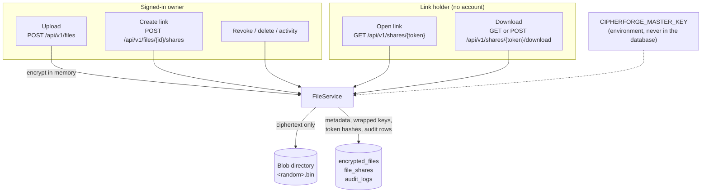

# Encrypted file sharing

Part of [CipherForge](../README.md). Related pages: the cryptography and key handling are in
[encryption-design.md](encryption-design.md), the HTTP endpoints in [api.md](api.md), where the
module sits in the system in [architecture.md](architecture.md), install and settings in
[setup.md](setup.md), proxy and volume requirements in [deployment.md](deployment.md), and the
screen walkthrough in [user-guide.md](user-guide.md).

Encrypted file sharing lets a signed-in user keep a file on the CipherForge server in encrypted form
and hand it to someone else through a **share link**. The link can expire, can be limited to a number
of downloads, can require a password, and can be revoked. Every use of a link is written to the audit
trail. The person who opens a link does not need an account.

The encryption is **server-side**: the API receives the file in plaintext over TLS, encrypts it in
memory and stores only ciphertext. It is not end-to-end encryption, and the server can decrypt every
file it holds. See [What this does not protect against](encryption-design.md#what-this-does-not-protect-against).

## At a glance

| | |
| --- | --- |
| Who can use it | Any signed-in role (User, Security Analyst, Admin) for their own files. Link holders are anonymous. |
| Where | The **Files** page (`/files`) for owners, the **share page** (`/share/<token>`) for link holders, and the `/api/v1/files` and `/api/v1/shares` endpoints. |
| Switched on by | Setting `CIPHERFORGE_MASTER_KEY`. Without it the rest of the application works and this feature reports itself as not configured. |
| What is stored | Ciphertext in files on disk, and in the database the owner, size, encrypted file name, wrapped key, and the share rules. Never the plaintext content, never the plaintext name, never a link token. |
| Default limits | 25 MiB per file (`MAX_ENCRYPTED_FILE_SIZE_MB`, which can be set from 1 to 100), links valid for 24 hours by default and for 720 hours at most (`MAX_SHARE_EXPIRY_HOURS`), one download per link unless more are asked for, and 100 at most (`MAX_SHARE_DOWNLOADS`). |
| Algorithm | AES-256-GCM for content, names and keys. Argon2id for share passwords. Details in [encryption-design.md](encryption-design.md). |

## How it works



1. **Upload.** The owner sends the raw bytes of the file. The service creates a random 256-bit key
   for that file, encrypts the content and the file name with it, wraps the key with the master key,
   writes the ciphertext to a randomly named blob, and records the metadata. Plaintext is never
   written to disk, not even to a temporary file.
2. **Share.** The owner creates a link with an expiry time, a download limit and optionally a
   password. The server generates a 256-bit random token, returns it once, and keeps only its
   SHA-256 hash.
3. **Open.** Anyone with the link can ask what it offers (size, expiry, downloads left, whether a
   password is needed). That request does not use up a download.
4. **Download.** The server checks the link against the rules below, decrypts the **whole** file and
   verifies its authentication tag, and only then takes one download from the counter and sends the
   bytes.
5. **Revoke or delete.** The owner can revoke a single link or delete the file, which removes the
   ciphertext, the key material and all of its links.

## Turning it on

1. Generate a master key (32 random bytes, base64url) and keep a copy somewhere safe:

   ```powershell
   python -c "import base64,secrets; print(base64.urlsafe_b64encode(secrets.token_bytes(32)).decode())"
   ```

2. Put it in `.env` as `CIPHERFORGE_MASTER_KEY=<the value>` and restart the API. In production keep
   it in a managed secret store instead of a file.
3. Check `GET /api/v1/files/status`. It answers `"configured": true` and lists the limits that apply.
   The Files page shows a notice instead of the upload form while `configured` is `false`.

**Back the key up.** Files cannot be decrypted without it, and there is no recovery. A blank value
leaves the feature off. A value that is not 32 bytes of base64url, or that does not look random, stops
the API from starting. A valid key that is *different* from the one that encrypted existing files does
not stop the API: those files then answer `503 encryption_key_mismatch` until the original key is
restored (see [When something goes wrong](#when-something-goes-wrong)).

The settings that control the feature are listed in [setup.md](setup.md#environment-variables):
`CIPHERFORGE_MASTER_KEY`, `ENCRYPTED_FILE_STORAGE_PATH`, `MAX_ENCRYPTED_FILE_SIZE_MB`,
`DEFAULT_SHARE_EXPIRY_HOURS`, `MAX_SHARE_EXPIRY_HOURS`, `MAX_SHARE_DOWNLOADS`,
`FILE_UPLOAD_RATE_LIMIT_PER_MINUTE`, `SHARE_CREATE_RATE_LIMIT_PER_MINUTE`,
`SHARE_DOWNLOAD_RATE_LIMIT_PER_MINUTE` and `SHARE_PASSWORD_ATTEMPT_LIMIT`. Out-of-range values stop
the API from starting, and so does a `DEFAULT_SHARE_EXPIRY_HOURS` that is longer than
`MAX_SHARE_EXPIRY_HOURS`.

## Uploading a file

The upload is the raw file body with `Content-Type: application/octet-stream` and the original name,
percent-encoded, in the `X-File-Name` header. `multipart/form-data` is refused with `415` on purpose:
its parser writes larger parts to temporary files, which would put plaintext on disk before it is
encrypted.

```powershell
curl.exe -X POST http://127.0.0.1:8000/api/v1/files `
  -H "Authorization: Bearer $env:TOKEN" `
  -H "Content-Type: application/octet-stream" `
  -H "X-File-Name: report.pdf" `
  --data-binary "@report.pdf"
```

- The size limit is applied to the declared `Content-Length` before any byte is read, and again as
  the stream arrives, so a chunked upload cannot get around it (`413 file_too_large`). An empty file
  is refused (`422 empty_file`).
- The name is cleaned before it is encrypted: Unicode-normalised, reduced to its last path component,
  control and bidirectional-override characters removed, characters Windows forbids replaced with
  `_`, leading and trailing spaces and dots removed, reserved device names such as `CON` prefixed with
  `_`, and shortened to 255 characters while keeping the extension. The header must appear exactly
  once, be at most 1024 ASCII characters and be valid percent-encoded UTF-8; anything else, or a name
  that is empty after cleaning, is `422 invalid_filename`. The cleaning lives in
  `backend/app/files/names.py`.
- Uploading the same name twice creates two independent files. Nothing is overwritten.
- The request is limited per user (`FILE_UPLOAD_RATE_LIMIT_PER_MINUTE`, default 10).
- The whole file is held in memory while it is encrypted, so memory use is bounded by the size limit.

## Creating a share link

`POST /api/v1/files/{file_id}/shares` takes an optional body:

| Field | Default | Rule |
| --- | --- | --- |
| `expires_in_hours` | `DEFAULT_SHARE_EXPIRY_HOURS` (24) | 1 up to `MAX_SHARE_EXPIRY_HOURS` (720). |
| `max_downloads` | 1 | 1 up to `MAX_SHARE_DOWNLOADS` (100). |
| `password` | none | 8 to 128 characters. An empty string is invalid; leave the field out for no password. |

The response contains the share record and the token, once:

```json
{ "share": { "id": "…", "status": "active", "downloads_remaining": 1, "password_protected": false },
  "token": "…43 characters…",
  "path": "/share/<token>" }
```

The dashboard builds the full link from its own address and the `path`. After this response the token
cannot be shown again, because only its SHA-256 hash is stored. If it is lost, revoke the link and
create a new one. The link holds neither a key nor the password: the key stays on the server.

Creating a link is limited per user (`SHARE_CREATE_RATE_LIMIT_PER_MINUTE`, default 10). A password link
costs one Argon2id derivation, and those share a small number of slots with password downloads, so
the limit stops one user from taking them all. A file that has been quarantined (see
[Integrity failures](#integrity-failures)) cannot be shared.

## Opening and downloading a link

Link holders need no sign-in and no cookie. Possession of the 256-bit token is the credential.

- `GET /api/v1/shares/{token}` returns the file size, the expiry time, the downloads left and whether a
  password is needed. The file name is included only for links **without** a password; for a password
  link it is withheld until the password has been accepted.
- `GET /api/v1/shares/{token}/download` downloads a link without a password.
- `POST /api/v1/shares/{token}/download` downloads a link with or without a password. The password goes
  in a small JSON body (`{"password": "…"}`, at most 4096 bytes) and never in a URL. A password link
  asked through `GET` answers `403 password_required`.

The download response is `application/octet-stream`. It carries `Content-Disposition: attachment`
with an ASCII fallback name plus an RFC 8187 `filename*`, and the headers
`X-Content-Type-Options: nosniff`, `Cache-Control: no-store`,
`Content-Security-Policy: default-src 'none'; sandbox` and `Referrer-Policy: no-referrer`, so a
browser treats the bytes as an opaque download.

### The checks, in order

Every public request goes through the same gate. The first failing step ends the request, so a link
that is both revoked and expired reports `revoked`. Every refusal of a link that **exists** is written
to the audit trail; requests for tokens that do not exist are not, so an anonymous caller cannot fill
the audit trail with noise. Opening the information page of a revoked, expired or used-up link is a
refusal too and is recorded the same way.

| # | Check | Answer when it fails |
| --- | --- | --- |
| 1 | Per-client request rate (`SHARE_DOWNLOAD_RATE_LIMIT_PER_MINUTE`, default 30; IPv6 clients are counted per `/64`) | `429 rate_limited` with `Retry-After` |
| 2 | The token has the right shape (43 URL-safe characters) | `404 share_not_found` |
| 3 | A link with that token exists | `404 share_not_found` |
| 4 | Not revoked | `410 share_revoked` |
| 5 | Not expired | `410 share_expired` |
| 6 | Downloads used are below the limit | `410 share_limit_reached` |
| 7 | The file exists and is not quarantined | `409 file_unavailable` |
| 8 | A master key is configured | `503 feature_not_configured` (not audited) |
| 9 | The master key is the one that wrapped this file | `503 encryption_key_mismatch` |
| 10 | Password links: a password was sent, the wrong-password budget is not spent, and the password opens the key | `403 password_required`, `429 too_many_attempts`, `403 invalid_password` |
| 11 | The blob is read, and the whole file and name decrypt and verify | `409 file_unavailable` and the file is quarantined ([Integrity failures](#integrity-failures)) |
| 12 | One download is reserved with a single conditional database update | the same answers as steps 4 to 6, or `409 file_unavailable` if none of those explains the lost slot |
| 13 | The reservation and its audit row are committed | Only now are bytes returned |

Steps 1 and 2 need no database access and step 3 is one lookup by the hash of the token (an equality
match on the stored SHA-256 value), so a flood of random tokens costs little. Steps 4 to 6 compare the
link against the server's clock; times are stored in UTC. The information page runs steps 1 to 9 and,
for a link without a password, also decrypts the file name; only a download runs all thirteen.

A blob that cannot be read because the storage itself fails (permissions, a full or missing disk) is
not an integrity failure: the answer is `503 storage_unavailable`, no audit row is written, the file
is not quarantined and no download is used.

### Download limits stay exact under load

Step 12 is the part that makes `max_downloads` reliable. The server decrypts and verifies first,
then tries `UPDATE file_shares SET download_count = download_count + 1 WHERE download_count <
max_downloads AND revoked_at IS NULL AND expires_at > now`. If two people ask for the last download at
the same moment, both decrypt, the database lets exactly one update through, and the other receives
`410 share_limit_reached` with its plaintext discarded. A request that fails an integrity check or
supplies a wrong password never uses a download.

### Passwords

A password link is protected by a second key derived from the password (Argon2id) and the server's
master key. No password and no password hash is stored; a wrong password simply fails to open the key.
The details are in [encryption-design.md](encryption-design.md#password-protected-shares).

Guessing is limited in two ways, counted over a 15-minute window:

- `SHARE_PASSWORD_ATTEMPT_LIMIT` (default 5) wrong passwords **per link**, and the same number per
  client network. When either budget is spent the request is refused with `429 too_many_attempts`
  before any expensive work runs.
- At most two Argon2id derivations run at once in the process. A request that waits more than ten
  seconds for a slot gets `503 service_busy`.

A correct password does not clear earlier failures, so someone who learns one password cannot keep
resetting the per-network counter. A spent budget stays spent until its oldest failure leaves the
window. Counters live in process memory, so they reset when the API restarts.

## Expiry, revocation and deletion

**Link status** is derived in this order of precedence, and the Files page shows it: `revoked`,
then `expired`, then `exhausted` (downloads used up), then `active`.

- **Expiry** is checked on every request against the server's clock (expiry times are stored in UTC).
  An expired link is not deleted automatically; it stays visible to the owner as `expired` and keeps
  its audit history.
- **Revocation** (`POST /api/v1/files/{file_id}/shares/{share_id}/revoke`) takes effect on the next
  request. It is idempotent: revoking a link twice changes nothing and writes one audit row.
- **Deleting a file** (`DELETE /api/v1/files/{file_id}`) removes the ciphertext blob first, then the
  database rows for the file and all its links, then records `FILE_DELETE`. If the blob cannot be
  removed the request fails with `503 storage_unavailable` and nothing else is deleted. The earlier
  audit rows for the file are kept; there is deliberately no way to delete audit rows.

## Who can see what

| Actor | Can do |
| --- | --- |
| The owner of a file | Upload, list, open, share, revoke and delete **their own** files, and read the activity of their own files. |
| Another signed-in user | Nothing with it. Another owner's file id answers `404 file_not_found`, exactly as an id that does not exist, so the answer does not reveal that the file exists. |
| A link holder | Open and download through the link, within the link's rules. Cannot list files, see other links of the file, or read the audit trail. |
| An administrator | Has no special access to other people's files through the API. Whoever controls the server, its database and its master key can of course decrypt everything. |

Ownership is the signed-in user's token subject (the `oid` claim when present, otherwise `sub`). With
`AUTH_MODE=dev` every request is the single fixed user `dev-user`, so ownership separation only has
meaning in Entra mode.

## Audit events

Every action below is written to the same audit trail as the rest of the application (timestamps are
UTC in the database and the API; the dashboard shows them in IST, see
[Time handling](architecture.md#time-handling-utc-storage-ist-display)). The target of each row is
`file:<file id>`.

| Action | Result | Recorded when | Details kept |
| --- | --- | --- | --- |
| `FILE_CREATE` | success | A file was encrypted and stored. | `size_bytes` |
| `FILE_DELETE` | success | The owner deleted a file. | `shares_removed` |
| `FILE_INTEGRITY_FAILED` | failed | Stored data failed verification or the blob was missing, and the file was quarantined. Recorded once, by the first request to notice. | `reason` (`wrapped_key_invalid`, `authentication_failed` or `blob_invalid`), and `share_id` when a link triggered it |
| `SHARE_CREATE` | success | The owner created a link. | `share_id`, `expires_at`, `max_downloads`, `password_protected` |
| `SHARE_REVOKE` | success | The owner revoked a link. Not repeated for a second revoke. | `share_id` |
| `SHARE_DOWNLOAD` | success | A download was reserved and committed. | `share_id` |
| `SHARE_DOWNLOAD_REJECTED` | rejected | A link that exists was refused: revoked, file unavailable, password required, or key mismatch. | `share_id`, `reason` |
| `SHARE_PASSWORD_FAILED` | rejected | A wrong password was sent. | `share_id`, `reason` |
| `SHARE_EXPIRED` | rejected | An expired link was used. | `share_id`, `reason` |
| `SHARE_LIMIT_REACHED` | rejected | A link that had used all its downloads was used again. | `share_id`, `reason` |

Link holders are recorded with the actor `anonymous`. The `reason` of a rejected row is one of
`revoked`, `expired`, `limit_reached`, `file_unavailable`, `password_required`, `invalid_password` or
`key_mismatch`. Each row also stores the client address the request came from, which is personal data
in many jurisdictions; the per-file **activity** view (`GET /api/v1/files/{file_id}/activity`)
therefore shows only time, action, result, link id and reason, newest first and at most 100 events,
and only to the file's owner.

Not recorded: file contents and names, passwords, tokens, and requests for tokens that do not exist.
Rejections for rate limiting (`429`), for too many wrong passwords and for an unconfigured feature are
not audited either; the individual wrong guesses that led to a lock-out are.

## Integrity failures

If a download finds that the stored data does not verify, the blob is missing, or the blob is not a
regular file of the expected size, the file is **quarantined**: its status becomes `corrupt`, a
`FILE_INTEGRITY_FAILED` row is written, the request answers `409 file_unavailable`, and no download
is consumed. Two other requests can find the same problem first: creating a link (the file's key must
unwrap) and opening the information page of a link without a password (the file name must decrypt).
A quarantined file refuses every further link use and cannot be shared again. It stays in
the owner's list so that the owner can see what happened and delete it. Restoring the blob from a
backup does not clear the status; delete the file and upload it again.

Quarantine is permanent on purpose: a file that failed authentication once is not served again until
a person has looked at why.

## Storage and cleanup

- Ciphertext lives in one flat directory (`ENCRYPTED_FILE_STORAGE_PATH`, default
  `backend/data/encrypted-files`, which is git-ignored; Docker Compose uses the named volume
  `encrypted_files`). Each blob is named `<32 hex characters>.bin` from a random generator, never from
  user input, and the name is checked again on every access.
- A blob holds only the ciphertext and its 16-byte authentication tag. The database row records the
  expected size, so a truncated or padded blob is detected before decryption.
- A write goes to a temporary `.tmp-*` file, is flushed to disk, and is moved into place with an atomic
  rename, so a reader sees all of a blob or none of it. A process crash in the middle of a write can
  leave an unused `.tmp-*` file behind; nothing removes it automatically, and it can be deleted
  by hand.
- Reads refuse symbolic links and other non-regular files, and re-check the file after opening it.
- On POSIX systems the directory is created with mode `0700`, and an existing directory with wider
  permissions is tightened to it (a warning is logged if that fails). On Windows no mode is set: the
  directory inherits the access rules of its parent, so restrict them yourself.
- If the database insert fails after the blob was written, the blob is removed again. If that removal
  fails too, the unreferenced blob stays (the API logs `blob_cleanup_failed`) and nothing removes it
  automatically.
- **What is cleaned up, and what is not.** Deleting a file removes its blob, its links and its row, and
  a failed write removes its own temporary file. Nothing else is removed automatically: expired and
  revoked links stay in the database (they go when their file is deleted), and so do `.tmp-*` files
  left by a crash and blobs left by a failed clean-up. Deleting a blob only unlinks it. It is not
  overwritten (no secure wipe), so ciphertext can remain on the disk, in snapshots or in backups. It
  cannot be decrypted without the file's wrapped key and the master key, but a database backup taken
  earlier still holds the wrapped key.
- A **backup** is only useful if it contains the database, the blob directory **and** the master key,
  taken so that they match. Restoring the database without the blobs leaves files that answer
  `409 file_unavailable`; restoring them with a different master key leaves files that answer
  `503 encryption_key_mismatch`.

Expired links and old files are not removed automatically in this version. See
[Limitations](#limitations).

## When something goes wrong

| What you see | Meaning | What to do |
| --- | --- | --- |
| Files page says file sharing is not configured, or `503 feature_not_configured` | `CIPHERFORGE_MASTER_KEY` is blank or unset. | Generate a key as shown in [Turning it on](#turning-it-on), set it, restart the API. |
| The API does not start and mentions the master key | The value is not 32 bytes of base64url, or looks non-random. | Generate a new key with the command above. If files already exist, use the **original** key instead of a new one. |
| `503 encryption_key_mismatch` | The configured key is not the key that encrypted this file. | Restore the original key. Do not generate a new one: files encrypted under the old key stay unreadable. |
| `422 empty_file`, `413 file_too_large`, `415 unsupported_media_type`, `422 invalid_filename` | The upload broke a rule in [Uploading a file](#uploading-a-file). | Fix the request. Behind a reverse proxy, also check its body-size limit ([deployment.md](deployment.md)). |
| `503 storage_unavailable` | The blob directory cannot be written or read (permissions, full disk, missing volume). | Check the path, free space and permissions. Nothing is stored in this state. |
| `409 file_unavailable` | The file failed authentication or its blob is missing, and it is quarantined. | Delete the file and upload it again. The audit trail shows `FILE_INTEGRITY_FAILED` with the reason. |
| `500 internal_error` on a file or link request | Either a database error in the file service (message "The request could not be completed."; the log has only the exception type, because database error text can contain key material), or any other unexpected failure (message "An internal error occurred."). | Check the database and the API log. |
| `410 share_expired` | The link's time is up. | The owner creates a new link. |
| `410 share_revoked` | The owner revoked the link. | The owner creates a new link if access is still wanted. |
| `410 share_limit_reached` | All downloads of this link were used. | The owner creates a new link. |
| `403 password_required` / `403 invalid_password` | The link needs a password, or the one sent is wrong. | Send the correct password in the POST body. |
| `429 too_many_attempts` | The wrong-password budget for this link or network is spent. | Wait for `Retry-After`; the window is 15 minutes. |
| `429 rate_limited` | Too many requests from this user or client. | Wait for `Retry-After`. |
| `503 service_busy` | All password-derivation slots were busy for ten seconds. | Retry in a moment. |

For environment problems around the key, volume and proxy, see also
[setup.md](setup.md#common-setup-problems).

## Limitations

These follow from the current design and are not hidden.

- **Server-side, not end-to-end.** The server sees plaintext during upload and download and holds the
  master key. See [encryption-design.md](encryption-design.md).
- **No independent review.** Nobody outside this project has reviewed the design or the code. See
  [threat-model.md](threat-model.md).
- **No master-key rotation.** There is no tool to re-wrap existing files under a new key, and no
  recovery if the key is lost: the files become unreadable.
- **Single API process.** Rate limits and the wrong-password budget are counted in process memory, so
  they reset on restart and are not shared between workers. Run one API worker for this feature.
- **Memory.** A file is encrypted and decrypted in memory, so memory use grows with the size limit
  (up to 100 MiB per request at the maximum setting). Python cannot reliably erase secrets from
  memory after use.
- **No automatic clean-up.** Expired and revoked links, files that nobody deleted, leftover `.tmp-*`
  files after a crash and blobs left behind by a failed clean-up stay until someone removes them.
  The owner deletes files and links; the other leftovers must be removed by hand.
- **No secure wipe.** Deleting a file unlinks its blob without overwriting it. Ciphertext can remain
  in free disk space, snapshots and backups.
- **No per-user quota.** The limits are the size of one file and the upload rate. Nothing caps the
  number or total size of the files one user keeps, so watch the volume's free space.
- **Quarantine needs the owner.** A `corrupt` file is refused until the owner deletes it.
- **Audit flooding.** A link holder can add audit rows for a link that exists, bounded only by the
  per-client rate limit.
- **Reverse proxies see tokens.** The API masks share tokens in its own logs. A proxy or load balancer
  that logs request URLs will record them unless it is configured not to; the bundled nginx
  configuration redacts them in its access log but not in its error log. See
  [deployment.md](deployment.md).
- **No virus scanning, no content inspection, no previews.** Files are opaque bytes. No inbound
  scanning is performed on upload.
- **No sharing with named users.** A link is the only way to share; there are no recipient accounts.
- **Metadata is visible to the server.** File size, owner, creation time and link rules are stored in
  plaintext in the database.
- **Tests.** Without `TEST_DATABASE_URL` the file-sharing tests run on SQLite only, which is how they
  were run on the development machine. The CI workflow sets it to a PostgreSQL 16 service, so the
  concurrent-download tests also run there. See [testing.md](testing.md#quality-checks).

## Where the code is

| What | Where |
| --- | --- |
| Endpoints, upload streaming, download headers | `backend/app/api/v1/files.py` |
| Use cases, the download gate, audit rows | `backend/app/files/service.py` |
| Encryption, key wrapping, Argon2id, tokens | `backend/app/files/crypto.py` |
| Blob storage | `backend/app/files/storage.py` |
| Wrong-password budget and client bucketing | `backend/app/files/attempts.py` |
| File-name cleaning and `Content-Disposition` | `backend/app/files/names.py` |
| Share token masking in logs | `backend/app/files/logsafe.py` |
| Tables | `backend/app/models/files.py`, migration `0005_encrypted_files` |
| Request and response models | `backend/app/schemas/files.py` |
| Tests | `backend/tests/test_files_*.py`, helpers in `backend/tests/files_helpers.py` |
| Dashboard | `frontend/src/pages/FilesPage.tsx`, `frontend/src/pages/SharePage.tsx`, `frontend/src/components/files/` |
