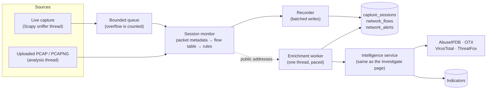

# Network monitoring

Part of [CipherForge](../README.md). Related pages: the rules and thresholds are in
[detection-engine.md](detection-engine.md), the HTTP endpoints in [api.md](api.md), where the module
sits in the system in [architecture.md](architecture.md), install and settings in
[setup.md](setup.md), and the screen walkthrough in [user-guide.md](user-guide.md).

Network monitoring turns packets into **flows** (one conversation between two addresses and ports),
runs seven rules over them, and looks up the public addresses involved with the threat-intelligence
providers. It is a defensive tool for analysts who watch their own machine or lab network, and for
people who want to analyse a capture file. It is not a replacement for an intrusion detection
system such as Suricata or Zeek, and it does not block anything.

## At a glance

| | |
| --- | --- |
| Who can use it | Security Analyst and Admin roles. Every session belongs to the user who started it, and nobody else can list, read, stop, enrich or delete it. |
| Where | The **Network** page (`/network`) and the `/api/v1/network` endpoints. |
| Two inputs | A **live capture** on one network interface of the machine that runs the API, or an uploaded **PCAP / PCAPNG** file. |
| What it keeps | Metadata only: time, source and destination address, ports, protocol, packet size, TCP flags. Never packet payloads. |
| What it needs | Offline analysis needs nothing extra. Live capture needs a capture driver (Npcap on Windows, libpcap or raw sockets on Linux) and sometimes elevated privileges. |
| Limits | One live capture and one file analysis at a time, for the whole application. |

## How it works



1. **Reduce.** For every packet only the outermost IPv4 or IPv6 header and the TCP, UDP or SCTP
   header are read (`app/network/packets.py`). Anything that is not IP (ARP, spanning tree) is only
   counted. Malformed packets are counted and skipped.
2. **Group.** The monitor keeps a table of active flows keyed by the two address/port pairs and the
   protocol, so a request and its reply land in the same flow (`app/network/flows.py`).
3. **Judge.** Every packet also feeds the rule engine, which keeps per-source sliding windows
   (`app/network/windows.py`, `app/detection/network_rules.py`). Time in the rules comes from the
   packet timestamps, so replaying a capture file gives the same alerts every time.
4. **Store.** A recorder writes finished flows, alerts and running totals to the database in
   batches, so a slow database cannot stall capture (`app/network/recorder.py`).
5. **Enrich.** Public addresses are queued for a threat-intelligence lookup, away from the packet
   path (see [External IP enrichment](#external-ip-enrichment)).

### Flows

A flow is bidirectional: `A:1000 → B:80` and `B:80 → A:1000` are one flow, with packet and byte
counters kept per direction. A flow is closed and stored when

- a TCP reset is seen, or a FIN has been seen in both directions (`closed`);
- no packet has arrived for `FLOW_IDLE_TIMEOUT_SECONDS` (`idle`). In a capture file the clock is the
  packet timestamps; in a live capture it is the wall clock;
- the session ends while the flow is still open (`ended`);
- the table is full (`MAX_ACTIVE_FLOWS`) and the least recently active flow is pushed out
  (`evicted`, also counted in the session totals).

At most `NETWORK_MAX_STORED_FLOWS` flows are written per session. Beyond that the oldest are
dropped first and the number is shown as "not stored" in the session detail, so the totals stay
honest.

## Live capture

### What it captures

The capture uses Scapy's `AsyncSniffer` with `store=False` (packets are handed over and never kept)
and `promisc=False`. Promiscuous mode is deliberately never enabled, so the module sees only
traffic to or from the machine that runs the API (plus broadcast and multicast it receives). It
cannot watch other hosts on a switched network unless that traffic is delivered to this machine's
interface, for example by running the API on a gateway.

The sniffer thread does as little as possible: it reduces each packet to its metadata and puts it
on a bounded queue (`MONITORING_BUFFER_SIZE`). If the queue is full the packet is counted as
**dropped**, never waited for, and the session shows the number. A separate consumer thread feeds
the monitor and also notices if the sniffer dies, which ends the session as `failed`.

### Requirements

| Platform | Capture backend | Notes |
| --- | --- | --- |
| Windows | **Npcap** | The tested backend. If Scapy finds only an older WinPcap-compatible driver, the status reports `winpcap` and capture is attempted, but that combination was not tried. With neither, the application reports `capture_backend_missing`. |
| Linux | **libpcap**, or Scapy's own raw sockets | Both work. Raw sockets need kernel packet-socket support, which standard distribution kernels have. |
| macOS and others | Not tested | Scapy can use libpcap there, but the module has not been exercised on those systems. |

The Network page shows the backend that was found and whether capture is possible. A server with
no backend still analyses capture files.

#### Installing Npcap on Windows

1. Download the installer from <https://npcap.com/#download>. Npcap has its own licence, so read
   it before using it in an organisation.
2. Run the installer. Two options matter:
   - **Restrict Npcap driver's access to Administrators only**: Npcap recommends it for
     multi-user machines. If you select it, the CipherForge API must be started from an elevated
     terminal ("Run as administrator"), otherwise capture fails with `capture_permission_denied`.
     If you leave it off, a normal user can capture.
   - **Install Npcap in WinPcap API-compatible Mode**: Scapy's installation notes advise turning
     this off. CipherForge does not need it.
3. Restart the API so Scapy finds the driver. A reboot is only needed if the installer asks.

Source: the [Npcap Users' Guide](https://npcap.com/guide/npcap-users-guide.html) and the
[Scapy installation notes](https://scapy.readthedocs.io/en/latest/installation.html#windows).

#### Installing libpcap on Linux

Scapy works on Linux without libpcap, using raw packet sockets. If you want libpcap (it also
compiles capture filters), install it with the package manager:

```bash
sudo apt-get install libpcap-dev     # Debian, Ubuntu
sudo yum install libpcap-devel       # Fedora (dnf accepts the same command)
```

Restart the API afterwards. The status endpoint reports `libpcap` or `native`.

#### Privileges

| Platform | What the API process needs |
| --- | --- |
| Windows, Npcap without the administrators-only option | A normal user account is enough. This is how live capture was verified on the author's machine. |
| Windows, Npcap restricted to Administrators | An elevated process. |
| Linux | Permission to open packet sockets: run as root, or give the process the `CAP_NET_RAW` capability. Scapy's documentation says to run with root privileges. |

Run the API with the least privilege that works. Giving a web service root only so that it can
capture packets is a real risk: if the API were compromised, so would the host be. A narrow
capability for a dedicated service account is safer than root. If the operating system refuses,
the session ends as `capture_permission_denied` and nothing is captured.

The Linux paths (the backend probe for raw sockets and libpcap, permission errors) are covered by
unit tests that fake the platform and the sniffer, but they have not been exercised against a live
Linux interface. Live capture was verified on Windows with Npcap (backend reported as `npcap`),
without elevated privileges.

#### Docker

The backend container drops all Linux capabilities and has a read-only filesystem, so live capture
is not available inside it. Offline PCAP analysis works in the container. For live capture, run
the API directly on the host (see [setup.md](setup.md)) and keep the database wherever you like.
[deployment.md](deployment.md) explains the rest of the container set-up.

### Starting and stopping

1. Choose an interface from the list (`GET /api/v1/network/interfaces`). The list is cached for 30
   seconds; "refresh" reloads it and is rate limited. Each interface shows its name, a description
   and up to four addresses.
2. Start the capture. The session goes `starting` → `running`. The start waits up to 5 seconds for
   the sniffer to confirm.
3. Stop it (only the user who started it can). The session goes `stopping` → `stopped` once the
   queue is drained (up to 10 seconds).

Only one live capture can run in the whole application. If another user holds the slot, the status
shows `busy` and starting returns `capture_already_running`.

If the API is stopped while a capture runs, shutdown ends the capture and flushes what it has. If
the process dies, the session is marked `failed` with the error `interrupted` the next time the
API starts.

## Analysing a capture file

Upload a `.pcap`, `.pcapng` or `.cap` file on the Network page, or send it to the API:

```powershell
curl.exe -X POST "http://127.0.0.1:8000/api/v1/network/pcap" `
  -H "Content-Type: application/octet-stream" `
  -H "X-File-Name: example.pcap" `
  --data-binary "@example.pcap"
```

The API answers `202` with a new session in the `running` state. Poll `GET
/api/v1/network/sessions/{id}` until the status is `completed` (or `failed`).

- **Raw body, not a form.** The file is the request body (`application/octet-stream`) and the name
  travels in `X-File-Name`, percent-encoded and ending in `.pcap`, `.pcapng` or `.cap`. The name is
  shown in the session list and is never used as a path. `multipart/form-data` is not supported.
- **Size.** `NETWORK_MAX_PCAP_SIZE_MB` (default 50). The declared `Content-Length` is checked before
  the body is read, and the stream is cut off at the limit.
- **Private spool.** The upload is written to a private temporary folder (`cipherforge-pcap-*`)
  under a random name, only while it is analysed, and removed afterwards in every case. A file left
  by a crash is removed at the next start once it is more than 24 hours old.
- **Structure check before analysis.** The magic number must be a PCAP (microsecond or nanosecond,
  either byte order) or a PCAPNG section header. The records are walked without decoding the
  packets. A record larger than 16 MiB, or a file with no complete packet, is `invalid_capture_file`
  (422). A file that is cut short or damaged part-way is analysed up to that point and the session
  carries `capture_truncated`.
- **One at a time**, and a 600-second limit per analysis (`analysis_timeout`, results so far are
  kept).
- **Timestamps** in the results are the capture's own. A file recorded last year produces alerts
  dated last year, and the session's duration is the span of the packets, not the time the
  analysis took.

### Trying it without a real capture

Two clearly labelled sources of **synthetic** traffic exist for trying the page out. Neither is
used by the real application.

- `frontend/e2e/data/synthetic-network.pcap` is a small invented capture: a port scan from an
  invented public IPv6 address that the simulated providers rate critical (so NET-005 fires through
  enrichment), a scan from a documentation-range address (`203.0.113.77`, never looked up), five
  DNS questions to `8.8.8.8`, a ping to `1.1.1.1`, a short conversation between two private
  addresses and one ARP frame. Analysed with the simulated providers it gives 72 packets, 59 flows
  and three alerts. Regenerate it with `python -m devtools.synthetic_network` from `backend/`.
- The offline demo server (`backend/devtools/demo_server.py`, see the README) replaces the capture
  driver with a simulation. Its two interfaces are named **Simulated office LAN** and **Simulated
  quiet link**, and nothing is captured from the machine.

## Detection rules

Seven rules judge each session: port scan (NET-001), connection rate (NET-002), SYN rate (NET-003),
high volume (NET-004), known malicious address (NET-005), suspicious port (NET-006) and unexpected
protocol (NET-007). Their logic, severities, evidence fields and every threshold setting are in
[detection-engine.md](detection-engine.md). `GET /api/v1/network/rules` returns the rules with the
thresholds this server is configured with.

Every alert carries the rule, a severity, what was observed against the threshold and window, a
plain-language explanation (times in IST), and the evidence that triggered it (for example the
sampled ports for a scan). An alert says "suspected" behaviour. It does not identify a person, and
a spoofed source address cannot be told apart from a real one.

## External IP enrichment

Public addresses that appear in an alert, and then the busiest addresses of the session, are
looked up with the same intelligence service the Investigate page uses (AbuseIPDB, AlienVault OTX,
VirusTotal and ThreatFox, whichever have a key). See
[threat-intelligence.md](threat-intelligence.md) for what each provider answers and how the score
is made. CipherForge adds no new score.

- **What leaves the machine:** the address text, to the providers you configured, and nothing else:
  no ports, directions, volumes, or capture data.
- **Never looked up:** private (for example RFC 1918 and IPv6 unique-local), loopback, link-local,
  multicast, reserved, unspecified and documentation ranges, anything else that is not globally
  routable, and anything that is not an IP address. An IPv4 address wrapped in IPv6
  (`::ffff:a.b.c.d`) is judged as the IPv4 address. Such addresses are marked `not_applicable`.
- **Pacing and budget:** one worker thread, `NETWORK_ENRICHMENT_MAX_PER_MINUTE` lookups that reach
  a provider per minute (default 4, which stays inside VirusTotal's free public quota), at most
  `NETWORK_ENRICHMENT_MAX_IPS` addresses per session (default 25). Answers served from the
  intelligence cache cost nothing and are not delayed. Addresses over the budget are marked
  `skipped_budget`.
- **Switch:** `EXTERNAL_ENRICHMENT_ENABLED=false` turns lookups off. Sessions then show `disabled`
  and NET-005 cannot fire. A single alert can also be enriched on demand (rate limited).
- **Timing:** lookups run in the background at the pace above, so they can finish after an analysis
  has ended. A NET-005 alert is added when its lookup ends, so a session can show one more alert
  than the "Analysis complete: N packets, N alerts" line of the upload panel reported.
- **What the session lists:** at most 100 external addresses, those with an alert first and then by
  traffic volume. The on-demand lookup works from an alert, so an address that raised no alert and
  was beyond the session's automatic budget cannot be looked up by hand.
- **Results become indicators.** A lookup creates or refreshes an indicator exactly like the
  Investigate page does, so looked-up addresses appear on the Indicators page and can be deleted
  there. The audit actor for these lookups is `system:network-monitor`. If an indicator is deleted
  while its lookup is pending, the result is `unavailable` with `indicator_deleted`.

| Status | Meaning |
| --- | --- |
| `pending` | Queued, not looked up yet. |
| `completed` | At least one provider answered. A score is shown only if a provider returned evidence (`assessed`); "no data" is shown as what it is. |
| `failed` | Providers were reached but all failed (`rate_limited` or `provider_error`). |
| `unavailable` | No provider could be asked (`no_provider_available`, no key configured) or the indicator was deleted. |
| `skipped_budget` | Over `NETWORK_ENRICHMENT_MAX_IPS` for this session. |
| `not_applicable` | Not a public address. |
| `disabled` | `EXTERNAL_ENRICHMENT_ENABLED` is off. |

"Not assessed" and "no data" never mean "safe". When every provider that answered had no data, the
address is shown without a risk score or classification (the API returns both as `null`, with
`assessed: false`), under the note "No provider returned data. This is not evidence the address is
safe.", next to each provider's own "No data" status.

## Data collected and privacy

| Stored (per session) | Not stored |
| --- | --- |
| Source of the session (interface name, or the uploaded file's display name), status, start and end times | Packet payloads, application data, HTTP content, DNS names, TLS content |
| Totals: packets, bytes, flows, drops, protocol mix, top sources and destinations | The capture file (it is deleted after analysis) |
| Per flow: addresses, ports, protocol, first and last time, packets and bytes per direction, TCP flag summary, close reason | MAC addresses |
| Per alert: rule, severity, observed value, threshold, explanation, evidence, enrichment result | Anything about the user's other network activity |

IP addresses can identify people, and an analyst's own capture will include the addresses of
whoever the machine talked to. Use the module only on machines and networks you own or are
authorised to monitor, tell the people affected, and keep the retention short.

- **Access:** a session, its flows and alerts are visible only to the user who created them; another
  user gets "not found". The audit trail keeps who started or stopped a capture, uploaded a file,
  enriched an alert or deleted a session. Audit entries hold the interface name or file size and
  format, counts, and no captured addresses or file names. Like every audit entry, they also record
  the address the API request came from (`source_ip`).
- **Logs:** the module logs error class names, session identifiers and counts. It does not log
  packet contents, addresses or file names.
- **Third parties:** only the public address lookups described above, and only if keys are set and
  `EXTERNAL_ENRICHMENT_ENABLED` is true.

### Retention and deletion

- Finished sessions older than `NETWORK_RETENTION_HOURS` (default 72, maximum 2160) are deleted
  together with their flows and alerts. There is no separate timer: the purge runs when the API
  starts and whenever the session list is loaded, at most once every 10 minutes. A session past its
  retention that has not been purged yet can still be opened by its identifier.
- A session can be deleted by its owner at any time once it is not running (`session_running`
  otherwise). The deletion is audited with counts.
- Deleting a session does **not** delete the indicators its enrichment created; those belong to
  the Indicators page and are removed there.
- Capture upload spool files are removed after analysis and, if left behind by a crash, 24 hours
  later at startup.

## When something goes wrong

A session that ends badly keeps a short code, and the API turns it into a fixed message: raw
exception text, paths and file names never reach the client. Symptom-by-symptom help is in
[setup.md](setup.md#common-setup-problems).

| Code | Meaning |
| --- | --- |
| `capture_backend_missing` | No capture driver found (Npcap or libpcap). Install one and restart the API. |
| `capture_permission_denied` | The operating system refused capture to the API process. See [Privileges](#privileges). |
| `interface_unavailable` | The chosen interface disappeared or is down. |
| `capture_failed` | The sniffer stopped with an error. The server log has the error class. |
| `interrupted` | The API stopped while the session was running. |
| `invalid_capture_file` | Not a readable PCAP or PCAPNG, or it holds no complete packet. |
| `capture_truncated` | The file is cut short or damaged after some point; everything before it was analysed. |
| `analysis_timeout` | Analysis hit the 600-second limit; results so far are kept. |
| `analysis_failed` | The file could not be analysed. |
| `results_incomplete` | The database was unavailable for part of the session, so totals may be incomplete. |

Request-level errors (`interface_not_found`, `capture_already_running`, `capture_not_running`,
`analysis_already_running`, `file_too_large`, `unsupported_media_type`, `invalid_filename`,
`session_not_found`, `session_running`, `alert_not_found`, `enrichment_disabled`,
`address_not_public`, `rate_limited`) are listed with their status codes in [api.md](api.md).

If the database is slow or briefly unavailable, the recorder keeps a bounded amount of pending
data in memory and retries. When the bound is exceeded the oldest pending flows or alerts are
dropped and counted (`flows_not_stored`, `alerts_lost`). If the final write still fails, the
session ends with the `results_incomplete` note. Resource limits are never silent.

## Limitations

- **Metadata only.** There is no payload inspection, no application-layer decoding and no TLS
  decryption. A rule can only judge what headers show.
- **Heuristic rules with starting-point thresholds.** The defaults are lab values, not standards.
  A scanner you run yourself, a backup job, a NAT gateway or a busy server can trip them. Tune the
  thresholds to the network, and treat an alert as a lead for an analyst, not a finding.
- **Spoofing.** A source address in a SYN flood or scan may be forged. The module never claims to
  identify who is behind an address.
- **Host-only view.** No promiscuous mode, no mirror or tap support, and one machine's interfaces.
  The remote sensor in [../sensor/README.md](../sensor/README.md) is planned, not built.
- **One capture, one analysis at a time**, per application. A live capture has no maximum duration
  and only the user who started it can stop it (restarting the API also ends it), so one analyst
  can hold the slot. Limits are kept in the memory of one API process, so run one API worker.
- **Not for high-rate links.** A bounded queue protects the machine, so a fast link drops packets
  instead of slowing it. Drops are counted and shown. No performance figure is claimed.
- **IP traffic only.** Non-IP packets are counted but not analysed.
- **No alert workflow yet.** Alerts have no status, assignee or case. No automatic response exists.
- **Linux live capture not verified live** (see [Privileges](#privileges)).
- **Enrichment depends on third parties** and their free-tier limits; it is paced and skippable.
  An address beyond the session's automatic budget that raised no alert is never looked up.

## Where the code is

| Path | Role |
| --- | --- |
| `backend/app/network/capture.py` | Interfaces, backend probe, live capture threads |
| `backend/app/network/pcap.py` | Upload spool, structure check, offline analysis |
| `backend/app/network/packets.py` | Packet to metadata |
| `backend/app/network/flows.py`, `windows.py` | Flow table and sliding windows |
| `backend/app/network/monitor.py` | Per-session pipeline (statistics, flows, rules) |
| `backend/app/detection/network_rules.py` | The seven rules |
| `backend/app/network/enrichment.py` | Enrichment worker |
| `backend/app/network/recorder.py`, `repository.py`, `views.py` | Persistence and read models |
| `backend/app/network/service.py` | Orchestration, retention, startup and shutdown |
| `backend/app/network/errors.py` | Error codes and safe messages |
| `backend/app/api/v1/network.py`, `backend/app/schemas/network.py` | HTTP layer |
| `backend/app/models/network.py`, `backend/alembic/versions/0004_network_monitoring.py` | Tables |
| `backend/devtools/synthetic_network.py` | Synthetic traffic for demos and tests only |

Tests and how to run them are in [testing.md](testing.md).
