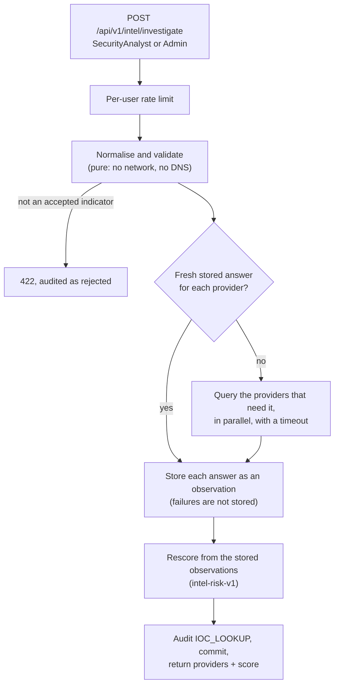

# Threat intelligence (Intel)

> **Status: implemented (Phase 2, backend; Phases 3 to 3c, analyst screens).** The API looks up one
> indicator at a time, asks every configured provider that supports it (AbuseIPDB, AlienVault OTX,
> VirusTotal and ThreatFox), stores each answer, scores the indicator with a documented method and
> audits the lookup. The dashboard shows the result; see
> [The analyst screens](#the-analyst-screens). Which providers have been called for real, and which
> have not, is stated in one place: [Verification status](#verification-status).

## Intent

Let an analyst look up an indicator of compromise (IOC), see what each external provider says, and get
a CipherForge assessment whose reasoning is visible. Supported indicator types: IPv4, IPv6, domains,
URLs and MD5, SHA-1 and SHA-256 file hashes. Providers: AbuseIPDB, AlienVault OTX, VirusTotal and
ThreatFox. Which of them answers which type is set out in
[Which provider answers which indicator type](#which-provider-answers-which-indicator-type).

## Principles

- **Evidence, not truth.** A provider's answer is one input. Feeds can be stale, incomplete,
  contradictory or rate-limited.
- **Show each provider independently**, then the CipherForge correlation and score. Never label an
  indicator malicious from a single source.
- **Explainable scores.** Every score lists the evidence behind it, no single provider can dominate
  it, and the classification bands are fixed and documented: 0-20 Informational, 21-40 Low,
  41-60 Medium, 61-80 High and 81-100 Critical.
- **Say what is unknown.** Distinguish provider evidence from internal evidence, and show confidence,
  freshness and uncertainty. No reports does not mean safe.
- **One normalised indicator, many observations.** Raw provider observations stay traceable to their
  source and are never merged away.
- **The backend makes the calls.** Browsers never talk to a provider and never see an API key.
  Responses are cached with per-provider freshness rules, and every lookup is audited.
- **Geolocation is not attribution.** IP reputation and location do not identify a person or an
  attacker's whereabouts, and the UI must not suggest they do.
- **Recommend, never auto-block.** Suggested actions are advice for an analyst.

## How an investigation works



The score is always computed from **stored** observations, whether the answer was fetched a moment ago
or served from the cache, so the result of an investigation and a later read of the same indicator
agree. Each provider is shown on its own, followed by the CipherForge score.

| Piece | Location |
| --- | --- |
| Normalisation | `backend/app/services/normalization.py` |
| Provider adapters | `backend/app/collectors/` (`abuseipdb.py`, `otx.py`, `virustotal.py`, `threatfox.py`, shared `base.py`, `sanitize.py`, `registry.py`) |
| Scoring | `backend/app/correlation/scoring.py` |
| Orchestration, caching, persistence | `backend/app/services/intel_service.py` |
| Audit writer, rate limiter | `backend/app/services/audit.py`, `backend/app/security/rate_limit.py` |
| API and response models | `backend/app/api/v1/intel.py`, `backend/app/schemas/intel.py` |
| Tables | `backend/app/models/threat.py`, `backend/app/models/audit.py`, migration `0002_threat_intel` |

The HTTP contract is in [api.md](api.md).

**Network monitoring uses the same lookup.** The public addresses that a capture session sees are
looked up by the service described here, with the same providers, cache and score (the worker is
`backend/app/network/enrichment.py`). Those addresses become indicators like any other: they appear
on the Indicators page and can be deleted there (see [Deleting indicators](#deleting-indicators)).
Which addresses are sent, the budget and the switch to turn it off are in
[network-monitoring.md](network-monitoring.md#external-ip-enrichment).

## Indicators and normalisation

Whatever an analyst pastes is turned into one canonical, validated indicator, so equivalent spellings
land on a single record, and unsafe input is rejected before it reaches the database or a provider.
Normalisation is pure: it never touches the network and never resolves DNS.

| Type | Canonical form | Rejected |
| --- | --- | --- |
| IPv4, IPv6 | Compressed form; an IPv4-mapped IPv6 address becomes IPv4. | Private, loopback, link-local, multicast, reserved, documentation and other non-public addresses; IPv6 zone identifiers. |
| Domain | Lower-case ASCII; internationalised names become punycode (IDNA 2008 with UTS 46 mapping); one trailing dot removed. | Single labels, email addresses, invalid labels, names over 253 characters, and reserved or private-use top-level domains (`local`, `internal`, `lan`, `test`, `example` and similar). |
| URL | `http` or `https` only; lower-case scheme and host; default port and fragment dropped; path and query percent-encoded with canonical escapes; path defaults to `/`. | Other schemes, embedded credentials, backslashes, a missing host, a non-public IP host, an invalid port. |
| File hash (MD5, SHA-1, SHA-256) | Lower-case hexadecimal. The length decides the type: 32 characters is MD5, 40 is SHA-1 and 64 is SHA-256. Upper-case input is accepted and lower-cased. | A hexadecimal string of any other length is not a hash. SHA-512 (128 characters) is rejected with an explicit message. |

Also:

- Defanged input (`hxxp://example[.]com`, `1.2.3[.]4`) is refanged first.
- A file hash is only an identifier. A lookup never receives, uploads or reads the file, and a hash
  says nothing to CipherForge about the file's content beyond what a provider already knows about
  that hash. [Which provider answers which hash type](#which-provider-answers-which-indicator-type)
  differs: ThreatFox has no SHA-1 search.
- The input is limited to 2048 characters. Whitespace, control characters and invisible or
  direction-changing characters are rejected, because they make look-alike indicators easy to forge.
- Error messages describe the problem and never echo the input, which may be hostile.
- A hostile but syntactically valid URL (for example one containing a script tag) is not rejected: it
  is percent-encoded and handled as data, and must only ever be displayed as text.

Rejecting non-public addresses and names matters twice over: internal addressing is not leaked to a
third party, and the feature cannot be used to make the server probe internal hosts.

## Providers

Four providers can answer. Each has an adapter in `backend/app/collectors/` that sends one read-only
lookup, keeps a bounded set of whitelisted fields and reduces the answer to a **signal** from 0 to 1
(see [Scoring](#scoring-intel-risk-v1)). A provider with no API key is "not configured": it makes no
network call and contributes nothing, and the response says so. Leave a key blank to switch that
provider off. How every other result is reported is in [Provider outcomes](#provider-outcomes).

### Which provider answers which indicator type

The table is taken from each adapter's `supported_types`. Where it says "no", the adapter is not asked
about that type: its row in the response is `unsupported`, nothing is sent to the provider, and it adds
no points and no uncertainty note.

| Indicator type | AbuseIPDB | AlienVault OTX | VirusTotal | ThreatFox |
| --- | --- | --- | --- | --- |
| IPv4, IPv6 | yes | yes | yes | yes |
| Domain | no | yes | yes | yes |
| URL | no | yes | yes | yes |
| MD5 | no | yes | yes | yes |
| SHA-1 | no | yes | yes | **no** |
| SHA-256 | no | yes | yes | yes |

- AbuseIPDB reports on IP addresses only.
- ThreatFox has no SHA-1 search. A SHA-1 hash is reported as unsupported by ThreatFox: the adapter does
  not convert it or guess another hash.
- So an address can be answered by four providers, a domain, a URL, an MD5 or a SHA-256 hash by three,
  and a SHA-1 hash by two.

### AbuseIPDB and AlienVault OTX

| | AbuseIPDB | AlienVault OTX |
| --- | --- | --- |
| Indicator types | IPv4, IPv6 | IPv4, IPv6, domain, URL, MD5, SHA-1, SHA-256 |
| Request | `GET https://api.abuseipdb.com/api/v2/check` with `ipAddress` and `maxAgeInDays=90` | `GET https://otx.alienvault.com/api/v1/indicators/{type}/{indicator}/general`, where `{type}` is `IPv4`, `IPv6`, `domain`, `url` or `file` (`file` for MD5, SHA-1 and SHA-256) |
| Credential header | `Key` | `X-OTX-API-KEY` |
| Get a key | <https://www.abuseipdb.com/account/api> (free account) | A free account at <https://otx.alienvault.com>; the key is shown in your account settings |
| Signal (0 to 1) | Abuse confidence ÷ 100. Zero if AbuseIPDB lists the address as whitelisted. Halved when there are only one or two reports in the window. | By number of pulses naming the indicator: 0 gives 0, 1 gives 0.25, 2 gives 0.4, 3 to 4 give 0.55, 5 to 9 give 0.7, 10 to 24 give 0.85, 25 or more give 1.0. Multiplied by 0.25 when OTX attaches validation entries, such as a known-good list. |
| Evidence date | Time of the last report. | Newest pulse modification time (the oldest pulse creation time is the first-evidence date). |
| Default cache time | 6 hours (`ABUSEIPDB_CACHE_TTL_SECONDS`) | 12 hours (`OTX_CACHE_TTL_SECONDS`) |
| Kept from the answer | Confidence score, report and reporter counts, last report time, window, whitelist and Tor flags, usage type, ISP, domain, country code. | Pulse count, up to 100 pulses examined, the 5 newest pulses (id, name, created, modified), validation entries, the most common malware families, ATT&CK technique ids and tags. |

### VirusTotal

CipherForge only **reads** from VirusTotal (API v3). It never uploads a file and never submits a URL
for scanning, so a lookup shares nothing beyond the indicator itself. An indicator that VirusTotal has
not seen has no record, and the answer says so. See [Verification status](#verification-status) for
how far this adapter has been checked against the real service.

| | VirusTotal |
| --- | --- |
| Indicator types | IPv4, IPv6, domain, URL, MD5, SHA-1, SHA-256 |
| Request | `GET` under `https://www.virustotal.com/api/v3` (`VIRUSTOTAL_BASE_URL`): `/ip_addresses/{ip}`, `/domains/{domain}`, `/urls/{id}` or `/files/{hash}`. A URL is addressed by its URL-safe base64 form without padding. |
| Credential header | `x-apikey` |
| Get a key | A free VirusTotal account; the key is shown at <https://www.virustotal.com/gui/my-apikey>. |
| Read from the answer | The engine counts in `last_analysis_stats` (malicious, suspicious, harmless, undetected and timed out), the community reputation score, the last-analysis and first-submission times, how many times it was submitted, up to 5 categories, the suggested threat label, up to 5 threat names and 3 malware families, the file name and type, the country code, AS number and AS owner, up to 10 tags, and the id used to link to VirusTotal's page. |
| Verdict | The strongest category any engine reported: `malicious` if one or more engines say so, otherwise `suspicious` if one or more do, otherwise `harmless`. `unknown` when VirusTotal holds the record but no engine has a result yet, and `not_found` when it has no record. |
| Signal (0 to 1) | From the weighted detections, set out below. |
| Evidence date | The last-analysis time, when engines have results. The first-submission time is the first-evidence date. |
| Default cache time | 24 hours (`VIRUSTOTAL_CACHE_TTL_SECONDS`) |
| Timeout and retries | 15 seconds for the whole lookup, retries included (`VIRUSTOTAL_TIMEOUT_SECONDS`), and up to 2 retries (`VIRUSTOTAL_MAX_RETRIES`). See [What every adapter does](#what-every-adapter-does). |

**How the signal is worked out.** The adapter weighs engines, not the verdict: each *malicious* engine
counts twice and each *suspicious* engine once, which gives the **weighted detections**. Engines that
timed out did not reach a verdict and are not counted. The steps are deliberately coarse, because one
or two flagging engines are weak evidence and lone detections are often false positives.

| Weighted detections | 0 | 1 | 2 to 3 | 4 to 5 | 6 to 9 | 10 to 19 | 20 or more |
| --- | --- | --- | --- | --- | --- | --- | --- |
| Signal | 0 | 0.1 | 0.25 | 0.5 | 0.7 | 0.85 | 1.0 |

One malicious engine is 2 weighted detections (signal 0.25) and ten are 20 (signal 1.0). The verdict
names the strongest category and the counts always travel with it, so a lone detection reads as "1 of
70", not as a certainty. The verdict is VirusTotal's own label, not a CipherForge verdict: only the
signal, the evidence date, the malware families and the notes enter the score.

**What "no detections" and "no result" mean.** Never "safe".

- No engine flagged the indicator: the answer is `ok` with signal 0 and verdict `harmless`, and a note
  that this is the engines' opinion at the time of the analysis, not proof that the indicator is safe.
- VirusTotal has no record (HTTP 404): `no_data` with verdict `not_found`, and a note that the
  indicator may simply never have been submitted.
- A record exists but no engine has a result yet: `no_data` with verdict `unknown`.
- One or two flagging engines: a note says that a lone detection is often a false positive, so the
  signal is low.

**Provider text and links.** Every string comes from VirusTotal or from whoever uploaded a sample (file
names, tags, categories), so it is cleaned and length-limited like any provider text. The link to
VirusTotal's page is built by CipherForge from the fixed address `https://www.virustotal.com/gui` and an
identifier it has checked: the indicator itself for an address or a domain, and a 64-character SHA-256
for a file or a URL. When the identifier is not what it should be there is no link. The links inside
VirusTotal's own response are not used.

**Limits.** `.env.example` states that the free VirusTotal key allows 4 requests per minute and 500 per
day, and that VirusTotal keeps every indicator you query, so a confidential indicator should not be
looked up with it. VirusTotal's own page on its public API gives the same two limits
([Public vs Premium API](https://docs.virustotal.com/reference/public-vs-premium-api), last updated
23 December 2025). When a quota is used up VirusTotal answers HTTP 429 and the row reads
`rate_limited`; see [Provider outcomes](#provider-outcomes). The terms that come with a free key are in
[Privacy and abuse considerations](#privacy-and-abuse-considerations).

### ThreatFox

ThreatFox is abuse.ch's community database of indicators of compromise. A match is a *report* that an
indicator is malware infrastructure, most often a command-and-control server. It is not a scan, and
having no match says little: ThreatFox expires IOCs after six months and does not serve expired ones
([ThreatFox Community API](https://threatfox.abuse.ch/api/)). See
[Verification status](#verification-status) for how far this adapter has been checked against the real
service.

| | ThreatFox |
| --- | --- |
| Indicator types | IPv4, IPv6, domain, URL, MD5, SHA-256. Not SHA-1. |
| Request | `POST` of a JSON body to `https://threatfox-api.abuse.ch/api/v1/` (`THREATFOX_BASE_URL`). A domain or URL uses `search_ioc` with `exact_match`. An IP address uses `search_ioc` as a wildcard search, because ThreatFox stores `ip:port`, and the answer is then filtered to entries for exactly that address. An MD5 or SHA-256 hash uses `search_hash`. |
| Credential header | `Auth-Key` |
| Get a key | A free key from abuse.ch's authentication portal, <https://auth.abuse.ch/>. |
| Read from the answer | For each matching IOC: its id, the IOC and its type, the threat type, the malware family and aliases, the reporter's confidence level (0 to 100), the first and last seen times, the reporter's name, a reference link, a Malpedia link and tags. At most 1,000 entries are scanned, and the 5 matches with the highest confidence are kept in detail. |
| Verdict | `malicious` when the highest confidence among the matches is 75 or more, otherwise `suspicious`: any match is at least suspicious. `not_found` when nothing matches. |
| Signal (0 to 1) | The highest reporter confidence divided by 100. |
| Evidence date | The latest last-seen time, or the first-seen time when there is no last-seen time (ThreatFox leaves it empty for an IOC that is still live). The earliest first-seen time is the first-evidence date. |
| Default cache time | 6 hours (`THREATFOX_CACHE_TTL_SECONDS`) |
| Timeout and retries | 15 seconds for the whole lookup, retries included (`THREATFOX_TIMEOUT_SECONDS`), and up to 2 retries (`THREATFOX_MAX_RETRIES`). A search changes nothing, so retrying it is as safe as retrying a GET. |

**Reporter confidence is not a detection count.** `confidence_level` is how sure the *reporter* is that
the IOC is malicious. It becomes the signal as it is, and it must not be compared with VirusTotal's
engine counts. The dashboard says so beside it.

**Hashes.** ThreatFox does not rate a file. For an MD5 or SHA-256 hash it returns the IOCs (usually
command-and-control servers) that it associates with that file, and the answer carries the note
"ThreatFox lists IOCs associated with this file hash; it does not rate the file."

**What "no result" means.** Never "safe". A query status of `no_result`, an empty list, or a list with
no entry for exactly the indicator searched is `no_data` with verdict `not_found`, and a note that this
does not mean the indicator is safe, because IOCs older than six months are no longer served.

**Failures.** A search term that ThreatFox calls illegal (a query status starting `illegal_`) is `error`
with reason `invalid_input`. An HTTP 401 or 403 is `auth_failed`, as for every adapter. The adapter's
source notes that ThreatFox's documentation does not say how a bad key is reported, so a normal answer
whose query status contains "unauthori" or "forbidden" is also treated as `auth_failed`. That is a
precaution based on the status text, not documented behaviour. Any other query status that is not `ok`
is `unavailable`, and an answer of the wrong shape is `malformed_response`.
The fixed messages are listed in [api.md](api.md#how-a-providers-result-is-reported).

**Provider text and links.** Reporter-supplied text and links are untrusted. Text is cleaned and
length-limited, and at most 10 tags are kept, lower-cased. A reference or Malpedia link is kept only
when it is a plain `http` or `https` URL without credentials, in ASCII, and at most 512 characters; a
Malpedia link must also start with `https://malpedia.caad.fkie.fraunhofer.de/`. Anything else is
dropped.

**Limits.** abuse.ch says the Community API is free under its fair use principles, and that use with
commercial or for-profit needs may require a paid subscription for its enhanced commercial API
([ThreatFox Community API](https://threatfox.abuse.ch/api/)). This document states no request limit
for ThreatFox.

### What every adapter does

- **Fixed destinations.** A provider's address is a constant in its adapter. For VirusTotal and
  ThreatFox it is a setting (`VIRUSTOTAL_BASE_URL`, `THREATFOX_BASE_URL`) that must be an `https` URL,
  with plain `http` allowed only for a loopback test server. The indicator appears in a request only as
  an escaped path segment, a query value or a JSON value. Redirects are never followed, so a key cannot
  be sent to another host.
- **Bounded calls.** The connect timeout is 5 seconds. AbuseIPDB and OTX share one timeout
  (`PROVIDER_TIMEOUT_SECONDS`, default 10). VirusTotal and ThreatFox each have a time limit of their
  own for the whole lookup, retries included (default 15). A response is read as a stream and refused
  when it is over 2 MiB after decompression. Providers are asked at the same time and each has its own
  deadline, so one that hangs or retries for a long time never costs another its answer.
- **Retries are opt-in.** Only VirusTotal and ThreatFox retry (`VIRUSTOTAL_MAX_RETRIES` and
  `THREATFOX_MAX_RETRIES`, default 2 each), and only after a failure that can heal by itself: a
  timeout, a connection failure, HTTP 502, 503 or 504, or a 429 whose `Retry-After` asks for 10 seconds
  or less. The wait is 0.5, 1, 2 and then 4 seconds, or the provider's `Retry-After` when it gives one,
  and a retry starts only if it still fits in the time limit. Rejected credentials (401 or 403),
  rejected requests (400 or 422), every other status and a 429 without a usable `Retry-After` are
  final.
- **Defensive parsing.** Only whitelisted fields survive, each bounded in size and cleaned of control
  and invisible characters: whitespace is collapsed, long text is shortened with an ellipsis, counts
  are range-checked, a date before 1990 or more than a day ahead is treated as unknown, and a country
  code must be two letters. A malformed answer degrades one provider and never the investigation.
- **Logs** carry the provider, the indicator type, the status, the reason and how long the call took.
  They never carry the indicator or a key.

What is **not** kept: the raw response. Provider payloads are attacker-influenceable (anyone can name an
OTX pulse or upload a sample to VirusTotal), so only whitelisted fields survive. Free text from a
provider is community-supplied; render it as text only, and never as markup. A country code is what the
provider reports for the address. It says nothing about who operates a host or where they are, and the
interface must not present it as an attacker's location.

### Provider outcomes

Each provider's result is reported separately with one of these statuses:

| Status | Meaning |
| --- | --- |
| `ok` | The provider answered with a record it holds on the indicator. The signal can still be 0, for example when no VirusTotal engine flagged it. |
| `no_data` | The provider answered and has nothing on the indicator (no pulses or a 404 for OTX; no reports and a zero score for AbuseIPDB; a 404 or a record with no engine results yet for VirusTotal; no matching IOC for ThreatFox). It counts as an answer, but it is not proof that the indicator is safe. |
| `not_configured` | No API key is set. No network call was made. |
| `unsupported` | The provider does not accept this indicator type. No network call was made. |
| `rate_limited` | The provider answered HTTP 429. |
| `error` | A timeout, a network failure, rejected credentials (401 or 403), a rejected request (400 or 422), an unexpected HTTP status, invalid JSON, an unexpected shape, or a response over 2 MiB. The message is fixed text and never contains the response. |
| `not_queried` | A stored indicator has no answer from this provider, and none was requested. |

A row that is not an answer also carries a **reason**, which tells a failure that can heal from one that
needs action:

| Reason | Meaning |
| --- | --- |
| `not_configured` | No API key is set. A stored answer from a provider that has since lost its key is still shown, with this reason and a message that the provider "is not configured, so this older answer cannot be refreshed." |
| `invalid_input` | The provider rejected the request (HTTP 400 or 422; for ThreatFox, a search term it calls illegal). |
| `auth_failed` | The provider rejected the key (HTTP 401 or 403). Another attempt cannot help: the key must be fixed on the server. |
| `rate_limited` | The provider's quota is used up (HTTP 429). |
| `timeout` | The provider did not answer within the time limit. |
| `unavailable` | The provider could not be reached, or answered with an unexpected HTTP status or query status. |
| `malformed_response` | The answer was not valid JSON, was over 2 MiB, or did not have the expected shape. |

VirusTotal and ThreatFox rows also carry a **verdict**, the provider's own label for the indicator:
`malicious`, `suspicious`, `harmless`, `unknown` or `not_found`. It describes that provider's data and
is not a CipherForge verdict. `harmless` and `not_found` never mean that the indicator is safe.

How a problem reaches the analyst:

- **A quota that is used up** is `rate_limited`. The message says how long to wait when the provider
  says so (for example "try again in about 30 seconds"). VirusTotal and ThreatFox first retry a wait of
  10 seconds or less themselves, if the time limit allows (see
  [What every adapter does](#what-every-adapter-does)).
- **Rejected credentials** are `error` with `auth_failed`, and are never retried.
- **An outage or a slow provider** (a timeout, a refused connection, an unexpected status such as 500)
  is `error` with `timeout` or `unavailable`, after any retries the adapter is allowed.
- **Nothing else is affected.** The other providers still answer, and the score's uncertainty list
  names a provider that is not configured or could not be queried instead of counting it as clean
  (see [Scoring](#scoring-intel-risk-v1)).

The exact messages and the status each situation maps to are in
[api.md](api.md#how-a-providers-result-is-reported).

Failures never abort an investigation and are never stored as observations, so a failed call cannot
overwrite or impersonate evidence. If an older answer exists it is still shown, with the failure
message next to it, and it is marked stale once it is older than the provider's cache time. The
provider that failed is asked again the next time the indicator is investigated, while a provider that
already has a fresh answer is not.

## Caching and refresh

PostgreSQL is the cache. There is no Redis or queue: the specification asks not to add one just to make
the MVP look complex.

- Each answer is stored as an observation with the time it was fetched. It is **fresh** while younger
  than that provider's cache time and **stale** afterwards. Every provider has a cache time of its
  own, set in [Configuration](#configuration): 6 hours for AbuseIPDB, 12 for OTX, 24 for VirusTotal
  and 6 for ThreatFox by default, each between 60 seconds and 30 days.
- Each provider is planned separately. Investigating the same indicator again inside a provider's
  cache time makes no call to that provider (`from_cache: true` on its row), while a provider whose
  answer has expired, or that never answered, is asked. After a partial failure, investigating again
  asks only the providers without a fresh answer. Every lookup is audited, cached or not.
- After the cache time the provider is asked again. If that fails, the stale answer is still used for
  scoring, flagged as stale, and lowers the confidence. A failed call stores nothing.
- `refresh: true` asks again before the cache time, but only for answers at least 60 seconds old, so
  a "refresh" button cannot burn a provider's free quota.
- `GET /api/v1/intel/indicators/{id}` and the list endpoints never call a provider.
- The indicator's `status` is `active` while at least one provider answer is fresh, otherwise `stale`.

## Scoring: `intel-risk-v1`

A pure, deterministic function from provider evidence to a score from 0 to 100. The same evidence and
the same clock always give the same score. The arithmetic is integer-only, so rounding never differs
between platforms.

**Properties**

- Every point belongs to a named factor, the factors always add up to the score, and the response
  lists them.
- No single provider can dominate. One contributes at most 45 points, and a score that fewer than two
  sources support is capped at 60. An indicator is never rated High or Critical on one source's word.
- Recent evidence counts more than old evidence, and corroboration by independent sources is rewarded
  as its own factor.
- "No data" scores zero but is never called safe. The result lists what is unknown.

**Method**

1. **Signal.** Each adapter reduces its answer to a number from 0 to 1 (see [Providers](#providers)).
   It is the strength of the provider's evidence, not a probability that the indicator is malicious.
2. **Recency weight**, from when the provider says the activity last happened (not when CipherForge
   fetched it): up to 7 days 1.0; up to 30 days 0.9; up to 90 days 0.7; up to 180 days 0.5; older
   0.3. No date given: 0.6. A date in the future counts as brand new.
3. **Provider points** = 45 × signal × recency weight, rounded half up.
4. A source **supports** the indicator when signal × recency weight is at least 0.4.
5. **Corroboration:** +8 when two sources support the indicator, +16 for three or more. An address can
   be answered by four providers, a domain, URL, MD5 or SHA-256 hash by three, and a SHA-1 hash by
   two, so the larger bonus is out of reach for a SHA-1 hash (see
   [Which provider answers which indicator type](#which-provider-answers-which-indicator-type)).
6. **Malware families:** +5 for each distinct family named by supporting sources, at most 10.
7. **Caps.** Fewer than two supporting sources: at most 60. In every case: at most 100. A cap shows up
   as its own negative factor, so the factors still add up.
8. **Confidence** measures how much and how good the evidence is, not how likely malice is: +35 for
   each fresh answer, +15 for each stale one, +20 when two or more sources support the indicator, at
   most 90. A "no data" answer is still an answer.

**Where each provider's evidence comes from**

All four providers enter the score in exactly the same way. A provider that answered gets one factor,
with the code `provider:<name>` (`provider:abuseipdb`, `provider:otx`, `provider:virustotal` or
`provider:threatfox`) and a label made of the provider's name and the word "evidence" (for example
"VirusTotal evidence"), worth at most 45 points. It supports the indicator at a signal times recency
weight of 0.4 or more, and it counts towards the corroboration, the caps and the confidence exactly as
described above. The scoring function has no code that is specific to one provider, and there is no
combined, second or provider-specific score: `intel-risk-v1` is the only score. The providers differ
only in how their adapters fill in the three inputs the method uses.

| Provider | Signal (0 to 1) | Evidence date, for the recency weight | Malware families |
| --- | --- | --- | --- |
| AbuseIPDB | Abuse confidence ÷ 100 | Last report | None |
| AlienVault OTX | Number of pulses, in steps | Newest pulse modification | Named by the pulses |
| VirusTotal | Weighted engine detections, in steps | Last analysis | Up to 3 |
| ThreatFox | Highest reporter confidence ÷ 100 | Latest last-seen time, otherwise first-seen | Up to 5 |

Only the signal, the evidence date and the families enter the number. A provider's verdict, such as
VirusTotal's `harmless` or ThreatFox's `malicious`, is its own label and is not used by the score. The
adapters' own notes, such as "a lone detection is often a false positive", are copied into the
uncertainty list when that provider answered.

**Not assessed is not clean**

- A provider that **answered** counts as an answer even when it has nothing to report. "No data" (a 404,
  no matching IOC, no reports) and a signal of 0 (no VirusTotal engine flagged it) both give 0 points,
  and both still add 35 to the confidence while fresh (15 when stale). The factor then reads "No
  malicious signal reported by this provider."
- A provider that is **not configured**, or **could not be queried**, contributes nothing: no points
  and no confidence. The uncertainty list names it, saying that the provider "is not configured" or
  "could not be queried" and so "contributed no evidence". A provider that does not accept the
  indicator's type, such as ThreatFox for a SHA-1 hash, adds no note: it was never a missing answer.
- When no provider answered at all, `answered_sources` is 0 and the score of 0 means **not assessed**,
  never "clean". When providers answered but none supports the indicator, the uncertainty list still
  says that an absence of reports is not proof that an indicator is safe.
- A weak signal does not corroborate. One malicious VirusTotal engine is 2 weighted detections, a
  signal of 0.25, which is below the 0.4 needed to support an indicator even when the answer is fresh.

**Classification bands**

| Score | Classification |
| --- | --- |
| 0 to 20 | Informational |
| 21 to 40 | Low |
| 41 to 60 | Medium |
| 61 to 80 | High |
| 81 to 100 | Critical |

Each band carries fixed advice for the analyst, such as searching internal telemetry first.
CipherForge recommends actions and never applies them. When no provider answered at all, the advice
says so ("cannot say whether it is safe") instead of "no action is needed", because a score of zero
then means "not assessed", not "clean". The API sends the band in lower case
(`informational`, `low`, `medium`, `high`, `critical`).

**Worked examples** (activity within the last 7 days unless stated)

| Evidence | Score | Band | Confidence | How |
| --- | --- | --- | --- | --- |
| AbuseIPDB 1.0, OTX not configured | 45 | Medium | 35 | One source gives its 45 points. |
| AbuseIPDB 1.0 and OTX 0.55 | 78 | High | 90 | 45 + 25 + 8 corroboration. |
| AbuseIPDB 1.0 and OTX 1.0 | 98 | Critical | 90 | 45 + 45 + 8. |
| AbuseIPDB 0.5 and OTX 0.5 | 54 | Medium | 90 | 23 + 23 + 8. |
| AbuseIPDB 1.0 and OTX 0.39 | 60 | Medium | 70 | OTX falls just short of supporting (0.39 < 0.4): 45 + 18 = 63, capped at 60. |
| AbuseIPDB 1.0 and OTX 0.3 | 59 | Medium | 70 | 45 + 14, below the cap, and no corroboration. |
| Both 1.0, both naming the same two malware families | 100 | Critical | 90 | 45 + 45 + 8 + 10 = 108, capped at 100. |
| AbuseIPDB 1.0, last report 100 days ago, alone | 23 | Low | 35 | 45 × 0.5. |
| AbuseIPDB 1.0, last report 400 days ago, alone | 14 | Informational | 35 | 45 × 0.3. |
| OTX 1.0, no date reported, alone | 27 | Low | 35 | 45 × 0.6. |
| VirusTotal: 1 malicious engine, alone | 11 | Informational | 35 | 2 weighted detections give a signal of 0.25: 45 × 0.25 = 11.25, rounded to 11. It does not support the indicator (0.25 < 0.4). |
| VirusTotal: 1 suspicious engine, alone | 5 | Informational | 35 | 1 weighted detection gives a signal of 0.1: 45 × 0.1 = 4.5, rounded half up to 5. |
| VirusTotal: 2 malicious engines, alone | 23 | Low | 35 | 4 weighted detections give a signal of 0.5: 45 × 0.5 = 22.5, rounded half up to 23. |
| ThreatFox: reporter confidence 75, alone | 34 | Low | 35 | 45 × 0.75 = 33.75. ThreatFox's own verdict is `malicious`, yet the score is Low: one source, and a signal of 0.75. |
| VirusTotal: 5 malicious engines, and ThreatFox: reporter confidence 90 | 87 | Critical | 90 | 10 weighted detections give 0.85, so 38; 0.9 gives 41; both support the indicator, so 38 + 41 + 8 corroboration (no malware family named). Confidence is 35 + 35 + 20. |
| VirusTotal: analysed, no engine flagged it, alone | 0 | Informational | 35 | The provider answered, so this is "assessed, with nothing reported". It is not "clean": the note says the engines' opinion is not proof. |
| Nothing answered | 0 | Informational | 0 | Zero does not mean safe. `answered_sources` is 0, and the uncertainty notes and the advice both say nothing can be concluded. |

The tests in `backend/tests/test_scoring.py` pin the AbuseIPDB and OTX examples above and check the
invariants: the factors sum to the score, the score never exceeds 100, it never falls as a provider's
signal rises, and it never rises as the evidence ages. The VirusTotal and ThreatFox rows apply the same
arithmetic to those adapters' signals; the scoring tests do not name those two providers, because the
scoring code treats every provider alike.

**Uncertainty** is part of the result. The score response lists, in words, what the number rests on and
what it does not: that no internal telemetry was available, which providers were missing or failed,
which answers are stale, when a provider gave no activity date, when only one source supports the
score, and that an absence of reports is not proof of safety. The wording the backend writes for
people, such as a stale answer's time, uses IST; the timestamps the API stores and returns are UTC (see
[Time handling](architecture.md#time-handling-utc-storage-ist-display)).

## The analyst screens

The dashboard is a client of the API described above. It adds no scoring logic of its own: it shows
what the API returns, and where the API is silent it says so. See
[architecture.md](architecture.md#frontend) for how it is built. Phase 3 built the screens; Phase 3b
redesigned them as a dark, dense "command deck" and added the overview aggregates; Phase 3c gave
that deck a new look and motion ("Aurora Forge") without changing what any screen shows or does.

| Screen | Route | What it does |
| --- | --- | --- |
| Overview | `/` | The command deck, drawn from one `GET /intel/overview`: five headline figures (indicators tracked, lookups, high-risk, critical, not assessed; the first two also show their change on the previous 24 hours); a 14-day lookup trend; indicators by risk band, by type and by type and band; an hourly activity grid; a map and ranked lists of the countries the providers report (AbuseIPDB and VirusTotal), malware families (OTX, VirusTotal and ThreatFox), ATT&CK techniques (OTX) and provider tags, each of which opens a drawer with the indicators behind it; the providers; the highest-risk and latest indicators; and the platform modules, with the unbuilt ones marked Planned. It refreshes itself every minute while the tab is visible. |
| Investigate | `/investigate` | One field and an option to ask the providers again. The field takes an IPv4 or IPv6 address, a domain, a URL, or an MD5, SHA-1 or SHA-256 file hash. A small badge names the type the text looks like, and example buttons (an IPv4 address, a domain, a URL, and the MD5, SHA-1 and SHA-256 of an empty file) only fill the field. The page warns that the indicator is sent to each configured provider, checks only that the field is not empty and not longer than 2048 characters, and leaves everything else, including the refusal of non-public targets, to the server, whose reason it shows. After a lookup it links to the saved record. |
| Indicators | `/indicators` | Search (at most 256 characters), filter by type and by risk (one band, High and Critical together, or Not assessed), sort by recent check or by risk, and page through the results. The filters are kept in the address, so a view can be bookmarked and Back works. It is also where stored indicators are deleted: tick rows (the box in the header ticks the page, Shift-click ticks a range) or press a row's bin button, then confirm in a dialog that names what will go. Ticks never outlive the page and filters they were made on. |
| Indicator details | `/indicators/<id>` | The stored record, read without calling a provider, with a button that re-checks it and a button that deletes it (after the same confirmation). The id is checked as a UUID before any request is made. |
| System status | `/status` | Whether the API is up and its database reachable, from `/health` and `/ready`. |
| Network | `/network` | Network monitoring: live capture and uploaded capture files, the flows they produce and the alerts the detection rules raise. It is described in [network-monitoring.md](network-monitoring.md). |
| Files | `/files` | Encrypted files and share links. It is described in [file-sharing.md](file-sharing.md), together with the public page that a share link opens (`/share/<token>`, outside the console). |

Around them, the shell offers a command palette (`/` or `Ctrl K`: go to a page, investigate or search
for what was typed, switch effects) and "go to" shortcuts (`G` then `O` for the overview, `I`, `L`, `N`,
`F` or `S` for Investigate, Indicators, Network, Files or System status). Plain keys
never fire while typing in a field or while a dialog is open. The effects (an animated background
that reacts to the pointer, a sliding navigation lamp, staggered entrances, numbers that count up,
charts that draw themselves) can be switched off from the header and stay off when the system asks
for reduced motion. That switch is the only thing the console keeps in the browser, and a lookup can
never be started by a link: the palette passes the value in the history state, not the address.

Investigate and the detail page share one layout, in this order:

1. **CipherForge assessment**: the indicator, its classification, score and confidence, status and
   when it was last checked, the activity window and the tags providers gave it.
2. **Provider answers**: one card per provider, each with the status the API reported
   (Answered, No data, Not configured, Not supported, Rate limited, Error or Not queried), its
   freshness, the evidence strength as a bar with its number, the activity dates, when it was
   checked, whether that was live or a stored answer and until when it is valid. The activity dates
   use the provider's own words: "Last analysed" and "First submitted" for VirusTotal, "Last seen" and
   "First seen" for ThreatFox, and "Latest activity" and "First activity" for the others.
   - **Verdict.** A VirusTotal or ThreatFox card also shows that provider's verdict as a badge
     (Malicious, Suspicious, Harmless, Unknown or Not found). Only Malicious and Suspicious get a
     warning colour. Harmless, Unknown and Not found are never drawn as a green "safe" mark, because
     they only say what the provider knows.
   - **Failures.** A failed lookup shows a badge for its reason when that differs from the status
     (Invalid input, Authentication failure, Rate limited, Timeout, Provider unavailable or Malformed
     response) and the time of the attempt ("Lookup attempted ..."), because a failed lookup stores no
     answer. When asking again can help (rate limited, timeout, unavailable or malformed response),
     the card has a **Retry** button for that provider alone, with a note that providers that already
     have a fresh answer are not asked again. There is no button for a missing key, a rejected key or
     a rejected indicator, because asking again cannot fix them.
   - **Provider facts.** AbuseIPDB's own abuse confidence is labelled as that provider's measure,
     separate from the CipherForge score. VirusTotal's card shows its engine results (for example "24
     malicious, 2 suspicious, 40 harmless, 4 undetected (70 engines)", and how many timed out), the
     analysis status, the community reputation score ("below zero is worse"), the threat label and
     names, malware families, categories, file name and type, how many times it was submitted and the
     network and country. ThreatFox's card shows how many records matched, the highest reporter
     confidence (labelled as the reporters' own and not a detection count, so it cannot be compared
     with VirusTotal's engine counts), the threat types and families, and one block for each kept
     match with its IOC, type, threat type, family and aliases, confidence, first and last seen times
     and reporter.
   - **Links.** OTX pulses, MITRE ATT&CK techniques, the VirusTotal report, ThreatFox records and
     Malpedia entries link to their own sites. The browser rebuilds each link from a fixed address and
     an identifier that must match a strict pattern (`features/intel/links.ts`), so a provider cannot
     choose where a link points, and a link of any other shape is not drawn. A ThreatFox reference is
     chosen by whoever reported the IOC, so it is **defanged** (for example `hxxps://`) and shown as
     text, never as a link.
3. **How the score was built**: each factor with its points and the total, how many providers
   answered, reported malicious activity and counted as support, and a collapsible description of
   `intel-risk-v1`. Then **What is not known** (the API's uncertainty list) and **Recommended next
   steps**, followed by "CipherForge only recommends. It never blocks, isolates or changes anything
   on its own."
4. **Internal evidence**: its own card, which says that no internal telemetry is connected while that
   is true.

Choices that keep the evidence honest:

- **"Not assessed" is not "clean".** When no provider answered (`answered_sources` is 0 on an
  investigation, confidence 0 on a list row), the badge reads "Not assessed" instead of
  "Informational", the score and confidence figures are left out, and the text says that nothing
  was checked. The overview keeps such indicators as a group of their own (its own tile, its own
  slice, its own column in the types-by-risk grid, and the list filter "Not assessed"), and the
  bands count only indicators a provider answered for.
- **Nothing rests on colour.** Each classification has a symbol and a word, bars carry their
  numbers, and a provider's status is a word, not just a colour. Every chart has a text equivalent
  for screen readers.
- **Geolocation is labelled for what it is.** The map and the country list show the country a
  provider reports for an IP address, and say that it is not where an attacker is and that domains,
  URLs and hashes have none. It is never called the attacker's location.
- **Numbers are never cut off.** Large counts are shortened (1.2M, or 12k in a chart label) and
  the exact value stays in the tooltip and in the text read by screen readers. Long names wrap or
  are shortened with an ellipsis, with the full text kept in the page.
- **Times are shown in IST.** The API stores and sends UTC, and the dashboard shows exact times as
  `DD-MM-YYYY hh:mm:ss A IST`. The overview's days and hours are IST calendar days and hours too. The
  overview also says how much data its trends cover, and warns when a bound was reached. See
  [Time handling](architecture.md#time-handling-utc-storage-ist-display).
- **Confidence and evidence strength are not probabilities**, and the cards say so.
- **The explanation of `intel-risk-v1` is a copy** of the rules in `correlation/scoring.py`
  (`ScorePanel.tsx`). It is shown only when the API reports that methodology, so a different method
  is never described with the wrong rules. Change a constant in the scorer and you must change that
  text too, and bump the method's name if the rules change.
- **Provider text is shown as text.** See [security.md](security.md#frontend-controls-phases-3-to-3c).

## Stored data and audit

| Table | Holds |
| --- | --- |
| `threat_sources` | One row per provider (`abuseipdb`, `otx`, `virustotal`, `threatfox`), created automatically by the first investigation. |
| `threat_indicators` | One row per normalised indicator (unique on type and value): risk score, confidence, first and last seen, source count, tags, status, and a snapshot of the score breakdown. The band is derived from the score. |
| `threat_observations` | One row per provider answer, with its signal, evidence dates, fetch time and the whitelisted summary. Removed together with its indicator when the indicator is deleted. |
| `audit_logs` | One row per investigation and one per indicator deleted: who, when, from which address, what, and the outcome. |

Each lookup is audited as `IOC_LOOKUP` with the result `success`, `partial` (a provider was queried and
failed) or `rejected` (input refused, with no target recorded). The audit row is committed together
with the work it describes. It holds the actor (the token's subject), the target as `type:value`, the
correlation ID that is also sent back in `X-Correlation-ID`, the caller's address when it is a valid
IP address, and a small details object: whether a refresh was requested (`refresh`); for each provider,
keyed by its name, its `status`, whether its answer came from the cache (`cache`: `hit`, `miss` or
`none`) and, when the lookup failed, its `reason`; and the resulting `score` and `classification` (for
a rejected lookup, the fixed reason text instead). A lookup that was discarded because its indicator
was deleted meanwhile records `discarded: indicator_deleted`. API keys and provider payloads are never
written to it. Database triggers reject `UPDATE` and `DELETE` on the table, on both SQLite and
PostgreSQL. Reading a stored indicator is not audited: only lookups and deletions are.

Network monitoring looks up addresses through the same service, so those lookups are audited as
`IOC_LOOKUP` too, with the actor `system:network-monitor` instead of a person (see
[network-monitoring.md](network-monitoring.md#external-ip-enrichment)).

### Deleting indicators

An analyst can delete stored indicators (`DELETE /api/v1/intel/indicators/{id}` for one,
`POST /api/v1/intel/indicators/bulk-delete` for up to 100; see [api.md](api.md)). The request names
exact ids: there is no "delete everything matching these filters".

- **What goes:** the indicator and every provider answer stored for it, in one transaction. The
  indicator disappears at once from the Indicators list, the overview's top-risk and latest lists
  and its indicator counts, and its detail page answers "not found".
- **What stays:** the audit trail. It is append-only, so each deleted indicator adds one `IOC_DELETE`
  row (who deleted it, when, from which address, and how many provider answers went with it) and
  the earlier `IOC_LOOKUP` rows are left as they were. Both name the indicator's `type:value`, so
  **a deleted value can still be read in the audit rows**; there is deliberately no feature to
  delete them. The overview's lookup counts come from those rows, so they do not drop.
- **Ids that are already gone** (another analyst deleted them a moment ago) are reported as
  `not_found` and are not an error, so repeating a request is harmless.
- **A lookup in flight** when its indicator is deleted is discarded: it answers `409`, and its audit
  row says the result was discarded. It never brings the indicator back. Investigating the value
  again later creates a new record, with a new id and no history.
- **There is no undo.** Nothing is kept aside, so a deleted indicator can only come back from a
  database backup.

## Security properties

| Property | How |
| --- | --- |
| Authorisation | Every Intel route, deletion included, requires `SecurityAnalyst` or `Admin`. Authorisation runs before the rate limiter, so a caller who is not allowed in never uses up anyone's budget. |
| Rate limiting | 30 investigations a minute for each user (`INVESTIGATE_RATE_LIMIT_PER_MINUTE`), as a sliding window, answered with `429` and `Retry-After`. Rejected input uses budget too. |
| No server-side request forgery | The backend only ever contacts four fixed provider hosts: `api.abuseipdb.com`, `otx.alienvault.com`, `www.virustotal.com` and `threatfox-api.abuse.ch`. For VirusTotal and ThreatFox the address is a setting that must be `https` (plain `http` is accepted only for a loopback test server). Analyst input appears in a request only as an escaped path segment, a query value or a JSON value, and non-public addresses and names are refused before any call. Redirects are not followed. Every call only reads: a GET, or for ThreatFox a search that changes nothing. No file is uploaded and no URL is submitted for scanning. |
| Bounded provider calls | A connect timeout of 5 seconds and an overall timeout (`PROVIDER_TIMEOUT_SECONDS`, default 10, for AbuseIPDB and OTX; VirusTotal and ThreatFox have their own, default 15, which also covers their few, capped retries), a 2 MiB response cap, and a small connection pool. A provider that hangs degrades to an `error` result. |
| Untrusted provider data | Parsed defensively: types checked, counts bounded, dates sanity-checked (nothing before 1990 or more than a day ahead), and text cleaned and truncated. Links are kept only in a strict shape. A malformed answer degrades one provider and never the whole investigation. |
| Keys stay server-side | API keys are read from the environment, are never returned or logged, and are passed to the `backend` service only, not to the migration job. Each key travels in a request header, never in the URL. The HTTP client's request logging is switched off because it would record full request URLs, which contain the indicator. |
| No indicator echo | Error responses and logs never repeat the submitted indicator. |

The wider analysis is in [threat-model.md](threat-model.md) and [security.md](security.md).

## Privacy and abuse considerations

Looking up an indicator sends it to a third party. Which ones depends on the type (see
[Which provider answers which indicator type](#which-provider-answers-which-indicator-type)): an IP
address goes to every configured provider, up to four, and a SHA-1 hash goes to OTX and VirusTotal
only. Only the indicator is sent. A hash lookup never sends the file, VirusTotal is never asked to scan
or fetch anything, and ThreatFox receives a search and nothing else. Analysts should not look up
anything they would not be comfortable sharing with a third party, and the lookups are audited. The
Investigate page says this beside the button. Provider terms of use and free-tier limits apply, and
the platform must stay within them; the cache time, the refresh floor and the rate limit exist partly
for that reason.

- **VirusTotal.** `.env.example` says the free key allows 4 requests per minute and 500 per day, and
  that VirusTotal keeps every indicator you query, so a confidential indicator should not be looked up
  with it. VirusTotal's page on its public API gives the same limits and adds that the public API
  "must not be used in commercial products or services" and "must not be used in business workflows
  that do not contribute new files"
  ([Public vs Premium API](https://docs.virustotal.com/reference/public-vs-premium-api), last updated
  by VirusTotal on 23 December 2025). CipherForge only reads and never uploads a file, but terms can
  change: check VirusTotal's current terms before using a free key for anything beyond learning or
  personal evaluation.
- **ThreatFox.** abuse.ch says its Community API is free under its fair use principles, and that use
  by companies, networks or individuals with commercial or for-profit needs may require a paid
  subscription for its enhanced commercial API
  ([ThreatFox Community API](https://threatfox.abuse.ch/api/)).
- **Network monitoring** looks up the public addresses it sees in traffic with the same providers,
  without anyone pressing a button. Only the address text is sent, at a paced rate that stays inside
  VirusTotal's free quota, and `EXTERNAL_ENRICHMENT_ENABLED=false` turns it off. See
  [External IP enrichment](network-monitoring.md#external-ip-enrichment).

## Configuration

| Variable | Default | Purpose |
| --- | --- | --- |
| `ABUSEIPDB_API_KEY` | empty (not configured) | AbuseIPDB key. |
| `OTX_API_KEY` | empty (not configured) | AlienVault OTX key. |
| `VIRUSTOTAL_API_KEY` | empty (not configured) | VirusTotal key. |
| `THREATFOX_API_KEY` | empty (not configured) | ThreatFox (abuse.ch) key, sent as the `Auth-Key` header. |
| `ABUSEIPDB_CACHE_TTL_SECONDS` | `21600` | How long an AbuseIPDB answer is fresh (60 seconds to 30 days). |
| `OTX_CACHE_TTL_SECONDS` | `43200` | How long an OTX answer is fresh (the same range). |
| `VIRUSTOTAL_CACHE_TTL_SECONDS` | `86400` | How long a VirusTotal answer is fresh (the same range). |
| `THREATFOX_CACHE_TTL_SECONDS` | `21600` | How long a ThreatFox answer is fresh (the same range). |
| `PROVIDER_TIMEOUT_SECONDS` | `10` | Overall limit for each AbuseIPDB and OTX call (1 to 30). |
| `VIRUSTOTAL_BASE_URL` | `https://www.virustotal.com/api/v3` | Where VirusTotal lookups go. Must be `https`; plain `http` is accepted only for a loopback test server. |
| `THREATFOX_BASE_URL` | `https://threatfox-api.abuse.ch/api/v1` | Where ThreatFox searches go. The same rule as above. |
| `VIRUSTOTAL_TIMEOUT_SECONDS` | `15` | Time one VirusTotal lookup may take, retries included (1 to 30). |
| `THREATFOX_TIMEOUT_SECONDS` | `15` | Time one ThreatFox lookup may take, retries included (1 to 30). |
| `VIRUSTOTAL_MAX_RETRIES` | `2` | Retries after a timeout, a connection failure, an HTTP 502, 503 or 504, or a short 429 wait (0 to 5). Rejected keys and requests are never retried. |
| `THREATFOX_MAX_RETRIES` | `2` | The same for ThreatFox (0 to 5). |
| `INVESTIGATE_RATE_LIMIT_PER_MINUTE` | `30` | Investigations a user may start per minute (1 to 600). |
| `EXTERNAL_ENRICHMENT_ENABLED` | `true` | Whether network monitoring may look up the public addresses it sees. |
| `NETWORK_ENRICHMENT_MAX_PER_MINUTE` | `4` | Network-monitoring lookups started per minute (1 to 60). The default stays inside VirusTotal's free quota. |
| `NETWORK_ENRICHMENT_MAX_IPS` | `25` | Public addresses looked up per monitoring session (1 to 200). |
| `KNOWN_MALICIOUS_MIN_SCORE` | `61` | The `intel-risk-v1` score at which a looked-up address raises the known-malicious-address alert in network monitoring (1 to 100). |

Docker Compose passes these to the `backend` service only. See [deployment.md](deployment.md) and
[setup.md](setup.md#environment-variables).

## Limitations

These are known and deliberate for the MVP:

- **Scores are recomputed only when an indicator is investigated.** A stored score does not decay on
  its own as evidence ages, and there is no background refresh.
- **Concurrent duplicates.** Two simultaneous investigations of the same new indicator may both call
  the providers and store two observations. The indicator row itself is created safely.
- **History is kept.** Observations accumulate, and there is no pruning yet.
- **The rate limiter is in memory and per process.** With several API replicas the effective limit is
  the limit times the number of replicas, and counters reset on restart. Use a shared limiter at the
  proxy or Redis when a hard global limit matters.
- **A hung DNS lookup** can leave an abandoned worker thread that delays shutdown of the process. The
  caller is not affected: that provider reports a timeout.
- **Four providers, and no internal evidence.** Each provider has its own usage limits and covers only
  some indicator types: AbuseIPDB answers for IP addresses only, and ThreatFox has no SHA-1 search. What
  providers say is community-supplied and can be wrong or out of date. The result always says that no
  internal telemetry was available; correlation with your own logs arrives with the later phases.
- **The dashboard has no sign-in.** It works against an API running with `AUTH_MODE=dev`; against
  Entra ID authentication every screen shows "Not signed in" until the MSAL sign-in is built.
- **The overview is computed on every request** from stored rows, with bounds on what it reads (the
  20,000 most recent lookups and 2,000 most recent provider answers). The `scope` part of the
  response and a note on the page say when a bound was reached. There is no pre-aggregation or
  cache, which is fine for a portfolio-sized database and would need revisiting for a large one.
- **The score explanation in the UI is a copy** of the scorer's rules, kept in step by hand (see
  [The analyst screens](#the-analyst-screens)).
- **The audit protection can be removed by a database superuser** who drops the triggers. It guards
  against application bugs and ordinary SQL, not against someone who owns the database.

## Verification status

This section is the one place that states which providers have been called for real.

| Provider | Called for real | What that rests on |
| --- | --- | --- |
| AbuseIPDB | Yes | The opt-in live test passed (one lookup of `8.8.8.8`), and the author's own installation holds real stored answers from it. |
| AlienVault OTX | Yes | The same. In those real answers the pulse count, each pulse's id, name, created and modified times, the malware families and the ATT&CK ids were present and populated. |
| VirusTotal | **No** | No key was available. The adapter follows VirusTotal's official API documentation and is tested only against hand-written sample answers. Its live test was skipped for lack of a key. |
| ThreatFox | **No** | No key was available. The adapter follows ThreatFox's official API documentation and is tested only against hand-written sample answers. Its live test was skipped for lack of a key. |

- The normaliser, the four adapters, the scoring function, the service and the API are covered by
  automated tests on SQLite and on PostgreSQL 16 (see [deployment.md](deployment.md#verification-status)).
  The adapters' tests use sample answers: they show how the code reads an answer of a known shape and
  how it handles each failure, not how a live service answers today.
- **To check VirusTotal and ThreatFox against the real services**, put `VIRUSTOTAL_API_KEY` and
  `THREATFOX_API_KEY` (one or both) in the git-ignored `.env` file in the project folder, then run the
  live tests from `backend` in PowerShell:

  ```powershell
  $env:CIPHERFORGE_LIVE_TESTS="1"; .\.venv\Scripts\python.exe -m pytest -m live -q -rs
  ```

  Each provider that has a key gets one request. A provider without a key is skipped, and `-rs` prints
  why. What the live tests do is described in [Opt-in live tests](testing.md#opt-in-live-tests).
- **A live pass is a narrow check.** Each live test looks up one address, so it does not show that the
  other indicator types, or a provider's failure answers, look the way the adapter expects.
- **Where the adapters' fields came from.** AbuseIPDB's request and response fields follow its public
  API documentation. For OTX, the URL pattern, the type names, the `general` section, the
  `X-OTX-API-KEY` header, the use of `validation` and the pulse names follow AlienVault's own Python
  SDK. If a field is missing or renamed, an adapter treats it as unknown and the investigation reports
  a weaker result; it does not fail.
- Run one real lookup with your own keys before relying on the output.
- **The dashboard is tested end to end in a real browser.** The Playwright suite in
  `frontend/e2e/` drives the production build behind a Node stand-in for nginx's headers and
  Content Security Policy, against a real API (`backend/devtools/demo_server.py`) on made-up data
  with **simulated providers**. It covers every screen and flow, keyboard use, accessibility (axe and
  a contrast audit), layouts from a phone to a wide screen and larger text, the security headers and
  policy, hostile provider text, very long and very large values, privacy (no cookies, no third
  parties) and one investigation followed through every screen; see
  [Testing the dashboard](testing.md#testing-the-dashboard). Because the providers are simulated,
  none of this shows how a real provider answers: the screens for real evidence (a High result,
  provider details, OTX pulses) are exercised with invented answers.

## Adding a provider

1. Add a collector in `backend/app/collectors/` that subclasses `Collector`: set `name`,
   `display_name` and `supported_types`, and implement `_query`, calling `_get_json` (or
   `_request_json` for a POST) and returning a `ProviderResult` with a signal from 0 to 1. Keep to
   whitelisted, bounded fields, and clean every provider-supplied string with the helpers in
   `sanitize.py`. The base class supplies the limits and failure handling described in
   [What every adapter does](#what-every-adapter-does). Two constructor arguments are optional:
   `timeout_seconds` (one time budget for all attempts) and `max_retries`; VirusTotal and ThreatFox
   set them, and an adapter that does not makes a single attempt. Passing `not_found_is_none=True` to
   the request helper returns `None` for an HTTP 404 instead of failing, for a provider that uses 404
   for "no record".
2. Add its key and cache-time settings to `Settings` (and its base URL, timeout and retry settings if
   the adapter takes them), register it in `registry.py`, and pass the settings through
   `docker-compose.yml` and `.env.example`. The order in `registry.py` is the order of `providers` in
   the API. The drift tests in `backend/tests/test_deployment_files.py` fail until all three agree.
3. Nothing to migrate: the provider's row in `threat_sources` is created by the first investigation
   after the provider is registered.
4. The dashboard shows a new provider's card without a change: the status, verdict, reason, freshness,
   strength, dates and any `notes`. To show the provider's own facts, add a reader to
   `frontend/src/features/intel/summaries.ts` and a case to `specificFacts` in
   `frontend/src/components/intel/ProviderCard.tsx`. A link is shown only if
   `frontend/src/features/intel/links.ts` can rebuild it in a strict shape.
5. Test it against sample responses, including malformed, oversized, rate-limited and unauthorised
   cases. The opt-in live suite (see [Verification status](#verification-status)) is separate and off
   by default; add a case there only if you want one real call to check your assumptions about the
   provider's answer.

The scoring method needs no change: it treats providers identically.

The related threats are tracked in [threat-model.md](threat-model.md).
