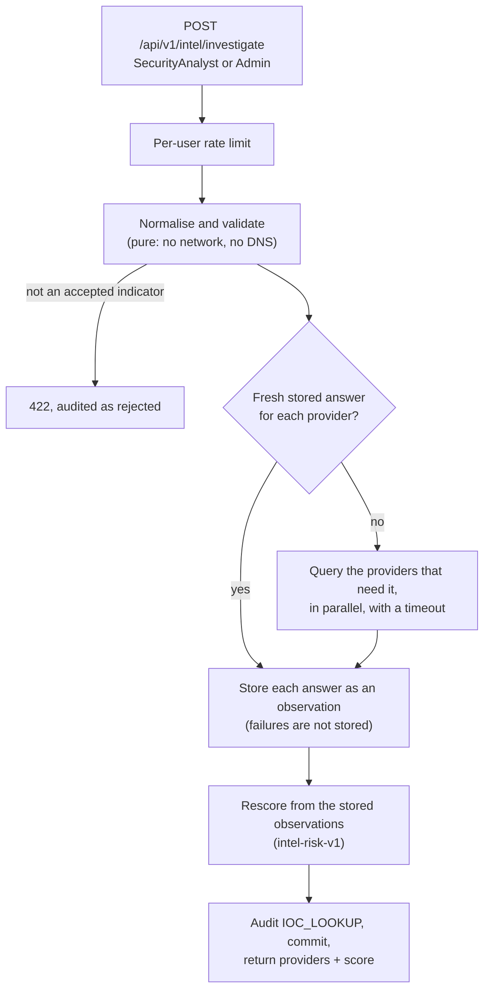

# Threat intelligence (Intel)

> **Status: implemented (Phase 2, backend).** The API looks up one indicator at a time, asks
> AbuseIPDB and AlienVault OTX about it, stores each answer, scores the indicator with a documented
> method and audits the lookup. The analyst screens for it are Phase 3. The provider adapters have
> only been run against recorded sample responses, never against the live services; see
> [Verification status](#verification-status).

## Intent

Let an analyst look up an indicator of compromise (IOC), see what each external provider says, and get
a CipherForge assessment whose reasoning is visible. Supported indicator types: IPv4, IPv6, domains,
URLs and SHA-256 hashes. Providers: AbuseIPDB and AlienVault OTX.

## Principles

- **Evidence, not truth.** A provider's answer is one input. Feeds can be stale, incomplete,
  contradictory or rate-limited.
- **Show each provider independently**, then the CipherForge correlation and score. Never label an
  indicator malicious from a single source.
- **Explainable scores.** Every score lists the evidence behind it, no single provider can dominate
  it, and the classification bands are fixed and documented: 0-20 Informational, 21-40 Low,
  41-60 Medium, 61-80 High and 81-100 Critical.
- **Say what is unknown.** Distinguish provider evidence from internal evidence, and show confidence,
  freshness and uncertainty. No reports does not mean safe.
- **One normalised indicator, many observations.** Raw provider observations stay traceable to their
  source and are never merged away.
- **The backend makes the calls.** Browsers never talk to a provider and never see an API key.
  Responses are cached with per-provider freshness rules, and every lookup is audited.
- **Geolocation is not attribution.** IP reputation and location do not identify a person or an
  attacker's whereabouts, and the UI must not suggest they do.
- **Recommend, never auto-block.** Suggested actions are advice for an analyst.

## How an investigation works

The score is always computed from **stored** observations, whether the answer was fetched a moment ago
or served from the cache, so the result of an investigation and a later read of the same indicator
agree. Each provider is shown on its own, followed by the CipherForge score.

| Piece | Location |
| --- | --- |
| Normalisation | `backend/app/services/normalization.py` |
| Provider adapters | `backend/app/collectors/` (`abuseipdb.py`, `otx.py`, shared `base.py`, `sanitize.py`, `registry.py`) |
| Scoring | `backend/app/correlation/scoring.py` |
| Orchestration, caching, persistence | `backend/app/services/intel_service.py` |
| Audit writer, rate limiter | `backend/app/services/audit.py`, `backend/app/security/rate_limit.py` |
| API and response models | `backend/app/api/v1/intel.py`, `backend/app/schemas/intel.py` |
| Tables | `backend/app/models/threat.py`, `backend/app/models/audit.py`, migration `0002_threat_intel` |

The HTTP contract is in [api.md](api.md).

## Indicators and normalisation

Whatever an analyst pastes is turned into one canonical, validated indicator, so equivalent spellings
land on a single record, and unsafe input is rejected before it reaches the database or a provider.
Normalisation is pure: it never touches the network and never resolves DNS.

| Type | Canonical form | Rejected |
| --- | --- | --- |
| IPv4, IPv6 | Compressed form; an IPv4-mapped IPv6 address becomes IPv4. | Private, loopback, link-local, multicast, reserved, documentation and other non-public addresses; IPv6 zone identifiers. |
| Domain | Lower-case ASCII; internationalised names become punycode (IDNA 2008 with UTS 46 mapping); one trailing dot removed. | Single labels, email addresses, invalid labels, names over 253 characters, and reserved or private-use top-level domains (`local`, `internal`, `lan`, `test`, `example` and similar). |
| URL | `http` or `https` only; lower-case scheme and host; default port and fragment dropped; path and query percent-encoded with canonical escapes; path defaults to `/`. | Other schemes, embedded credentials, backslashes, a missing host, a non-public IP host, an invalid port. |
| SHA-256 | 64 hexadecimal characters, lower-case. | MD5, SHA-1 and SHA-512 are rejected with an explicit message. |

Also:

- Defanged input (`hxxp://example[.]com`, `1.2.3[.]4`) is refanged first.
- The input is limited to 2048 characters. Whitespace, control characters and invisible or
  direction-changing characters are rejected, because they make look-alike indicators easy to forge.
- Error messages describe the problem and never echo the input, which may be hostile.
- A hostile but syntactically valid URL (for example one containing a script tag) is not rejected: it
  is percent-encoded and handled as data, and must only ever be displayed as text.

Rejecting non-public addresses and names matters twice over: internal addressing is not leaked to a
third party, and the feature cannot be used to make the server probe internal hosts.

## Providers

| | AbuseIPDB | AlienVault OTX |
| --- | --- | --- |
| Indicator types | IPv4, IPv6 | IPv4, IPv6, domain, URL, SHA-256 |
| Request | `GET https://api.abuseipdb.com/api/v2/check` with `ipAddress` and `maxAgeInDays=90` | `GET https://otx.alienvault.com/api/v1/indicators/{type}/{indicator}/general`, where `{type}` is `IPv4`, `IPv6`, `domain`, `url` or `file` |
| Credential header | `Key` | `X-OTX-API-KEY` |
| Get a key | <https://www.abuseipdb.com/account/api> (free account) | A free account at <https://otx.alienvault.com>; the key is shown in your account settings |
| Signal (0 to 1) | Abuse confidence ÷ 100. Zero if AbuseIPDB lists the address as whitelisted. Halved when there are only one or two reports in the window. | By number of pulses naming the indicator: 0 gives 0, 1 gives 0.25, 2 gives 0.4, 3 to 4 give 0.55, 5 to 9 give 0.7, 10 to 24 give 0.85, 25 or more give 1.0. Multiplied by 0.25 when OTX attaches validation entries, such as a known-good list. |
| Evidence date | Time of the last report. | Newest pulse modification time (the oldest pulse creation time is the first-evidence date). |
| Default cache time | 6 hours (`ABUSEIPDB_CACHE_TTL_SECONDS`) | 12 hours (`OTX_CACHE_TTL_SECONDS`) |
| Kept from the answer | Confidence score, report and reporter counts, last report time, window, whitelist and Tor flags, usage type, ISP, domain, country code. | Pulse count, up to 100 pulses examined, the 5 newest pulses (id, name, created, modified), validation entries, the most common malware families, ATT&CK technique ids and tags. |

A provider with no API key is simply "not configured": it makes no network call and contributes
nothing, and the response says so. Leave a key blank to switch that provider off.

What is **not** kept: the raw response. Provider payloads are attacker-influenceable (anyone can name an
OTX pulse), so only whitelisted fields survive, each bounded in size and cleaned of control and
invisible characters. Free text from a provider is community-supplied; render it as text only, and
never as markup. A country code is what the provider reports for the address. It says nothing about
who operates a host or where they are, and the interface must not present it as an attacker's
location.

### Provider outcomes

Each provider's result is reported separately with one of these statuses:

| Status | Meaning |
| --- | --- |
| `ok` | The provider answered with evidence. |
| `no_data` | The provider answered and has nothing on the indicator (no pulses or a 404 for OTX; no reports and a zero score for AbuseIPDB). It counts as an answer, but it is not proof that the indicator is safe. |
| `not_configured` | No API key is set. No network call was made. |
| `unsupported` | The provider does not accept this indicator type. No network call was made. |
| `rate_limited` | The provider answered HTTP 429. |
| `error` | A timeout, a network failure, rejected credentials (401 or 403), an unexpected HTTP status, invalid JSON, an unexpected shape, or a response over 2 MiB. The message is fixed text and never contains the response. |
| `not_queried` | A stored indicator has no answer from this provider, and none was requested. |

Failures never abort an investigation and are never stored as observations, so a failed call cannot
overwrite or impersonate evidence. If an older answer exists it is still shown, marked stale, with the
failure message next to it.

## Caching and refresh

PostgreSQL is the cache. There is no Redis or queue: the specification asks not to add one just to make
the MVP look complex.

- Each answer is stored as an observation with the time it was fetched. It is **fresh** while younger
  than that provider's cache time and **stale** afterwards.
- Investigating the same indicator again inside the cache time makes no provider call
  (`from_cache: true`). Every lookup is audited, cached or not.
- After the cache time the provider is asked again. If that fails, the stale answer is still used for
  scoring, flagged as stale, and lowers the confidence.
- `refresh: true` asks again before the cache time, but only for answers at least 60 seconds old, so
  a "refresh" button cannot burn a provider's free quota.
- `GET /api/v1/intel/indicators/{id}` and the list endpoints never call a provider.
- The indicator's `status` is `active` while at least one provider answer is fresh, otherwise `stale`.

## Scoring: `intel-risk-v1`

A pure, deterministic function from provider evidence to a score from 0 to 100. The same evidence and
the same clock always give the same score. The arithmetic is integer-only, so rounding never differs
between platforms.

**Properties**

- Every point belongs to a named factor, the factors always add up to the score, and the response
  lists them.
- No single provider can dominate. One contributes at most 45 points, and a score that fewer than two
  sources support is capped at 60. An indicator is never rated High or Critical on one source's word.
- Recent evidence counts more than old evidence, and corroboration by independent sources is rewarded
  as its own factor.
- "No data" scores zero but is never called safe. The result lists what is unknown.

**Method**

1. **Signal.** Each adapter reduces its answer to a number from 0 to 1 (see [Providers](#providers)).
   It is the strength of the provider's evidence, not a probability that the indicator is malicious.
2. **Recency weight**, from when the provider says the activity last happened (not when CipherForge
   fetched it): up to 7 days 1.0; up to 30 days 0.9; up to 90 days 0.7; up to 180 days 0.5; older
   0.3. No date given: 0.6. A date in the future counts as brand new.
3. **Provider points** = 45 × signal × recency weight, rounded half up.
4. A source **supports** the indicator when signal × recency weight is at least 0.4.
5. **Corroboration:** +8 when two sources support the indicator, +16 for three or more. Today there
   are two providers, so the larger bonus needs a third.
6. **Malware families:** +5 for each distinct family named by supporting sources, at most 10.
7. **Caps.** Fewer than two supporting sources: at most 60. In every case: at most 100. A cap shows up
   as its own negative factor, so the factors still add up.
8. **Confidence** measures how much and how good the evidence is, not how likely malice is: +35 for
   each fresh answer, +15 for each stale one, +20 when two or more sources support the indicator, at
   most 90. A "no data" answer is still an answer.

**Classification bands**

| Score | Classification |
| --- | --- |
| 0 to 20 | Informational |
| 21 to 40 | Low |
| 41 to 60 | Medium |
| 61 to 80 | High |
| 81 to 100 | Critical |

Each band carries fixed advice for the analyst, such as searching internal telemetry first.
CipherForge recommends actions and never applies them. When no provider answered at all, the advice
says so ("cannot say whether it is safe") instead of "no action is needed", because a score of zero
then means "not assessed", not "clean". The API sends the band in lower case
(`informational`, `low`, `medium`, `high`, `critical`).

**Worked examples** (activity within the last 7 days unless stated)

| Evidence | Score | Band | Confidence | How |
| --- | --- | --- | --- | --- |
| AbuseIPDB 1.0, OTX not configured | 45 | Medium | 35 | One source gives its 45 points. |
| AbuseIPDB 1.0 and OTX 0.55 | 78 | High | 90 | 45 + 25 + 8 corroboration. |
| AbuseIPDB 1.0 and OTX 1.0 | 98 | Critical | 90 | 45 + 45 + 8. |
| AbuseIPDB 0.5 and OTX 0.5 | 54 | Medium | 90 | 23 + 23 + 8. |
| AbuseIPDB 1.0 and OTX 0.39 | 60 | Medium | 70 | OTX falls just short of supporting (0.39 < 0.4): 45 + 18 = 63, capped at 60. |
| AbuseIPDB 1.0 and OTX 0.3 | 59 | Medium | 70 | 45 + 14, below the cap, and no corroboration. |
| Both 1.0, both naming the same two malware families | 100 | Critical | 90 | 45 + 45 + 8 + 10 = 108, capped at 100. |
| AbuseIPDB 1.0, last report 100 days ago, alone | 23 | Low | 35 | 45 × 0.5. |
| AbuseIPDB 1.0, last report 400 days ago, alone | 14 | Informational | 35 | 45 × 0.3. |
| OTX 1.0, no date reported, alone | 27 | Low | 35 | 45 × 0.6. |
| Nothing answered | 0 | Informational | 0 | Zero does not mean safe. `answered_sources` is 0, and the uncertainty notes and the advice both say nothing can be concluded. |

The tests in `backend/tests/test_scoring.py` pin the main examples and check the invariants: the
factors sum to the score, the score never exceeds 100, it never falls as a provider's signal rises,
and it never rises as the evidence ages.

**Uncertainty** is part of the result. The score response lists, in words, what the number rests on and
what it does not: that no internal telemetry was available, which providers were missing or failed,
which answers are stale, when a provider gave no activity date, when only one source supports the
score, and that an absence of reports is not proof of safety.

## Stored data and audit

| Table | Holds |
| --- | --- |
| `threat_sources` | One row per provider (`abuseipdb`, `otx`), created automatically the first time that provider is used. |
| `threat_indicators` | One row per normalised indicator (unique on type and value): risk score, confidence, first and last seen, source count, tags, status, and a snapshot of the score breakdown. The band is derived from the score. |
| `threat_observations` | One row per provider answer, with its signal, evidence dates, fetch time and the whitelisted summary. Cascades when the indicator is deleted. |
| `audit_logs` | One row per investigation: who, when, from which address, what, and the outcome. |

Each lookup is audited as `IOC_LOOKUP` with the result `success`, `partial` (a provider was queried and
failed) or `rejected` (input refused, with no target recorded). The audit row is committed together
with the work it describes. It holds the actor (the token's subject), the target as `type:value`, the
correlation ID that is also sent back in `X-Correlation-ID`, the caller's address when it is a valid
IP address, and a small details object: whether a refresh was requested, each provider's status and
whether its answer came from the cache, and the resulting score and band (for a rejected lookup, the
fixed reason text). API keys and provider payloads are never written to it. Database triggers reject
`UPDATE` and `DELETE` on the table, on both SQLite and PostgreSQL. Reading a stored indicator is not
audited: only lookups are.

## Security properties

| Property | How |
| --- | --- |
| Authorisation | Every Intel route requires `SecurityAnalyst` or `Admin`. Authorisation runs before the rate limiter, so a caller who is not allowed in never uses up anyone's budget. |
| Rate limiting | 30 investigations a minute for each user (`INVESTIGATE_RATE_LIMIT_PER_MINUTE`), as a sliding window, answered with `429` and `Retry-After`. Rejected input uses budget too. |
| No server-side request forgery | The backend only ever contacts two fixed provider hosts. Analyst input appears in a request only as an escaped path segment or query value, and non-public addresses and names are refused before any call. Redirects are not followed. |
| Bounded provider calls | A connect timeout of 5 seconds and an overall timeout (`PROVIDER_TIMEOUT_SECONDS`, default 10), a 2 MiB response cap, and a small connection pool. A provider that hangs degrades to an `error` result. |
| Untrusted provider data | Parsed defensively: types checked, counts bounded, dates sanity-checked (nothing before 1990 or more than a day ahead), and text cleaned and truncated. A malformed answer degrades one provider and never the whole investigation. |
| Keys stay server-side | API keys are read from the environment, are never returned or logged, and are passed to the `backend` service only, not to the migration job. The HTTP client's request logging is switched off because it would record full request URLs, which contain the indicator. |
| No indicator echo | Error responses and logs never repeat the submitted indicator. |

The wider analysis is in [threat-model.md](threat-model.md) and [security.md](security.md).

## Privacy and abuse considerations

Looking up an indicator sends it to a third party: AbuseIPDB for an IP address, and both providers
for any indicator they support. Analysts should not look up anything they would not be comfortable
sharing with a third party, and the lookups are audited. Provider terms of use and free-tier limits
apply, and the platform must stay within them; the cache time, the refresh floor and the rate limit
exist partly for that reason.

## Configuration

| Variable | Default | Purpose |
| --- | --- | --- |
| `ABUSEIPDB_API_KEY` | empty (not configured) | AbuseIPDB key. |
| `OTX_API_KEY` | empty (not configured) | AlienVault OTX key. |
| `ABUSEIPDB_CACHE_TTL_SECONDS` | `21600` | How long an AbuseIPDB answer is fresh (60 seconds to 30 days). |
| `OTX_CACHE_TTL_SECONDS` | `43200` | How long an OTX answer is fresh. |
| `PROVIDER_TIMEOUT_SECONDS` | `10` | Overall limit for each provider call (1 to 30). |
| `INVESTIGATE_RATE_LIMIT_PER_MINUTE` | `30` | Investigations a user may start per minute (1 to 600). |

Docker Compose passes these to the `backend` service only. See [deployment.md](deployment.md).

## Limitations

These are known and deliberate for the MVP:

- **Scores are recomputed only when an indicator is investigated.** A stored score does not decay on
  its own as evidence ages, and there is no background refresh.
- **Concurrent duplicates.** Two simultaneous investigations of the same new indicator may both call
  the providers and store two observations. The indicator row itself is created safely.
- **History is kept.** Observations accumulate, and there is no pruning yet.
- **The rate limiter is in memory and per process.** With several API replicas the effective limit is
  the limit times the number of replicas, and counters reset on restart. Use a shared limiter at the
  proxy or Redis when a hard global limit matters.
- **A hung DNS lookup** can leave an abandoned worker thread that delays shutdown of the process. The
  caller is not affected: that provider reports a timeout.
- **Only two providers**, and no internal evidence. The result always says that no internal telemetry
  was available; correlation with your own logs arrives with the later phases.
- **The audit protection can be removed by a database superuser** who drops the triggers. It guards
  against application bugs and ordinary SQL, not against someone who owns the database.

## Verification status

- The normaliser, both adapters, the scoring function, the service and the API are covered by
  automated tests on SQLite and on PostgreSQL 16 (see [deployment.md](deployment.md#verification-status)).
- **The adapters were tested with recorded sample responses only; no real API call was made.** No keys
  were available while building. The AbuseIPDB request and response fields were checked against its
  public API documentation. For OTX, the URL pattern, the type names, the `general` section, the
  `X-OTX-API-KEY` header, the use of `validation` and the pulse names were checked against
  AlienVault's own Python SDK. The remaining pulse-level fields (`pulse_info.count`, a pulse's
  `created` and `modified`, `malware_families` and `attack_ids`) come from the sample responses and
  have **not** been confirmed against the live service. If a field is missing or renamed, the adapter
  treats it as unknown and the investigation reports a weaker result; it does not fail.
- Run one real lookup with your own keys before relying on the output.

## Adding a provider

1. Add a collector in `backend/app/collectors/` that subclasses `Collector`: set `name`,
   `display_name` and `supported_types`, and implement `_query`, calling `_get_json` and returning a
   `ProviderResult` with a signal from 0 to 1. Keep to whitelisted, bounded fields.
2. Add its key and cache-time settings to `Settings`, register it in `registry.py`, and pass the
   settings through `docker-compose.yml` and `.env.example`. The drift tests in
   `backend/tests/test_deployment_files.py` fail until all three agree.
3. Nothing else to migrate: the provider's row in `threat_sources` is created on its first lookup.
4. Test it against recorded responses, including malformed, oversized, rate-limited and unauthorised
   cases. Never test against a live API.

The scoring method needs no change: it treats providers identically.

The related threats are tracked in [threat-model.md](threat-model.md).
