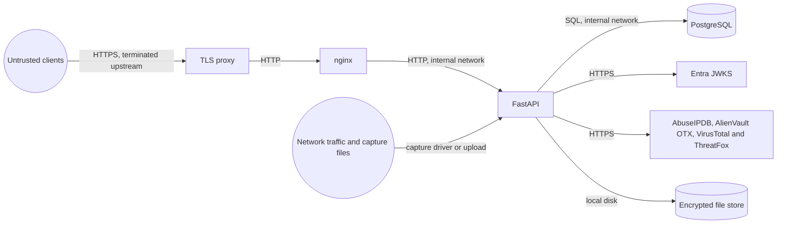

# Threat model

A STRIDE analysis of what exists today: the Phase 1 platform (the API, its identity and database layer,
the nginx front end, the container stack and the build pipeline), the Phase 2 threat-intelligence
backend (outbound provider calls, third-party data, the audit trail), the Phase 3 to 3c dashboard
that displays that data, and the Phase 4 expansion (India Standard Time display, VirusTotal and
ThreatFox lookups, network monitoring and encrypted file sharing). It is a living document: each new
feature must extend it before it ships.

The earlier rule that file sharing ("Vault") needs its own threat model is met by
[Encrypted file sharing (Phase 4)](#encrypted-file-sharing-phase-4) (rows 57 to 71) and the design in
[encryption-design.md](encryption-design.md). Both were written together with the implementation, not
before it, and **nobody outside this project has reviewed either of them or the code.** Until someone
has, treat the file-sharing module as unreviewed.

## Scope and assumptions

In scope: the browser-to-nginx-to-API-to-database path, token validation, configuration and
secrets, the containers, the CI pipeline, the API's calls to its four providers (AbuseIPDB,
AlienVault OTX, VirusTotal and abuse.ch ThreatFox), how the dashboard renders what those providers
send, network monitoring (packet capture on the machine that runs the API, uploaded capture files and
the lookups they trigger) and encrypted file sharing (uploads, the encrypted file store, share links
and the public download routes).

Assumptions:

- The host and Docker engine are trusted and patched. A compromised host is out of scope.
- TLS is terminated by a proxy in front of nginx in any deployment that is not purely local.
- Microsoft Entra ID is the identity authority, and its signing keys and token claims are
  trustworthy once the signature, issuer, audience and tenant are verified.
- Operators are authorised to run the stack and to test it.
- The packet-capture driver (Npcap or libpcap) and the operating system's capture permissions are
  trusted. Whether an account may capture is decided by the operating system, not by CipherForge.
- Whoever starts a capture is authorised to monitor that network.
- The operator of the server is trusted with its files. File sharing encrypts on the server, which
  holds the master key, so anyone who controls the server, its database and its key can read every
  file (row 67).

## Assets

| Asset | Why it matters |
| --- | --- |
| Entra access tokens | Bearer credentials. Anyone holding one can act as the user until it expires. |
| Database credentials | Full access to stored intelligence, alerts and audit data. |
| Provider API keys | Quota and billing; may be abused or leaked. |
| Stored intelligence and network alerts | Integrity matters most: a poisoned score or a forged alert misleads an analyst. |
| Captured network metadata | Addresses, ports and times can identify people and show how a network is laid out. |
| Stored files, share links and the master key | A link is a bearer credential for one file. The master key (`CIPHERFORGE_MASTER_KEY`) unwraps every file's data key: lose it and every file is unreadable, leak it together with the database and the file store and every file is readable. |
| Audit trail | Must stay trustworthy to be useful after an incident. |
| Availability of the API | Analysts depend on it during an incident. |

## Trust boundaries

Everything left of the API is untrusted input. Responses from Entra and the threat feeds are
treated as untrusted data too: they are validated and bounded before use. Two more inputs are
untrusted since Phase 4: the packets and capture files that network monitoring reads (they can be
forged or hostile, and the capture driver hands them to the API process), and the bytes of uploaded
files. Apart from the health checks, the public share routes (`/api/v1/shares/…`) are the only
routes that need no sign-in; the link token is their credential.

## STRIDE

| # | Threat | Category | Mitigation | Status |
| --- | --- | --- | --- | --- |
| 1 | Forged or tampered token (wrong key, `alg: none`, HS256 with the public key as secret) | Spoofing | RS256 only, signature against tenant JWKS, required claims, `tid`, `iss`, `aud` checks; covered by tests. | Mitigated |
| 2 | Stolen token replayed | Spoofing | Short token lifetime from Entra, TLS upstream, tokens never persisted in the browser client. Revocation is not available. | Partly mitigated |
| 3 | Dev auth mode left on in production | Spoofing, Elevation | The API refuses to start with `AUTH_MODE=dev` when `ENVIRONMENT=production`, and production is the default. | Mitigated |
| 4 | A user calls an endpoint above their role | Elevation | Deny by default; `require_roles` on each route; 403 is logged. | Mitigated |
| 5 | Another user's resource accessed with the same role | Elevation | Resource-level checks. Capture sessions (row 49) and files, links and file activity (row 62) belong to the user who created them, and another user's id answers `404`, the same as an id that does not exist. Stored indicators have no owner (row 41). | Mitigated for sessions and files; indicators are shared by design |
| 6 | SQL injection | Tampering | SQLAlchemy parameterised queries only; no string-built SQL. | Mitigated |
| 7 | Malformed input crashes or confuses the API | Tampering, DoS | Pydantic validation; strict IOC normalisation and a 2048-character limit; nginx body limit of 64 KB. | Mitigated |
| 8 | Secrets in logs, errors or health responses | Information disclosure | Redaction filter, `SecretStr`, value-free configuration errors, generic 500s, tested. | Mitigated |
| 9 | Stack traces or SQL in responses | Information disclosure | One error envelope; unhandled exceptions return a generic message. | Mitigated |
| 10 | Log injection through the correlation header | Repudiation, Tampering | Incoming IDs must match `[A-Za-z0-9._-]{8,64}` or are replaced. | Mitigated |
| 11 | Cross-site scripting | Tampering, Information disclosure | React escapes output, no `dangerouslySetInnerHTML` (ESLint rejects it, along with `innerHTML` assignment, `eval` and `new Function`), strict CSP with no inline scripts. Provider-supplied text is the main untrusted input; see rows 25 and 33. | Mitigated |
| 12 | Clickjacking | Tampering | `X-Frame-Options: DENY` and `frame-ancestors 'none'`. | Mitigated |
| 13 | CSRF | Tampering | The API authenticates with a bearer header, not cookies, so browsers do not attach credentials automatically. Revisit if cookies are ever introduced. | Not applicable today |
| 14 | Wildcard CORS exposes the API to any site | Information disclosure | `*` is rejected; origins must be listed; no credentials mode. | Mitigated |
| 15 | Database exposed to the network | Information disclosure | Port bound to `127.0.0.1`; the database is not published on other interfaces. | Mitigated locally |
| 16 | Container breakout or privilege escalation | Elevation | Non-root users, all capabilities dropped, `no-new-privileges`, read-only root filesystem for the API. | Partly mitigated |
| 17 | Request flood against the API | DoS | Per-user limits answer `429` with `Retry-After`: investigations, interface-list refreshes, capture-file uploads and alert enrichment share one budget (30 a minute), and file uploads and link creation have their own (10 a minute each). Public share requests are limited per client (row 57) and wrong passwords per link and per client (row 58). Every limiter is in memory and per process. nginx adds a body limit (64 KB, or up to 500 MB on the two upload paths) and timeouts. Other routes, such as listing and reading, and other unauthenticated requests are not throttled. | Partly mitigated |
| 18 | Key service (JWKS) outage causes auth failures | DoS | Keys cached for an hour; outage returns 503 with a distinct code. | Mitigated |
| 19 | Actions not attributable to a user | Repudiation | Correlation IDs on every request; the authenticated subject is logged on denials; every investigation (including refused input) and every deletion of a stored indicator is written to the audit table with actor, target, result and correlation ID. Reads of stored indicators are not audited. | Partly mitigated |
| 20 | Vulnerable or malicious dependency | Tampering | Exact pins, lockfile, `pip-audit`, `npm audit`, Dependabot, SHA-pinned Actions. Transitive Python packages are not hash-locked. CI blocks on findings in the frontend packages that ship; the build and test tools are audited too but the step only reports (it was made non-blocking for a `picomatch` advisory that GitHub has since withdrawn; see `docs/security.md`). Phase 3c added one runtime dependency, anime.js 4.5.0 (MIT, no dependencies of its own), imported from a single file and exercised under the strict CSP by every browser test. Phase 4 added three Python packages, `cryptography` (already pulled in by PyJWT), `scapy` (which parses untrusted packets, row 50) and `tzdata`, all exactly pinned, and no frontend package. Scapy's licence (GPL-2.0-only, against the project's MIT) is a licensing question, not a security one, and is covered in [security.md](security.md#dependency-management). | Partly mitigated |
| 21 | Compromised CI or build | Tampering | Least-privilege workflow, no persisted credentials, no secrets in the pipeline. Image signing and scanning are not in place. | Partly mitigated |
| 22 | Weak or default database password | Spoofing | Compose requires `POSTGRES_PASSWORD`, the API refuses the `CHANGE_ME` template password in production. | Mitigated |
| 23 | TLS stripped or absent | Information disclosure | Not provided by this stack; the front proxy must terminate TLS and set HSTS. | Operator responsibility |
| 24 | Server-side request forgery: an indicator (URL, domain or address) makes the server contact an internal host | Information disclosure, Tampering | The backend never fetches an indicator. It calls four provider hosts, each fixed in code, and sends the indicator only as an escaped path, query value or JSON field. The VirusTotal and ThreatFox base URLs can be changed by setting, but only to `https` (plain `http` only for loopback) with no credentials, query or fragment. Private, loopback, link-local, reserved and documentation addresses, and reserved or private-use domain names, are refused before any call. Redirects are not followed. Addresses taken from network traffic pass through the same checks (row 54). | Mitigated |
| 25 | Hostile provider data: markup or control characters in an OTX pulse name, a VirusTotal threat name or a ThreatFox malware name, oversized or malformed JSON, absurd counts or dates | Tampering, DoS | Parsed defensively into whitelisted fields with bounded sizes; text stripped of control and invisible characters; 2 MiB response cap; implausible dates discarded; a parser failure degrades one provider only. A ThreatFox reference address is kept only if it is a plain `http` or `https` URL without credentials or whitespace. Provider text must be displayed as text, which the dashboard does (rows 11 and 33). | Mitigated |
| 26 | Provider outage, rate limit or slow response | DoS | A connect timeout and an overall timeout, run in parallel against one deadline; each failure becomes a labelled status; failures are never stored; an older answer is still shown as stale. VirusTotal and ThreatFox retry only after a timeout, a connection failure or a 5xx answer, inside their own overall timeout. | Mitigated |
| 27 | A user burns the provider's free quota | DoS, cost | Per-user investigation limit, cache times (AbuseIPDB 6 hours, OTX 12 hours, VirusTotal 24 hours, ThreatFox 6 hours), a 60-second floor on `refresh`, and keys held server-side only. Network enrichment is paced at four provider lookups a minute by default (`NETWORK_ENRICHMENT_MAX_PER_MINUTE`), which is VirusTotal's free allowance (4 a minute, 500 a day); a lookup over a provider's quota comes back as a labelled `rate_limited` failure for that provider only. The limiter is per process, so replicas multiply the limit. | Partly mitigated |
| 28 | Provider API key or the file-sharing master key leaked through logs, responses, the wrong container or the HTTP client | Information disclosure | `SecretStr` settings (the four provider keys and the master key, see row 66) masked by value in logs; never returned (the stats endpoint reports only whether a key is set); given to the `backend` container only, not the migration job; sent only in a request header, and a VirusTotal or ThreatFox base-URL override must be `https`, so a key is never sent in clear text; HTTP client request logging silenced because it records full URLs. Each is tested. The `.env` file on the host is the operator's to protect. | Mitigated |
| 29 | A single source, a stale answer or a poisoned feed mislabels an indicator | Tampering (analyst decisions) | Each provider is shown on its own; no score from one source exceeds 60; recency and corroboration are explicit factors; uncertainty and missing sources are listed; CipherForge recommends actions and never blocks anything. VirusTotal and ThreatFox add evidence to the same deterministic score and add no score of their own. Feeds can still be wrong, so scores are advice. | Partly mitigated |
| 30 | The audit source address is spoofed through `X-Forwarded-For` | Repudiation | The header is honoured only from private proxy networks; the value is stored only if it is a valid IP address; the actor comes from the token. A peer inside the trusted ranges that can reach the backend directly can still choose the recorded address. | Partly mitigated |
| 31 | Audit rows altered or deleted | Repudiation, Tampering | The application has no update or delete path for audit rows, and deleting an indicator only adds an `IOC_DELETE` row; database triggers reject `UPDATE` and `DELETE` on SQLite and PostgreSQL. A database superuser can drop the triggers. | Partly mitigated |
| 32 | An analyst sends internal or sensitive indicators to a third party | Information disclosure | Non-public addresses and names are refused. Looking up anything else discloses it to the providers by design; the lookups are audited, the Investigate page says so beside the button, and the privacy note in [threat-intelligence.md](threat-intelligence.md#privacy-and-abuse-considerations) applies. | Accepted, documented |
| 33 | Provider data steers a link in the dashboard: a hostile OTX pulse id, ATT&CK identifier, VirusTotal or Malpedia address or reporter-supplied reference makes the UI link to a phishing page or a `javascript:` URL | Tampering, Spoofing | Links to other sites are built only from a fixed base and an identifier matching a strict pattern. The VirusTotal and Malpedia addresses are accepted only in one exact shape and rebuilt from their parts, and the ThreatFox record link is built from its numeric id. Anything else is shown as plain text. A reporter-supplied reference address, which may point at the malware itself, is shown defanged (`hxxp`) and is never linked. Links open with `rel="noopener noreferrer"`. | Mitigated |
| 34 | A crafted address makes the dashboard request an unintended API path (for example `/indicators/..%2F..%2Fhealth`) | Tampering | The detail route accepts only a UUID and sends no request otherwise; identifiers placed in a request are URL-encoded. | Mitigated |
| 35 | The dashboard misleads the analyst: "nothing answered" read as "clean", or one indicator's result shown under another | Tampering (analyst decisions) | "Not assessed" is its own state with no score; each provider is shown separately with what is not known; requests are cancelled when the screen changes and the detail page is keyed by indicator. Component tests pin each behaviour. The backend side of "no data is not clean" is row 47. | Mitigated in the display; feed accuracy is row 29 |
| 36 | What an analyst searched for leaks through the address bar, browser history or a `Referer` header | Information disclosure | `Referrer-Policy: no-referrer` and `noreferrer` links keep it from other sites. Only the Indicators search text is placed in the address, and what is typed on the Investigate page is not. History and shared links still show the search text. | Partly mitigated |
| 37 | The console tells a third party who is using it: a font host, CDN or map tile server contacted by the page, or a cookie or `Referer` that travels with a request | Information disclosure | The fonts, the world map and the icons are bundled; the CSP allows only the console's own origin (and `data:` images); a browser test follows a whole session and checks every request went to that origin with no cookie and no `Referer`, and another checks that the built files name no host other than a short documented list. The only thing stored in the browser is the effects switch. | Mitigated |
| 38 | The dashboard presents a provider-reported country as where an attacker is, or demo data as real data | Tampering (analyst decisions) | The map and the lists say "provider-reported country" and place a marker on a country's label point, not a place; a scope note says what the figures leave out; whenever any provider is simulated, a banner says so on every screen. | Mitigated in the display; feed accuracy is row 29 |
| 39 | Repeated overview requests exhaust the server: the overview aggregates stored history on every request, and every open dashboard refreshes it each minute | DoS | The route needs the analyst role, is read-only, and scans a bounded amount (the newest 2,000 provider answers, and up to 20,000 lookups and 20,000 new indicators from the last 14 days), reporting when a bound cut a figure short. There is no per-user limit on reads. | Partly mitigated |
| 40 | The demo server (development sign-in, simulated providers) is run against real data or exposed to a network | Elevation, Tampering | It sets `ENVIRONMENT=development` and `AUTH_MODE=dev` (which production refuses), accepts only a `.db` file inside `backend/.demo/`, makes no outbound calls, is excluded from the container image and is imported by nothing in `app/`. It listens on loopback unless told otherwise. | Mitigated by construction; never bind it to a network |
| 41 | An analyst deletes the wrong indicators, or far more than they meant, with one click | Tampering (stored intelligence) | Deletion is by exact id only: there is no "delete everything matching this search", and one request carries at most 100 ids. The dashboard ticks only rows on the page being shown, forgets the selection when the filters or the page change, and always asks first, naming the values (or how many) that will go. Each deletion is audited with who did it. There is no undo and no soft delete: a deleted indicator is gone, and investigating it again starts a new record. Any analyst can delete any indicator (indicators have no owner). | Partly mitigated: it is permanent by design |
| 42 | A page on another site, a form or a crafted link deletes stored indicators | Tampering (CSRF) | Deletion uses `DELETE` and `POST` only, never `GET`, so a link or an image cannot start it. It needs the bearer header, a JSON body of ids that must be UUIDs, and no other content type is accepted, so a cross-site form or `text/plain` request is refused with `422`. CORS is off unless origins are listed, so the preflight for a cross-site `DELETE` is refused by default. Browser and API tests cover each. | Mitigated |
| 43 | A lookup and a deletion race: the answer of a lookup still waiting on providers is written for an indicator that was just deleted, so it comes back or leaves orphan rows | Tampering | The lookup checks again when it saves. If the indicator has been deleted it is discarded, the caller gets `409`, and the audit row says the result was discarded. SQLite enforces foreign keys, so no answer can be stored for a row that is not there. | Mitigated |
| 44 | Deleted values remain in the audit trail | Information disclosure | By design: the audit rows are append-only and name the `type:value` they are about, so the older `IOC_LOOKUP` rows and the new `IOC_DELETE` row still contain a deleted indicator. There is deliberately no feature to delete audit rows. Removing a value from the trail is a database administrator's job, outside the application, and it removes evidence. | Accepted, documented |
| 45 | Deleted data can still be recovered from storage: freed database pages, the write-ahead log, backups, replicas | Information disclosure | SQLite overwrites freed bytes (`secure_delete`) and PostgreSQL reclaims space at vacuum. Copies outside the database file are the operator's to handle. | Partly mitigated; operator responsibility |
| 46 | A lookup uploads or submits something to a provider: a file to VirusTotal, or a URL that VirusTotal would then scan and publish | Information disclosure | VirusTotal is only asked for existing reports (`GET` of an address, domain, URL identifier or hash), and the adapter has no upload, scan, rescan or comment call. ThreatFox is only searched (`search_ioc`, `search_hash`). A hash is looked up by value, and CipherForge never reads a file for it. | Mitigated |
| 47 | "Nothing found" is read as "clean": VirusTotal has no record of an indicator, or ThreatFox has no match | Tampering (analyst decisions) | A provider with no record is stored as no data, adds no evidence and never lowers a score. An indicator that no provider answered for is stored with a score of 0 and `answered_sources: 0` (the API tells a script to treat that as "unknown", not "clean"); the dashboard shows it as "Not assessed" with no score, and shows each provider's state on its own (row 35). The scoring method (`intel-risk-v1`, including the single-source cap of 60) is unchanged: VirusTotal and ThreatFox only add evidence to it. | Mitigated |
| 48 | A time is misread because the screen and the data use different zones, or an expiry is decided in the wrong zone | Tampering (analyst decisions), Repudiation | The database, the API and the audit trail hold timezone-aware UTC, and expiry, retention and rule windows are computed in UTC. India Standard Time (`Asia/Kolkata`, written `DD-MM-YYYY hh:mm:ss A IST`) is applied only when a time is shown to a person, by one helper on the server (`app/core/timeutil.py`) and one on the dashboard (`frontend/src/features/time/ist.ts`), and is always labelled `IST`. `APP_TIMEZONE` accepts no other zone. The API still returns UTC, so a script and a person reading the same record see two zones; the rule is stated once, in [Time handling](architecture.md#time-handling-utc-storage-ist-display). | Mitigated; the two zones are a reading hazard to know about |
| 49 | Another user's capture session, flows or alerts are listed, read, enriched, stopped or deleted | Elevation, Information disclosure | Every session belongs to the user who created it, and every read, enrichment, stop and delete is filtered by that owner. Another user's id answers `404`, the same as an id that does not exist, and only the user who started a capture can stop it (anyone else is told they have none). There is no administrator override. The routes need `SecurityAnalyst` or `Admin`. Repository and service tests cover the scoping. | Mitigated |
| 50 | A hostile capture file: oversized, truncated, with crafted record sizes, a hostile file name, or content meant to crash or stall the parser | Tampering, DoS | Raw body only. The declared length is checked before the body is read and the stream is cut at `NETWORK_MAX_PCAP_SIZE_MB` (50 by default, 500 at most). The file is written under a random name in a private temporary folder, its structure is checked before analysis (a record over 16 MiB, or no complete packet, is refused), one analysis runs at a time under a 600-second limit, every failure ends with a fixed code and message, and the file is deleted afterwards. The name is a sanitised display label, never a path and never logged. Scapy, a large third-party parser, reads the headers inside the API process, so a parser bug would run with the API's privileges. | Partly mitigated |
| 51 | Traffic volume or variety exhausts memory or disk: very many flows, many spoofed sources, an alert flood, a slow database | DoS | Everything is bounded: the packet queue (`MONITORING_BUFFER_SIZE`, 10,000 by default), the active flows (`MAX_ACTIVE_FLOWS`, 10,000) and the flows stored per session (`NETWORK_MAX_STORED_FLOWS`, 20,000), capped per-source rule tables and windows, 500 alerts per session and 200 per rule, and a bounded write backlog in the recorder (at most 50,000 flows and 2,000 alerts waiting). Overflow is dropped and counted, never waited for, and the session shows the numbers. Sessions are deleted after `NETWORK_RETENTION_HOURS` (72 by default). | Mitigated |
| 52 | The capture runs with more privilege than it needs, or a capture is left running after the API stops | Elevation, DoS | The application never raises its own privileges and never enables promiscuous mode. If the operating system refuses, the session ends as `capture_permission_denied` and nothing is captured. The containers drop every capability, so live capture is a host-only feature, and the documentation recommends a narrow capability on a dedicated account over root. Stopping the API ends the sniffer and drains the queue, and a session still marked running after a crash is marked `failed` (`interrupted`) at the next start. | Partly mitigated: the privilege is the operator's decision, and Linux capture is verified only by unit tests |
| 53 | One analyst holds the only live-capture slot, by accident or on purpose | DoS | Only one live capture runs in the whole application, which protects the host; other analysts see the slot as busy. Only the user who started it can stop it, and a capture has no maximum duration. The operator can end it by restarting the API. | Accepted, documented |
| 54 | An address seen on the network makes the server contact an internal host, or internal addresses leak to a provider | Information disclosure, Tampering | The module fetches nothing itself. It passes IP address text to the same intelligence service as the Investigate page, so rows 24 and 28 apply unchanged. Private, loopback, link-local, multicast, reserved, unspecified and documentation addresses are never sent (`not_applicable`), only the address leaves (no port, volume or capture data), and lookups are paced, capped per session and can be switched off (`EXTERNAL_ENRICHMENT_ENABLED`). The public addresses a network talks to are sent to the providers by design, as in row 32. | Mitigated; public addresses are disclosed by design |
| 55 | Captured metadata is personal data: it is kept longer than needed or seen by someone it should not be | Information disclosure | Only time, addresses, ports, protocol, packet length and TCP flags are kept, never payloads, MAC addresses or DNS names. Sessions are visible only to their owner (row 49), are deleted after 72 hours by default (2,160 at most) and can be deleted earlier by the owner. Audit rows hold counts, an interface name or a file size, never traffic addresses or file names; each row's own `source_ip` is the address of the API client who made the request (row 30). The operator must be authorised to monitor the network and tell the people affected. Deleted rows are subject to row 45. | Partly mitigated: whom to monitor is the operator's decision |
| 56 | A spoofed source address makes an innocent host look like a scanner, harmless traffic trips a rule, or a quiet session is read as "all clear" | Spoofing, Tampering (analyst decisions) | The rules judge headers only, so alerts say "suspected" and show their evidence (what was observed against which threshold and window). No alert names a person, and nothing is blocked. Thresholds are configurable starting points, rule time comes from packet timestamps so replaying a file gives the same alerts, and the known-malicious alert (NET-005) needs provider evidence at or above `KNOWN_MALICIOUS_MIN_SCORE`. A session with no alerts only means that no rule fired. | Partly mitigated: these are heuristics (see [detection-engine.md](detection-engine.md#limitations)) |
| 57 | A share token is guessed, enumerated or brute-forced, or random tokens are used to flood the service | Spoofing, Information disclosure, DoS | A token is 256 bits from `secrets.token_urlsafe(32)`, and only its SHA-256 is stored, so guessing is infeasible and a copy of the database gives out no working link. The link is found by looking up the hash of the presented token (there is no hand-written comparison of token values), so what protects it is the size of the token, not the lookup. Public requests are limited per client (`SHARE_DOWNLOAD_RATE_LIMIT_PER_MINUTE`, 30 by default; IPv6 clients are counted per `/64`), and a token of the wrong shape is rejected before any database access. A refused request for a token that exists says why (revoked, expired, used up), which tells the holder of that token about their own link only. | Mitigated |
| 58 | A link's password is guessed, or password checks are used to exhaust the server | Spoofing, DoS | No password and no password hash is stored. A second key is derived from the password and the master key (Argon2id, 3 passes, 64 MiB), so a wrong password only fails to open the data key. Wrong guesses are limited to 5 per link and 5 per client network in 15 minutes (`SHARE_PASSWORD_ATTEMPT_LIMIT`), checked before any derivation, and a correct password does not refill the budget. At most two derivations run at once, and a request that waits over ten seconds for a slot gets `503 service_busy`. The counters are in process memory. Someone who holds the master key and the database can still test passwords offline at the Argon2id cost per guess. | Partly mitigated |
| 59 | A link leaks through a proxy log, the browser history, a `Referer` header, a chat message or a screenshot | Information disclosure | The token is shown once, when the link is created, and the API masks it in its own logs. The bundled nginx writes `[redacted]` in its access log (checked against a real nginx 1.30.8), and responses carry `Referrer-Policy: no-referrer`. A password link also needs the password, which travels only in a `POST` body. Links expire (24 hours by default) and can be revoked at any time. The nginx **error** log is not redacted: a share URL requested while the backend was down appeared there in full. Other proxies must be set up the same way, and the browser history keeps the link. | Partly mitigated |
| 60 | AES-GCM misuse: a nonce is reused under one key, a key is used too widely, or a ciphertext is replayed in another place | Information disclosure, Tampering | Every file has its own random 256-bit data key, used for exactly two messages (content and name) with different random 96-bit nonces; a repeat is drawn again. The master key wraps one data key per file with a fresh nonce, far below the limit NIST SP 800-38D gives for random nonces. Associated data ties each ciphertext to its row (row 61). The ciphers and key derivation come from the `cryptography` library (the HMAC and SHA-256 from Python's standard library) and none is written here. One weakness of the key use remains: the master key is not split per purpose. It is the AES key that wraps data keys, the HMAC key of the fingerprint (row 66) and half of the HKDF input of password links, kept apart only by separate labels. Tests cover unique nonces and keys, flipped bits, truncation and extension. | Mitigated by design; no independent review |
| 61 | A stored ciphertext is modified, truncated, extended, swapped between files or restored from another copy | Tampering | AES-GCM verifies its tag before any plaintext is used. The recorded size and the associated data (a label plus the file id, and the share id for keys wrapped by a share) are checked too, so a blob copied to another row fails even with the right key. A failure quarantines the file (`corrupt`), writes `FILE_INTEGRITY_FAILED`, answers `409 file_unavailable` and uses no download. A wrong master key is a separate `503 encryption_key_mismatch` and does not quarantine. Quarantine lasts until the owner deletes the file. | Mitigated |
| 62 | Another user's file, link or activity is read, shared, revoked or deleted, or its existence is probed | Elevation, Information disclosure | Ownership is the token's subject. Every file route is filtered by owner, another user's id and an unknown id both answer `404 file_not_found`, no role bypasses it (an administrator included), and the per-file activity view leaves out source addresses. A link holder can only open and download through the link. In `AUTH_MODE=dev` every request is one fixed user, so separation only means something with Entra sign-in. Tests cover foreign ids, ids of the wrong file and every role. | Mitigated in Entra mode |
| 63 | Concurrent downloads exceed a link's limit, or an expired, revoked or used-up link is still served | Tampering | The server decrypts and verifies first, then reserves the download with one conditional `UPDATE … WHERE download_count < max_downloads AND revoked_at IS NULL AND expires_at > now`. The database lets through only as many requests as downloads remain, and the others get `410 share_limit_reached` with their plaintext discarded. Expiry is checked against the server's clock on every request (times are stored in UTC), revocation applies on the next one, and a request that fails or is rejected uses no download. Tests release parallel downloads at the same instant and check the limit holds. | Mitigated; the race tests ran on SQLite and on a local PostgreSQL 16.15, and CI runs them on PostgreSQL 16 |
| 64 | A file name with path parts, device names (`CON`), direction-override characters or header-breaking characters escapes the store or the response headers | Tampering | The name is cleaned (control and direction-override characters, path separators, characters Windows forbids, reserved device names, length) and is never used as a path. Blobs are stored under random `<32 hex>.bin` names whose shape is checked again on every access, and reads refuse symbolic links. The download header carries an ASCII fallback plus an RFC 8187 `filename*`. The stored name is encrypted. | Mitigated |
| 65 | An upload exhausts memory, disk, the proxy or the CPU | DoS | The declared length is checked before the body is read and the stream is cut at `MAX_ENCRYPTED_FILE_SIZE_MB` (25 by default, 100 at most). Only raw `application/octet-stream` bodies are accepted (no multipart, so no plaintext lands in a temporary file). Uploads and link creation are rate limited per user, a write goes to a temporary file and is renamed atomically, and a failed insert removes the blob. nginx streams the two upload paths without buffering them on disk. A file is held in memory while it is encrypted, and there is no cap on how many files or bytes one user may store. Nothing removes expired links, leftover `.tmp-*` files or an orphan blob automatically (see [file-sharing.md](file-sharing.md#storage-and-cleanup)). | Partly mitigated |
| 66 | The master key is leaked (logs, images, backups), lost, or replaced by a different key | Information disclosure, DoS | `CIPHERFORGE_MASTER_KEY` is a `SecretStr`: masked by exact value in logs, never returned by an endpoint, and given to the `backend` container only. A malformed value stops start-up with a message that names the setting and never the value. A fingerprint stored with each file (an HMAC, not the key) turns a wrong key into `503 encryption_key_mismatch` instead of unreadable data. The real `.env` is git-ignored and `.env.example` ships the key blank. There is no rotation, escrow or recovery: lose the key and every file is gone. It comes from the environment until a secret store is added (Phase 11). | Partly mitigated; the operator owns the key |
| 67 | Whoever controls the server, its environment, its database and its file store reads every file | Information disclosure | Not prevented: encryption is server-side, so the server sees plaintext during upload and download and holds the master key. At-rest encryption protects files from other application users, from someone who steals only the blob directory or only a database backup, and from an operator who has neither the key nor the running process. End-to-end encryption is planned and not built (see [encryption-design.md](encryption-design.md#planned-end-to-end-encryption)). | Accepted, documented |
| 68 | Deleted or quarantined files can still be recovered from disk, snapshots or backups | Information disclosure | Deleting a file removes the blob, then the rows (the wrapped data key included). Blobs are not overwritten, and copies in backups, snapshots or flash storage may remain. Without the master key those copies are ciphertext. | Partly mitigated; operator responsibility, as in row 45 |
| 69 | A link holder floods the audit trail or uses it to learn about the owner | DoS, Information disclosure | Requests for tokens that do not exist, rate-limited requests and an unconfigured feature are never audited, so guessing writes nothing. A link that does exist can still add audit rows, bounded only by the per-client rate limit. Link holders appear as `anonymous`, the owner's activity view shows time, action, result, link and reason but never a source address, and audit rows hold no file name, content, password or token. The rows do keep the client's address (row 30), which no endpoint returns. | Partly mitigated |
| 70 | A downloaded file runs as active content in the browser (script in an uploaded HTML or SVG file, content sniffing) or is cached by a shared proxy | Tampering, Information disclosure | Downloads are served as `application/octet-stream` with `Content-Disposition: attachment`, `X-Content-Type-Options: nosniff`, `Content-Security-Policy: default-src 'none'; sandbox`, `Cache-Control: no-store` and `Referrer-Policy: no-referrer`. Files are not scanned for malware, so what a recipient opens is still the recipient's decision. | Mitigated in the browser; the file itself is the recipient's risk |
| 71 | Error messages or timing show that a file, link or key exists, or what is wrong inside | Information disclosure | Failures carry fixed codes and messages with no input, path or exception text. Another user's file and an unknown file give the same `404`, and a database error on these routes is logged by exception type only, because its text can hold key material. The state of a link (revoked, expired, used up) is told to whoever holds its token, so a recipient gets a useful message. Timing was not analysed: a wrong password costs an Argon2id derivation and an unknown token does not. | Mitigated for content; timing not analysed |

## Residual risks and deliberate limits

- There is no token revocation list; a stolen token works until it expires.
- Browser sign-in arrives in a later phase. The investigation limiter and the Phase 4 limiters (file
  uploads, link creation, downloads and wrong passwords) are per process and kept in memory, so run
  one API worker (see [security.md](security.md#not-implemented-yet) and row 17).
- The dashboard cannot sign in, so it works only against `AUTH_MODE=dev`, which production refuses
  (row 3). Do not weaken that check to make the dashboard work; build the sign-in instead.
- Container hardening was not exercised on a Docker engine in the build environment; the pipeline
  smoke test is the first real run (see [deployment.md](deployment.md#verification-status)).
- Four provider adapters exist. AbuseIPDB and AlienVault OTX were also run once against the live
  services with a real key (an opt-in test). VirusTotal and ThreatFox were tested against recorded
  and simulated responses only, because no key for them was available, so their behaviour against
  the live services is unconfirmed (see
  [threat-intelligence.md](threat-intelligence.md#verification-status)).
- The dashboard is checked in a real browser (Microsoft Edge on Windows) against a stand-in for
  nginx's headers and the demo server's simulated providers, never the live services. The container
  image is built and started only in the pipeline's Docker job, which makes a few requests through
  nginx (readiness, health, the current user, a page route and the CSP header); the browser suite
  never runs against the real nginx. The
  nginx configuration itself was run once through a real nginx 1.30.8 to check the security headers,
  the upload limits and the share-link log redaction (see
  [deployment.md](deployment.md#verification-status)).
- Live packet capture was run on Windows with Npcap and without elevated rights. Linux capture is
  covered by unit tests with a faked platform only (row 52).
- The file-encryption design has had no review from anyone outside this project (rows 60 and 61).
  The master key is not split per purpose (row 60), there is no master-key rotation, recovery or
  per-user storage quota (rows 65 and 66), deleted blobs are not overwritten (row 68), and nothing
  removes expired links or leftover temporary files automatically (row 65).
- The bundled nginx redacts share tokens in its access log but not in its error log (row 59).
- The tests that need a database ran on SQLite and on a local PostgreSQL 16.15, and the pipeline runs
  them on PostgreSQL 16 (see [testing.md](testing.md)). No running server was tried on PostgreSQL by
  hand after migration `0002`.

## Threat-intelligence data (Phase 2)

Phase 2 adds outbound calls and untrusted third-party data. Rows 24 to 32 above analyse them. The
design, the scoring method and the provider behaviour are in
[threat-intelligence.md](threat-intelligence.md). Later phases that add internal telemetry or any
automated response must extend this model first.

## Deleting indicators

Analysts can delete stored indicators from the dashboard (one at a time or a ticked selection). Rows
41 to 45 analyse it, and the controls are listed in [security.md](security.md). The feature adds two
endpoints (`DELETE /api/v1/intel/indicators/{id}` and `POST /api/v1/intel/indicators/bulk-delete`),
needs the same role as the rest of `/api/v1/intel`, and adds no way to delete or edit audit rows:
the audit trail stays append-only and gains an `IOC_DELETE` record for each deletion.

## Dashboard (Phases 3 to 3c)

Phases 3 to 3c add a browser client that displays the Phase 2 data, including text written by third
parties. Rows 11, 25 and 33 to 40 analyse it, and the controls are listed in
[security.md](security.md#frontend-controls-phases-3-to-3c). Phase 3b added one read-only endpoint
(`GET /api/v1/intel/overview`, which needs the same role as the rest) and no new privileges: every
call goes through the same authorised API routes. Phase 3c restyled the screens and moved the
effects onto an animation library (row 20): it added no endpoint, privilege, request, stored value
or way to start a lookup, and its code reads no provider text, so rows 11, 33 and 37 are unchanged.

## Providers and time (Phase 4)

Phase 4 adds VirusTotal and ThreatFox to the two Phase 2 providers and shows every time in India
Standard Time. Rows 24 to 29 were extended for the two new hosts, keys and kinds of evidence, and
rows 46 to 48 are new. The providers join the existing investigation: no route, role or privilege
changed, so the per-user budget, the caches and the retry rules of rows 17, 26 and 27 apply to them
unchanged. They are asked only for existing reports (row 46), and their answers are evidence for
the unchanged `intel-risk-v1` method, with no score of their own (rows 29 and 47). The design is in
[threat-intelligence.md](threat-intelligence.md).

## Network monitoring (Phase 4)

Network monitoring adds a new kind of untrusted input (packets and capture files, rows 50 and 51),
one privileged operation (live capture, row 52) and a new use of the providers (enrichment of public
addresses, row 54). Rows 49 to 56 analyse it, the controls are listed in
[security.md](security.md#network-monitoring), and the design is in
[network-monitoring.md](network-monitoring.md). The module adds 12 endpoints under
`/api/v1/network`. All of them need `SecurityAnalyst` or `Admin`, each user sees only their own
sessions, and five audit actions record starts, stops, analyses, deletions and enrichments. It reads
packet headers only and cannot block, change or inject traffic: an alert is information for an
analyst, and the rules are heuristics (row 56).

## Encrypted file sharing (Phase 4)

File sharing is the first feature that stores users' own data and the first that answers requests
without a token. Rows 57 to 71 analyse it, the controls are listed in
[security.md](security.md#encrypted-file-sharing), the cryptographic design is in
[encryption-design.md](encryption-design.md), and the behaviour is in
[file-sharing.md](file-sharing.md). It adds 8 endpoints under `/api/v1/files`, which need a signed-in
user and are filtered by owner (row 62), and 3 under `/api/v1/shares`. Those 3 are the only routes,
besides the health checks and the interactive API pages when they are enabled, that answer without a
token (rows 57 and 58). Encryption happens on the server and is not end to end (row 67), the feature
stays off until `CIPHERFORGE_MASTER_KEY` is set (row 66), and the design has not been reviewed by
anyone outside this project.
