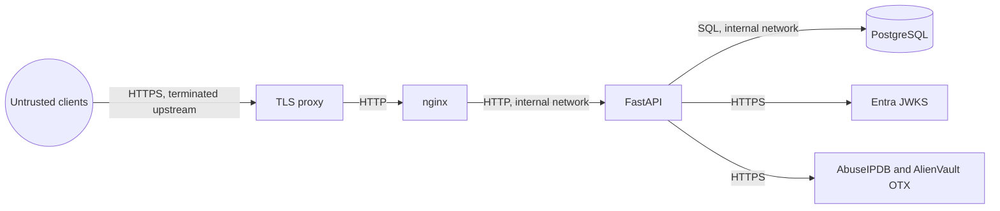

# Threat model

A STRIDE analysis of what exists today: the Phase 1 platform (the API, its identity and database layer,
the nginx front end, the container stack and the build pipeline), the Phase 2 threat-intelligence
backend (outbound provider calls, third-party data, the audit trail) and the Phase 3 to 3c dashboard
that displays that data. It is a living document: each
new feature must extend it before it ships. **Vault in particular needs its own, separate threat
model before any code is written.**

## Scope and assumptions

In scope: the browser-to-nginx-to-API-to-database path, token validation, configuration and
secrets, the containers, the CI pipeline, the API's calls to AbuseIPDB and AlienVault OTX, and how
the dashboard renders what those providers send.

Assumptions:

- The host and Docker engine are trusted and patched. A compromised host is out of scope.
- TLS is terminated by a proxy in front of nginx in any deployment that is not purely local.
- Microsoft Entra ID is the identity authority, and its signing keys and token claims are
  trustworthy once the signature, issuer, audience and tenant are verified.
- Operators are authorised to run the stack and to test it.

## Assets

| Asset | Why it matters |
| --- | --- |
| Entra access tokens | Bearer credentials. Anyone holding one can act as the user until it expires. |
| Database credentials | Full access to stored intelligence, alerts and audit data. |
| Provider API keys | Quota and billing; may be abused or leaked. |
| Stored intelligence and, later, telemetry | Integrity matters most: a poisoned score misleads an analyst. |
| Audit trail | Must stay trustworthy to be useful after an incident. |
| Availability of the API | Analysts depend on it during an incident. |

## Trust boundaries

Everything left of the API is untrusted input. Responses from Entra and the threat feeds are
treated as untrusted data too: they are validated and bounded before use.

## STRIDE

| # | Threat | Category | Mitigation | Status |
| --- | --- | --- | --- | --- |
| 1 | Forged or tampered token (wrong key, `alg: none`, HS256 with the public key as secret) | Spoofing | RS256 only, signature against tenant JWKS, required claims, `tid`, `iss`, `aud` checks; covered by tests. | Mitigated |
| 2 | Stolen token replayed | Spoofing | Short token lifetime from Entra, TLS upstream, tokens never persisted in the browser client. Revocation is not available. | Partly mitigated |
| 3 | Dev auth mode left on in production | Spoofing, Elevation | The API refuses to start with `AUTH_MODE=dev` when `ENVIRONMENT=production`, and production is the default. | Mitigated |
| 4 | A user calls an endpoint above their role | Elevation | Deny by default; `require_roles` on each route; 403 is logged. | Mitigated |
| 5 | Another user's resource accessed with the same role | Elevation | Resource-level checks. No such resources exist yet. | Planned with each feature |
| 6 | SQL injection | Tampering | SQLAlchemy parameterised queries only; no string-built SQL. | Mitigated |
| 7 | Malformed input crashes or confuses the API | Tampering, DoS | Pydantic validation; strict IOC normalisation and a 2048-character limit; nginx body limit of 64 KB. | Mitigated |
| 8 | Secrets in logs, errors or health responses | Information disclosure | Redaction filter, `SecretStr`, value-free configuration errors, generic 500s, tested. | Mitigated |
| 9 | Stack traces or SQL in responses | Information disclosure | One error envelope; unhandled exceptions return a generic message. | Mitigated |
| 10 | Log injection through the correlation header | Repudiation, Tampering | Incoming IDs must match `[A-Za-z0-9._-]{8,64}` or are replaced. | Mitigated |
| 11 | Cross-site scripting | Tampering, Information disclosure | React escapes output, no `dangerouslySetInnerHTML` (ESLint rejects it, along with `innerHTML` assignment, `eval` and `new Function`), strict CSP with no inline scripts. Provider-supplied text is the main untrusted input; see rows 25 and 33. | Mitigated |
| 12 | Clickjacking | Tampering | `X-Frame-Options: DENY` and `frame-ancestors 'none'`. | Mitigated |
| 13 | CSRF | Tampering | The API authenticates with a bearer header, not cookies, so browsers do not attach credentials automatically. Revisit if cookies are ever introduced. | Not applicable today |
| 14 | Wildcard CORS exposes the API to any site | Information disclosure | `*` is rejected; origins must be listed; no credentials mode. | Mitigated |
| 15 | Database exposed to the network | Information disclosure | Port bound to `127.0.0.1`; the database is not published on other interfaces. | Mitigated locally |
| 16 | Container breakout or privilege escalation | Elevation | Non-root users, all capabilities dropped, `no-new-privileges`, read-only root filesystem for the API. | Partly mitigated |
| 17 | Request flood against the API | DoS | A per-user limit on investigations (30 a minute, in memory and per process) with `429` and `Retry-After`; nginx body limit and timeouts. Other routes and unauthenticated requests are not throttled. | Partly mitigated |
| 18 | Key service (JWKS) outage causes auth failures | DoS | Keys cached for an hour; outage returns 503 with a distinct code. | Mitigated |
| 19 | Actions not attributable to a user | Repudiation | Correlation IDs on every request; the authenticated subject is logged on denials; every investigation (including refused input) and every deletion of a stored indicator is written to the audit table with actor, target, result and correlation ID. Reads of stored indicators are not audited. | Partly mitigated |
| 20 | Vulnerable or malicious dependency | Tampering | Exact pins, lockfile, `pip-audit`, `npm audit`, Dependabot, SHA-pinned Actions. Transitive Python packages are not hash-locked. Phase 3c added one runtime dependency, anime.js 4.5.0 (MIT, no dependencies of its own), imported from a single file and exercised under the strict CSP by every browser test. | Partly mitigated |
| 21 | Compromised CI or build | Tampering | Least-privilege workflow, no persisted credentials, no secrets in the pipeline. Image signing and scanning are not in place. | Partly mitigated |
| 22 | Weak or default database password | Spoofing | Compose requires `POSTGRES_PASSWORD`, the API refuses the `CHANGE_ME` template password in production. | Mitigated |
| 23 | TLS stripped or absent | Information disclosure | Not provided by this stack; the front proxy must terminate TLS and set HSTS. | Operator responsibility |
| 24 | Server-side request forgery: an indicator (URL, domain or address) makes the server contact an internal host | Information disclosure, Tampering | The backend never fetches an indicator. It calls two fixed provider hosts and sends the indicator only as an escaped path or query value. Private, loopback, link-local, reserved and documentation addresses, and reserved or private-use domain names, are refused before any call. Redirects are not followed. | Mitigated |
| 25 | Hostile provider data: markup or control characters in an OTX pulse name, oversized or malformed JSON, absurd counts or dates | Tampering, DoS | Parsed defensively into whitelisted fields with bounded sizes; text stripped of control and invisible characters; 2 MiB response cap; implausible dates discarded; a parser failure degrades one provider only. Provider text must be displayed as text, which the dashboard does (rows 11 and 33). | Mitigated |
| 26 | Provider outage, rate limit or slow response | DoS | A connect timeout and an overall timeout, run in parallel against one deadline; each failure becomes a labelled status; failures are never stored; an older answer is still shown as stale. | Mitigated |
| 27 | A user burns the provider's free quota | DoS, cost | Per-user investigation limit, 6 and 12 hour cache times, a 60-second floor on `refresh`, and keys held server-side only. The limiter is per process, so replicas multiply the limit. | Partly mitigated |
| 28 | Provider API key leaked through logs, responses, the wrong container or the HTTP client | Information disclosure | `SecretStr` settings masked by value in logs; never returned (the stats endpoint reports only whether one is set); given to the `backend` container only, not the migration job; HTTP client request logging silenced because it records full URLs. Each is tested. The `.env` file on the host is the operator's to protect. | Mitigated |
| 29 | A single source, a stale answer or a poisoned feed mislabels an indicator | Tampering (analyst decisions) | Each provider is shown on its own; no score from one source exceeds 60; recency and corroboration are explicit factors; uncertainty and missing sources are listed; CipherForge recommends actions and never blocks anything. Feeds can still be wrong, so scores are advice. | Partly mitigated |
| 30 | The audit source address is spoofed through `X-Forwarded-For` | Repudiation | The header is honoured only from private proxy networks; the value is stored only if it is a valid IP address; the actor comes from the token. A peer inside the trusted ranges that can reach the backend directly can still choose the recorded address. | Partly mitigated |
| 31 | Audit rows altered or deleted | Repudiation, Tampering | The application has no update or delete path for audit rows, and deleting an indicator only adds an `IOC_DELETE` row; database triggers reject `UPDATE` and `DELETE` on SQLite and PostgreSQL. A database superuser can drop the triggers. | Partly mitigated |
| 32 | An analyst sends internal or sensitive indicators to a third party | Information disclosure | Non-public addresses and names are refused. Looking up anything else discloses it to the providers by design; the lookups are audited, the Investigate page says so beside the button, and the privacy note in [threat-intelligence.md](threat-intelligence.md#privacy-and-abuse-considerations) applies. | Accepted, documented |
| 33 | Provider data steers a link in the dashboard: a hostile OTX pulse id or ATT&CK identifier makes the UI link to a phishing page or a `javascript:` URL | Tampering, Spoofing | Links to other sites are built only from a fixed base and an identifier matching a strict pattern; anything else is shown as plain text. Links open with `rel="noopener noreferrer"`. | Mitigated |
| 34 | A crafted address makes the dashboard request an unintended API path (for example `/indicators/..%2F..%2Fhealth`) | Tampering | The detail route accepts only a UUID and sends no request otherwise; identifiers placed in a request are URL-encoded. | Mitigated |
| 35 | The dashboard misleads the analyst: "nothing answered" read as "clean", or one indicator's result shown under another | Tampering (analyst decisions) | "Not assessed" is its own state with no score; each provider is shown separately with what is not known; requests are cancelled when the screen changes and the detail page is keyed by indicator. Component tests pin each behaviour. | Mitigated in the display; feed accuracy is row 29 |
| 36 | What an analyst searched for leaks through the address bar, browser history or a `Referer` header | Information disclosure | `Referrer-Policy: no-referrer` and `noreferrer` links keep it from other sites. Only the Indicators search text is placed in the address, and what is typed on the Investigate page is not. History and shared links still show the search text. | Partly mitigated |
| 37 | The console tells a third party who is using it: a font host, CDN or map tile server contacted by the page, or a cookie or `Referer` that travels with a request | Information disclosure | The fonts, the world map and the icons are bundled; the CSP allows only the console's own origin (and `data:` images); a browser test follows a whole session and checks every request went to that origin with no cookie and no `Referer`, and another checks that the built files name no host other than a short documented list. The only thing stored in the browser is the effects switch. | Mitigated |
| 38 | The dashboard presents a provider-reported country as where an attacker is, or demo data as real data | Tampering (analyst decisions) | The map and the lists say "provider-reported country" and place a marker on a country's label point, not a place; a scope note says what the figures leave out; whenever any provider is simulated, a banner says so on every screen. | Mitigated in the display; feed accuracy is row 29 |
| 39 | Repeated overview requests exhaust the server: the overview aggregates stored history on every request, and every open dashboard refreshes it each minute | DoS | The route needs the analyst role, is read-only, and scans a bounded amount (the newest 2,000 provider answers, and up to 20,000 lookups and 20,000 new indicators from the last 14 days), reporting when a bound cut a figure short. There is no per-user limit on reads. | Partly mitigated |
| 40 | The demo server (development sign-in, simulated providers) is run against real data or exposed to a network | Elevation, Tampering | It sets `ENVIRONMENT=development` and `AUTH_MODE=dev` (which production refuses), accepts only a `.db` file inside `backend/.demo/`, makes no outbound calls, is excluded from the container image and is imported by nothing in `app/`. It listens on loopback unless told otherwise. | Mitigated by construction; never bind it to a network |
| 41 | An analyst deletes the wrong indicators, or far more than they meant, with one click | Tampering (stored intelligence) | Deletion is by exact id only: there is no "delete everything matching this search", and one request carries at most 100 ids. The dashboard ticks only rows on the page being shown, forgets the selection when the filters or the page change, and always asks first, naming the values (or how many) that will go. Each deletion is audited with who did it. There is no undo and no soft delete: a deleted indicator is gone, and investigating it again starts a new record. Any analyst can delete any indicator (indicators have no owner). | Partly mitigated: it is permanent by design |
| 42 | A page on another site, a form or a crafted link deletes stored indicators | Tampering (CSRF) | Deletion uses `DELETE` and `POST` only, never `GET`, so a link or an image cannot start it. It needs the bearer header, a JSON body of ids that must be UUIDs, and no other content type is accepted, so a cross-site form or `text/plain` request is refused with `422`. CORS is off unless origins are listed, so the preflight for a cross-site `DELETE` is refused by default. Browser and API tests cover each. | Mitigated |
| 43 | A lookup and a deletion race: the answer of a lookup still waiting on providers is written for an indicator that was just deleted, so it comes back or leaves orphan rows | Tampering | The lookup checks again when it saves. If the indicator has been deleted it is discarded, the caller gets `409`, and the audit row says the result was discarded. SQLite enforces foreign keys, so no answer can be stored for a row that is not there. | Mitigated |
| 44 | Deleted values remain in the audit trail | Information disclosure | By design: the audit rows are append-only and name the `type:value` they are about, so the older `IOC_LOOKUP` rows and the new `IOC_DELETE` row still contain a deleted indicator. There is deliberately no feature to delete audit rows. Removing a value from the trail is a database administrator's job, outside the application, and it removes evidence. | Accepted, documented |
| 45 | Deleted data can still be recovered from storage: freed database pages, the write-ahead log, backups, replicas | Information disclosure | SQLite overwrites freed bytes (`secure_delete`) and PostgreSQL reclaims space at vacuum. Copies outside the database file are the operator's to handle. | Partly mitigated; operator responsibility |

## Residual risks and deliberate limits

- There is no token revocation list; a stolen token works until it expires.
- Browser sign-in arrives in a later phase, and the investigation rate limiter is per process (see
  [security.md](security.md#not-implemented-yet)).
- The dashboard cannot sign in, so it works only against `AUTH_MODE=dev`, which production refuses
  (row 3). Do not weaken that check to make the dashboard work; build the sign-in instead.
- Container hardening was not exercised on a Docker engine in the build environment; the pipeline
  smoke test is the first real run (see [deployment.md](deployment.md#verification-status)).
- The provider adapters were tested against recorded responses only, never the live services (see
  [threat-intelligence.md](threat-intelligence.md#verification-status)).
- The dashboard was checked in a real browser (Microsoft Edge on Windows, 686 automated tests) against
  a stand-in for nginx's headers, and with provider evidence only through simulated and invented
  answers, never the live services (see
  [threat-intelligence.md](threat-intelligence.md#verification-status)).

## Threat-intelligence data (Phase 2)

Phase 2 adds outbound calls and untrusted third-party data. Rows 24 to 32 above analyse them. The
design, the scoring method and the provider behaviour are in
[threat-intelligence.md](threat-intelligence.md). Later phases that add internal telemetry or any
automated response must extend this model first.

## Deleting indicators

Analysts can delete stored indicators from the dashboard (one at a time or a ticked selection). Rows
41 to 45 analyse it, and the controls are listed in [security.md](security.md). The feature adds two
endpoints (`DELETE /api/v1/intel/indicators/{id}` and `POST /api/v1/intel/indicators/bulk-delete`),
needs the same role as the rest of `/api/v1/intel`, and adds no way to delete or edit audit rows:
the audit trail stays append-only and gains an `IOC_DELETE` record for each deletion.

## Dashboard (Phases 3 to 3c)

Phases 3 to 3c add a browser client that displays the Phase 2 data, including text written by third
parties. Rows 11, 25 and 33 to 40 analyse it, and the controls are listed in
[security.md](security.md#frontend-controls-phases-3-to-3c). Phase 3b added one read-only endpoint
(`GET /api/v1/intel/overview`, which needs the same role as the rest) and no new privileges: every
call goes through the same authorised API routes. Phase 3c restyled the screens and moved the
effects onto an animation library (row 20): it added no endpoint, privilege, request, stored value
or way to start a lookup, and its code reads no provider text, so rows 11, 33 and 37 are unchanged.
