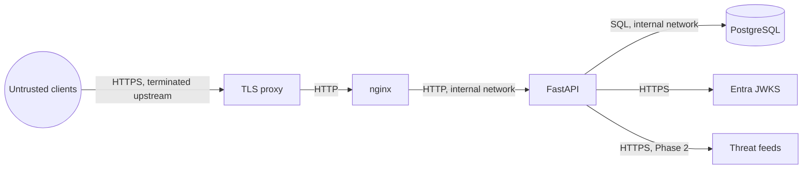

# Threat model

A STRIDE analysis of what exists today (Phase 1: the API, its identity and database layer, the
nginx front end, the container stack and the build pipeline). It is a living document: each new
feature must extend it before it ships. **Vault in particular needs its own, separate threat
model before any code is written.**

## Scope and assumptions

In scope: the browser-to-nginx-to-API-to-database path, token validation, configuration and
secrets, the containers, and the CI pipeline.

Assumptions:

- The host and Docker engine are trusted and patched. A compromised host is out of scope.
- TLS is terminated by a proxy in front of nginx in any deployment that is not purely local.
- Microsoft Entra ID is the identity authority, and its signing keys and token claims are
  trustworthy once the signature, issuer, audience and tenant are verified.
- Operators are authorised to run the stack and to test it.

## Assets

| Asset | Why it matters |
| --- | --- |
| Entra access tokens | Bearer credentials. Anyone holding one can act as the user until it expires. |
| Database credentials | Full access to stored intelligence, alerts and audit data. |
| Provider API keys (Phase 2) | Quota and billing; may be abused or leaked. |
| Stored intelligence and, later, telemetry | Integrity matters most: a poisoned score misleads an analyst. |
| Audit trail (Phase 2) | Must stay trustworthy to be useful after an incident. |
| Availability of the API | Analysts depend on it during an incident. |

## Trust boundaries

Everything left of the API is untrusted input. Responses from Entra and the threat feeds are
treated as untrusted data too: they are validated and bounded before use.

## STRIDE

| # | Threat | Category | Mitigation | Status |
| --- | --- | --- | --- | --- |
| 1 | Forged or tampered token (wrong key, `alg: none`, HS256 with the public key as secret) | Spoofing | RS256 only, signature against tenant JWKS, required claims, `tid`, `iss`, `aud` checks; covered by tests. | Mitigated |
| 2 | Stolen token replayed | Spoofing | Short token lifetime from Entra, TLS upstream, tokens never persisted in the browser client. Revocation is not available. | Partly mitigated |
| 3 | Dev auth mode left on in production | Spoofing, Elevation | The API refuses to start with `AUTH_MODE=dev` when `ENVIRONMENT=production`, and production is the default. | Mitigated |
| 4 | A user calls an endpoint above their role | Elevation | Deny by default; `require_roles` on each route; 403 is logged. | Mitigated |
| 5 | Another user's resource accessed with the same role | Elevation | Resource-level checks. No such resources exist yet. | Planned with each feature |
| 6 | SQL injection | Tampering | SQLAlchemy parameterised queries only; no string-built SQL. | Mitigated |
| 7 | Malformed input crashes or confuses the API | Tampering, DoS | Pydantic validation; strict IOC normalisation and length limits in Phase 2; nginx body limit of 64 KB. | Partly mitigated |
| 8 | Secrets in logs, errors or health responses | Information disclosure | Redaction filter, `SecretStr`, value-free configuration errors, generic 500s, tested. | Mitigated |
| 9 | Stack traces or SQL in responses | Information disclosure | One error envelope; unhandled exceptions return a generic message. | Mitigated |
| 10 | Log injection through the correlation header | Repudiation, Tampering | Incoming IDs must match `[A-Za-z0-9._-]{8,64}` or are replaced. | Mitigated |
| 11 | Cross-site scripting | Tampering, Information disclosure | React escapes output, no `dangerouslySetInnerHTML`, strict CSP with no inline scripts. | Mitigated |
| 12 | Clickjacking | Tampering | `X-Frame-Options: DENY` and `frame-ancestors 'none'`. | Mitigated |
| 13 | CSRF | Tampering | The API authenticates with a bearer header, not cookies, so browsers do not attach credentials automatically. Revisit if cookies are ever introduced. | Not applicable today |
| 14 | Wildcard CORS exposes the API to any site | Information disclosure | `*` is rejected; origins must be listed; no credentials mode. | Mitigated |
| 15 | Database exposed to the network | Information disclosure | Port bound to `127.0.0.1`; the database is not published on other interfaces. | Mitigated locally |
| 16 | Container breakout or privilege escalation | Elevation | Non-root users, all capabilities dropped, `no-new-privileges`, read-only root filesystem for the API. | Partly mitigated |
| 17 | Request flood against the API | DoS | nginx body limit and timeouts only. No rate limiting yet. | **Gap** (Phase 2) |
| 18 | Key service (JWKS) outage causes auth failures | DoS | Keys cached for an hour; outage returns 503 with a distinct code. | Mitigated |
| 19 | Actions not attributable to a user | Repudiation | Correlation IDs on every request; the authenticated subject is logged on denials. A durable audit table is not built. | **Gap** (Phase 2) |
| 20 | Vulnerable or malicious dependency | Tampering | Exact pins, lockfile, `pip-audit`, `npm audit`, Dependabot, SHA-pinned Actions. Transitive Python packages are not hash-locked. | Partly mitigated |
| 21 | Compromised CI or build | Tampering | Least-privilege workflow, no persisted credentials, no secrets in the pipeline. Image signing and scanning are not in place. | Partly mitigated |
| 22 | Weak or default database password | Spoofing | Compose requires `POSTGRES_PASSWORD`, the API refuses the `CHANGE_ME` template password in production. | Mitigated |
| 23 | TLS stripped or absent | Information disclosure | Not provided by this stack; the front proxy must terminate TLS and set HSTS. | Operator responsibility |

## Residual risks and deliberate limits

- There is no token revocation list; a stolen token works until it expires.
- Rate limiting, the audit table and browser sign-in arrive in later phases (see
  [security.md](security.md#not-implemented-yet)).
- Container hardening was not exercised on a Docker engine in the build environment; the pipeline
  smoke test is the first real run (see [deployment.md](deployment.md#verification-status)).

## Threat-intelligence data (Phase 2 additions)

Phase 2 adds outbound calls and untrusted third-party data. Its threats (SSRF through URL
indicators, poisoned or stale feed data, quota exhaustion, leaking API keys, over-trusting a single
source) are analysed in [threat-intelligence.md](threat-intelligence.md) when that feature is built.
