# User guide

A screen-by-screen walkthrough of the dashboard: what every panel and button does, how to read a
result, and how to delete indicators. See the [README](../README.md) for a faster overview, or
[setup.md](setup.md) if you have not got CipherForge running yet.

Open <http://127.0.0.1:5173> for Paths A and B, or <http://localhost:3000> for Path C.

The pictures in this section come from the demo (Path A), so the indicators and numbers in them are
**invented**. Yours will look different. The numbered markers were added to the pictures to match the
numbered lists under them. They are not on the real screen.

## The screens

Use the menu on the left to move around. On a phone it becomes a bar along the bottom.

| Menu item | Address | What it is for |
| --- | --- | --- |
| **Overview** | `/` | Figures, charts and a map for everything you have checked. |
| **Investigate** | `/investigate` | Type in an indicator and read the result. |
| **Indicators** | `/indicators` | A searchable list of everything you have checked. You can also delete indicators here. |
| *(click any indicator)* | `/indicators/…` | The saved record of one indicator. You can re-check it or delete it there. |
| **System status** | `/status` | Is the API running, and can it reach its database? |

Every screen has its own address, so you can bookmark it. The Indicators list keeps your search and
filters in the address too.

## A five-minute walk

Try this on Path A. It touches every screen.

1. On the **Overview**, read the five tiles at the top, then scroll down through the charts.
2. Click **Investigate an indicator**.
3. Under "Fill with an example", click **IPv4**, then press **Investigate**. The result is calm: a
   score of 0 and **Informational**.
4. Investigate `2100:3946:b9d8::e0f4`. This invented address comes back **Critical**, with a score of
   100. Scroll down to read each provider's card and "How the score was built".
5. Open **Indicators** in the menu. Try the search box and the filters, then click an indicator to
   open its saved record.
6. On the record, press **Re-check with providers**. It asks the providers again and updates the
   record.
7. Open **System status** and press **Refresh**.
8. Press `Ctrl K` (`Cmd K` on a Mac), type `8.8.8.8` and look at the options.
9. Last, try deleting. Go back to **Indicators**, search for `8.8.8.8` (the one you checked in step
   3), tick its box and press **Delete selected (1)**. Read the box, which says what will go, then
   press **Delete indicator**. The indicator disappears from the list. The demo's data are invented,
   so nothing real is lost, and you can rebuild it
   ([Stop it and start it again](setup.md#stop-it-and-start-it-again)). To leave everything as it
   was, press **Cancel** instead.

On Path B with no keys, every result comes back **Not assessed**. That is correct.

## The Overview screen

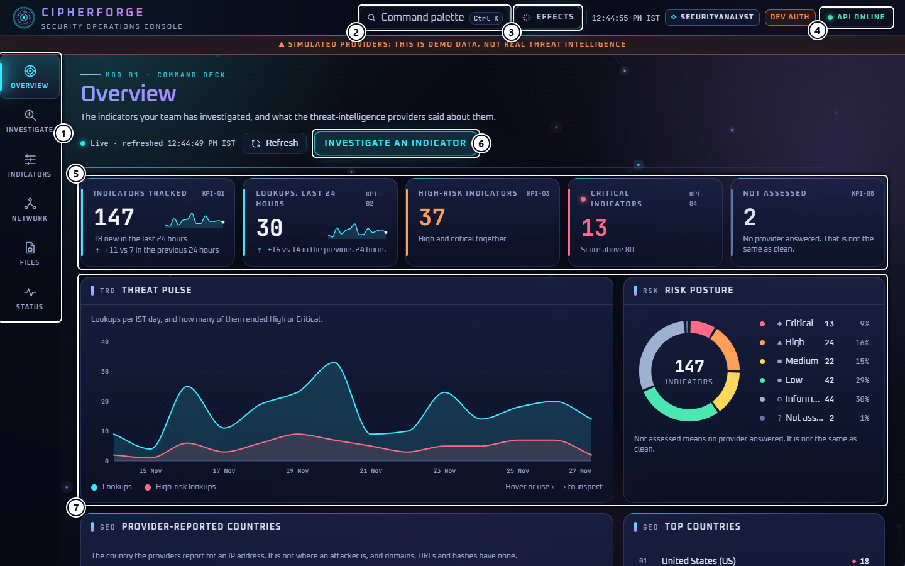

1. **The menu.** One item for each screen.
2. **The command palette button.** Opens a quick-jump box. See
   [Shortcuts and the command palette](#shortcuts-and-the-command-palette).
3. **The Effects switch.** Turns the animated visuals on or off. See
   [Visual effects and small screens](#visual-effects-and-small-screens).
4. **API ONLINE.** The dashboard can reach the API. It changes to **API DEGRADED** (the API is up, but
   something it needs is not healthy) or **API OFFLINE** (the API cannot be reached). Click it to
   open System status.
5. **The five tiles.** *Indicators tracked*, *Lookups, last 24 hours*, *High-risk indicators* (High
   and Critical together), *Critical indicators* (score above 80) and *Not assessed* (no provider
   answered, which "is not the same as clean"). The first two also show the change since the 24 hours
   before. **Click a tile** to open the list of indicators behind it.
6. **Investigate an indicator.** The quickest way to start a lookup. Next to it, "Live · refreshed
   14:32:05" shows when the figures were last updated, and **Refresh** updates them now. They also
   update by themselves every minute.
7. **Threat pulse and Risk posture.** Threat pulse shows the lookups per day and how many of them
   ended High or Critical. Risk posture is a ring that shows how your indicators are spread across
   the risk bands.

On wide screens the top bar also shows who you are: your role and the sign-in mode ("Dev auth").

Scroll down for more panels:

| Panel | What it shows |
| --- | --- |
| **Provider-reported countries**, **Top countries** | A dot map and a ranked list of the countries that providers report for IP addresses. This is *not* where an attacker is, and domains, URLs and hashes have no country. |
| **Malware families** | Families of malware that providers link to your indicators. |
| **ATT&CK techniques** | MITRE ATT&CK codes (such as `T1059`) that providers mention. |
| **Provider tags** | Labels that providers attached, such as `botnet`. |
| **Indicator types by risk** | A grid of how many indicators of each type sit in each risk band. |
| **Indicator mix** | A radar shape showing how your indicators are split by type. |
| **Lookup activity** | A grid of lookups per hour of the day (UTC) over the last days. |
| **Intelligence providers** | Which providers are set up, what each one handles, and whether it is **Configured**, **Not configured** or **Simulated**. |
| **Highest risk**, **Latest investigations** | The top-scoring and the newest indicators. Click one to open its record. |
| **Platform modules** | The parts of the full platform. Only Threat intelligence is **LIVE**. The rest are **PLANNED**. |

**Click a country, a malware family, an ATT&CK technique or a tag** and a drawer slides in from the
right. It shows how many indicators match, the highest risk among them and the highest-risk ones,
each with a link to its record. For a technique it also links to the MITRE ATT&CK page. Press `Esc`
to close it.

Every chart also has a text version of its numbers, for people who use screen readers. If you ever
have a very large number of lookups, the Overview uses only the most recent ones and prints a note
saying so.

## The Investigate screen

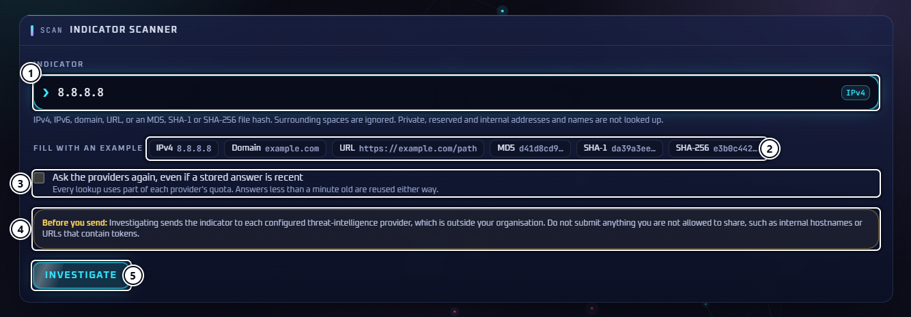

1. **The input box.** Type or paste one indicator. A chip underneath (here "Looks like IPv4") shows
   what CipherForge thinks you typed.
2. **Fill with an example.** One click puts a sample of each type in the box.
3. **Ask the providers again, even if a stored answer is recent.** Normally CipherForge reuses an
   answer it saved a few hours ago, which protects your daily allowance with the providers. Tick the
   box to ask again anyway. This uses allowance. (An answer less than a minute old is reused
   regardless.)
4. **Before you send.** A reminder that the indicator is sent to each configured provider, which is
   outside your organisation. Do not enter internal host names or links that contain secret tokens.
5. **Investigate.** Starts the lookup.

### What you can type

| Type | Example | Who is asked |
| --- | --- | --- |
| IPv4 address | `8.8.8.8` | AbuseIPDB and AlienVault OTX |
| IPv6 address | `2001:4860:4860::8888` | AbuseIPDB and AlienVault OTX |
| Domain | `example.com` | AlienVault OTX only |
| URL | `https://example.com/path` | AlienVault OTX only |
| SHA-256 hash | 64 characters made of `0-9` and `a-f` | AlienVault OTX only |

Only one provider can answer about a domain, a URL or a hash. The rules need two providers to back
each other up before a score can pass 60, so for these types **the score never goes above 60
(Medium)**.

CipherForge cleans up what you type. It accepts "defanged" text such as `hxxp://example[.]com` and
`1.2.3[.]4`, and it writes names in a standard form, so different spellings of the same thing end up
on one record.

It **refuses**, with a message that explains why: private or internal addresses (such as
`192.168.1.10`), made-up endings such as `.local`, `.internal` and `.lan`, single words, email
addresses, web links that contain a user name and password, MD5, SHA-1 and SHA-512 hashes, and
anything longer than 2,048 characters.

### A low-risk result

1. **The gauge.** A ring that fills up to the score and changes colour with the risk band.
2. **The score**, from 0 to 100, with its band name.
3. **The confidence bar.** How much fresh evidence stands behind the score. It is *not* the chance
   that the indicator is bad.
4. **The facts.** The status (**Active** means at least one provider answer is still fresh,
   **Stale** means none is), when it was last checked, the activity window (when the providers saw
   it active) and how many sources had evidence.
5. **Open the saved record.** Every result is saved. The strip above the picture says, "This result
   is saved. You can return to it from the Indicators page."

### A high-risk result

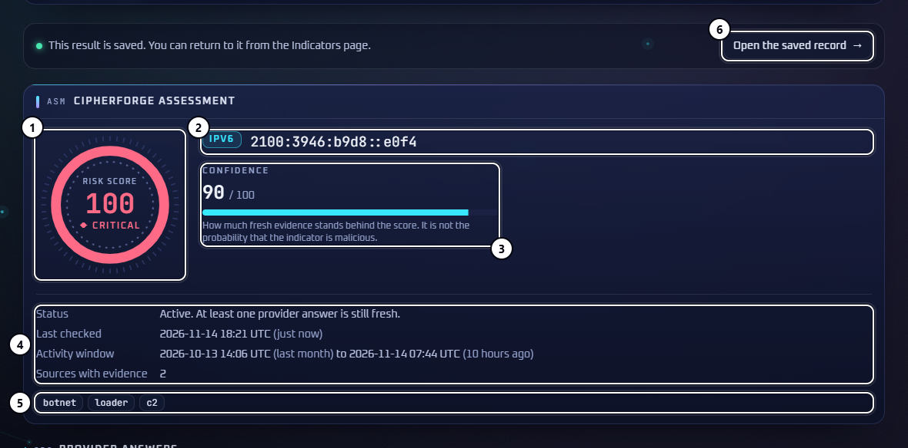

Markers 1 to 4 are the same as above. The new ones are:

5. **Provider tags.** Labels that the providers attached, here `botnet`, `loader` and `c2`. ("C2"
   means command and control: the servers that attackers use to give orders to infected machines.)
6. **The saved-record link**, as before.

### Each provider's answer

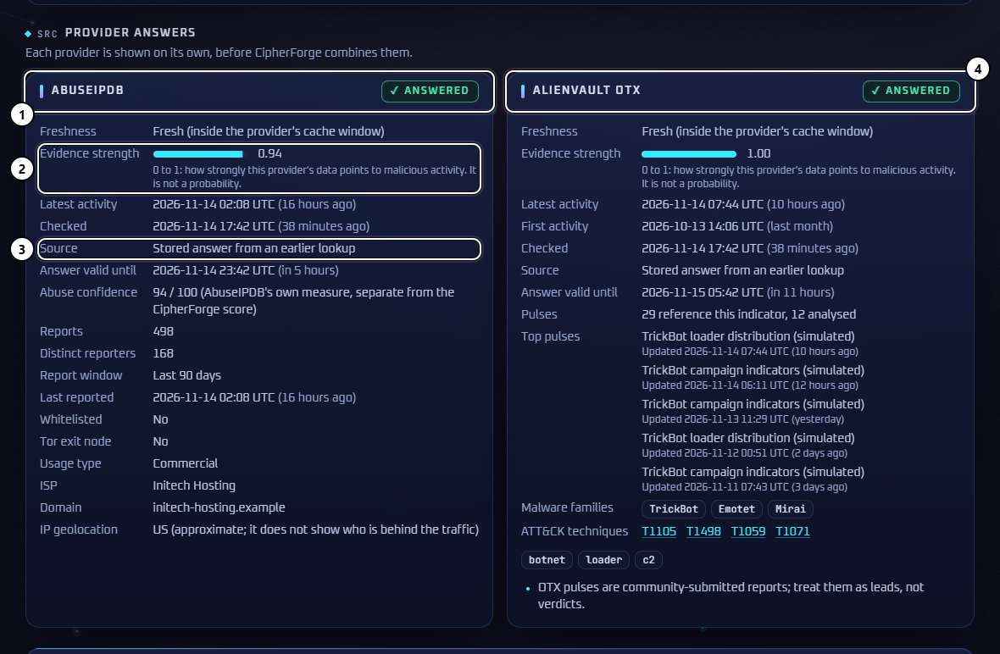

Scroll down to **Provider answers**. There is one card for each provider, so if the providers
disagree you see it here.

1. **The card header.** The provider's name and a status label such as **Answered**. The labels are
   explained in [What the provider labels mean](#what-the-provider-labels-mean).
2. **Evidence strength.** How strong this provider's evidence is, from 0 to 1. It is not a
   probability.
3. **Source.** "Queried live for this lookup" or "Stored answer from an earlier lookup".
4. **The other provider's card.**

A card also lists how fresh the answer is, the first and latest activity, when it was checked and
how long the answer stays valid, followed by the provider's own facts. AbuseIPDB gives an abuse
confidence (out of 100), the number of reports and of different reporters, the type of use, the
internet provider and an approximate location. OTX gives the number of *pulses* (reports written by
its community) that mention the indicator, and lists the top ones.

### How the score was built

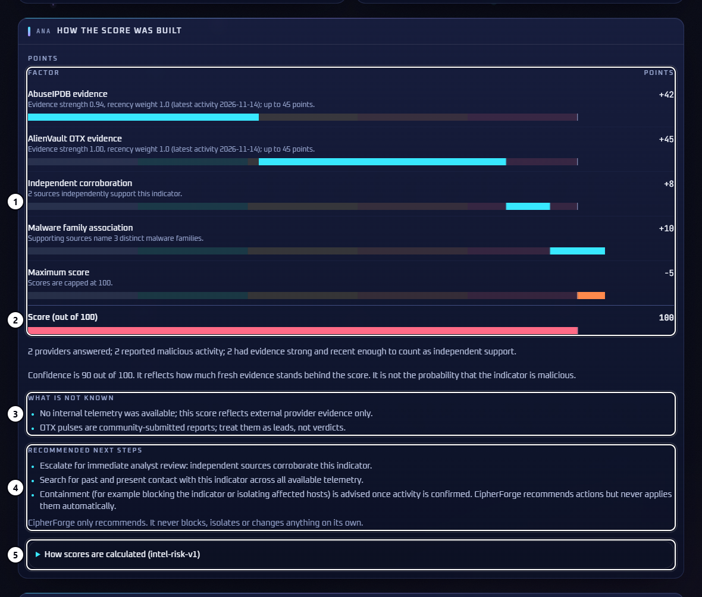

This panel comes right after the provider cards. It starts with a one-line summary, such as "2
providers answered; 2 reported malicious activity; 2 had evidence strong and recent enough to count
as independent support."

1. **The points table.** Each line is one reason with its points. A minus number takes points away
   (for example the cap at 100).
2. **The total**, "Score (out of 100)".
3. **What is not known.** The gaps in the evidence, stated plainly (for example "No internal
   telemetry was available").
4. **Recommended next steps.** Advice that depends on the risk band. CipherForge only recommends.
   It never blocks, isolates or changes anything on its own.
5. **How scores are calculated (intel-risk-v1).** A folded section; click it to open it. It explains
   the rules in the same terms as
   [How the score is made](../README.md#how-the-score-is-made), with the full method and worked
   examples in [threat-intelligence.md](threat-intelligence.md).

### When nothing can be said

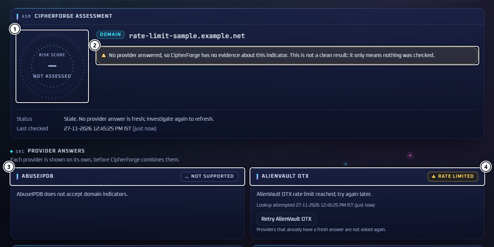

1. **The gauge** says **Not assessed** and shows no number.
2. **The explanation**: "No provider answered, so CipherForge has no evidence about this indicator.
   This is not a clean result: it only means nothing was checked."
3. **The first card.** Here AbuseIPDB says **Not supported**, because it only handles IP addresses
   and this indicator is a domain.
4. **The second card.** Here OTX says **Rate limited**: it refused the request because its allowance
   was used up.

The demo does this on purpose for any value that contains `rate-limit`. With no keys configured you
see the same screen, with **Not configured** on both cards.

### When an indicator is refused

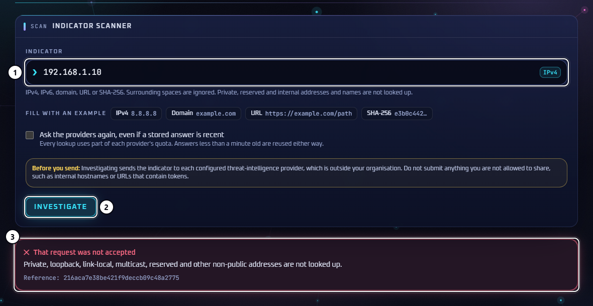

1. **The input** holds `192.168.1.10`, a private address that only exists inside a home or office
   network.
2. **Investigate**, as usual.
3. **The red alert**: "That request was not accepted", followed by the reason: private, loopback,
   link-local, multicast, reserved and other non-public addresses are not looked up.

There are two reasons. Your internal addressing is not leaked to a third party, and nobody can use
CipherForge to make the server probe machines inside your network. A refused lookup is still
recorded in the audit log, without the text you typed.

## The Indicators screen

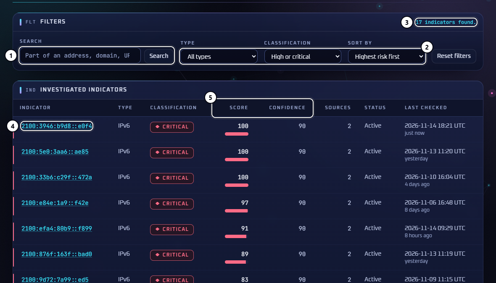

This is the list you get when you click the **High-risk indicators** tile on the Overview.

1. **The search box.** Type part of an address, domain, URL or hash, then press **Search**.
2. **The filters.** **Type** (IPv4, IPv6, Domain, URL or SHA-256), **Classification** (High or
   critical, Critical, High, Medium, Low, Informational or Not assessed) and **Sort by** (Most
   recently checked, or Highest risk first). **Reset filters** appears when a filter is on.
3. **The count**, such as "17 indicators found."
4. **An indicator.** Click it to open its saved record.
5. **Score and Confidence.** The two numbers for each indicator. The other columns are Type,
   Classification, Sources (how many had evidence), Status and Last checked.
6. **The tick boxes.** Tick the rows you want to delete. The box in the header ticks every row on the
   page.
7. **The bin button.** Deletes that one indicator, after asking you to confirm.
8. **The hint.** "Tick rows to delete them. Hold Shift to tick a range." Once you tick something, it
   is replaced by **Clear selection** and **Delete selected (N)**.

Deleting is explained step by step in [Deleting indicators](#deleting-indicators).

The list shows 25 indicators at a time. Use **Previous** and **Next** under the table.

## A saved record

1. **← All indicators.** Goes back to the list.
2. **Re-check with providers.** Asks the providers again and updates the record. This uses some of
   the providers' daily allowance, so use it when you need fresh evidence.
3. **The result.** The same gauge, provider cards and score breakdown that you saw on the Investigate
   screen. The page says, "This is the stored record. Re-checking asks the configured providers again
   and updates it."
4. **Delete indicator.** Deletes this indicator and its stored provider answers, after asking you to
   confirm. The page then says **Indicator deleted** and offers **Back to the list** and
   **Investigate another indicator**.

## Deleting indicators

Use this to get rid of indicators you no longer want, such as a test lookup, a typo or an old entry.
You can delete one indicator or many at once. **Deleting is permanent.** The indicator and every
provider answer stored for it are removed from the database, and it disappears from every screen.
Deleting through the API instead is covered in [api.md](api.md#deleting-indicators).

| You want to delete… | Do this |
| --- | --- |
| **One indicator from the list** | Press the bin button at the end of its row. |
| **The indicator you are reading** | Open its saved record and press **Delete indicator**. |
| **Several indicators** | Tick their boxes, then press **Delete selected (N)**, where N is how many you ticked. |
| **A run of rows next to each other** | Tick the first box, then hold `Shift` and click the last box. Every row between them is ticked as well. |
| **Every row on the page** | Tick the box in the table header, then press **Delete selected (N)**. |

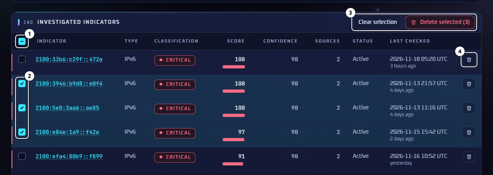

1. **The header box.** Ticks or unticks every row on the page. It shows a dash when only some rows are
   ticked.
2. **The ticked rows.** Click one box, then `Shift`-click another to tick every row between them.
3. **Clear selection** and **Delete selected (3)**. They appear as soon as one row is ticked. **Clear
   selection** unticks everything.
4. **The bin button.** It stays on every row, for deleting just that one.

Whichever way you choose, a box opens and asks you to confirm. Nothing is deleted until you press the
red button in it.

1. **The title.** How many indicators are about to go: "Delete this indicator?" for one, or "Delete 3
   indicators?" for three.
2. **The list.** The indicators you chose. It names up to five, then says "and N more".
3. **The warning.** "This permanently removes them, and every provider answer stored for them, from
   the database. It cannot be undone."
4. **The audit note.** "The audit log is kept as it is: it still records the past lookups and gains a
   record of this deletion."
5. **The buttons.** **Cancel** closes the box and changes nothing. It is the button that is selected
   when the box opens, so pressing Enter by mistake cannot delete anything. The red button does the
   deleting. If something goes wrong, such as the API being unreachable, the box stays open and says
   why, and nothing is deleted.

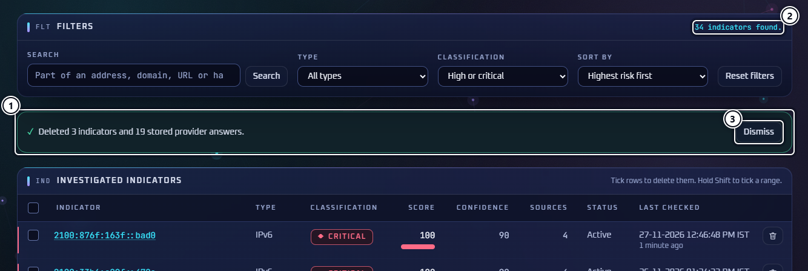

1. **The notice.** "Deleted 3 indicators and 15 stored provider answers." If an indicator had
   already been deleted by someone else, the notice also says how many were "already gone".
2. **The count.** It goes down by the number you deleted, here from 17 to 14.
3. **Dismiss.** Closes the notice.

Things to know:

- **There is no undo.** Be sure before you press the red button. Only a database backup can bring an
  indicator back.
- **Ticks belong to the page you are on.** When you change page, search or filter, the ticks are
  cleared, so you can never delete rows you cannot see.
- **There is no "delete everything" button.** The list shows 25 rows at a time. To empty a long list,
  tick the header box, delete, and repeat. (To start again with an empty database, see
  [Stop it and start it again](setup.md#stop-it-and-start-it-again).)
- **The audit log is not touched.** Its old entries stay as they are, and each deletion adds one new
  entry (`IOC_DELETE`) saying who deleted what and when. It still holds the text of a deleted
  indicator, such as `8.8.8.8`. That is on purpose: it is the permanent record of what was done.
  CipherForge has no feature for deleting audit entries.
- **A deleted indicator can come back as a new one.** If you investigate the same text again, the
  providers are asked afresh and a new record is saved.
- **Who may delete.** Anyone who may investigate: a `SecurityAnalyst` or an `Admin`.

## The System status screen

1. **Overall status.** One word and one sentence. **Operational**: the API is up and its database is
   reachable. **Degraded**: the API is up, but something it needs is not healthy. **Down**: the API
   cannot be reached. **Checking**: it is still finding out.
2. **Refresh**, and the time of the last check. The page also refreshes itself every 30 seconds.
3. **The API card.** **Up** with the service name and version, or **Unreachable**.
4. **The Database card.** **Reachable** when the API can run queries, or **Unavailable** when it
   cannot reach its database.

If something looks wrong anywhere else, look here first.

## Shortcuts and the command palette

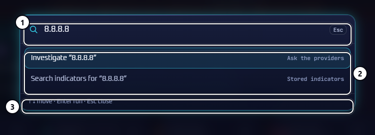

Press `Ctrl K` (`Cmd K` on a Mac) or `/` to open the palette from any screen.

1. **The input row.** Type what you want.
2. **The options.** Anything you type can be investigated or searched for, so the first two options
   are always "Investigate “8.8.8.8”" and "Search indicators for “8.8.8.8”". Typing a screen name
   offers to go there. You can also turn the visual effects on or off.
3. **The hint line.** "↑ ↓ move · Enter run · Esc close".

Choosing **Investigate** starts the lookup at once, so the indicator is sent to the providers
straight away. Following a link never does that.

| Keys | What happens |
| --- | --- |
| `Ctrl K` or `Cmd K` | Open or close the palette |
| `/` | Open the palette |
| `G`, then `O` | Go to Overview |
| `G`, then `I` | Go to Investigate |
| `G`, then `L` | Go to Indicators (**L** for list) |
| `G`, then `S` | Go to System status |
| `Esc` | Close the palette or a drawer |

For the two-key shortcuts, press the second key within one second. Plain keys do nothing while you
are typing in a box or while the palette or a drawer is open, so they cannot get in your way.

## What the provider labels mean

Each provider card has one of these labels.

| Label | What it means | What to do |
| --- | --- | --- |
| **Answered** | The provider returned evidence about this indicator. | Read its card. |
| **No data** | The provider answered but holds no reports about this indicator. **That is not proof it is safe.** | Treat it as "no information from this source". |
| **Not configured** | No API key is set on the server for this provider, so it was not asked. | Add the key: [Add your API keys](setup.md#add-your-api-keys-optional). |
| **Not supported** | This provider does not handle this type of indicator. | Nothing. AbuseIPDB, for example, only handles IP addresses. |
| **Rate limited** | The provider refused the request because its allowance was used up. | Try again later. |
| **Error** | The provider could not be asked, or returned something unusable. | Try again. See [Common setup problems](setup.md#common-setup-problems). |
| **Not queried** | No stored answer exists for this provider. | Investigate or re-check the indicator to ask it. |

An indicator's **Status** is **Active** when at least one provider answer is still fresh and
**Stale** when none is. A stale indicator is not wrong. It just has not been checked for a while.

## Things to try in the demo

These only work in [demo mode](setup.md#path-a-try-it-without-api-keys), where the providers are
simulated.

| Type this | What happens |
| --- | --- |
| `8.8.8.8` | Score 0, **Informational**, confidence 70. The providers were asked and nothing bad was reported. |
| `2100:3946:b9d8::e0f4` | **Critical**, score 100, confidence 90. Both providers report it. |
| `rate-limit-sample.example.net` | **Not assessed**. AbuseIPDB cannot handle domains, and OTX says **Rate limited**. |
| `provider-error.example.com` | **Not assessed**. AbuseIPDB cannot handle domains, and OTX shows **Error**. Any value containing `provider-error` fails on purpose. |
| `hxxp://example[.]com` | Accepted and tidied into the URL `http://example.com/`. |
| `192.168.1.10` | Refused: a private address. |
| `d41d8cd98f00b204e9800998ecf8427e` | Refused: this is an MD5 hash, and only SHA-256 is accepted. |

**Anything else you type also gets an answer, but the answer is invented.** The simulated providers
make up a profile from the text you typed, so the same value always gets the same answer. It says
nothing about the real indicator, so never use the demo to judge one.

## Visual effects and small screens

The dashboard has a futuristic look: an animated background (aurora glows, a grid floor, drifting
dots and a light that follows your pointer), numbers that count up, charts that draw themselves and
headings that "decode". The motion is built with [anime.js](https://animejs.com/).

- **The Effects switch** in the top bar turns all of it off. Your choice is remembered in this
  browser only.
- **Reduced motion.** If your computer is set to reduce motion, the effects stay off and the switch is
  disabled, with a tooltip that says why.
- **Nothing depends on an effect.** Every screen works the same with them off.
- **Touch screens** skip the light that follows the pointer.
- **Slow computers.** The effects were not tuned for slow hardware. If a page feels sluggish, switch
  them off.
- **Phones.** The layout adapts and the menu moves to the bottom:

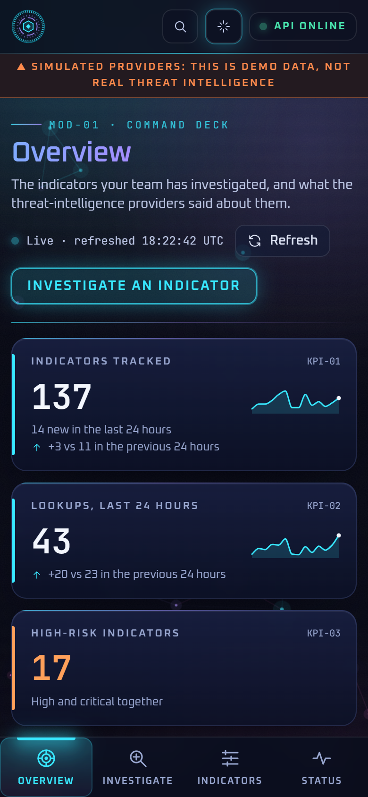
