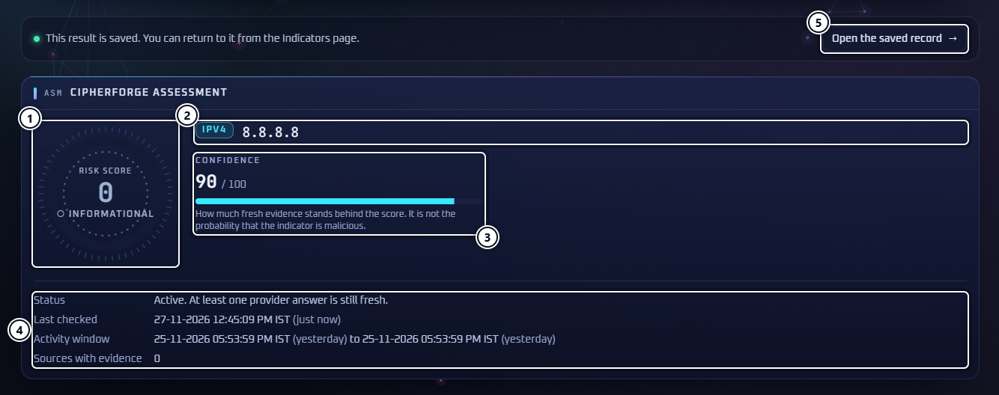
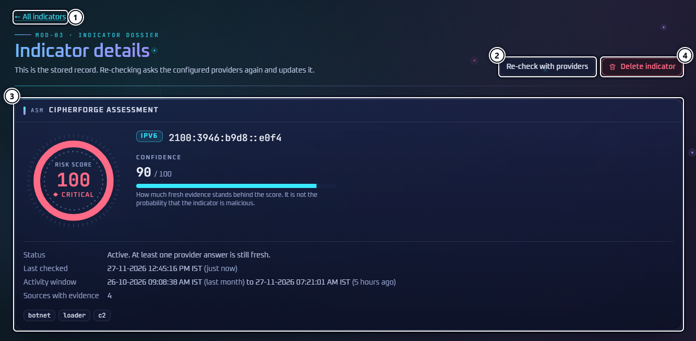
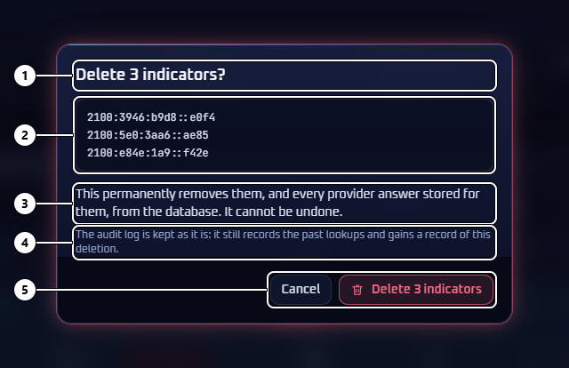
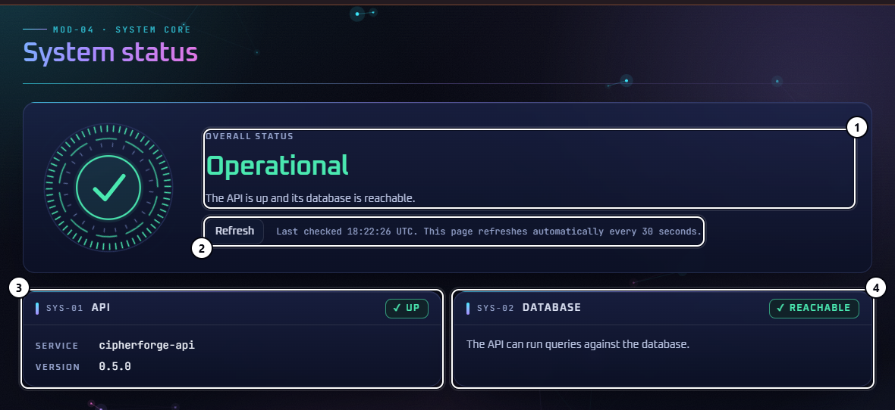

# User guide

A screen-by-screen walkthrough of the dashboard: what every panel and button does, how to read a
result, how to delete indicators, how to watch network traffic and how to share an encrypted file.
See the [README](../README.md) for a faster overview, or [setup.md](setup.md) if you have not got
CipherForge running yet.

Open <http://127.0.0.1:5173> for Paths A and B, or <http://localhost:3000> for Path C.

The pictures in this guide come from the demo (Path A), so the indicators and numbers in them are
**invented**. Yours will look different. The numbered markers were added to the pictures to match the
numbered lists under them. They are not on the real screen.

**The pictures are older than the screens.** They were taken before the Network and Files screens,
VirusTotal, ThreatFox and Indian Standard Time were added. So the menu in them is shorter, the
provider section shows two cards instead of four, and any times in them are in UTC. The text under
each picture describes the screen as it is now. The Network and Files screens have no pictures:
their buttons and messages are quoted exactly as they appear, so you can match them.

**Times are in Indian Standard Time.** Every time on screen is IST (UTC+05:30), written like
`25-11-2026 09:49:00 AM IST` or, where the date is obvious, `09:49:00 AM IST`. CipherForge stores
and sends times in UTC and converts them only to show them to you. See
[Time handling](architecture.md#time-handling-utc-storage-ist-display).

## The screens

Use the menu on the left to move around. On a phone it becomes a bar along the bottom.

| Menu item | Address | What it is for |
| --- | --- | --- |
| **Overview** | `/` | Figures, charts and a map for everything you have checked. |
| **Investigate** | `/investigate` | Type in an indicator and read the result. |
| **Indicators** | `/indicators` | A searchable list of everything you have checked. You can also delete indicators here. |
| *(click any indicator)* | `/indicators/…` | The saved record of one indicator. You can re-check it or delete it there. |
| **Network** | `/network` | Watch the traffic of one network interface, or analyse a capture file, and see what the detection rules flagged. |
| **Files** | `/files` | Encrypt a file, keep it in the vault and share it through links that expire, run out of downloads or can be revoked. |
| **System status** | `/status` | Is the API running, and can it reach its database? |
| *(a share link)* | `/share/…` | The page a person sees when you send them a link to a file. It has no menu and needs no sign-in. |

Every screen has its own address, so you can bookmark it. The Indicators list keeps your search and
filters in the address too, and so does the Network screen (the session you picked) and the Files
screen (the file you opened).

Who can use what: the lookups behind Overview, Investigate and Indicators need a `SecurityAnalyst` or
an `Admin`, and so does **Network**. **Files** is open to a `User` as well. **System status** needs no
role. In the demo and with the default development sign-in you are a `SecurityAnalyst`, so every
screen works.

## A five-minute walk

Try this on Path A. It touches every screen.

1. On the **Overview**, read the five tiles at the top, then scroll down through the charts.
2. Click **Investigate an indicator**.
3. Under "Fill with an example", click **IPv4**, then press **Investigate**. The result is calm: a
   score of 0 and **Informational**.
4. Investigate `2100:3946:b9d8::e0f4`. This invented address comes back **Critical**, with a score of
   100. Scroll down to read each provider's card and "How the score was built".
5. Open **Indicators** in the menu. Try the search box and the filters, then click an indicator to
   open its saved record.
6. On the record, press **Re-check with providers**. It asks the providers again and updates the
   record.
7. Open **Network**. In the "Live capture" panel pick **Simulated office LAN** and press **Start
   capture**. Within about ten seconds the summary shows around 70 packets and the Alerts panel lists
   port-scan alerts from two addresses. Press **Stop capture**. (Rather not wait? Upload the sample
   file instead: see
   [Trying it without a real capture](network-monitoring.md#trying-it-without-a-real-capture).)
8. Open **Files**. Choose a small file, press **Encrypt and upload**, choose **Share this file** and
   press **Create link**. Copy the link and open it in a private browser window to see what the person
   who receives it sees.
9. Open **System status** and press **Refresh**.
10. Press `Ctrl K` (`Cmd K` on a Mac), type `8.8.8.8` and look at the options.
11. Last, try deleting. Go back to **Indicators**, search for `8.8.8.8` (the one you checked in step
   3), tick its box and press **Delete selected (1)**. Read the box, which says what will go, then
   press **Delete indicator**. The indicator disappears from the list. The demo's data are invented,
   so nothing real is lost, and you can rebuild it
   ([Stop it and start it again](setup.md#stop-it-and-start-it-again)). To leave everything as it
   was, press **Cancel** instead.

On Path B with no keys, every result comes back **Not assessed**. That is correct. Steps 7 and 8 need
more on Path B: live capture needs a packet-capture driver
([prerequisites](setup.md#live-capture-prerequisites-optional)) and Files needs a master key
([generate one](setup.md#generate-the-master-key-for-file-sharing)).

## The Overview screen

1. **The menu.** One item for each screen.
2. **The command palette button.** Opens a quick-jump box. See
   [Shortcuts and the command palette](#shortcuts-and-the-command-palette).
3. **The Effects switch.** Turns the animated visuals on or off. See
   [Visual effects and small screens](#visual-effects-and-small-screens).
4. **API ONLINE.** The dashboard can reach the API. It changes to **API DEGRADED** (the API is up, but
   something it needs is not healthy) or **API OFFLINE** (the API cannot be reached). Click it to
   open System status.
5. **The five tiles.** *Indicators tracked*, *Lookups, last 24 hours*, *High-risk indicators* (High
   and Critical together), *Critical indicators* (score above 80) and *Not assessed* (no provider
   answered, which "is not the same as clean"). The first two also show the change since the 24 hours
   before. **Click a tile** to open the list of indicators behind it.
6. **Investigate an indicator.** The quickest way to start a lookup. Next to it, "Live · refreshed
   09:49:00 AM IST" shows when the figures were last updated, and **Refresh** updates them now. If a
   refresh fails, "Live" turns into "Stale" and the figures on screen are the last good ones. They
   also update by themselves every minute.
7. **Threat pulse and Risk posture.** Threat pulse shows the lookups per day and how many of them
   ended High or Critical. Risk posture is a ring that shows how your indicators are spread across
   the risk bands.

On wide screens the top bar also shows who you are (your role and the sign-in mode, "Dev auth") and a
clock in IST that ticks every second.

Scroll down for more panels:

| Panel | What it shows |
| --- | --- |
| **Provider-reported countries**, **Top countries** | A dot map and a ranked list of the countries that providers report for IP addresses. This is *not* where an attacker is, and domains, URLs and hashes have no country. |
| **Malware families** | Families of malware that providers link to your indicators. |
| **ATT&CK techniques** | MITRE ATT&CK codes (such as `T1059`) that providers mention. |
| **Provider tags** | Labels that providers attached, such as `botnet`. |
| **Indicator types by risk** | A grid of how many indicators of each type sit in each risk band. |
| **Indicator mix** | A radar shape showing how your indicators are split by type. |
| **Lookup activity** | A grid of lookups per hour of the day (IST) over the last days. |
| **Intelligence providers** | The four providers (AbuseIPDB, AlienVault OTX, VirusTotal and ThreatFox), what each one handles, and whether it is **Configured**, **Not configured** or **Simulated**. |
| **Highest risk**, **Latest investigations** | The top-scoring and the newest indicators. Click one to open its record. |
| **Platform modules** | The parts of the full platform. **Threat intelligence**, **Network monitoring** and **Secure file sharing** are **LIVE**. **Incident management** and **Administration** are **PLANNED**. |

**Click a country, a malware family, an ATT&CK technique or a tag** and a drawer slides in from the
right. It shows how many indicators match, the highest risk among them and the highest-risk ones,
each with a link to its record. For a technique it also links to the MITRE ATT&CK page. Press `Esc`
to close it.

Every chart also has a text version of its numbers, for people who use screen readers. A note on the
screen says what the figures cover: counts and risk bands include every stored indicator, and the
trends cover the last few days, all in IST. If you ever have a very large number of lookups, the
Overview uses only the most recent ones and prints a note saying so.

## The Investigate screen

1. **The input box.** Type or paste one indicator. A chip underneath (here "Looks like IPv4") shows
   what CipherForge thinks you typed.
2. **Fill with an example.** One click puts a sample of each type in the box.
3. **Ask the providers again, even if a stored answer is recent.** Normally CipherForge reuses an
   answer it saved a few hours ago, which protects your daily allowance with the providers. Tick the
   box to ask again anyway. This uses allowance. (An answer less than a minute old is reused
   regardless.)
4. **Before you send.** A reminder that the indicator is sent to each configured provider, which is
   outside your organisation. Do not enter internal host names or links that contain secret tokens.
5. **Investigate.** Starts the lookup.

### What you can type

| Type | Example | Who is asked |
| --- | --- | --- |
| IPv4 address | `8.8.8.8` | AbuseIPDB, AlienVault OTX, VirusTotal and ThreatFox |
| IPv6 address | `2001:4860:4860::8888` | AbuseIPDB, AlienVault OTX, VirusTotal and ThreatFox |
| Domain | `example.com` | AlienVault OTX, VirusTotal and ThreatFox |
| URL | `https://example.com/path` | AlienVault OTX, VirusTotal and ThreatFox |
| MD5 hash | 32 characters made of `0-9` and `a-f` | AlienVault OTX, VirusTotal and ThreatFox |
| SHA-1 hash | 40 characters made of `0-9` and `a-f` | AlienVault OTX and VirusTotal (ThreatFox searches MD5 and SHA-256 only) |
| SHA-256 hash | 64 characters made of `0-9` and `a-f` | AlienVault OTX, VirusTotal and ThreatFox |

A provider is really asked only if it has a key on the server (in the demo, the simulated providers
answer). One that does not handle the type shows **Not supported**, and one without a key shows **Not
configured**. VirusTotal is only asked what it already knows: CipherForge never uploads a file to it
and never asks it to scan anything new.

The rules need at least two providers whose evidence supports the score before it can pass 60. When
fewer do, because only one provider has a key or the others know nothing about it, **the score is
capped at 60 (Medium)**: an indicator is never rated High or Critical on one provider's word. See
[How the score was built](#how-the-score-was-built).

CipherForge cleans up what you type. It accepts "defanged" text such as `hxxp://example[.]com` and
`1.2.3[.]4`, and it writes names in a standard form, so different spellings of the same thing end up
on one record.

It **refuses**, with a message that explains why: private or internal addresses (such as
`192.168.1.10`), made-up endings such as `.local`, `.internal` and `.lan`, single words, email
addresses, web links that contain a user name and password, SHA-512 hashes, and anything longer than
2,048 characters.

### A low-risk result

1. **The gauge.** A ring that fills up to the score and changes colour with the risk band.
2. **The score**, from 0 to 100, with its band name.
3. **The confidence bar.** How much fresh evidence stands behind the score. It is *not* the chance
   that the indicator is bad.
4. **The facts.** The status (**Active** means at least one provider answer is still fresh,
   **Stale** means none is), when it was last checked, the activity window (when the providers saw
   it active) and how many sources had evidence.
5. **Open the saved record.** Every result is saved. The strip above the picture says, "This result
   is saved. You can return to it from the Indicators page."

### A high-risk result

Markers 1 to 4 are the same as above. The new ones are:

5. **Provider tags.** Labels that the providers attached, here `botnet`, `loader` and `c2`. ("C2"
   means command and control: the servers that attackers use to give orders to infected machines.)
6. **The saved-record link**, as before.

### Each provider's answer

Scroll down to **Provider answers**. Its subtitle says, "Each provider is shown on its own, before
CipherForge combines them." There is one card for each of the four providers (AbuseIPDB, AlienVault
OTX, VirusTotal and ThreatFox), so if they disagree you see it here.

1. **The card header.** The provider's name, then badges. A **verdict** says what the provider
   thinks of the indicator: **Malicious**, **Suspicious**, **Harmless**, **Unknown** or **Not
   found**. A **status** says what happened when it was asked, such as **Answered**. The labels are
   explained in [What the provider labels mean](#what-the-provider-labels-mean).
2. **Evidence strength.** How strong this provider's evidence is, from 0 to 1. It is not a
   probability.
3. **Source.** "Queried live for this lookup" or "Stored answer from an earlier lookup".
4. **The next provider's card.**

A card also lists how fresh the answer is, the first and latest activity, when it was checked and how
long the answer stays valid ("Answer valid until"), followed by the provider's own facts:

| Provider | What its card adds |
| --- | --- |
| **AbuseIPDB** | The abuse confidence (out of 100), the number of reports and of different reporters, the report window and the last report, whether the address is whitelisted or a Tor exit node, the type of use, the internet provider, the domain and an approximate location. |
| **AlienVault OTX** | The number of *pulses* (reports written by its community) that mention the indicator, the top ones, validation results, malware families and ATT&CK techniques. |
| **VirusTotal** | The result of its scanning engines as a sentence such as "5 malicious, 1 suspicious, 60 harmless, 10 undetected (76 engines)", the analysis, reputation and threat label, threat names, malware families, categories, the file details for a hash, how many times it was submitted, the network for an address, and a "VirusTotal page" link. Its dates are labelled "Last analysed" and "First submitted". |
| **ThreatFox** | The number of records, the *reporter confidence*, threat types, malware families and the matches themselves. Its dates are labelled "Last seen" and "First seen". A match shows the reported indicator, its type and threat type, the reporter's confidence, dates, tags and, when ThreatFox gives them, the links **ThreatFox record** and **Malpedia entry**. A reference web address inside a match is shown as plain defanged text, marked "shown as text; the reporter chose it", and is never a link. |

Two of those numbers are easy to misread. A **VirusTotal** engine count is how many scanners flagged
the indicator at the time of the analysis, not proof either way. A **ThreatFox** reporter confidence
is a number that the people who reported the indicator assign themselves. It is not a count of
detections.

#### When a provider could not answer

A card whose lookup failed shows one more badge next to the status that says why: **Not
configured**, **Invalid input**, **Authentication failure**, **Rate limited**, **Timeout**,
**Provider unavailable** or **Malformed response**. (When the reason and the status would read the
same, as with **Rate limited**, you see only one badge.) It also shows "Lookup attempted" and the
time, except when no key is set.

If trying again could help (rate limited, timeout, provider unavailable or a malformed answer), the
card offers **Retry** and the provider's name, such as **Retry VirusTotal**. Retry runs the whole
lookup again without forcing a refresh, so a provider that already holds a fresh answer is reused
and only the failed ones are asked again. The text beside the button says, "Providers that already
have a fresh answer are not asked again." On the Investigate screen the result is replaced by the
working animation while the lookup runs, and then by the new result. On a saved record the old
result stays on screen, and the button says **Retrying…**, until the new one arrives. The button is
never offered when a retry would change nothing: no key, a wrong key, or an input the provider
cannot take.

### How the score was built

This panel comes right after the provider cards. It starts with a one-line summary, such as "2
providers answered; 2 reported malicious activity; 2 had evidence strong and recent enough to count
as independent support."

1. **The points table.** Each line is one reason with its points. A minus number takes points away
   (for example the cap at 100).
2. **The total**, "Score (out of 100)".
3. **What is not known.** The gaps in the evidence, stated plainly (for example "No internal
   telemetry was available").
4. **Recommended next steps.** Advice that depends on the risk band. CipherForge only recommends.
   It never blocks, isolates or changes anything on its own.
5. **How scores are calculated (intel-risk-v1).** A folded section; click it to open it. It explains
   the rules in the same terms as
   [How the score is made](../README.md#how-the-score-is-made), with the full method and worked
   examples in [threat-intelligence.md](threat-intelligence.md).

There is one method for every indicator, whichever providers answered. VirusTotal and ThreatFox add
evidence to it in the same way as AbuseIPDB and AlienVault OTX; there is no separate VirusTotal
score and no second, combined number. A provider with no record of an indicator adds nothing, and
that is never read as "safe".

### When nothing can be said

1. **The gauge** says **Not assessed** and shows no number.
2. **The explanation**: "No provider answered, so CipherForge has no evidence about this indicator.
   This is not a clean result: it only means nothing was checked."
3. **The first card.** Here AbuseIPDB says **Not supported**, because it only handles IP addresses
   and this indicator is a domain.
4. **The second card.** Here OTX says **Rate limited**: it refused the request because its allowance
   was used up.

The demo does this on purpose for any value that contains `rate-limit`. With all four providers, a
domain such as `rate-limit-sample.example.net` shows AbuseIPDB as **Not supported** and AlienVault
OTX, VirusTotal and ThreatFox each as **Rate limited**, with a **Retry** button on each of the three.
A value that contains `provider-error` fails in the same way, with **Error** and **Provider
unavailable** instead. With no keys configured you see the same screen, with **Not configured** on
every provider that could have handled the indicator.

When only some providers fail, the others still count. See
[Things to try in the demo](#things-to-try-in-the-demo) for a value that makes just one provider
fail.

### When an indicator is refused

1. **The input** holds `192.168.1.10`, a private address that only exists inside a home or office
   network.
2. **Investigate**, as usual.
3. **The red alert**: "That request was not accepted", followed by the reason: private, loopback,
   link-local, multicast, reserved and other non-public addresses are not looked up.

There are two reasons. Your internal addressing is not leaked to a third party, and nobody can use
CipherForge to make the server probe machines inside your network. A refused lookup is still
recorded in the audit log, without the text you typed.

## The Indicators screen

This is the list you get when you click the **High-risk indicators** tile on the Overview.

1. **The search box.** Type part of an address, domain, URL or hash, then press **Search**.
2. **The filters.** **Type** (All types, IPv4, IPv6, Domain, URL, MD5, SHA-1 or SHA-256),
   **Classification** (High or critical, Critical, High, Medium, Low, Informational or Not assessed)
   and **Sort by** (Most recently checked, or Highest risk first). **Reset filters** appears when a
   filter is on.
3. **The count**, such as "17 indicators found."
4. **An indicator.** Click it to open its saved record.
5. **Score and Confidence.** The two numbers for each indicator. The other columns are Type,
   Classification, Sources (how many had evidence), Status and Last checked.
6. **The tick boxes.** Tick the rows you want to delete. The box in the header ticks every row on the
   page.
7. **The bin button.** Deletes that one indicator, after asking you to confirm.
8. **The hint.** "Tick rows to delete them. Hold Shift to tick a range." Once you tick something, it
   is replaced by **Clear selection** and **Delete selected (N)**.

Deleting is explained step by step in [Deleting indicators](#deleting-indicators).

The list shows 25 indicators at a time. Use **Previous** and **Next** under the table.

## A saved record

1. **← All indicators.** Goes back to the list.
2. **Re-check with providers.** Asks the providers again, even for answers that are still fresh, and
   updates the record. This uses some of the providers' daily allowance, so use it when you need
   fresh evidence. If only one provider failed, **Retry** on its card is cheaper: it asks again
   without forcing a refresh, so only the providers without a fresh answer are asked
   (see [When a provider could not answer](#when-a-provider-could-not-answer)).
3. **The result.** The same gauge, provider cards and score breakdown that you saw on the Investigate
   screen. The page says, "This is the stored record. Re-checking asks the configured providers again
   and updates it."
4. **Delete indicator.** Deletes this indicator and its stored provider answers, after asking you to
   confirm. The page then says **Indicator deleted** and offers **Back to the list** and
   **Investigate another indicator**.

## Deleting indicators

Use this to get rid of indicators you no longer want, such as a test lookup, a typo or an old entry.
You can delete one indicator or many at once. **Deleting is permanent.** The indicator and every
provider answer stored for it are removed from the database, and it disappears from every screen.
Deleting through the API instead is covered in [api.md](api.md#deleting-indicators).

| You want to delete… | Do this |
| --- | --- |
| **One indicator from the list** | Press the bin button at the end of its row. |
| **The indicator you are reading** | Open its saved record and press **Delete indicator**. |
| **Several indicators** | Tick their boxes, then press **Delete selected (N)**, where N is how many you ticked. |
| **A run of rows next to each other** | Tick the first box, then hold `Shift` and click the last box. Every row between them is ticked as well. |
| **Every row on the page** | Tick the box in the table header, then press **Delete selected (N)**. |

1. **The header box.** Ticks or unticks every row on the page. It shows a dash when only some rows are
   ticked.
2. **The ticked rows.** Click one box, then `Shift`-click another to tick every row between them.
3. **Clear selection** and **Delete selected (3)**. They appear as soon as one row is ticked. **Clear
   selection** unticks everything.
4. **The bin button.** It stays on every row, for deleting just that one.

Whichever way you choose, a box opens and asks you to confirm. Nothing is deleted until you press the
red button in it.

1. **The title.** How many indicators are about to go: "Delete this indicator?" for one, or "Delete 3
   indicators?" for three.
2. **The list.** The indicators you chose. It names up to five, then says "and N more".
3. **The warning.** "This permanently removes them, and every provider answer stored for them, from
   the database. It cannot be undone."
4. **The audit note.** "The audit log is kept as it is: it still records the past lookups and gains a
   record of this deletion."
5. **The buttons.** **Cancel** closes the box and changes nothing. It is the button that is selected
   when the box opens, so pressing Enter by mistake cannot delete anything. The red button does the
   deleting. If something goes wrong, such as the API being unreachable, the box stays open and says
   why, and nothing is deleted.

1. **The notice.** "Deleted 3 indicators and 15 stored provider answers." If an indicator had
   already been deleted by someone else, the notice also says how many were "already gone".
2. **The count.** It goes down by the number you deleted, here from 17 to 14.
3. **Dismiss.** Closes the notice.

Things to know:

- **There is no undo.** Be sure before you press the red button. Only a database backup can bring an
  indicator back.
- **Ticks belong to the page you are on.** When you change page, search or filter, the ticks are
  cleared, so you can never delete rows you cannot see.
- **There is no "delete everything" button.** The list shows 25 rows at a time. To empty a long list,
  tick the header box, delete, and repeat. (To start again with an empty database, see
  [Stop it and start it again](setup.md#stop-it-and-start-it-again).)
- **The audit log is not touched.** Its old entries stay as they are, and each deletion adds one new
  entry (`IOC_DELETE`) saying who deleted what and when. It still holds the text of a deleted
  indicator, such as `8.8.8.8`. That is on purpose: it is the permanent record of what was done.
  CipherForge has no feature for deleting audit entries.
- **A deleted indicator can come back as a new one.** If you investigate the same text again, the
  providers are asked afresh and a new record is saved.
- **Who may delete.** Anyone who may investigate: a `SecurityAnalyst` or an `Admin`.

## The Network screen

The Network screen watches the traffic of one network interface, or reads a capture file that you
give it, and shows what the detection rules flagged. Open it from the menu or press `G`, then `N`.
You need the `SecurityAnalyst` or `Admin` role, and you see only the sessions you started. This
section is a tour of the screen. How the module works, exactly what it collects and what the seven
rules look for is in [network-monitoring.md](network-monitoring.md).

**Packet contents are never stored.** CipherForge keeps addresses, ports, the protocol, the length
of each packet, the time and the TCP flags, grouped into *flows*. A flow is one conversation between
two addresses and ports.

At the top, "Live · refreshed 09:49:00 AM IST" says when the page last heard from the server (it
says **Stale** if the last attempt failed), and **Refresh** asks again. While a capture or an
analysis is running, the page refreshes itself every 2 seconds. Otherwise it does so more slowly.

### Capturing live traffic

The **Live capture** panel has a badge that shows its state: **Not configured**, **Ready**,
**Starting**, **Running**, **Stopping**, **Stopped**, **Failed** or **Permission denied**.

1. Pick an interface in **Interface**. Each one is listed by name and description, with its
   addresses underneath. **Refresh interfaces** looks again.
2. Press **Start capture**. The badge changes to **Running** and the panel says, "Capturing on
   <interface>. The figures below update as packets arrive."
3. Press **Stop capture** when you are done. The badge says **Stopped**, and the session stays in
   the history.

Only one live capture can run on a server at a time, and only the person who started it can stop it.
When **Start capture** is disabled, the panel says why, for example "A capture is already running.
Stop it to start another." or "Choose an interface first."

The capture is not promiscuous: it sees the traffic of the machine that runs the API, not of the
whole network. If the server cannot capture, the badge says **Not configured** or **Permission
denied** and the panel says what is missing. [Live-capture prerequisites](setup.md#live-capture-prerequisites-optional)
shows how to fix it. In the demo, two clearly named interfaces, **Simulated office LAN** and
**Simulated quiet link**, replay made-up traffic instead; nothing is captured from your machine. See
[Trying it without a real capture](network-monitoring.md#trying-it-without-a-real-capture).

### Analysing a capture file

The **Analyse a capture file** panel reads a file that someone captured earlier. Choose the file
(`.pcap`, `.pcapng` or `.cap`, up to the size limit that the panel shows) and press **Analyse file**.
The panel counts as it goes ("Analysis in progress. 1,200 packets and 90 kB read so far, 31 flows, 2
alerts.") and ends with "Analysis complete: N packets, N alerts." The analysis is real, so a real
capture file works as well as the demo's sample.

- A file that is the wrong type, or too large, is refused before it is sent ("The file was not
  sent").
- Only one file is analysed at a time on a server. While another person's analysis runs, the panel
  says that uploads are paused until it finishes.
- If the file cannot be read to the end, the panel says "The analysis failed". **Open partial
  results** shows what was read before the failure.

### Session history

Every live capture and every analysed file is a *session*. **Session history** lists them, five to a
page, with their source, status, start time, duration, packets and alerts. **View** opens a session
below. The address then ends in `?session=` and the session's ID, so you can bookmark it. A bar above
the session says "You are looking at a session you picked, not at your live capture." and offers
**Back to the live capture** (or **Clear selection** when no capture is running).

### Reading a session

| Panel | What it shows |
| --- | --- |
| **Session summary** | Duration, Packets, Data, Active flows, Flows seen, Alerts and Packets dropped, with the source, the start and end of the capture, and the alerts per rule. **What the totals leave out** lists what was not counted, such as non-IP and malformed packets, flows that were closed early or not stored, repeat alerts that were suppressed and alerts that were lost. |
| **Protocol distribution** | How the packets and bytes divide between protocols. |
| **Top talkers** | The ten source and the ten destination addresses with the most data. A note warns when these lists may undercount. |
| **Alerts** | One entry for each alert: its severity (**Low**, **Medium**, **High** or **Critical**), the rule's ID and title, an explanation, and "Observed X against a threshold of Y, within N seconds." **Evidence** opens the packets, flows and addresses behind it. Filter by severity or rule; **Clear filters** resets them. When there are none, the panel says, "No alerts were raised in this session. That says only that no rule fired: it is not a statement that the traffic is safe." |
| **External IP addresses** | The public addresses the session talked to: when they were first and last seen, packets, data, ports, protocols, peers, whether they raised an alert, and the result of the address lookup. At most 100 are listed, with the ones that raised an alert first. |
| **Flows** | The finished flows, 25 to a page: the two ends, protocol, first and last seen, duration, packets and data in each direction, TCP flags and what ended the flow (**Idle**, **Evicted**, **Closed** or **Session ended**). |
| **Detection rules** | The seven rules with their threshold, time window and the severity at one, three and ten times the threshold. A rule that needs address lookups shows **Inactive** when lookups are switched off on the server. |

### Address lookups

Public addresses that a session meets can be checked with the same four providers as the Investigate
screen. Each address shows one of these states: **Not looked up**, **Looking up**, **Looked up**,
**Lookup failed**, **Lookup unavailable**, **Lookup limit reached**, **Enrichment off** or **No
public address**. A finished lookup shows "Risk score N of 100" and the risk band. When no provider
had data, it shows neither, says so, and adds, "This is not evidence the address is safe." A result
that reaches the known-malicious score raises an alert from rule NET-005: High, or Critical when the
address is rated critical. Lookups run in the background, so that alert can arrive after the upload
panel has said "Analysis complete" and the session then shows one more alert than that line did.

Only the public address is sent to the providers, never the traffic. Private, loopback and other
non-public addresses are never looked up, and show **No public address**. For an alert whose lookup
did not happen or did not finish, a **Look up address** button asks again. How many addresses are
looked up, and how fast, is set out in
[External IP enrichment](network-monitoring.md#external-ip-enrichment).

### Deleting a session

The bin button on a session in the history, or **Delete session** in the summary, asks "Delete this
session?" and warns that it "permanently removes the session with its stored flows, its alerts and
the address lookup results kept with it." **Cancel** is the selected button. The audit log is kept,
and gains a record that the session was deleted. A session that is still running cannot be deleted:
stop it first. Indicators that a lookup created stay in the Indicators list.

### When something goes wrong

The panels explain failures in their own words. The ones you may meet first are "The operating
system refused packet capture" (the process has no capture permission), "No packet-capture library
found" (Npcap or libpcap is missing), "Not a readable capture file" and "Another analysis is in
progress". Each is explained, with its fix, in
[When something goes wrong](network-monitoring.md#when-something-goes-wrong).

## The Files screen

The Files screen keeps files encrypted and shares them through links that expire, run out of
downloads or can be revoked. Open it from the menu or press `G`, then `F`. Any signed-in role can
use it, and **you see only your own files**: nobody else, not even an administrator, can list, open,
share or delete them. How it works and why it is built this way is in
[file-sharing.md](file-sharing.md).

If the server has no master key, the screen says "Encrypted files are not set up on this server" and
names the setting, `CIPHERFORGE_MASTER_KEY`. Uploading and sharing stay switched off until it is set.
[Generate the master key](setup.md#generate-the-master-key-for-file-sharing) shows how.

### Uploading a file

In **Upload a file**, choose a file and press **Encrypt and upload**. The panel shows the largest
size the server accepts ("Largest file: 25 MB."). When it is done, it says "<name> is encrypted and
stored", with a link, **Share this file**, that opens the file's details.

### Your files

**Your files** lists what you have stored: the name, size, upload time, state and share links. The
state is **Ready**, or **Integrity problem** if the file failed its check when it was last read. Such
a file cannot be shared, and the page says to delete it and upload the original again. The last
column reads **No links**, "N active of M links" or **Cannot be shared**. Click a file to open its
details. The address then ends in `?file=` and the file's ID.

### A file's details

The details show the size, upload time, state, the encryption (AES-256-GCM) and the number of links,
and offer **Delete file**. Below them are three panels.

- **Share links** lists every link made for the file. Each shows a status (**Active**, **Expired**,
  **Revoked** or **Limit reached**), a **Password** tag when it has one, and a short ID (the first
  eight characters of its identifier, which is not the link itself). It also shows when the link was
  created and when it expires, how many downloads were used ("2 / 5 used") or are left, the last
  download and whether it was revoked. **Revoke** appears on an active link. It asks first ("Revoke
  this link?") and then the link stops working at once.
- **Create a share link** has **Expires after (hours)**, **Maximum downloads** and an optional
  **Password**, with a **Show** and **Hide** switch for it. The limits are the server's. Press
  **Create link**.
- **Activity** lists what happened to the file: **File uploaded**, **Link created**, **File
  downloaded**, **Download refused**, **Wrong password**, **Expired link opened**, **Link revoked**,
  **Download limit reached**, **Integrity check failed** and **File deleted**. Every row shows when
  it happened (in IST), whether it succeeded, which link was involved and a short detail. It does
  not show who or where the request came from.

**The new link is shown once.** After **Create link**, the panel says, "Copy it now: this link is
shown only once. CipherForge keeps only a fingerprint of it, so it cannot be shown again. If you lose
it, revoke the link and make a new one." Press **Copy link**, and **Hide link** when you are done.
Hiding it does not revoke it. Anyone who has the link can download the file, or, if you set a
password, anyone who has the link and the password. The encryption key is not part of the link, so
tell the person the password through another channel.

The link is built from the address you are using, so on your own computer it looks like
`http://127.0.0.1:5173/share/<a long random token>` and works only on that computer. Behind a real
host name it uses that name.

**Delete file** asks "Delete this file?" and warns that it "permanently deletes the encrypted file
and its key" and that every link made for it stops working at once. The audit log keeps a record
that the file existed and was deleted.

## The share page

A share link opens the share page (`/share/` and the token). It is the one screen that needs no
sign-in and has no menu: it shows "Shared with you", the file's name, its size, when the link expires
and how many downloads are left. A password-protected file shows "A password-protected file" instead
of its name until it has been downloaded, and a box for the password.

Press **Download**. The page says "Decrypting and checking the file. This can take a moment." and
then "Your download has started". If your browser did not start it, **Save again** tries again.

When a link does not work, the page says why, in its own words. The same words are used however the
link failed, so the page does not reveal whether a link ever existed.

| The page says | What happened |
| --- | --- |
| This link does not work | The link is wrong, or it never existed. |
| This link has expired | Its time ran out. |
| This link has been revoked | Its owner revoked it. |
| This link has reached its download limit | All its downloads were used. |
| That password is not correct | The password is wrong. After five wrong tries the page says **Too many attempts** and asks you to wait. |
| This file could not be verified and was not released | The stored file failed its integrity check, so it was not decrypted for you. |
| Sharing is not available right now | The server has no master key. |

## The System status screen

1. **Overall status.** One word and one sentence. **Operational**: the API is up and its database is
   reachable. **Degraded**: the API is up, but something it needs is not healthy. **Down**: the API
   cannot be reached. **Checking**: it is still finding out.
2. **Refresh**, and the time of the last check. The page also refreshes itself every 30 seconds.
3. **The API card.** **Up** with the service name and version, or **Unreachable**.
4. **The Database card.** **Reachable** when the API can run queries, or **Unavailable** when it
   cannot reach its database.

If something looks wrong anywhere else, look here first.

## Shortcuts and the command palette

Press `Ctrl K` (`Cmd K` on a Mac) or `/` to open the palette from any screen.

1. **The input row.** Type what you want.
2. **The options.** Anything you type can be investigated or searched for, so the first two options
   are always "Investigate “8.8.8.8”" and "Search indicators for “8.8.8.8”". Typing a screen name
   offers to go there. You can also turn the visual effects on or off.
3. **The hint line.** "↑ ↓ move · Enter run · Esc close".

Choosing **Investigate** starts the lookup at once, so the indicator is sent to the providers
straight away. Following a link never does that.

| Keys | What happens |
| --- | --- |
| `Ctrl K` or `Cmd K` | Open or close the palette |
| `/` | Open the palette |
| `G`, then `O` | Go to Overview |
| `G`, then `I` | Go to Investigate |
| `G`, then `L` | Go to Indicators (**L** for list) |
| `G`, then `N` | Go to Network |
| `G`, then `F` | Go to Files |
| `G`, then `S` | Go to System status |
| `Esc` | Close the palette or a drawer |

For the two-key shortcuts, press the second key within one second. Plain keys do nothing while you
are typing in a box or while the palette or a drawer is open, so they cannot get in your way.

## What the provider labels mean

A provider card can carry up to three kinds of label: the **status** of the lookup, the provider's
own **verdict**, and, when a lookup failed, the **reason**.

### Status

Every card has one of these.

| Label | What it means | What to do |
| --- | --- | --- |
| **Answered** | The provider returned evidence about this indicator. | Read its card. |
| **No data** | The provider answered but holds no reports about this indicator. **That is not proof it is safe.** | Treat it as "no information from this source". |
| **Not configured** | No API key is set on the server for this provider, so it was not asked. | Add the key: [Add your API keys](setup.md#add-your-api-keys-optional). |
| **Not supported** | This provider does not handle this type of indicator. | Nothing. AbuseIPDB, for example, only handles IP addresses. |
| **Rate limited** | The provider refused the request because its allowance was used up. | Try again later. |
| **Error** | The provider could not be asked, or returned something unusable. | Try again. See [Common setup problems](setup.md#common-setup-problems). |
| **Not queried** | No stored answer exists for this provider. | Investigate or re-check the indicator to ask it. |

### Verdict

Only VirusTotal and ThreatFox give a verdict. It is the provider's own conclusion about the
indicator, shown beside the counts or the record it comes from. It is never CipherForge's verdict:
the score is built separately, as described in [How the score was built](#how-the-score-was-built).

| Label | What it means |
| --- | --- |
| **Malicious** | The provider's own data rates the indicator malicious. For VirusTotal, at least one engine said so. For ThreatFox, a record was reported with a reporter confidence of 75 or more. |
| **Suspicious** | The provider's data points at the indicator with less certainty. For VirusTotal, an engine flagged it as suspicious and none as malicious. For ThreatFox, every matching record was reported with a lower confidence. |
| **Harmless** | VirusTotal analysed the indicator and no engine flagged it. That is the engines' opinion at the time, **not proof that it is safe**. |
| **Unknown** | VirusTotal holds a record for the indicator but has no engine results for it yet. |
| **Not found** | The provider has no record of the indicator. **That is not proof that it is safe.** |

### Reason

When a lookup did not produce an answer, a reason badge says why. It is left out when it would only
repeat the status label, which is the case for **Not configured** and **Rate limited**.

| Label | What it means | What to do |
| --- | --- | --- |
| **Invalid input** | The provider rejected the indicator as malformed. | Check the value. Retrying will not help. |
| **Authentication failure** | The provider rejected the API key set on the server. | An administrator needs to check the key: [Add your API keys](setup.md#add-your-api-keys-optional). Retrying will not help. |
| **Timeout** | The provider did not answer in time. | **Retry** on the card. |
| **Provider unavailable** | The provider could not be reached or reported a temporary failure. | **Retry** on the card. |
| **Malformed response** | The provider answered with data CipherForge could not read. | **Retry** on the card. If it keeps happening, the provider may have changed its format. |

**Retry** appears only on a card whose reason is **Rate limited**, **Timeout**, **Provider
unavailable** or **Malformed response**, because asking again can help in those cases and nowhere
else.

### An indicator's own status

An indicator's **Status** is **Active** when at least one provider answer is still fresh and
**Stale** when none is. A stale indicator is not wrong. It just has not been checked for a while.

## Things to try in the demo

These only work in [demo mode](setup.md#path-a-try-it-without-api-keys), where all four providers
are simulated. The answers below were measured on the demo. The same text always gets the same answer.

| Type this | What happens |
| --- | --- |
| `8.8.8.8` | Score 0, **Informational**, confidence 90. All four providers answered and none reported anything bad. VirusTotal's verdict is **Harmless** and ThreatFox's is **Not found**. |
| `2100:3946:b9d8::e0f4` | **Critical**, score 100, confidence 90. All four providers report it, VirusTotal and ThreatFox with a **Malicious** verdict. |
| `example.com` | Score 0, **Informational**, confidence 90. AbuseIPDB shows **Not supported** because it only handles IP addresses. The other three answered and reported nothing bad. |
| `hxxp://example[.]com` | Accepted and tidied into the URL `http://example.com/`. Nothing bad is reported. |
| `d41d8cd98f00b204e9800998ecf8427e` | Accepted as an **MD5** hash. AbuseIPDB shows **Not supported**. The other three answered and reported nothing bad, so the score is 0. |
| `da39a3ee5e6b4b0d3255bfef95601890afd80709` | Accepted as a **SHA-1** hash. Only OTX and VirusTotal can look it up (ThreatFox does not accept SHA-1 and AbuseIPDB only handles IP addresses). Both answer and VirusTotal reports it: **Medium**, score 42, confidence 70. |
| `rate-limit-sample.example.net` | **Not assessed**. OTX, VirusTotal and ThreatFox all say **Rate limited** and each card offers **Retry**. AbuseIPDB shows **Not supported**. Any value containing `rate-limit` fails this way. |
| `provider-error.example.com` | **Not assessed**. OTX, VirusTotal and ThreatFox all show **Error** with the reason **Provider unavailable**. Any value containing `provider-error` fails this way. |
| `threatfox-down.example.net` | **One provider fails and the others still answer.** ThreatFox shows **Error**. OTX and VirusTotal both report the domain, so the score is still **Critical**, 100, with confidence 90. |
| `virustotal-down.example.net` and `otx-down.example.net` | The same, with VirusTotal or OTX as the provider that fails. |
| `192.168.1.10` | Refused: a private address. |

To make exactly one provider fail, put `otx-down`, `virustotal-down` or `threatfox-down` in a domain
name. The other providers then answer as they would for a heavily reported indicator. AbuseIPDB
has no marker of its own, because an IP address cannot contain a word. A 128-character SHA-512 hash
is refused, because only MD5, SHA-1 and SHA-256 are accepted.

**Anything else you type also gets an answer, but the answer is invented.** The simulated providers
make up a profile from the text you typed, so the same value always gets the same answer. It says
nothing about the real indicator, so never use the demo to judge one.

## Visual effects and small screens

The dashboard has a futuristic look: an animated background (aurora glows, a grid floor, drifting
dots and a light that follows your pointer), numbers that count up, charts that draw themselves and
headings that "decode". The motion is built with [anime.js](https://animejs.com/).

- **The Effects switch** in the top bar turns all of it off. Your choice is remembered in this
  browser only.
- **Reduced motion.** If your computer is set to reduce motion, the effects stay off and the switch is
  disabled, with a tooltip that says why.
- **Nothing depends on an effect.** Every screen works the same with them off.
- **Touch screens** skip the light that follows the pointer.
- **Slow computers.** The effects were not tuned for slow hardware. If a page feels sluggish, switch
  them off.
- **Phones.** The layout adapts and the menu moves to the bottom:

